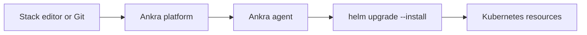

An add-on is a Helm chart that Ankra installs on a cluster and keeps reconciled: an ingress controller, a monitoring tool, a database operator, or a chart you publish yourself. Every add-on belongs to a [Stack](/concepts/stacks), next to the manifests and applications it works with, so its values, chart version and dependencies are versioned and deployed together with them.

## How an add-on reaches the cluster

1. **Stack editor or Git**: you choose the chart, pin its version and set its values in the Stack editor, or in a connected [GitOps repository](/concepts/gitops).
2. **Ankra platform**: stores the desired state of the Stack and dispatches the deploy.
3. **Ankra agent**: receives the deploy inside your cluster.
4. **Helm release**: the agent runs `helm upgrade --install` with your values. The step succeeds once the release is healthy.
5. **Kubernetes resources**: the rendered manifests are applied to the cluster.

This is the **native** engine, the default for new clusters. Clusters created before it may still use the ArgoCD engine, where an ArgoCD installation in the cluster applies the chart instead; the Stack you build is the same either way. See [Deployment Engines](/concepts/deployment-engines) for how each engine detects drift and heals it.

## What an add-on is made of

You add an add-on to a Stack from **Add → Helm add-on** in the Stack editor. The **Add a Helm add-on** dialog searches the charts of the Helm registries your organisation has connected (**Find a chart**), then asks for four things:

| Field | What it holds |
|-------|---------------|
| **Pinned chart version** | One exact release of the chart. The platform checks downgrades before deployment, so moving to an older release asks you to confirm. A release is the same with or without a leading `v`, as Helm treats it: an add-on pinned to `1.20.4` is the release a registry lists as `v1.20.4`. |
| **Add-on name** | The name of the add-on in the Stack. Lowercase letters, digits and hyphens, unique within the Stack. |
| **Namespace** | Where the release is installed. It is created by the add-on's release if it does not exist. |
| **Values** | Your overrides for the chart's values, in YAML. Chart defaults are not repeated here. |

A chart only appears once its registry is connected. Connecting a public or private Helm repository or OCI registry is described in [Registries](/guides/registries), and hosting your own charts on GHCR in [Create a Registry](/guides/create-a-registry).

Once added, the add-on is a member of the Stack. Selecting it in the editor opens its resource editor:

| Tab | What it is for |
|-----|----------------|
| **Properties** | What the member is: its chart and registry, the Helm release name and the namespace. |
| **Deployment settings** | How the release is deployed: Helm wait timeout, revisions to retain, the retry policy, and the Argo CD synchronization options. See [Add-on Settings](/concepts/addon-settings). |
| **Values** and **Source** | The values you set, as fields or as YAML. |
| **Diff** | Your values compared with the chart's defaults, so you can see exactly which keys this Stack sets. |
| **Parents** | The other members this add-on waits for, and the members that wait for it. This is what orders a deploy. |
| **Notes** | The add-on's **Operational notes · AGENTS.md**, described below. |
| **Live state** | The last state the cluster reported for the release, with its health and the time of the last job update. |

Every change you make lands in the Stack's shared draft and reaches the cluster only when the draft is deployed. How drafts, review and deployment work is explained in [Stacks](/concepts/stacks).

## Keeping secrets out of values

A password, an API key or a webhook URL does not belong in an add-on's values as plain text. Ankra has two ways to keep it out:

- **Organisation secrets.** Store the value once under **Infrastructure → Variables and secrets** and put its reference, `${SECRET_SLOT:<id>}`, in the values instead. The editor shows each reference with a lock and the name of the secret it points to, and marks a reference the organisation has no secret for as an error before you save or deploy. Ankra writes the value into a SOPS-encrypted file, so Git never holds the value in plain text, and the cluster decrypts it when it deploys. This needs the organisation's SOPS encryption: without it, Ankra refuses to save the reference. See [Organisation Secrets](/guides/organisation-secrets).
- **SOPS encryption.** When the cluster is connected to Git, declare the value keys to encrypt in the add-on's `encrypted_paths`. Ankra encrypts those values with the organisation's SOPS key before it writes the values file to Git, keeps the key names readable for diffs, and decrypts them when it deploys. The Stack editor has no field for `encrypted_paths`: declare it in the cluster YAML, or use `ankra cluster encrypt`. SOPS needs a one-time setup for the organisation; see [SOPS](/guides/sops).

## Operational notes (AGENTS.md)

Every add-on can carry an **AGENTS.md**: a markdown document of operational learnings, such as upgrade gotchas, a safe rollout order, or values that must stay pinned, that teammates and Ankra AI build up over time. You edit it on the add-on's **Notes** tab. The notes are applied with the resource configuration and stored in Git as a plain markdown file, and the Stack editor refuses notes that look like they carry a credential. See [Teach Your Agents with AGENTS.md](/platform/agents-md).

## What the cluster is running

**Infrastructure → Clusters → &lt;your cluster&gt; → Add-ons** lists every Helm release on the cluster, not only the ones a Stack manages. For each one it shows:

| Column | What it tells you |
|--------|-------------------|
| **Add-on** | The release name. |
| **Chart version** | The deployed chart version, and the newer release when the registry has one. |
| **Namespace & stack** | Where the release runs and which Stack manages it. A release no Stack manages reads **Standalone**, and one that Ankra does not manage also reads **Not managed through Ankra**. |
| **Health** | The release's reported health. |
| **Security** | The security advisories reported for the release, or **No advisories reported**. |

You can filter the list and sort it by name or namespace.

Opening an add-on shows its page:

- **Release overview**: the **Helm chart** and version, the **Namespace**, and **Managed by**, which links to the owning Stack.
- **Running workloads**: the Deployments, StatefulSets, DaemonSets, Jobs and CronJobs the release created, with their pods, as the cluster reports them.
- **Configuration**: the values in two tabs. **Saved values** are the overrides saved in Ankra, without chart defaults. **Installed values** are the values the installed release reports, including chart defaults, and may differ from the saved ones. Protected values stay masked, including in YAML and copied text. A badge says whether the saved values reached the release: **Saved values applied**, **Not yet applied**, **Apply failed** or **Not reported**.

**Edit add-on** opens the owning Stack in the editor with this add-on selected; a role that may not edit the Stack sees **View stack** instead. The **More add-on actions** menu holds **Reapply saved values**, which applies the stored configuration to the release again (workloads may restart, and unsaved draft changes are not deployed), and **View cluster operations**.

## Security advisories no chart release fixes yet

An add-on's advisory is either fixed in a chart release, or not yet: fixed upstream only, or with no fix published yet. When a chart release fixes it, the add-on's page offers that version, and so does the cluster overview's Security card, which then reads **Needs you**. When no chart release fixes any of the add-on's advisories, someone with the `security.triage` permission on the cluster can choose **Ignore for now**, on that card or on the add-on's page. On the Roles page the permission is **Security, alerts and automations** at **Use and change**; Operator, Admin and Owner have it.

- An ignore covers only advisories no chart release fixes, and only the ones the add-on has when you choose it. An advisory published later is not covered.
- It ends by itself once a chart release fixes them: the add-on comes back to the Security card, which then reads **Needs you**, with the version to upgrade to.
- An add-on whose every advisory is ignored leaves the Security card, and the Add-ons list reads **N advisories ignored until a chart release fixes them**. Its page says when they were ignored, with **You ignored them** when you did, and **Stop ignoring** brings it back at once.
- **Ignore for now** is never offered on an add-on that has an upgrade or a partial fix available.

## Platform add-on updates wait for you

Ankra installs some add-ons itself, at versions it pins: the network plugin, the ingress controller, cert-manager and the storage driver among them. A new cluster starts on the versions pinned at the time. Most of these then keep the version they were installed with, because a newer pin reaches new clusters only.

A few of them do get newer versions on running clusters: the backup add-ons, the cluster autoscaler, the security baseline's scanner, the UpCloud storage driver's images, and the cloud controller managers Ankra installs on UpCloud, AWS and Scaleway. On a cluster that is already running, Ankra does not apply these updates on its own. It holds each one and raises a notification for the cluster, **A platform add-on update is waiting for you**, listing the version the cluster runs and the version Ankra would set. **Take Ankra's update** applies the updates waiting for your decision, at the versions shown, on the next publish of their stack, once the cluster can take them:

- Taking an update needs the `clusters.write` permission, and every take is recorded in the cluster's audit log.
- A notification that changed since you opened it is refused, so you never take an update you have not seen. A newer version after that waits for you again.
- Where Ankra can tell that someone on your team chose a version, it keeps that version and lists it under **Kept as your team chose**.
- From the CLI: `ankra cluster held-updates take <notification-id> --fingerprint <fingerprint>`.

## Changing, upgrading and rolling back

An add-on changes the same way as everything else in a Stack: you edit its values or pick a new **Pinned chart version** in the draft, review the change, and deploy it. In a cluster connected to Git you can also change the values file in the repository; Ankra picks the change up through the repository's webhook or periodic polling.

When the registry has a newer release, the **Chart version** column on the Add-ons page says so (`<version> available`). For an add-on a Stack manages, that link opens the Stack editor at the add-on with the new version chosen, so you review and deploy it like any other change.

<Warning>
A major chart version can carry breaking changes. Read the chart's release notes, and deploy the new version to a non-production cluster first.
</Warning>

To roll back, open the Stack and choose **More → History and rollback**. The page lists every recorded version of each member, who changed it and when, lets you compare two versions, and restores the one you pick. Restoring needs the `clusters.operate` permission. In a cluster connected to Git, reverting the commit in the repository has the same effect on the next sync.

Add-on settings and Helm values are also readable and changeable through Ankra AI and MCP clients, alongside sync, rollback and uninstall, so routine add-on work can run from chat or your editor. See the [MCP Tool Reference](/platform/mcp-tools#add-ons). To automate add-on management from your own tooling, see the [API Reference](/api-reference/introduction).

## Related

<CardGroup cols={2}>
  <Card title="Stacks" icon="cubes" href="/concepts/stacks">
    How add-ons, manifests and applications deploy together.
  </Card>
  <Card title="Add-on Catalog" icon="box" href="/platform/addon-catalog">
    Browse available Helm charts.
  </Card>
  <Card title="Add-on Settings" icon="sliders" href="/concepts/addon-settings">
    Deployment, retry and sync settings per add-on.
  </Card>
  <Card title="SOPS Encryption" icon="lock" href="/guides/sops">
    Encrypt sensitive add-on values in Git.
  </Card>
</CardGroup>
