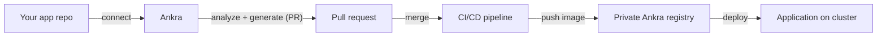

import { CliVersion } from "/snippets/cli-version.jsx";
import { YouTube } from "/snippets/youtube.jsx";

Applications take you from source code to a deployable workload. Connect an application's Git repository and Ankra analyzes it, generates the packaging it's missing, and opens a pull request in your repository, unless it finds nothing there it can build and keep running. Once merged, CI builds and publishes a container image that you can deploy to a cluster.

<Note>
Applications connect to **GitHub** repositories and use a [GitHub credential](/integrations/github). By default the generated CI/CD pipeline pushes the container image to your organisation's private Ankra registry; if you already run your own registry, [declare it](#using-your-own-registry) and Ankra publishes to and reads from it instead.
</Note>

<Tip>
**No repository yet?** A [Claude Design](https://claude.ai/design) export can be imported straight into an application: Ankra converts the artboards into a static site, creates the GitHub repository, commits it with a Dockerfile and registers it, and the same setup pull request, build and deploy lane follows. See [From Claude Design to a live application](/guides/claude-design-to-ankra).
</Tip>

---

Watch a GitHub repository go from its repo page to a running app on its own address.

<YouTube id="HzImi_lkMmw" title="From a GitHub repo to a running app with Ankra" />

## How it works



<Steps>
  <Step title="Connect a repository">
    **Applications → Add an application** opens **What are you shipping?**. Choose a **Repository connection** (or **Connect GitHub** first), find and pick the **Repository**, then give the **Application name** and pick the **Branch** from the repository's own branch list.
  </Step>
  <Step title="Analyze and generate">
    Ankra inspects the repository, detects the language and framework, and generates the artifacts it needs: a Dockerfile, Kubernetes manifests, and a CI/CD workflow.
  </Step>
  <Step title="Merge the pull request">
    The pull request runs its own checks first: it builds the image, scans it and runs the security gate. It stays a draft, which GitHub will not merge, until they pass, and then Ankra marks it ready for review; if you run the [AI review](/platform/ai-code-review), it skips the draft until then unless **Review drafts** is on. Review and merge it. Merging activates the CI/CD pipeline in your repository. When they fail, Ankra fixes the pull request itself, and the [PR shepherd](#the-pr-shepherd) keeps it moving until you merge it - or merges it for you, if you opt in. Beside CI that Ankra adopted, with no CI at all, or on a private repository whose GitHub plan has no drafts, it opens ready for review.
  </Step>
  <Step title="Build and publish">
    CI builds and pushes the container image to the organisation's private Ankra registry. Ankra surfaces the image URL and scans the published image.
  </Step>
  <Step title="Deploy">
    Deploy the application onto a cluster. Ankra verifies that the image was published and tracks the rollout.
  </Step>
</Steps>

<Note>
**When setup stops before the pull request.** In two cases Ankra opens no setup pull request and deploys nothing. The setup ends as failed, and the application's error message says why:

- **Nothing in the repository keeps running.** When the analysis finds only a program that runs once and exits, or nothing that runs at all, the message starts "Ankra did not set this repository up as an always-on application" and gives the reason. That is a decision, not a fault, and the application's page says so: see [A repository that is not a service](#a-repository-that-is-not-a-service).
- **Nothing can be built.** When there is no Dockerfile in the repository, on an open setup branch or among the files Ankra generated, the failed `setup_stopped` task says what Ankra found and what it could not write. Add a Dockerfile and run setup again.

Both messages carry the same sentence: "No setup pull request was opened and nothing was deployed." A repository that commits its own manifests under `.ankra/manifests/`, or whose own CI already publishes an image, still gets its setup pull request, with no build for anything that has no Dockerfile. So does a monorepo in which at least one component can be built.
</Note>

### A repository that is not a service

Ankra deploys an application as a service: a program that keeps running and answers on a port. Some repositories hold something else - a tools image that Kubernetes Jobs run, an image another workload uses, a batch job, documentation. For one of those Ankra sets nothing up on purpose, and the application says that instead of showing a setup that failed.

On the application's **Environments** view, the card headed **Not a service** says what builds the repository: Ankra Pipelines, a workflow in your repository (your own, or the one Ankra added), or nothing that publishes an image to Ankra. When Ankra could not tell what builds it, the card says so. It shows the newest published version, the reason Ankra gave, and a way to the pipeline runs. Where nothing publishes an image to Ankra, there are no runs to show, and the card shows a version only when Ankra has seen one published. The card offers no **Retry setup** and no **Fix with Ankra**, because nothing failed. The **Overview** says the application is not deployed as a service and that there is nothing to take live, and the applications list shows it as **Not deployed as a service**.

The application read carries the verdict in `workload`: `job` for a program that runs and exits, `none` for a repository with nothing to run, `service` for one Ankra set up, and `null` when no verdict is recorded. `analysis_status` stays `failed` for `job` and `none`, so a client that waits for the setup to end still sees it end.

If the repository does hold a program that keeps running, choose **This is a service** on that card. Ankra runs the setup again and treats the repository as a service. Over the API, the statement goes with the retry:

```bash
curl -X POST https://platform.ankra.app/api/v1/org/applications/<application-id>/retry \
  -H "Authorization: Bearer $ANKRA_TOKEN" \
  -H "Content-Type: application/json" \
  -d '{"workload_preference": "service"}'
```

`"auto"` withdraws the statement, and Ankra decides again on the next setup run. A retry that states nothing keeps a statement you made earlier. Stating either needs the `applications.write` and `applications.deploy` permissions.

An application whose setup stopped this way before the verdict was recorded shows as a failed setup until its setup runs once more: choose **Retry setup**, or run `ankra application retry <application-id>`.

Every setup run reads the repository again, so its answer can change. If a run reads the repository as a service, Ankra opens a setup pull request as it does for any service. Close that pull request when the repository is not one. Nothing is deployed until a setup pull request merges, and Ankra merges one by itself only where you have [opted in to merging](#opting-in-to-merging).

### When your repository already has CI

If your repository already runs CI, Ankra reads it during analysis and works with it instead of adding a pipeline of its own. It reads GitHub Actions workflows, `.gitlab-ci.yml`, `bitbucket-pipelines.yml` and `.circleci/config.yml`, and notes for each one whether it runs tests, builds an image, pushes it (to which registry, tagged how), deploys, what triggers it and which runners it asks for.

| What your CI does | What Ankra does |
| --- | --- |
| Builds and pushes the image | Adopts it. The application deploys the image your CI pushes, and the setup pull request adds only what deploying needs, such as the manifests. No `.ankra/pipeline.yaml`, workflow or Dockerfile is added. |
| Pushes an image under a name only the run knows, such as a repository name held in a secret | Adopts it, and tells you what it still needs: point the application at that image with `ankra application registry set`, or choose Ankra Pipelines to publish instead. |
| Runs tests but publishes no image | Keeps your CI for the tests and proposes Ankra Pipelines to build and publish the image. |
| Nothing (no CI) | Proposes Ankra Pipelines. |

The analysis says which of these it chose and why, and the setup pull request carries the same reasoning under **Your existing CI**.

When the image your CI pushes lives in a private registry, add a registry credential for it and name it with `ankra application registry set --credential` so the cluster can pull the image.

Ankra also checks whether your CI actually starts. If the newest run of a workflow has waited in the queue for more than 20 minutes, the analysis reports it, names the runner labels the jobs ask for (for example a `depot-` or self-hosted label nothing is serving), and suggests switching `runs-on` to `ubuntu-latest`, connecting a runner for that label, or letting Ankra Pipelines run the build. Ankra never edits your workflow.

To build with Ankra Pipelines anyway, convert the application with `ankra application pipeline convert`. A repository that already commits `.ankra/pipeline.yaml` keeps building with it.

### When the setup pull request does not pass its checks

A repository can already carry problems Ankra did not put there - most often dependencies with known security issues, which the security gate refuses to publish. The setup pull request then fails its own checks, and you do not have to fix it yourself:

- **Ankra AI fixes it on the same pull request.** An agent reads the run, commits a fix to the setup branch (for vulnerable dependencies: newer releases, overrides, a regenerated lockfile) and watches the checks until they pass. It never opens a second pull request and never touches your default branch.
- **The pull request says what is happening.** Ankra's status comment explains in plain words what stopped the run and that Ankra AI is fixing it, and the application's **Go live** page shows the same. Merge once the checks are green.
- **A fix has 45 minutes.** When the agent reaches that limit the fix ends, also while it is waiting for a check to report, and the application's history shows it as ended. It does not read as still fixing.
- **You can turn it off.** Automatic build fixing is on for every application by default. Turn it off for one application, or pause Ankra's autonomous actions, and the pull request only gets the explanation and a **Fix with Ankra** link.

When you create the application from the portal yourself and hold pipeline management access, Ankra also approves the pipeline it generated in your name, so the first runs are not held for an approval. An application added with the CLI, an API token or the AI Assistant leaves that approval to an administrator.

### When a build on your branch fails

A failed build on the application's tracked branch dispatches the same agent. What it may do depends on the repository's **CI/CD** lane on the application's **AI** tab:

| Lane | What happens |
| --- | --- |
| **Ask** (the default) | The agent investigates and proposes a fix, without committing |
| **Agent** | The agent commits the fix and opens a pull request for you to review |

### When a pull request fails its checks

On Ankra Pipelines, a failed build, image gate or `run` step (your tests, for example) on any pull request from a branch of your repository, not only the setup pull request, is fixed on that pull request:

- **The fix lands on the pull request's own branch.** An agent commits it to the head branch and watches the run that commit starts. It opens no second pull request and changes only what the failure needs. For an image gate the agent is handed each vulnerable package with the releases that fix it, and moves it to at least the highest.
- **A conflict with the base branch is resolved the same way.** The status comment opens "This pull request conflicts with" and names the base. The agent merges the base into the head with a merge commit, resolving every file both sides changed, and the run of that merge commit is its check. Nothing is ever merged into your default branch.
- **When the AI allowance is used up**, on Ankra's own models with no key of your own, the status comment says the fix is queued and starts by itself when the allowance resets on the 1st of the month, or as soon as an organisation owner adds the organisation's own model key under **Organisation settings**, **AI provider**; if billing has paused AI, it names that instead.
- **Without AI, vulnerable Python packages are still upgraded.** When the image gate blocked the run and the fix has to wait, Ankra moves each package a lock file pins to a release that fixes it, checked against the packages' own requirements, commits that to the pull request on GitHub, and leaves the rest for the allowance.
- **The same switches hold it:** automatic build fixing turned off for the application, Ankra's autonomous actions paused, or an environment of the application set to **You run it**.
- **A step the build cluster stopped is not fixed.** When no node had room for the step, or the cluster could not run it, none of your code was tested, so the agent commits nothing. Make room on the build cluster, then run the checks again.

A pull request from a fork is never committed to: it gets the explanation and a **Fix with Ankra** link on the run page.

### The PR shepherd

Ankra watches the pull requests it opens in your repository - the setup pull request, and any [portability pull request](/use-cases/vercel-to-ankra) a Launch Plan opens - and drives each one to a state you can merge. You see it as an **Ankra PR shepherd** check on the pull request's latest commit. Its summary says where the pull request stands - waiting, ready, needs a person, or merged - and why, and it is updated as things change.

What the shepherd does on its own:

- **Your CI never starts.** When no CI check has started on the pull request after about 20 minutes - no runner picks the job up, or the Ankra agent on your CI cluster cannot run pipeline steps - Ankra starts a full Ankra pipeline run on the pull request's head, builds it on Ankra's builders and runs a proof of the application, so the pull request still gets an answer.
- **The pull request falls behind its base branch.** Ankra merges the base branch into its own branch with a merge commit - never a force-push or a rebase. It waits until the head has sat for about 6 hours, or does it straight away when merging is opted in (below).
- **The pull request conflicts with its base branch.** Ankra resolves the conflict only when every file in the pull request is one Ankra owns: the Dockerfile, `.dockerignore`, the `.ankra/` directory, the generated build workflow and the `.github/dependabot.yml` the setup pull request adds. If the base branch has gained a Dependabot config of its own since, Ankra keeps the base branch's file rather than its own. Your own files are kept exactly as the base branch has them, and a conflict that touches them is left for you.
- **A check fails.** When the pull request only changes Ankra's own files, Ankra AI fixes it on the same branch, up to 3 times, then reports it for a person. A failure in a pull request that changes your files is reported, never "fixed". On an application that builds with Ankra Pipelines, the fix starts from the pull request's own failed pipeline run at its latest commit, and waits for the run of the commit it pushes. No fix starts when that run is still running, passed, was never started, or failed outside a build, test or image gate step, and the check says which. A run of the same commit that belongs to another pull request, or a manual run someone started outside the pull request, is never used; a re-run of the pull request's own run counts as its run.
- **The checks could not run.** When the **Ankra pipeline** check is red because the build cluster stopped its run before any of your code was tested, there is nothing in the pull request to fix. That happens when no node there had room for a step, or the cluster could not run it. Ankra AI then changes nothing in the pull request. The **Ankra PR shepherd** check reads **Needs a person** and says the run could not test the pull request. Make room on the build cluster, then run the checks again. A check that failed on the code is still fixed as above.
- **The proof of the head never gives an answer.** Where your organisation has a staging cluster, a proof still queued 20 minutes after Ankra queued it, or one that ended not proven, is a dead end: once nothing else is pending, the check reads **Needs a person**, names the proof and its reason, and Ankra does not merge. The shepherd keeps looking every 15 minutes, so a proof that passes later turns it **Ready to merge**.

These are the shepherd's own actions. On Ankra Pipelines, a pull request from a branch of your repository is also fixed as [When a pull request fails its checks](#when-a-pull-request-fails-its-checks) describes, whichever files it changes.

#### Merging

Ankra merges a pull request only when all of these hold:

- merging is opted in for the application (below);
- every check on the head has finished green, and the proof of the application passed;
- GitHub reports the pull request mergeable. Branch protection is always honoured, never worked around.

Otherwise the check reports the pull request as ready for a person to merge. Ankra never merges a pull request whose own CI never ran - Ankra's pipeline run and proof make it ready for you, not merged - and it never merges a portability pull request, because that changes your code.

After a merge, the application deploys as usual. When your CI could not build the pull request, Ankra builds the merge commit on its own builders so the deploy has an image.

#### Opting in to merging

Merging is off by default. Two settings decide it:

- **The organisation's setting**, `auto_merge_setup_pull_requests` on `PUT /org/applications/settings` (or `ankra_application_settings` in [Terraform](/integrations/terraform)). Only organisation admins can change it.
- **The application's own setting**, which overrides the organisation's: on for this application, off for this application, or follow the organisation (the default). Read it with `GET /org/applications/{application_id}/auto-merge-setup-pull-requests` and change it with `PUT` and a body of `{"enabled": true}`, `{"enabled": false}`, or `{"enabled": null}` to follow the organisation again. Only organisation admins can change it. The answer carries the application's own value, the organisation's, and the `effective` one Ankra acts on.

An application set to on is merged even when the organisation's setting is off, and one set to off never is. If a setting cannot be read, Ankra does not merge.

---

## Building on Ankra's builders

The flow above puts the first image behind a merged pull request: until the generated workflow is on your default branch, your CI has nothing to run, and nothing to publish. Ankra can also build the image itself, on its own builders, with no workflow in the repository at all.

Ankra clones the commit, resolves a recipe for it, builds it, and pushes the image to the same registry the application publishes to. The recipe is the first of these that fits:

1. **The repository's own `Dockerfile`** - used as-is.
2. **A generated Dockerfile** - the one Ankra wrote for this application.
3. **Buildpacks** - when there is no Dockerfile to use.

No Actions minutes are spent, no runners need operating, and no registry credentials go anywhere near the repository.

<CliVersion since="0.14.0" command="application build" />

```bash
# Queue a build and follow it to a result
ankra application build start <application-id> --commit <full-sha> --ref main --wait

# Read what the builders did
ankra application build list <application-id>
ankra application build get <application-id> <build-id>
```

Reach for this when the repository's own CI cannot do the job - a private repository on a plan whose Actions never leave the queue, a first image needed before anyone merges the setup PR, or an unattended caller with no browser to click through.

<Note>
`--commit` takes a **full** 40- or 64-character commit sha. The queue deduplicates on the string it is given, so an abbreviation would be a second key for the same commit and would build it twice. Asking twice for one commit joins a single build rather than racing two, and the answer's `already_requested` says when that happened.
</Note>

### Following a build

A request is not yet a build. `start` answers with a **request id** immediately; the build itself is created when a builder claims the request. So there are two things to read:

```bash
# The queued ask - pending until claimed, then it names its build
ankra application build request <application-id> <request-id>

# The build itself
ankra application build get <application-id> <build-id>
```

`ankra application build start --wait` walks both steps for you and exits non-zero if the build failed, which makes it usable as a pipeline gate. Watching the build list instead is a trap: a previous failed build of the same commit is still the newest one for that commit, so it would report an old failure as your build's result.

### Waiting for a builder

Ankra's builders are one pool that every organisation shares. Your organisation runs at most three builds on it at a time, so a burst of builds from one organisation - onboarding a repository with many components, say - cannot hold every builder while others wait. Requests beyond three stay `pending`, in the order they were made, and the next one starts as soon as one of your running builds finishes. A pending request is waiting its turn, not failing: it keeps its request id, and `--wait` keeps following it.

### What a failure means

A failed build carries an `error_class` that says whose failure it was:

| `error_class` | Whose | What to do |
|---------------|-------|------------|
| `build_failed` | Yours | The recipe did not build. Read `error_message`. |
| `clone_auth` | Yours | Ankra could not clone the repository - check the application's Git credential. |
| `recipe_missing` | Yours | No Dockerfile and no buildpack matched the repository. |
| `push_failed` | Ankra's | The image built but could not be pushed. |
| `timeout` | Ankra's | The build exceeded its budget. |
| `capacity` | Ankra's | No builder was running to take the build. |

The last three are platform-side and are already visible to Ankra without anyone reporting them.

<Note>
This replaces the **image build**, not the whole generated pipeline. That workflow also runs a Semgrep scan, and packages a Helm chart for applications that publish one. If you plan to retire the workflow entirely, decide where those two go first.
</Note>

---

## The application workspace

An application opens as a workspace at `/next/applications/<application-id>`: the application's own menu takes the sidebar's place, in the order the work happens. Each section is a view of that page, named in the address with `?view=`, and a view's own tabs with `&section=`. A link that uses a view's older name still opens the view it meant. The table describes the sections this page refers to; [The application page](/platform/application-page) lists every row of the menu in order. The last column gives each section's address, after `/next/applications/<application-id>`; [Portal URLs](/platform/portal-urls#applications-and-pipelines) lists them in full.

| Section | What it shows | In the address |
| --- | --- | --- |
| **Overview** | Where the application is right now: an **Environments** card with each environment's state and version, its health, the services it uses, its cost and whether it is safe. Before the first deployment, one line leads to **Go live on Environments**. **Add** beside the environments puts the application on another cluster; see [Add an environment on another cluster](/guides/application-environments#add-an-environment-on-another-cluster). | no `?view=` |
| **Pipelines** | One row per change, grouped by day: a pull request's checks and its merge share a row. A run still going shows its steps, and a finished one says how it ended. Pushes that ran nothing are counted below the list, and listed under **Nothing ran** when you ask for them. A run opens under the same tabs with its stages and steps, and **All runs** returns to the list. Pipelines has four tabs: **Runs**, **Schedules**, **Cache** and **Configuration**. | `?view=pipelines` |
| **Previews** | What the CLI and API call demos. One card per preview with its branch or pull request, when it started, the version it runs, when it ends automatically and its data, with **Open preview** once it has a public address and **Stop preview**. **New preview** starts one. See [Preview demos](#preview-demos). | `?view=previews` (in the **Deploy** group) |
| **Security** | What the last scans found. **Fix first** and **What stops a release** come first, then **Every finding** in three parts: **Container image**, **Code and configuration** and **Image versions**, and last **What is running: the image in each environment, and the run that built it**. **What needs you** comes above them only when Ankra has a fix to show you, or could not read the fixes. Filter the findings by severity and open one for what it is and how to fix it. See [Security scanning](#security-scanning). | `?view=security` |
| **Variables** | Every value the application reads, per environment, in one table: its secrets and its plain values, each row marked *Secret* or *Plain*. In the environment in view a secret reads *Applied*, *Saved*, *Uses the shared default*, *Value missing*, *Turned off here* or *No value* (*Couldn't check* when Ankra could not reach the secret store), and the application's other environments are shown beside it. A key the environment needs and has no value for is listed first, marked *Required*. Beside **Apply values in** *environment*, the page says whether the deployment has the saved values. A secret's value is never displayed: the API has no route that returns one. A plain value, for configuration that is not a credential, is shown. See [Variables](/platform/application-page#variables). | `?view=secrets` |
| **Settings** | Where people reach the application, delivery per environment, how many copies run and the memory and CPU each gets (**Scaling**), who runs it, the repository Ankra builds it from, the [image registry](#using-your-own-registry), publishing the application as an add-on, running setup again, parking or removing a deployment (**Park or remove**), and delete last. | `?view=settings&section=<section>`: `deploys`, `registry`, `repository`, `runtime` and the other Settings tabs; Settings opens on **Address** |
| **Settings → Repository** | One of the Settings tabs, listed on its own because setup and publishing live there. The repository Ankra builds the application from and the **Deployment files** it keeps there, each with **Review file** to open it in your Git provider, the setup pull request while there is one, **Update repository workflow**, and **Publish to the organisation catalog**. | `?view=settings&section=repository` |
| **Where it runs** | The last section of **Environments**. Every place the application runs, grouped by the environment it serves, each with its cluster and namespace (or the stack or add-on it is in), status, version, copies running and when it last changed. A fact the platform does not report reads *Not reported*. Places no environment claims are listed under **Outside your environments**. When Ankra cannot read the environments, every place is listed ungrouped under **Every place**. An environment's place has **Uninstall** on its row, and a place whose removal is recorded is listed apart under **Being removed**; see [Remove a deployment from one cluster](#remove-a-deployment-from-one-cluster). | `?view=environments&section=where-it-runs` |

The menu carries three marks. **Environments** reads as needing attention while the environment in view has failed or is degraded, or its rollout is stuck, and while the **Deploy** group is closed, its heading carries the mark. **Security** carries the number of serious findings of the last scans. **Variables** is marked when the next promotion waits for a secret its target does not have.

The Applications list groups applications under **Needs you**, **Ankra is on it**, **Live**, **Parked**, **Not deployed yet** and **Couldn't check**, with a count of each under the title. You can search by name or repository, and filter by status, environment and language.

### Address and version for adopted GitOps applications

The application overview can show the address and running version of a deployment managed through GitOps. Ankra uses the address of a single HTTPS root route to a Service that selects the application's Deployment. The running version comes from the image tag when all expected replicas are ready on the same digest-pinned image.

### Remove a deployment from one cluster

Removing takes the application off one cluster and leaves the application, and everywhere else it runs, in place. Ankra uninstalls its workloads, services and configuration in that namespace, and deletes the installation record once the uninstall has been handed to the cluster; the place reads as removing in the deployments read until the cluster has taken it down. A deployment that holds data (a CloudNativePG database, a persistent volume claim or a StatefulSet's volume claims in the application's manifests) is removed only when a complete restore point of its stack, taken in the last 24 hours, covers that data. An add-on among what it would remove, such as a wizard stack's database add-on, is never covered, because Ankra cannot see its volumes from its definition, and neither is a manifest Ankra cannot read. Otherwise nothing is removed, and the removal fails with a reason naming the data and the two ways forward: take a restore point and remove again within a day, or remove those members from the stack yourself on the cluster's Stacks page. The application itself, with its settings, secrets, published images and release history, its other deployments, the add-ons on that cluster other workloads may use, and the cluster itself all stay, so you can deploy there again from **Environments → Deploy a version**. To stop a deployment for a while without losing anything, park it instead; to take the application out of Ankra everywhere, delete it.

Its home is **Settings** → **Park or remove** (`?view=settings&section=runtime`). The environment in view lists where the application runs, each place with **Park** (or **Wake**) and **Uninstall**; below it are the places that run the application outside every environment, a stack the deploy wizard made or an add-on carrying its chart in a stack the application did not create, which cannot be parked. Each of those has **Uninstall**, except an add-on Ankra can name, which has **Remove** and is taken out of its stack. **Where it runs**, the last section of **Environments**, offers **Uninstall** on an environment's place too, behind the same review, and links everything else to Park or remove. Removing an installation or a wizard stack needs permission to deploy the application (`applications.deploy`); an add-on's removal needs `stacks.delete` on that cluster instead, as below.

A deploy to a parked environment keeps it parked. If the deploy sets `replicas`, that number is how many copies run when the environment is woken.

The review names what goes and what stays before anything happens and, opened from Park or remove on an environment's place that is not parked, offers **Park instead**. Removing an installation takes one deliberate press, except when the deployment serves a production environment, is the only place the application runs, or Ankra could not read where else it runs or which environment it serves: then the cluster's name has to be typed. The platform answers as soon as it has accepted the teardown, not when it is done: the installation reads `removing` until the teardown job has handed the uninstall to the cluster and deletes it, or `failed` with its reason, which is also what `ankra application installations` shows. When the commit to the cluster's Git repository has to wait, for example because the repository has changes Ankra has not taken in yet, the removal still finishes and the installation is deleted; the job's answer says the commit to Git is deferred and what it waits for. Park or remove lists it under **Being removed**, reading every few seconds for the first two minutes and every half minute after that, and says what became of a removal asked for there once it settles: removed, naming any stacks left in place because other workloads may use them, or that it did not finish, with the platform's reason when it gave one, in which case the deployment is listed again and can be removed again once the cause is fixed. A deployment that holds data with no fresh restore point fails this way, with the reason above. A second removal of the same deployment is refused as **Already being removed** (`409`), a deployment no longer on that cluster as **Nothing to remove**, and while a removal runs a deploy to the same cluster and namespace is refused with `409`.

An application deployed with the deploy wizard has no installation: it runs as a stack, named by cluster and stack name. Ankra removes only a stack it can show runs this application, from push to deploy's record or from the image it runs; one it cannot attribute is left in place as **This stack stays**, because it may be a shared operator, and goes from the cluster's Stacks page if it is no longer needed. The other stacks the same deploy created stay and are named in the answer, and the removal is followed through its `undeploy_application` job, which `ankra application jobs` lists.

An add-on that carries the application's chart in a stack the application did not create is removed from that stack through the cluster's add-on uninstall. The review says whose stack it is, that Ankra commits the change to the cluster's Git repository and that the rest of the stack stays; the cluster's name is always asked for, and it needs permission to delete stacks on that cluster (`stacks.delete`). An add-on that belongs to a deployment of this application is refused as **Remove it as a deployment**: remove that deployment instead, so its record goes with it. A cluster Ankra cannot reach that is not stopped either cannot take the removal (**That cluster isn't reachable**), and a change its Git repository did not take reads **The change wasn't committed**.

On a stopped cluster a removal is recorded now and carried out when the cluster next starts, so you do not need to start the cluster for it. Ankra takes what goes out of the cluster's Git repository now, or at the cluster's next sync when its repository has changes Ankra has not taken in yet, and uninstalls it when the cluster next starts. An add-on's removal is listed in Park or remove under **Waiting for the cluster to start**, with **Keep add-on** (permission to change stacks on that cluster, `stacks.write`) to take the removal back while it waits; a removal the cluster cannot hold until it starts is refused as **This removal can't wait for the cluster**.

An installation's or a wizard stack's removal is held the same way: the installation reads `removing` until the cluster starts and the uninstall is handed to it. Until then it can be taken back over the API, with `POST /api/v1/org/applications/{application_id}/deployments/withdraw-removal` and the remove's body (permission to deploy the application, `applications.deploy`). The deployment is declared in Git again, its installation gets back the status it had when the removal was asked for, and it runs again when the cluster starts. Once the removal has been carried out there is nothing to take back: the answer is `409` with `error_code` `removal_not_pending`, and deploying again is the way back. A removal Ankra cannot hold for the start, such as one of an application that was not running when the cluster stopped, fails with nothing removed and a reason that says to start the cluster and remove the deployment again.

If another change to the cluster is saved while it is starting, such as an edit to one of its stacks or a removal recorded or taken back, the start answers `409` that the cluster is still stopped, with nothing of the start saved: start it again.

This covers removing a deployment from an application. Deleting a whole Stack from the cluster's Stacks page, or with `ankra cluster stacks delete`, is not yet held for the start: start the cluster before you delete a Stack.

A place whose removal is recorded is no longer where the application runs, whatever its cluster still carries. The deployments read answers it in `removal_deployments`, apart from `deployments`, without a health or sync verdict, and the cluster and health counters are summed over `deployments` alone. **Where it runs** lists these places under **Being removed**, with when the removal finishes as its status, and no version: for a cluster named `staging`, **Removed when staging starts** for a removal waiting for the stopped cluster, **Finishes when staging is back online** for one on an unreachable cluster, and **Being removed** otherwise. A place listed under **Being removed** is never **Needs attention**, and an application whose only places are being removed no longer reads *Nothing is running anywhere yet*.

When a cluster is deleted, Ankra removes the application's deployments on it by itself shortly after. Nothing is uninstalled, because the cluster is gone: the deployment's record and its saved deploy settings are deleted, and the organisation's audit log records each removal. A new build no longer starts a deploy to a deleted cluster. The application, its other deployments and its environments stay. A stopped or archived cluster is not deleted, and keeps its deployments.

Over the API, `POST /api/v1/org/applications/{application_id}/deployments/remove` takes `cluster_id` with `namespace` for an installation or `stack_name` for a wizard stack, not both, and answers `202` with the `cluster_id`, the `namespace` (empty for a stack) and a stack's `stack_name`, an installation's `installation_id`, any `retained_stacks`, the teardown's `operation_id` and `status` `removing`. `ankra application remove <application> --cluster <cluster>` does the same and asks first (`--yes` skips the prompt): `--namespace` only when the application runs in more than one namespace on that cluster, `--stack` for a deploy-wizard deployment, `-o json` or `-o yaml` for the answer. Ankra's AI and MCP clients have `remove_application_deployment`, which Ankra's chat runs only after you confirm it (an MCP client with `mcp:write` runs it directly), with `list_application_installations` to find the cluster and namespace and `park_application_deployment` as the reversible stop; see the [MCP Tool Reference](/platform/mcp-tools#applications).

<CliVersion since="0.29.0" command="application remove" />

## What Ankra tracks

For each application you see:

- **State** and **analysis status** - where the application is in the connect/analyze/generate/build lifecycle, with an error message if something needs attention.
- **Repository** - owner, name, branch, and URL.
- **Components** - the repository's deployable apps. An ordinary repository has one; a monorepo has one per app.
- **Artifacts** - the private container image URL and the latest published build, per component.
- **Pull request** - a link to the generated PR.
- **Jobs** - the underlying platform jobs for the application, so you can follow analysis and generation as it runs.

### Monorepos

A repository that builds more than one deployable app is onboarded as a **monorepo**: Ankra records one component per app, and each component gets its own packaging and its own image.

| Per component | Where it lives |
| --- | --- |
| Dockerfile | `<component-directory>/Dockerfile` |
| Kubernetes manifests | `.ankra/manifests/<component>-*.yaml` |
| Build workflow | `.github/workflows/<component>-build-and-publish.yml`, with a `paths:` filter scoped to the component's directory so touching one app does not rebuild the others |
| Container image | `<your-registry-project>/<repository>/<component>` |

Ankra decides the components from, in order: the `components` block of the repository's [`.ankra/ankra.yaml`](/reference/application-descriptor#components), when it declares one; the per-component workflows the repository already carries (so re-running analysis never renames a component and orphans the images it has published), the apps the analysis proposed, then the repository's structure - two or more Dockerfiles in subdirectories and no Dockerfile at the root, or a workspace marker (`nx.json`, `turbo.json`, `lerna.json`, `pnpm-workspace.yaml`, `go.work`) plus two or more subdirectories with their own dependency manifest. **Without a declaration, a Dockerfile at the repository root always means a single app**, whatever else the repository contains.

The AI proposal and structural detection can add components to a monorepo but never leave it with fewer than it records: a run whose inference finds fewer keeps the recorded ones. Only a declaration, or two or more of Ankra's per-component build workflows for fewer components than the record, can shrink it, and a run that drops or renames a recorded component records the new set and reports the change as the failed task `record_components`. A repository whose layout inference misreads, such as an API built from `deploy/docker/Dockerfile` at the root beside a web app in `web/`, declares its components in [`.ankra/ankra.yaml`](/reference/application-descriptor#components), and the declaration is also how you remove one.

Build state, published images, deploys, demos, and container scanning are all reported per component, so an application whose API component built and whose frontend did not says exactly that.

### Using your own registry

An application publishes to your organisation's private Ankra registry unless you say otherwise. If you already operate a registry - the same Harbor whose OCI charts Ankra indexes, for instance - declare it on the application and Ankra publishes there, reads the published tags back from there, and pulls from there.

Declare it on an existing application from **Settings → Registry**, from the CLI, or with `image_registry` when you create the application. The settings panel also reports the host and project the declaration resolved to and the image repository each component is expected to publish to, so you can compare them against where your builds actually push.

<CliVersion since="0.13.0" />

```bash
# Show the effective registry and the expected repositories
ankra application registry get <application-id>

# Declare a registry you operate
ankra application registry set <application-id> \
  --url oci://artifact.example.com/commerce-images \
  --credential example-harbor-pull

# Go back to your organisation's own Ankra registry
ankra application registry clear <application-id>
```

The same declaration at create time:

```json
{
  "name": "commerce",
  "app_repo_credential_name": "github",
  "app_repo_owner": "example-org",
  "app_repo_name": "commerce",
  "image_registry": {
    "url": "oci://artifact.example.com/commerce-images",
    "credential_name": "example-harbor-pull",
    "pull_secret_name": "harbor-registry",
    "username_secret_name": "HARBOR_USERNAME",
    "password_secret_name": "HARBOR_PASSWORD"
  }
}
```

| Field | Meaning |
| --- | --- |
| `url` | The registry project images publish to, as `oci://<host>/<project>`. A deeper path becomes a prefix every component's repository nests under. |
| `credential_name` | An existing [registry credential](/guides/registries) of the organisation - the same credential resource your chart registries authenticate with. Ankra reads published tags and builds the cluster pull secret from it. |
| `api_url` | Optional. The registry's management API base; defaults to `https://<host>`, which is where a Harbor serves its own API. |
| `pull_secret_name` | Optional. The `kubernetes.io/dockerconfigjson` Secret the generated manifests reference through `imagePullSecrets`. Defaults to `ankra-registry-pull`. |
| `username_secret_name` / `password_secret_name` | Optional. The repository Actions secrets the build workflow logs in with. Default to `ANKRA_REGISTRY_USERNAME` / `ANKRA_REGISTRY_PASSWORD`. |
| `admin_credential_name` | Optional. A registry credential with project administrator rights on the project (or a robot granted the robot-account permissions). Setting it hands robot management on your registry to Ankra: it mints and revokes a push robot for the application with it, and rotates it when the credential is a Harbor user. See [Robot accounts](#robot-accounts). |
| `manage_actions_secrets` | Optional, default `false`. See below. |
| `component_repositories` | Optional. The repository inside the project for a component, keyed by component name - `{"backend": "commerce-backend"}` publishes the backend at `<project>/commerce-backend` - for a registry whose layout follows neither Ankra's nesting nor the flat component name. Unnamed components keep the derived path. CLI: `--component-repository backend=commerce-backend` (repeatable); portal: one field per component under **Settings → Registry**. |
| `flat_repositories` | Optional, default `false`. Publish a monorepo's components straight under the project - `<project>/<component>` - instead of Ankra's `<project>/<app>/<component>`. Turn it on when the registry already holds the images that way, so publish readiness, the deploy gate and the generated workflows all address the repositories your pipeline already pushes to. Single-component applications are unaffected. |

**Ankra does not mint robots for a registry you operate unless you hand it the keys.** With a declared registry and no `admin_credential_name`, setup names the two Actions secrets the workflow reads and leaves them to you, rather than writing a credential Ankra happens to hold over a push robot you administer. Publish readiness reports whether those secrets exist and names them. Name an `admin_credential_name` to have Ankra mint a push robot for the application there ([Robot accounts](#robot-accounts)), or set `manage_actions_secrets: true` to have it write the declared credential into them instead.

<Warning>
`credential_name` is what makes a declaration usable rather than merely descriptive. Without one Ankra records where the images live but cannot read their tags or pull them, so publish readiness, the demo build check and the deploy gate all keep reporting the application as never built - while it publishes healthily to a registry Ankra simply cannot see.
</Warning>

<Note>
An application is bound to the GitHub credential it was created with; its App installation must reach the repository for builds, deploys and Actions secrets. Move an application onto another credential of the organisation with `ankra application credential set <application-id> --credential <name>` (`GET`/`PUT /api/v1/org/applications/{application_id}/repository-credential`); the answer reports whether the new binding resolves to an installation.
</Note>

<Note>
On a monorepo, a component may declare its own `image_registry` to publish into a different project of the same registry - useful when each app has its own robot accounts and retention rules. A component's declaration wins over the application's; the application's applies to every component that declares none.
</Note>

Publish readiness, the deploy gate, image tag listings, container scanning, and preview demos all resolve the declared registry, so an application whose images live outside Ankra reports what is actually published rather than staying blocked on an artifact that was never going to appear in Ankra's own project.

Running Harbor yourself? [Harbor as your application registry](/guides/harbor-registry) covers the operator's side: which credential does what, which Harbor releases let a robot administer robots and when the credential must be a Harbor user, how to check the minted robot from Harbor's own API, and how the pull secret reaches every cluster and namespace the application deploys to.

### Robot accounts

Every application gets a registry robot account of its own: a push+pull robot named `robot$<project>+app-<application-id>` on the project it publishes to, stored as the platform-managed registry credential `ankra-harbor-app-<application-id>` and written into the repository's Actions secrets as the login the build workflow uses. Nothing else shares that login, so a leaked repository secret is rotated or revoked for that one application, and a deleted application takes its robot with it.

- **On your organisation's Ankra registry** the robot is minted automatically when the application is set up, and again whenever the application is reconciled. Applications onboarded before robots existed get one when the application is next reconciled, or from **Settings → Registry** with **Set up publishing login**.
- **On a registry you operate**, Ankra mints one only with a credential that may: set `admin_credential_name` to a registry credential with project administrator rights on the declared project (in Harbor, a project admin user, or a robot granted the robot-account permissions). Without it Ankra never touches your robots; publish readiness names the field.

The robot is shown - name, registry, when it was created and last rotated - under **Settings → Registry**, where **Set up publishing login**, **Rotate publishing login** and **Revoke publishing login** create, rotate or revoke it. Rotating refreshes the secret and rewrites the repository's Actions secrets; the previous secret stops working the moment the registry answers. Revoking deletes the robot from the registry and drops its credential, leaving the repository's secrets holding a login that no longer works.

```bash
# Show the application's robot
ankra application registry robot get <application-id>

# Mint one (or confirm the existing one) and write its login into the repository
ankra application registry robot ensure <application-id>

# Rotate its secret after a leak
ankra application registry robot rotate <application-id>

# Revoke it
ankra application registry robot revoke <application-id> --yes

# Let Ankra manage robots on a registry you operate
ankra application registry set <application-id> \
  --url oci://artifact.example.com/commerce-images \
  --credential example-harbor-pull \
  --admin-credential example-harbor-admin
```

The same is available on the API at `/api/v1/org/applications/{application_id}/registry-robot` (`GET`, `POST` with `{"rotate": true|false}`, `DELETE`). The robot's credential appears in your organisation's registry credentials as managed by Ankra; it cannot be edited or deleted there, only through the application.

### Security scanning

The **Security** view shows what the last scans of the application found. Once its repository has a finished Ankra pipeline run, each scan comes from the newest of the last 20 default-branch runs that ran it, or of any branch until the default branch has one. A promoted run shows the scan of the run it was promoted from. Until then, Ankra reads the repository's GitHub workflow results and Dependabot alerts; open Dependabot alerts stand in for the workflow's image scan, so the image reads **Not scanned**, as it does after a check of the Dockerfile's base image.

A sentence at the top says whether the last scans found serious issues, meaning critical or high, or which scan could not be checked. Below it come **Fix first** and **What stops a release**, then **Every finding**, and last **What is running: the image in each environment, and the run that built it**. **What needs you** comes above them only when Ankra has a fix to show you (one it prepared, one you started that needs a look, or a pull request it opened), or could not read the fixes.

**What needs you** holds the fixes Ankra prepared, fixes you started that need a look, and **Fixes Ankra opened**. When Ankra has no fix to show you and could read them all, it is not shown. **Fix first** lists critical and high findings, not marked in Ankra, that no fix covers yet, most severe first. It lists at most five, and a line such as *2 more critical or high findings are in Every finding, below.* counts the rest. With more than one, a button such as **Fix all 3 with Ankra** hands all of them to Ask Ankra at once, for a role that may ask Ankra, once Ankra has read its fix pull requests. If you may not let Ankra act, it reads **Ask Ankra how to fix them**. With no critical or high finding to list, **Fix first** lists up to three other open findings that have a fix.

**What stops a release** names the image gate's setting, with **Change the gate** unless your role cannot read that setting. It reads the gate on the newest run of the tracked branch and on up to three pull requests it blocked, and links to each run. A passed run reads like *The security gate passed run #184: 14 findings judged, none blocking.* A blocked run lists the first three findings the gate blocked on and counts the rest. When they cannot be listed, it reads like *The security gate blocked run #184: 2 blocking of 14 findings.* **What is running: the image in each environment, and the run that built it** is closed until you open it. Its table gives each environment's **Version**, **Image**, **Built by**, **Scanned** and **Open findings**, and an image without a scan reads *Not scanned yet*.

Under **Every finding** the view has three parts. It opens on the part the address names, else on the scan holding the most severe findings, with **Container image** on a tie:

| Part | What it lists |
| --- | --- |
| **Container image** | The vulnerabilities the last image scan found, with a line saying which version it scanned and whether that version runs in the environment in view. When Ankra can tell what fixes them, they are grouped by a newer base image or the file that declares the package. **Only findings with fixes** narrows the list. |
| **Code and configuration** | The Semgrep code scan's findings, the Checkov configuration scan's, and the vulnerable packages the repository's lockfiles pin that the image scan does not already list. |
| **Image versions** | One row per pushed tag, with the version running in the environment in view first. A row shows its scan (**Not scanned**, **No findings** or a count), digest, observed workloads, bill of materials and, once scanned, its findings by severity. |

The names **Container image** and **Code and configuration** carry a short note when the scan is not complete and current, such as `· not scanned`, or else how many of its findings are open, such as `· 3 open`. The part you choose is kept in the address as `&evidence=image`, `code` or `versions`.

On those two parts, a badge says how complete and current the scan is: **Scan reported**, **Partly scanned**, **Scan out of date**, **Scan failed** or **Not scanned**. Only a complete, current scan with nothing found reads *The last scan found nothing.* When nothing in a part has been scanned and no other source reported findings, the list reads *No scan yet. Scans run when a version is built.* and offers **Go to Pipelines**. **Scan out of date** means an image or dependency scan used vulnerability data more than 72 hours old, or a newer commit has a pipeline run that has not finished.

A scan that failed, never ran or is out of date gets a notice with the platform's reason. The most pressing notice offers a next step, such as **Scan it now** or **Watch the scan run**, and a failed scan may get two. When the code scan could not read every file, its notice says so, and a run that records the split tells the files it did not read at all from those where it skipped only lines it could not parse. **Which files and lines** lists them, up to 50. A file the scan ran out of time on may be read next time, but code the scanner cannot parse stays out of every scan until it is rewritten.

The four severity tiles, **Critical**, **High**, **Medium** and **Low**, count the findings and filter the list, and **Search findings** narrows it further, 25 findings to a page. A finding opens with its severity, what found it, what it is, **Where** and **How to fix**, plus the **Rule** of a code finding. **Advisory** opens the reference the scan gave, and a CVE, GHSA, RUSTSEC or GO finding links to its [advisory page](/guides/cluster-security#advisory-pages) in the Security Center.

**Fix with Ankra** hands the finding to Ask Ankra with the other findings that block the pipeline's image gate, and asks for one pull request that passes the Ankra pipeline. If you may not let Ankra act, the button reads **Ask Ankra how to fix it** and Ankra says what to change instead. To hand over several findings at once, select them in the list and choose **Fix selected with Ankra**, or **Ask Ankra how to fix them** if you may not let Ankra act.

With `security.manage` you can mark a Semgrep or Checkov finding as a false positive or an accepted risk, when the repository runs on Ankra pipelines. A mark needs a reason, and an accepted risk a review date at most a year away. While the mark stands, the image gate does not block on that rule in that file, and Ankra still reports the finding. A critical finding cannot be marked. **Revoke** ends a mark with a reason, and from its next run the image gate blocks on the finding again when its severity reaches the gate's threshold.

Pull requests Ankra opened to fix the findings are listed above the three parts under **Fixes Ankra opened**: each open one with its checks and its [Ankra AI review](/platform/ai-code-review#what-a-review-posts), finished ones folded under a count. **Merge** shows only when the merge waits for you, you may approve it, its checks passed and the review did not ask for changes.

On a monorepo, **Container image** shows the primary component's image, **Image versions** names each version's component, and the code scans cover the whole repository. **Image versions** ends with **Open the organisation Security Center**, for findings, packages and workloads across every image; see [Security Center](/guides/cluster-security).

---

## Preview demos

Before you merge, you can spin up a **throwaway demo** of a pull request or branch build to see it running. In the portal these live in the application's **Previews** section, which calls each one a preview; the CLI and API keep the `demo` name. Each demo is deployed into its own isolated namespace (`ankra-demo-pr-<n>` or `ankra-demo-br-<branch>`) on the organisation's **staging cluster**, PodSecurity-hardened and quota-bounded, and is automatically torn down when its TTL expires - so it can never affect existing workloads.

<Steps>
  <Step title="Configure a staging cluster">
    An admin sets the organisation's **Staging cluster** under **Ankra AI → AI workspaces**. Optionally set a **Preview domain** (with an **Ingress class** and **TLS secret**) there too - this is what gives demos a public URL.
  </Step>
  <Step title="Deploy a demo">
    Deploy a branch or PR demo from the application's **Previews** section, from the CLI, or by asking the AI assistant. The demo pulls the image tag the PR/branch build pushed.
  </Step>
  <Step title="Open the preview">
    When a public host is available, Ankra returns a **preview URL** you can open directly. Otherwise the demo stays reachable in-cluster (service DNS + a `kubectl port-forward` command).
  </Step>
</Steps>

Two guides cover the two ways a demo starts: [branch demos](/guides/branch-demos) walks the launch dialog field by field, and [PR preview environments](/guides/pr-preview-environments) covers the automatic per-pull-request flow.

### The preview URL

Ankra resolves the demo's public hostname automatically, and every surface (portal, CLI, MCP, and automatic PR previews) uses the same rule:

1. **An organisation demo base domain**, if configured, wins outright - the host is `<namespace>.<demo-base-domain>`, served with your configured ingress class and TLS secret.
2. **Otherwise, the staging cluster's own delegated DNS zone**, but only when that zone is active - giving `<namespace>.<cluster-id>.<org-id>.<ankra-domain>`, a hostname the `external-dns` running on that cluster can resolve. When the cluster also carries the Ankra networking stack, the demo's ingress requests a certificate from its `letsencrypt-prod` issuer automatically, so the preview URL is served over **https**. When the staging cluster's Ankra Stacks carry no such issuer, as on an imported cluster or one built without the networking stack, the preview URL is served over plain **http** and browsers mark it Not Secure. Ankra says so under **Ankra AI → AI workspaces → Domains for previews** (to a role that holds `ai.manage`), in a warning on the pull request's preview card, and in the `get_ai_environment` and `inspect_demo` MCP tools. To get https, add cert-manager and a manifest named `letsencrypt-prod` declaring a `ClusterIssuer` named `letsencrypt-prod`, with an ACME HTTP-01 solver on the `traefik` ingress class, to a Stack on the staging cluster. Ankra only finds an issuer in the cluster's Ankra Stacks: one installed outside them is not used. The next preview deploy is then served over https.
3. **Otherwise the demo stays in-cluster-only** - no ingress is created, and you reach it with the returned service DNS name and `kubectl port-forward`.

<Note>
A demo only gets a resolvable public URL when the organisation has a demo base domain configured **or** the staging cluster has an active Ankra DNS zone. Without either, the demo still deploys - it just stays in-cluster-only.
</Note>

The Ankra domain in rule 2 is `ankra.cc` by default. An organisation can register **its own custom domain** - dedicated to that organisation alone - in the **Custom Ankra domain** field under **Ankra AI → AI workspaces**, or from the CLI with `ankra org domain set <domain>`. The domain must be a bare domain the organisation owns, its NS records must already point at Ankra's nameservers (the ones serving `ankra.cc`), and no other organisation may hold it.

With a custom domain registered, the `external-dns` Ankra runs on each of the organisation's clusters is scoped to the **whole domain**, not just that cluster's delegated `<cluster-id>.<org-id>.<domain>` zone. An Ingress on any hostname under the domain - a top-level name like `app.example.com` included - is published automatically by the cluster serving it. On the shared `ankra.cc` root the scope stays the cluster's own delegated zone: names directly under `ankra.cc` are allocated by the platform, and one organisation's cluster must never be able to write another's.

Zones already provisioned keep the domain they were minted under, so the switch is refused while any cluster DNS zone or [DNS record](/platform/organisation-settings#dns-records) still lives under the old domain. The refusal names exactly what is blocking it - the portal lists the cluster domains and records beside the field, and `ankra org domain set` prints the same list - so the migration is a checklist rather than a guess:

<Steps>
  <Step title="Inventory what is under the current root">
    `ankra org dns zones` lists every cluster domain in the organisation with its state; `ankra org dns list` lists the DNS records. Both are reads. In the portal the same two lists are on **Infrastructure → Domains**: the cluster domains under **Cluster names**, and the records on the organisation's Ankra domain.
  </Step>
  <Step title="Destroy any playground environment">
    A playground publishes a wildcard DNS record in the organisation's zone, and that record is **reconciled** - the platform writes it again on its next pass over a ready environment, so deleting it in the next step will not clear it. Destroy the environment instead: `ankra cluster playground destroy <cluster_id>`. The refusal names any playground that is still holding a record.
  </Step>
  <Step title="Remove each cluster domain">
    `ankra cluster domain <cluster> --remove` (or `DELETE /api/v1/clusters/{cluster_id}/dns-zone`, or **Take the name away** on the cluster's row under **Cluster names** in the portal) hands the zone to Ankra for teardown.

    The removal is **held**: nothing re-creates the zone until you ask for it back in the last step - not the `external-dns` Ankra runs on that cluster, and not the discovery that mints zones for clusters that have none. `ankra cluster domain <cluster>` reports `Opted out: yes` for as long as the hold stands, so a domain that is gone is distinguishable from one that is between reconciler passes.
  </Step>
  <Step title="Delete the DNS records">
    `ankra org dns delete <record>`, or delete them from the records list on **Infrastructure → Domains**. These are the records you created; anything the platform publishes is listed separately in the refusal, with what to remove instead.
  </Step>
  <Step title="Register the new domain">
    `ankra org domain set example.com`, or save the **Custom Ankra domain** field. Ankra tears the organisation zone down and re-creates it under the new domain automatically.
  </Step>
  <Step title="Re-enable the cluster domains">
    `ankra cluster domain <cluster> --enable` withdraws the hold and re-creates each cluster's zone under the new root, and the cluster's external-dns picks up the new zone on its next cloud-provider stack pass. Every cluster you removed in step 3 needs this, the staging cluster included.
  </Step>
</Steps>

<Note>
`ankra cluster domain <cluster>` on its own is a **read**: it reports the cluster's domain, or state `none` when it has none, and never creates a zone. Creating one is the explicit `--enable`. (Before CLI v0.13.0 the bare command created a zone, which meant checking a cluster's domain could add a blocker to this very migration.)
</Note>

### What a root-domain switch does and does not touch

Two questions decide whether the switch is safe to attempt on a domain that is already in use. Both have short answers.

**Ankra touches only the records it creates in the domain you register.** Registering `example.com` adopts it as the organisation's zone apex, with each cluster's own `<cluster-id>.example.com` subzone under it, and the `external-dns` Ankra installs on every cluster is scoped to the whole domain so it can publish top-level names like `app.example.com`. Each controller runs with its own record ownership (`--txt-owner-id`), so it creates, updates and deletes only the records that exist because of an Ingress on its cluster: records you already publish at the apex or under any other name in `example.com` are never read, written or deleted - not by the switch, and not by anything Ankra runs afterwards.

**A switch never re-labels a zone.** Zone labels are derived from the organisation and cluster ids, so they are the same under any root: a cluster that was `axmndle4sl.<org>.ankra.cc` becomes `axmndle4sl.<org>.example.com`. The label is also what Ankra passes as `external-dns`'s `--txt-owner-id`, and what any GitOps path built from a cluster domain embeds - so the TXT ownership registry stays matched to its records across the switch, and the paths do not move. `--enable` re-creating a zone preserves the label for the same reason.

<Warning>
`external-dns` on each cluster runs with `--policy=sync` against its own subzone. That is safe here precisely because the label and the owner id survive the switch together: an owner id that changed under a `--policy=sync` controller would be the configuration that deletes records the controller no longer recognises as its own. Ankra does not change it, and nothing in the switch asks you to.
</Warning>

### Serving a zone in your own DNS account from every cluster

A custom Ankra domain has to be hosted in Ankra's own DNS account, because Ankra mints the per-cluster credentials for it. A zone you keep in **your own** DNS provider account is different: Ankra cannot mint anything there, so the `external-dns` it installs drops Ingress hostnames on that zone silently (the sync logs `All records are already up to date`, because from its point of view there is nothing in scope), and cert-manager's HTTP-01 challenge for such a hostname waits forever for a name that never resolves.

Declare the zone with a credential of your own instead, once, for the whole organisation:

```bash
ankra org dns credentials create --name my-dns \
  --webhook-provider-url https://dns.example/api/external-dns/<token>   # stored in the platform's secret store; never echoed back
ankra org custom-dns-zones add --zone example.dev --credential my-dns
ankra org custom-dns-zones list
```

Every cluster in the organisation - the ones running now and every one created afterwards - then gets its own `external-dns` for `example.dev`, rendered and reconciled by Ankra in a dedicated `custom-dns` stack, within about two minutes of the declaration or of the cluster coming up. An Ingress on `chat.example.dev` publishes from whichever cluster serves it, and the certificate follows once the name resolves. On a cluster with the [Gateway API](/guides/gateway-api) option, an HTTPRoute hostname on the zone publishes the same way, once the Gateway API CRDs are on the cluster. Each cluster's controller is pinned to exactly that zone (`--domain-filter`) with its own record ownership, so it can never fight the controller Ankra runs for the cluster's Ankra domain, another cluster's controller, or records you publish in the zone yourself.

- The credential is the external-dns **webhook provider URL** including its token, for any provider that speaks the external-dns webhook protocol. It is written to the platform's secret store on create and no read surface returns it; re-creating it under the same name re-points every cluster at once, which is how a rotated token rolls out. Its name is what `list` shows.
- `ankra cluster custom-dns-zones add <cluster> --zone <zone> --credential <name>` declares the same thing for **one** cluster. A cluster's own declaration of a zone takes precedence over the organisation's on that cluster - the way to serve a zone with a different credential on one cluster - and `ankra cluster custom-dns-zones list <cluster>` shows where each zone a cluster serves was declared (`SOURCE` = `cluster` or `organisation`).
- A zone that overlaps the domain Ankra already serves for the organisation (its `<org-id>.<ankra-domain>` zone, or the whole custom Ankra domain when one is registered) is refused: Ankra's own controllers publish there already and cannot be told to stay off those names. A zone **above** the Ankra domain is accepted, and each cluster's controller is told to leave the Ankra-served part alone.
- A zone at Cloudflare needs no webhook: connect a scoped Cloudflare API token once with `ankra org cloudflare connect <name>` and declare the zone with `--cloudflare-credential <name>`. Ankra checks with Cloudflare that the token reaches the zone and is not denied DNS edit there before the declaration is stored, and that controller runs upsert-only: it never changes or deletes a record someone else made. See [Serve a Cloudflare zone from every cluster](/guides/use-your-own-domain#serve-a-cloudflare-zone-from-your-clusters).
- A domain in Avura needs no credential of your own: once the Avura workspace is connected to the organisation and the domain is shared with Ankra, declare it with `--credential avura`. See [use Avura domains with Ankra](/guides/avura-domains).
- `ankra org custom-dns-zones remove --zone example.dev` withdraws the declaration. Ankra tears down the controllers it rendered on every cluster that inherited the zone; clusters that declared it themselves keep theirs, and the zone's records are yours and are left untouched.

The same declarations are available on the API: `GET`/`POST` `/api/v1/org/custom-dns-zones`, `DELETE /api/v1/org/custom-dns-zones/{zone}`, and the per-cluster `/api/v1/clusters/{cluster_id}/custom-dns-zones` twins.

### Deploying a demo

A demo deploys **every component** of the application by default. A single-app application runs its one image; a monorepo runs one pod per component - the frontend and the API of a two-app repository both come up, wired together, instead of half an application answering where the other half belonged. You can still deselect components or demo a single one.

<Tabs>
  <Tab title="Portal">
    Open the application's **Previews** section, choose **Launch preview**, pick a branch or enter a pull request number, and deploy. The dialog groups what to preview, its lifetime and environment, and the staging cluster, and lists the branch, image, lifetime, template, resources, cleanup and access in a summary before the launch button; a missing image or an offline staging agent is an explicit blocker. The section shows one card per active preview with its branch or commit, component, image, expiry, access and cluster. Each preview links to its own detail page - live provisioning progress read from the staging cluster, the namespace's bill of materials with manifests (grouped per component), Kubernetes events, and pod logs, plus the preview URL or port-forward command to reach it. On a monorepo the launch dialog lists every component with its own build status and tag, lets you include or exclude each, and marks the **web entry** - the component that owns the demo URL.
  </Tab>
  <Tab title="CLI">
    ```bash
    # Deploy a branch demo
    ankra application demo deploy <application-id> --branch feature/login

    # Deploy a PR demo with an explicit TTL
    ankra application demo deploy <application-id> --pr-number 42 --ttl-hours 8

    # List active demos, then stop one
    ankra application demo list <application-id>
    ankra application demo stop <application-id> <workspace-id>

    # Inspect a demo: record + provisioning steps, and a bounded log tail
    ankra application demo detail <application-id> <workspace-id>
    ankra application demo logs <application-id> <workspace-id> --tail 200

    # Read or edit the saved demo defaults
    ankra application demo config get <application-id>
    ankra application demo config set <application-id> \
      --database=true --env 'DATABASE_URL=${{ ankra.demo_database.url }}' \
      --migrate-command 'pnpm run db:migrate' --database-extension vector

    # Dispatch the AI pre-setup mission for a failed demo
    ankra application demo fix <application-id> <workspace-id>
    ```
    The deploy response includes `preview_url` when a public host was resolved. `config set` fetches the saved configuration first and applies only the flags you pass, so it never drops entries or dependency designations you did not name.
  </Tab>
  <Tab title="AI / MCP">
    Ask the AI assistant to demo a pull request, or call the `deploy_pr_demo` tool directly (it is allowed in **Ask** mode - the demo is isolated and self-expiring). The result carries the same `preview_url`, names the `entry_component`, and lists every deployed workload under `components[]` with its image, container port and ingress path - so a multi-component launch reports what it actually provisioned rather than only the component that owns the URL. Pass `entry_component` to choose which component serves `/`. Tear down early with `demo_stop`.
  </Tab>
</Tabs>

Opening a pull request on a connected application also deploys a preview automatically and posts the URL back as a PR status comment that updates in place - see the [PR preview environments guide](/guides/pr-preview-environments) for the comment lifecycle, requirements, and troubleshooting.

### Monorepo demos: every component, one URL

A monorepo demo deploys each component as its own Deployment and Service inside the demo namespace, and the demo only reports **ready** once every component accepts connections:

- **The web entry owns the demo URL.** Ankra picks the frontend-shaped component (a name or directory like `frontend`, `web`, `ui`, `portal`) as the entry serving `/` on the demo host; you can move the entry in the launch dialog or with `entry_component` on the API.
- **API components share the host under a path.** The single API-shaped component (`api`, `backend`, `server`) is published under `/api` on the same demo host, routed straight to its Service - so a browser calling `/api/...` reaches the API even when the frontend's own proxy target was baked for another environment. Override per component with `ingress_path`.
- **Save the routing when the guess is wrong.** The entry and the `/api` path above are heuristics, and the lanes with no human in the loop - the automatic PR previews and the MCP demo tools - have no launch dialog to correct them in. Declare the routing once in the demo configuration and every lane follows it:

  ```json
  {
    "routing": {
      "entry_component": "commerce-frontend",
      "components": [{ "name": "commerce-backend", "ingress_path": "/api/v1" }]
    }
  }
  ```

  A declaration is authoritative: the `/api` guess stops running, so a component you leave out of `components` stays reachable in-cluster only rather than picking up a path it never asked for. Per-launch `ingress_path` overrides still win over the declaration. Clear it with `"routing": null` to return every lane to the heuristics.
- **Components reach each other by name.** Every component's Service is named after it, so in-namespace URLs like `http://crm-api:8090` resolve. Env values can also use placeholders that resolve at deploy time:

| Placeholder | Resolves to |
|---|---|
| `${{ ankra.demo_component.<name>.url }}` | `http://<component>:<port>` inside the namespace |
| `${{ ankra.demo_component.<name>.host }}` | The component's Service name |
| `${{ ankra.demo_component.<name>.port }}` | The component's container port |

The saved [migration command](#environment-variables-and-a-throwaway-database) runs once per deploy, inside the image of the component that owns the schema (the primary component - usually the backend). Demo environment defaults and the throwaway database are shared by every component of the demo.

<Note>
Existing demos and single-app applications are unaffected: a demo recorded before multi-component support (or of an application with one component) keeps exactly the previous single-pod shape.
</Note>

### Environment variables and a throwaway database

Most real applications need configuration to boot - a database name, an API key, an SMTP host. Demos support both **per-application defaults** and **per-launch overrides**, so any codebase can run as a demo without changes:

- **Defaults** are the application's **environment template**, under **Previews** (*Preview settings*), which separates the disposable dependencies each preview gets from the shared services it points at and labels every generated value with the dependency it comes from. Every demo of the application inherits them - manual launches, CLI/MCP deploys, and the automatic PR previews.
- **Overrides** are set per launch in the *Environment & database* section of the launch dialog (or via the `env` argument of `deploy_pr_demo`). Overrides win by name.

Values marked **secret** are stored as Ankra secret slots, held in the platform secret store - the plaintext never persists and is mounted into the demo as a Kubernetes Secret at deploy time.

**Need a database?** Toggle **Attach a throwaway Postgres** and an ephemeral Postgres is provisioned inside the demo namespace with a random per-demo password, destroyed together with the demo. Because every codebase names its configuration differently, nothing is injected automatically - reference these placeholders in your env *values* and they resolve when the demo starts:

| Placeholder | Resolves to |
|---|---|
| `${{ ankra.demo_database.url }}` | Full `postgresql://` connection string |
| `${{ ankra.demo_database.host }}` | In-namespace service host |
| `${{ ankra.demo_database.port }}` | `5432` |
| `${{ ankra.demo_database.name }}` | Database name |
| `${{ ankra.demo_database.user }}` | Database user |
| `${{ ankra.demo_database.password }}` | The per-demo random password |

<Note>
The throwaway database is ephemeral by design: it starts empty on every deploy and is wiped with the namespace. The database runs a pgvector-capable Postgres, so migrations using `CREATE EXTENSION vector` work. `.url` and `.password` references are always delivered through a Kubernetes Secret, never as plain env text.
</Note>

**Migrations.** If your image does not run its own migrations on boot, set a **migration command** in the demo configuration (`migrate_command`) - for example `pnpm run db:migrate` or `alembic upgrade head`. It runs inside your application image (`sh -c`) as an init container, after the database accepts connections and with the same environment the app sees, so a fresh demo database provisions its schema before the first request. Because every deploy starts the database empty, the command re-runs on every deploy - write migrations to be idempotent (every standard migration tool is).

<Note>
The command runs with your image's `WORKDIR` as the working directory **and** on `PYTHONPATH`. Python puts the *script's* directory on `sys.path`, not the working directory, so a migration entrypoint that is a script rather than a console script - `python scripts/bootstrap_database.py` - could not import the application package sitting beside it and died at import with `ModuleNotFoundError`. Setting `PYTHONPATH` yourself in the command still wins.
</Note>

**Extensions.** If your schema needs Postgres extensions beyond what migrations create themselves, list them in `database_extensions` (for example `["vector"]`) and the demo database creates them at initdb, before your migrations run.

Ankra detects both automatically when it analyses a repository: a Postgres client dependency, an ORM configuration, or a composed database marks the application as database-needing, its referenced connection variables are wired to the `${{ ankra.demo_database.* }}` placeholders, and a recognised migration script becomes the migration command - so the first demo of a database-backed application works without any manual configuration. Detection only ever seeds an application that has no demo configuration yet; it never overwrites what you or the pre-setup agent saved.

### The demo container port

The demo's readiness probe, Service, and preview route all target one container port, resolved in this order: the component's recorded port, the generated runtime Dockerfile's `EXPOSE`, the generated Deployment manifest's `containerPort`, the analysed `target_port` parameter, and only then the platform default. The launch dialog shows the resolved port and where it came from; a port you did not edit is left to the platform to resolve.

When the resolved port is still wrong - stale analysis, a hand-edited Dockerfile - the platform corrects itself at runtime: a demo whose container runs cleanly but never accepts connections has its logs read for the port the server actually announces (`Accepting connections at…`, `Listening on…`, and the other common startup banners). If the evidence is unambiguous, the demo is repointed at the announced port on the fly, the correction is recorded on the application so the next launch resolves it statically, and the demo detail page shows the correction. Ambiguous evidence never auto-corrects; it flows into the failure message ("Nothing accepted connections on port 3000. The container's logs say it listens on port 8001.") and dispatches the pre-setup agent instead.

### Automatic pre-setup when a demo crashes

An image that validates its environment on boot - refusing to start without a database URL, an auth secret, an API key - crash-loops when demoed with no configuration. Ankra now detects this and fixes it with an agent:

1. When a demo fails with a **startup crash** (CrashLoopBackOff or a container configuration error), a **failed migration command**, or a port-evidence timeout (the container announced a different port than the demo probed), Ankra dispatches a one-shot **pre-setup agent** for it automatically. The run appears on the **AI agents** page like any other mission.
2. The agent reads the crashed container's logs, works out which environment variables the application demands, and generates a **pre-setup**: missing database URLs become `${{ ankra.demo_database.* }}` references with the throwaway Postgres enabled, secrets get fresh random values, and mode flags get the value that avoids external side effects.
3. It saves the pre-setup as the application's demo defaults - so **every future demo inherits it** - and redeploys the failed demo to prove it boots.

The agent can also set the migration command and database extensions when the logs show schema or `CREATE EXTENSION` failures. It never weakens the application's own validation, never reuses values found in logs, and merges with existing demo settings rather than replacing what you configured. Dispatch is bounded to one run per demo per day; image-pull failures and provisioning timeouts never dispatch (no environment can fix those). You can also trigger it on demand with `POST /org/applications/{application_id}/demos/{workspace_id}/fix`, or just ask the AI assistant to fix the failed demo - the chat has the same `get_demo_diagnostics`, `update_application_demo_config`, and `redeploy_demo` tools the mission uses.

---

## Managing applications

| Action | What it does |
|--------|--------------|
| **Retry** | Re-run analysis and generation after fixing an issue (for example, adding the right credential or repository permissions) |
| **Reconcile** | Re-evaluate the application against its repository and refresh its state |
| **Remove** or **Uninstall** | Take one deployment off its cluster (**Settings** → **Park or remove**, or **Where it runs**) and keep the application and its other deployments; see [Remove a deployment from one cluster](#remove-a-deployment-from-one-cluster) |
| **Delete** | Disconnect the application from Ankra |

The pull request review and your organisation's review rules are set per application under **Settings** → **Who runs it**, in the **On your pull requests** card. The automatic preview of each pull request is the **Preview every pull request** switch under **Settings** → **Deploys**, in the **Pull requests** card. See [Application AI settings](/platform/application-ai).

---

## Prerequisites

<Steps>
  <Step title="Connect GitHub">
    Add a [GitHub credential](/integrations/github) with access to the application's repository. The Ankra GitHub App needs permission to open pull requests, commit workflow files, and manage Actions secrets. Ankra installs the Ankra registry credentials on the repository automatically; for [your own registry](#using-your-own-registry) you set the login secrets yourself.
  </Step>
  <Step title="Have a target cluster">
    Make sure you have a [cluster](/guides/import-cluster) with the [agent](/concepts/cluster-agent) connected to deploy onto.
  </Step>
</Steps>

---

## API

Applications are available over the API for CLI and scripted use, under `/api/v1/org/applications` (bearer-token authenticated) - create, list, inspect, retry, reconcile, and delete. See the [API Reference](/api-reference/introduction) for endpoints and schemas.

The same lifecycle is available through Ankra's AI and MCP clients - connect, deploy, retry, reconcile, and delete applications, and follow their CI workflow runs - see the [MCP Tool Reference](/platform/mcp-tools#applications).

See the [CI/CD Pipeline guide](/guides/cicd-pipeline) for how the generated pipeline fits into GitOps.
