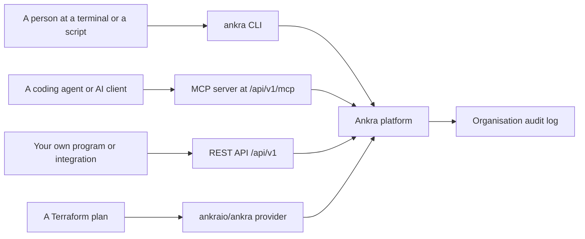

You can drive Ankra from outside the portal in four ways: the `ankra` CLI, the Ankra MCP server, the REST API and the Terraform provider. They are not four products. The CLI, MCP clients and your own automation all call the same bearer-authenticated `/api/v1` API, they authenticate with the same personal and service tokens, and what they do lands in the same audit log. What differs is who drives them and what each one is shaped for.

## What each is best at

| | Best at | Credential |
|---|---|---|
| **CLI** | People at a terminal, shell scripts and CI jobs. It follows long work to the end with `--wait`, prints JSON with `-o json`, and keeps an [exit-code contract](/guides/script-the-cli#exit-codes) a script can branch on | A browser sign-in with `ankra login`, a token with **Full API access**, or a GitHub Actions job's OIDC identity |
| **MCP** | Coding agents and AI clients such as Claude Code, Cursor and Codex. Tools are described for a model, filtered to what the token's scope and role allow, and each answer can carry a link to the portal page | A token with **Editor tools: read only** (`mcp:read`) or **Editor tools: read and change** (`mcp:write`), or an OAuth connection from Claude |
| **API** | Your own programs and integrations, in any language. The [API reference](/api-reference/introduction) is generated from the platform's OpenAPI document | A token with **Full API access**, sent as `Authorization: Bearer <token>` |
| **Terraform** | Declaring Ankra objects in the same plan as the rest of your infrastructure, reviewed as a plan before they change | An Ankra API token in the provider configuration. See [Terraform](/integrations/terraform) |

The four combine. A platform team can declare clusters and organisation settings in Terraform, run the CLI in CI to deploy and wait, and connect engineers' editors to the MCP server read only.

## What each cannot do

Some limits hold for every surface, because they are limits on tokens rather than on a tool:

- **No token changes the Kubernetes access policy.** The CLI and the MCP server can only propose a change and answer an apply link, which an organisation owner or admin opens, signed in, to apply it. See [Organisation access policy](/guides/cluster-access#organisation-access-policy).
- **A pipeline definition's protected sections are approved by a person.** A service account's token is refused.
- **A service token stays in its organisation.** Naming another organisation answers "Service account tokens cannot act outside their organisation", and a token pinned to a project answers "Pinned tokens cannot act outside their organisation".

Each surface also has limits of its own:

- **MCP** tokens reach the MCP server and nothing else: the REST API, the CLI and Terraform refuse them. An MCP token is pinned to one project and cannot switch organisation ("MCP-scoped tokens cannot override their organisation"). It cannot approve or reject an Ankra AI action that waits for a person, or resume the organisation's paused AI actions. Tools that only work inside an Ankra chat conversation are not offered. A call has a 55-second deadline, except `workspace_exec`; a tool that starts longer work answers with an operation id that `wait_for_execution` waits on. See [Ankra MCP server](/platform/mcp-server).
- **The REST API** serves tokens under `/api/v1`. The portal's own routes under `/org` and `/chat` authenticate with the portal's session cookie, never with a token, and need an `X-Ankra-CSRF` header on every change. Some portal reads also answer under `/api/v1`, to a personal token with no scopes and no project pin and to no other token. A request acts in the token's pinned project, else in the project the `X-Ankra-Project-Id` header names, else in the organisation's Default project. It never follows the project selected in the portal.
- **The CLI** acts with one credential at a time, and a saved `ankra login` wins over `ANKRA_API_TOKEN`. A coding agent that runs `ankra` in your terminal therefore acts as you. See [Give a coding agent least privilege](/guides/least-privilege-for-coding-agents).
- **Terraform** manages the objects the provider has resources for. The [Terraform](/integrations/terraform) page lists them and the provider's own limits.

## How they share tokens

There is one set of tokens, made in two places:

- **Personal tokens** are made under **Your account → API access** (`/next/account/api`), or with `ankra tokens create` and `ankra mcp connect`. They act as you, with your role.
- **Service tokens** are made under **Identity & access → API and automation** (`/next/organisation/automation`), or with `ankra tokens create --service`. They belong to the organisation, act with their service account's role, and keep working when the person who made them leaves. See [Service tokens](/guides/service-tokens).

When a token is made, its access is chosen once: **Full API access** for the REST API, the CLI and Terraform, or one of the two editor tools answers for the MCP server. The two kinds do not mix, so an agent's MCP credential cannot double as a general API key. Either kind can be pinned to one project.

## Where the state lives

Ankra keeps the live record of every cluster, Stack and setting. Two of the surfaces add a second record outside Ankra:

- A [GitOps](/concepts/gitops) repository holds each cluster's configuration as YAML, and sync runs both ways. A change committed there reaches the cluster, and a change made through the portal, the CLI, the API or Ankra AI is written back to a GitHub or Bitbucket Cloud repository, so Git stays the record whichever surface made it. Ankra does not push to a Bitbucket Data Center repository.
- Terraform keeps the objects it manages in its own state, and an apply changes Ankra to match the configuration. A change made to such an object anywhere else differs from that configuration until the next apply.

Give each object one owner: declare it in Terraform, or keep it in the GitOps repository and change it from any of the other surfaces.

## One audit log

Every surface writes to the same [audit log](/guides/audit-log), under the person or service account whose token was used. A service account's rows name it as `service_account:<name>`. Requests from the CLI and from MCP clients also say which client sent them: the CLI names its version and the command, never its arguments or flags, and under a coding agent the agent and a digest of its session. Every call to a tool an MCP token can see, refused calls included, has its own row with the action `mcp_tool_call`.

## Related

- [Ankra CLI](/integrations/ankra-cli) and [Script the Ankra CLI](/guides/script-the-cli)
- [Ankra MCP server](/platform/mcp-server) and [MCP tools](/platform/mcp-tools)
- [API reference](/api-reference/introduction)
- [Terraform](/integrations/terraform)
- [Give a coding agent least privilege](/guides/least-privilege-for-coding-agents)
