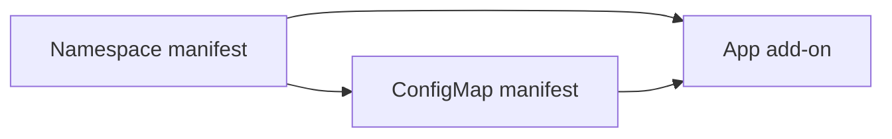

import { CliVersion } from "/snippets/cli-version.jsx";

A cluster rarely needs just one chart. Monitoring needs a namespace, Prometheus, Grafana and an ingress rule, and they have to go on in the right order. A **Stack** is how you describe that set once in Ankra and deploy it as one unit, to one cluster or to many. [How Ankra Works](/concepts/how-ankra-works) shows where Stacks sit in the overall model.

## What a Stack contains

- **[Add-ons](/concepts/addons)** - Helm charts, each with a chart version and its values.
- **[Manifests](#manifests)** - your own Kubernetes YAML: namespaces, Secrets, CRDs, RBAC, custom resources.
- **[Variables](/concepts/variables)** - Stack-level values referenced as `${{ ankra.name }}`. A Stack variable overrides a cluster or organisation variable of the same name.
- **Dependency edges** - which component has to succeed before another one starts.

A cluster usually has several Stacks, one concern each, rather than one Stack that holds everything.

## Deployment order

Components that do not depend on anything deploy in parallel. A component with parents waits until they have succeeded, so a namespace manifest goes before the add-ons and resources that live in it, and an operator goes before the custom resources it reconciles.



Here the namespace deploys first, then the ConfigMap, then the add-on that reads both.

## Manifests

A manifest is a YAML document of Kubernetes resources, written by you, that Ankra applies as part of a Stack. Use one for anything a Helm chart does not create for you: the namespace a chart installs into, a Secret it reads, the RBAC your team needs, or the custom resources an operator add-on reconciles. Manifests always live inside a Stack, so they deploy in order with the add-ons that need them.

A single manifest can hold several resources separated by `---`:

```yaml
apiVersion: v1
kind: Namespace
metadata:
  name: monitoring
---
apiVersion: rbac.authorization.k8s.io/v1
kind: Role
metadata:
  namespace: monitoring
  name: monitoring-reader
rules:
  - apiGroups: [""]
    resources: ["pods", "services"]
    verbs: ["get", "list"]
```

**Secrets in manifests.** If a manifest carries a password or key and the cluster is connected to Git, list the key names under **Encrypted Keys (SOPS)** in the manifest editor, for example `password` or `stringData.admin-user`. Ankra encrypts those values with SOPS before it writes the manifest to Git and decrypts them when it deploys. SOPS needs a one-time setup for the organisation - see [SOPS](/guides/sops).

**Operational notes.** Every manifest and add-on has an **AGENTS.md** tab where you and Ankra's AI record what matters when changing it, such as upgrade order or fields that must stay pinned. Editing it never triggers a redeploy. See [Teach Your Agents with AGENTS.md](/platform/agents-md).

## Building a Stack

In the portal, open the cluster's **Stacks** and click **+ Create**. In the Stack Builder, **Add Add-on** adds a Helm chart and **Add Manifest** adds your own YAML. Drag from one component to another to add a dependency edge, and click a component to edit its values or YAML. The **Variables** tab holds the Stack's own variables. **Create Stack** saves the Stack and deploys it.

A Stack that has not been deployed yet shows a **Draft** badge in the list, or **AI draft** when Ankra's AI proposed it.

You can also describe what you need to Ankra's AI (`⌘J`) and let it propose the Stack, for example:

> I need a monitoring stack with Prometheus, Grafana and alerting for this cluster.

In chat every change needs your confirmation. The same Stack tools are available to MCP clients with the `mcp:write` scope - see the [MCP Tool Reference](/platform/mcp-tools#stacks).

## What a Stack Is Running

The Stack page shows what a Stack declares: its add-ons and manifests and the deployments that applied them. The **Runtime** tab shows what those components actually put on the cluster right now, in four panels: **Endpoints** (the hosts and paths its Ingresses publish), **Pods**, **Services** and **Events**.

Runtime scopes by ownership, not by namespace. Several Stacks can share a namespace and one Stack can span several, so Ankra follows the objects it recorded for the Stack and their owner references down to ReplicaSets, Jobs and Pods. When the cluster cannot answer a listing, the tab says so rather than showing an empty list. It reads the cluster only while it is open.

## Stacks in Git

When the cluster has a repository connected, each Stack is written to its own directory, by default `clusters/<cluster-name>-<short-id>/stacks/<stack>/`, with one `values.yaml` per add-on and one YAML file per manifest. Commits to those files are applied to the cluster. See [GitOps](/concepts/gitops).

## Uninstalling a Stack

**Uninstall stack** takes a Stack off the cluster without deleting it. Every add-on, manifest and application in it leaves the cluster, in reverse dependency order. The Stack and every member's definition and values stay in Ankra and in the cluster's GitOps repository, and nothing is committed to Git. **Install stack** deploys it again.

<Warning>
**Back up the Stack before you uninstall it.** Data is treated exactly as a delete treats it: what a chart or operator removes together with its workload is removed too, and installing the Stack again does not bring it back. Some charts and operators delete their volumes, and the data on them, with their workloads. A manifest that declares a PersistentVolumeClaim directly has that claim deleted. [Protect the Stack or take a restore point](/guides/backups#protect-a-stack) first, and see [Protect Persistent Data](/guides/protect-persistent-data) for when a deleted claim takes its disk with it.
</Warning>

In the new Ankra portal (`/next` on your portal's address), open the Stack and choose **More**, then **Uninstall stack**. The dialog asks you to type the Stack's name and links to **Back up this stack**. While a draft is open on the Stack, it asks you to deploy or discard the draft first and changes nothing.

From the CLI:

<CliVersion since="0.73.0" />

```bash
# See what the Stack stores, and take a restore point
ankra cluster stacks data list shop --cluster my-cluster
ankra cluster stacks restore-points create shop --cluster my-cluster --wait

# Take the Stack off the cluster, and later deploy it again
ankra cluster stacks uninstall shop --cluster my-cluster
ankra cluster stacks install shop --cluster my-cluster
```

Both commands need the cluster named with `--cluster`. They never act on the cluster `ankra cluster select` saved, which every shell and agent session on the machine shares. `uninstall` says what it removes and asks first: `--yes` answers, and without a terminal `--yes` is required. With `-o json`, both print the platform's answer: the Stack, whether it is installed now, and the members the call moved.

| Exit code | Meaning |
|-----------|---------|
| `2` | `--cluster` is missing, or `uninstall` has no terminal to ask on and no `--yes` |
| `3` | No cluster has the name or id you gave, or the cluster does not have the Stack |
| `4` | You declined the confirmation |
| `7` | Your role lacks `stacks.delete` (uninstall) or `stacks.deploy` (install) on the cluster |
| `8` | The platform refused, and nothing changed. The command prints the platform's reason |

### While a Stack is uninstalled

- Its members stay off the cluster through cluster starts and Git syncs.
- Changes you make to the Stack and its members are saved, and deployed when you install it.
- Retrying an earlier deployment of one of its members is refused. Install the Stack instead.
- Until the uninstall has removed a member, Ankra refuses a change that would alter what that removal deletes: the member's own definition, moving it to another Stack, or the Stack's variables or name.
- Ankra keeps the uninstalled state itself. It is not written to Git, and a Git commit cannot uninstall or install a Stack.

The Stack page reads **Uninstalling** while members are being removed and **Uninstalled** once they are all off the cluster, and the Stacks list reads **Uninstalled**. `ankra cluster stacks list` shows the Stack as `uninstalled`, and its `-o json` output carries `"uninstalled": true`.

If an uninstall did not finish, the Stack page reads **Partly uninstalled** and names the members Ankra still records as on the cluster. **Uninstall again** removes only those.

### Installing it again

**Install stack**, on the Stack page or under **More**, deploys the Stack again in dependency order, with what it holds now. That includes members added or edited while it was uninstalled. A member that was already off the cluster before the uninstall, such as an add-on you uninstalled on its own, stays off it. Data the uninstall removed does not come back.

### When Ankra refuses

A refused uninstall or install changes nothing, and the reason says what to do first.

| Refused when | Uninstall | Install |
|--------------|:---------:|:-------:|
| The cluster is stopped or not online | ✓ | ✓ |
| The Stack has an open draft. Deploy or discard it first | ✓ | ✓ |
| The Stack is being deleted | ✓ | ✓ |
| A member's deployment has not finished: it is still running, or it failed | ✓ |  |
| A managed service owns the Stack. [Delete the service](/guides/delete-a-managed-service) instead | ✓ |  |
| The uninstall is still removing members |  | ✓ |
| The Stack is not uninstalled |  | ✓ |

Before an install, deploying the open draft keeps its changes for the install.

### Uninstall or delete

**Delete stack** removes the Stack itself: its resources leave the cluster, and the deletion is committed to the cluster's GitOps repository when one is connected. Uninstalling keeps the Stack in Ankra and in Git so you can install it again. Both treat data the same way.

Uninstalling needs the `stacks.delete` permission on the cluster, as deleting does, and installing needs `stacks.deploy`. The portal offers each action only to people who may use it. See [Roles & Access](/guides/roles-and-access).

## Reusing a Stack

- **Clone to Cluster** in a Stack's menu copies it to another cluster, including one in another organisation. Encrypted values are not copied. See [Clone Stacks](/guides/clone-stack).
- **Save as Profile** turns a deployed Stack into a versioned, parameterised template you can deploy on any cluster. See [Stack Profiles](/concepts/stack-profiles).

## Next

[Add-ons](/concepts/addons) explains how a Helm chart becomes an add-on and how its values are managed.
