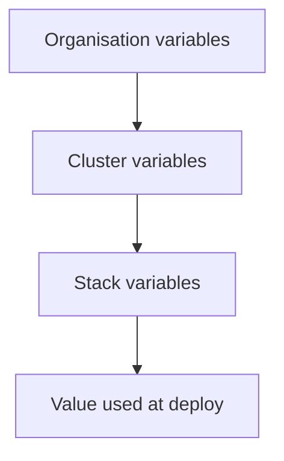

import { CliVersion } from "/snippets/cli-version.jsx";

The same Stack often needs a different domain, replica count or bucket name on each cluster. Variables let you write `${{ ankra.name }}` once in your values and manifests and set the actual value on the organisation, a cluster or a Stack. Ankra fills it in when it deploys. [How Ankra Works](/concepts/how-ankra-works) shows where variables sit in the overall model.

## Overview

A variable can be set at three levels, and **the more specific one wins: Stack > cluster > organisation**.



1. **Stack variables** - set on one Stack. They win over everything else.
2. **Cluster variables** - set on one cluster. They win over organisation variables.
3. **Organisation variables** - set once for every cluster and Stack in the organisation.

So a Stack variable named `domain_name` replaces a cluster or organisation variable of the same name for that Stack only.

---

## Variable Syntax

Reference variables in your stacks using the following syntax:

```yaml
${{ ankra.variable_name }}
```

**Examples:**

```yaml
# In a manifest
apiVersion: v1
kind: ConfigMap
metadata:
  name: app-config
  namespace: default
data:
  domain: ${{ ankra.domain_name }}
  api_url: https://${{ ankra.domain_name }}/api
```

```yaml
# In Helm values
ingress:
  enabled: true
  hosts:
    - host: ${{ ankra.domain_name }}
```

---

## Organisation Variables

Organisation variables apply to every cluster and Stack in the organisation. Use them for values that are the same across your infrastructure.

They live under **Infrastructure → Variables and secrets** (`/next/organisation/secrets`), in the **Variables** section. **Add variable** opens **Add a variable**, which asks for:

- **Name** - letters, numbers and underscores, starting with a letter, for example `base_domain` or `BASE_DOMAIN`. The name cannot change later, because Stacks refer to it.
- **Value** - the value Stacks receive.
- **Description** (optional) - what it is for.
- **Secret** - keeps the value out of every list; see [Secret variables](#secret-variables).

The new variable appears in the list, with when it last changed. A changed value reaches the Stacks that refer to it when they next deploy. Each variable's menu offers **Change…** and **Delete…**, and Ankra shows where a variable is used and where it is overridden.

### Common Organisation Variables

| Variable Name | Example Value | Use Case |
|---------------|---------------|----------|
| `domain_name` | `example.com` | Base domain for all services |
| `registry_url` | `ghcr.io/myorg` | Container registry URL |
| `environment` | `production` | Environment identifier |
| `alert_email` | `alerts@example.com` | Notification email address |
| `log_level` | `info` | Default logging level |

---

## Cluster Variables

Cluster variables apply to every Stack on one cluster. Use them for values that differ between environments.

They live under **Infrastructure → Clusters → &lt;your cluster&gt; → Settings → Variables**. **Add variable** asks for a **Name**, a **Value** and an optional **Description**, with the same naming rules as organisation variables. A cluster variable's value is kept as plain text, so keep passwords and keys in the organisation's stored secrets instead (see [Secret variables](#secret-variables)).

### Common Cluster Variables

| Variable Name | Example Value | Use Case |
|---------------|---------------|----------|
| `cluster_domain` | `prod.example.com` | Override the [built-in cluster domain](#built-in-variables) for this cluster |
| `storage_class` | `gp3` | Default storage class |
| `node_selector` | `app=production` | Node selector labels |
| `replica_count` | `3` | Default replica count |
| `resource_quota` | `high` | Resource allocation tier |

---

## Stack Variables

Stack variables belong to one Stack and have the highest precedence. Use them for values that should override cluster and organisation variables for that Stack only.

They are edited in the Stack editor under **More → Stack settings**, next to the Stack's description and deploy wave. Like every Stack change, they are saved into the Stack's draft and take effect when the draft is deployed (see [Stacks](/concepts/stacks#drafts-review-and-deployment)). A value that looks like a credential is refused: keep secrets in the secret store and reference them by name.

### Common Stack Variables

| Variable Name | Example Value | Use Case |
|---------------|---------------|----------|
| `app_version` | `v2.1.0` | Application version tag |
| `replicas` | `5` | Stack-specific replica count |
| `feature_flag` | `enabled` | Feature toggles |
| `log_level` | `debug` | Stack-specific logging |
| `custom_config` | `{"key": "value"}` | JSON configuration |

### When to Use Stack Variables

Use stack variables when:

- A specific stack needs values that differ from cluster defaults
- You want to override cluster or organisation variables for one stack
- You're testing different configurations on the same cluster
- You need stack-specific feature flags or version tags

---

## Secret Variables

An organisation variable marked **Secret** is kept out of every list: the portal, `ankra org variables list` and `get` never show its value. People who may change variables can still show it, and each look is recorded in the audit log. Stacks use it as before.

<Warning>
Marking a variable secret hides its value; it does not encrypt it. The stored value is unchanged, and Ankra reads it to fill in `${{ ankra.<name> }}` when a Stack deploys. A cluster variable has no secret setting at all and is kept as plain text.
</Warning>

For a password, token or key, use an **organisation secret** instead. Organisation secrets are stored in the **Secrets** section of the same **Variables and secrets** page, and their value is shown to no one after you store it, you included. A manifest or add-on value refers to one as `${SECRET_SLOT:<id>}`; the Stack editor shows each reference with a lock and the secret's name, and Ankra resolves it at deploy time, so the value stays in Ankra and is sealed in Git. See [Organisation Secrets](/guides/organisation-secrets).

The **Encryption key** section of the same page holds the organisation's SOPS public key, the key that keeps secrets in Git unreadable to anyone but Ankra, and shows the `ankra cluster encrypt` command that seals a value in a Stack's manifest before it reaches Git. See [SOPS](/guides/sops).

| | Secret variable | Organisation secret | SOPS encryption |
|---|---|---|---|
| **Hidden in lists** | Yes | Yes | Not applicable |
| **Readable again** | By people who may change variables, recorded | No one | Through Ankra's key only |
| **Where the value is kept** | In Ankra, as entered | In Ankra's vault | Encrypted in your repository |
| **Best for** | A value that should not be on screen | Passwords, tokens and keys | Values you write into Git yourself |

---

## Using Variables in Stacks

### In Manifests

Reference variables anywhere in your Kubernetes manifests:

```yaml
apiVersion: apps/v1
kind: Deployment
metadata:
  name: myapp
spec:
  replicas: ${{ ankra.replica_count }}
  template:
    spec:
      containers:
        - name: app
          image: ${{ ankra.registry_url }}/myapp:latest
          env:
            - name: DOMAIN
              value: ${{ ankra.domain_name }}
```

### In Add-on Values

Use variables in Helm chart values:

```yaml
# Grafana add-on values
grafana:
  adminPassword: ${{ ankra.grafana_password }}
  ingress:
    enabled: true
    hosts:
      - grafana.${{ ankra.cluster_domain }}
```

### Built-in Variables

Two names are reserved and resolve from platform state without any variable being created:

| Variable | Resolves to |
|----------|-------------|
| `${{ ankra.cluster_domain }}` | The cluster's public domain: by default its generated Ankra domain (`<cluster-id>.<org-id>.<ankra-domain>`), or the organisation's Preview domain when a custom DNS zone you declared covers it. See [Cluster domains](/platform/organisation-settings#cluster-domains). `ankra cluster domain <cluster>` shows the value. |
| `${{ ankra.stack_name }}` | The name the stack carries on its cluster, so a profile deployed twice renders distinct namespaces and hostnames. |

A stack, cluster, or organisation variable of the same name overrides the built-in. A cluster with no public domain at all leaves the reference literal, which an Ingress host rejects loudly rather than resolving to nothing.

### Variable Resolution

When you deploy a stack, Ankra resolves variables in this order:

1. Check for a matching stack variable (highest priority)
2. If not found, check for a matching cluster variable
3. If not found, check for a matching organisation variable
4. If still not found, the literal `${{ ankra.variable_name }}` is left in place (which will likely cause deployment errors)

<Info>
This precedence allows you to define sensible defaults at the organisation level, environment-specific overrides at the cluster level, and stack-specific customizations when needed.
</Info>

---

## Managing Variables

### Deleting Variables

<Warning>
Deleting a variable that Stacks use makes them fail their next deploy until it is added back. A cluster variable's Stacks fall back to an organisation variable of the same name when there is one. Deleting cannot be undone.
</Warning>

Before you delete an organisation variable, check where it is used and where it is overridden. **Delete…** in the variable's menu asks you to confirm with **Delete variable**.

### Variable Naming Rules

Variable names must follow these rules:

- Start with a letter (a-z, A-Z)
- Contain only letters, numbers, and underscores
- Be unique within their scope (organisation, cluster or Stack)

**Valid names:** `domain_name`, `API_KEY`, `replica_count_v2`

**Invalid names:** `123_name`, `my-variable`, `name with spaces`

---

## Managing variables via API and CLI

All three scopes can be managed over the API and the [Ankra CLI](/integrations/ankra-cli), so you can manage them from scripts and pipelines as well as the portal.

### CLI

<CliVersion since="0.41.0" />

```bash
# Organisation scope - available to every cluster
ankra org variables set DB_HOST db.example.com --description "Primary DB"
ankra org variables list

# A secret organisation variable, its value read from stdin
ankra org variables set API_TOKEN - --secret < token.txt
ankra org variables reveal API_TOKEN

# Cluster scope - shadows org variables on that cluster
ankra cluster variables set DB_HOST db.prod.example.com --cluster prod

# Stack scope - shadows both for one Stack
ankra cluster stacks variables set my-stack DB_HOST db.shop.example.com --cluster prod
```

`set` is an upsert, and `-` reads the value from stdin. Without `--secret`, a value piped in this way is stored as a plain variable that every member can read, so add `--secret` for anything sensitive, or store it as an [organisation secret](/guides/organisation-secrets). `reveal` reads a secret variable back for people who may change variables, and every reveal is audited. See the [CLI reference](/reference/cli/org#ankra-org-variables) for the full command set.

### REST API

Organisation and cluster variables expose the same list, create, update and delete shape under `/api/v1/org/variables` (organisation) and `/api/v1/org/clusters/imported/{cluster_id}/variables` (cluster). A Stack's variables are read and changed together with `GET` and `PATCH` on `/api/v1/org/clusters/imported/{cluster_id}/stacks/{stack_name}/variables`, and one at a time with `PUT` and `DELETE` on `/api/v1/org/clusters/imported/{cluster_id}/stacks/{stack_name}/variables/{variable_name}`. All of them take a bearer token. See the [API Reference](/api-reference/introduction) for schemas.

---


## AI Prompts

Ask Ankra AI with prompts such as these:

<AccordionGroup>
  <Accordion title="Create Variables for a Stack">
    ```
    I need to deploy the same stack to dev and prod clusters with
    different domain names. Help me set up variables.
    ```
  </Accordion>
  <Accordion title="Migrate Hardcoded Values">
    ```
    Review my stack and suggest which values should be
    converted to variables.
    ```
  </Accordion>
</AccordionGroup>

---

## Related

<CardGroup cols={2}>
  <Card title="Stacks" icon="cubes" href="/concepts/stacks">
    Build stacks that use variables.
  </Card>
  <Card title="SOPS Encryption" icon="lock" href="/guides/sops">
    Encrypt sensitive values in Git.
  </Card>
  <Card title="Organisation Settings" icon="building" href="/platform/organisation-settings">
    Configure organisation-level settings.
  </Card>
  <Card title="Cluster Settings" icon="server" href="/platform/cluster-settings">
    Configure cluster-level settings and variables.
  </Card>
</CardGroup>
