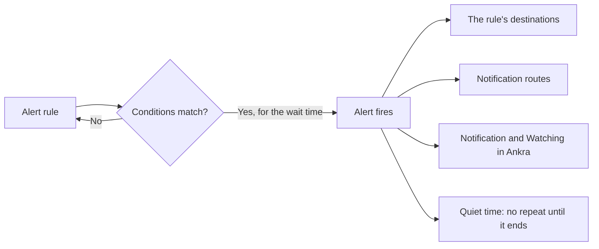

import { CliVersion } from "/snippets/cli-version.jsx";

An alert rule says what Ankra watches for, how serious it is, and who is told when it fires. Ankra checks each rule about once a minute. When its conditions match, the alert fires, tells the destinations you chose, and shows up in Ankra as a notification and under **Ankra AI → Watching**. [Notification routes](/guides/notification-routing) can send it to more places.



A worked example, from a Slack channel to a rule that watches manifest deployments, is in [Alert in Slack when a manifest fails to deploy](/guides/webhook-integrations).

## Before you start

- **A role that manages alerts** to add, change, switch or delete rules in the portal. A role that can only read alerts sees **Your role can look at alert rules but not change them. Someone who manages alerts can.** See [Roles and access](/guides/roles-and-access).
- **A destination** for the alert to tell, such as a Slack channel or a webhook. Add one under **Integrations & alerts → Notification destinations**, see [Webhooks](/guides/webhooks). Without one, notification routes decide who is told.

## Add an alert rule

<Tabs>
  <Tab title="Portal">
    1. Open **Integrations & alerts → Alert rules** (`/next/organisation/alert-rules`) and click **Add alert rule**.
    2. In **Add an alert rule**, enter a **Name** (up to 100 characters) and, if you like, a **Description**, which is shown with the alert when it fires.
    3. Under **Watch**, choose **Clusters** (whether a cluster is online, its GitOps sync, metrics and CVEs) or **What runs on clusters** (add-ons, manifests, Stacks and GitOps repositories, and the jobs that deploy them).
    4. For **What runs on clusters**, tick the **Kinds to watch** (none ticked watches every kind) and, if you like, enter **Name contains** to watch only resources whose name contains that text.
    5. Set **Condition 1**: **What to check**, then the **State** or **Measure**, the **Comparison** and, for a number, the **Threshold**. The [conditions](#conditions) below list every choice. **Add condition** adds another, up to ten; set **Together with the condition before** to **And: both must match** or **Or: either one is enough**.
    6. Under **Where**, choose **Every cluster** (including clusters added later) or **Only the clusters or environments I choose**, then tick **Clusters** or **Environments**. An environment covers every cluster in it, including ones added later.
    7. Choose the **Severity**: **Critical**, **Warning** or **Info**.
    8. Set the [timing](#timing): **Wait before firing (minutes)** and **Quiet time after firing (minutes)**.
    9. Under **Tell these destinations**, tick the destinations to notify.
    10. Click **Add alert rule**.
  </Tab>
  <Tab title="CLI">
    <CliVersion since="0.73.0" />

    Write the alert as YAML. Field names are the platform's: `resource_type` is `cluster` or `cluster_resource`, the conditions use the values in [Conditions](#conditions), and `integration_names` are the names of your destinations.

    ```yaml alert.yaml
    name: production-cluster-offline
    enabled: true
    integration_names:
      - platform-alerts
    rules:
      - name: production-cluster-offline
        resource_type: cluster
        all_clusters: true
        severity: critical
        cooldown_minutes: 15
        conditions:
          - condition_type: cluster_state
            condition_operator: eq
            condition_value: offline
            logical_operator: AND
    ```

    ```bash
    ankra alerts rules create -f alert.yaml
    ankra alerts rules list
    ```

    For **What runs on clusters**, set `resource_type: cluster_resource` and name the kinds in `cluster_resource_types` (for example `[manifest]`). `min_failure_duration_minutes` is **Wait before firing** and `cooldown_minutes` is **Quiet time after firing**.

    `ankra alerts rules get <alert-id>`, `update <alert-id> -f changes.yaml`, `disable <alert-id>`, `enable <alert-id>` and `delete <alert-id> --yes` manage it afterwards. Creating, changing and deleting need `alerts.manage`; `disable` and `enable` need `alerts.write`.
  </Tab>
  <Tab title="MCP">
    The Ankra MCP server has `list_alerts`, `create_alert`, `set_alert_enabled` and `delete_alert`. `create_alert` writes only conditions the evaluator implements. You can also ask Ankra AI in chat to create, mute or delete an alert. See [MCP tools](/platform/mcp-tools).
  </Tab>
</Tabs>

**You should see** the new rule in the list with its severity and a sentence for what it watches, for example **Critical · The cluster is offline on every cluster**, and under it the destinations it tells (**Tells platform-alerts**), or **Only through notification routes** when you ticked none. The switch on the row is on.

To change a rule, open its options menu (**…**) and choose **Change…**. The switch turns a rule off without deleting it; an off rule shows **Off**. **Delete…** asks **Delete this alert rule?** and, once you click **Delete alert rule**, Ankra stops checking its conditions.

## Conditions

These are the conditions Ankra's rule evaluator implements, and the only ones the portal offers. A condition outside them saves without complaint and never fires.

### Watch: Clusters

| What to check | State or Measure | Comparison |
|---------------|------------------|------------|
| **Cluster connection** | **Offline**, **Online** | **Is**, **Is not** |
| **GitOps sync** | **Failing**, **Degraded (merge conflict)**, **Healthy** | **Is**, **Is not** |
| **A cluster metric** | **CPU use (%)**, **Memory use (%)**, **Disk use (%)**, **Disk use on the fullest node (%)**, **Pod restarts in 15 minutes**, **Out-of-memory kills in 15 minutes**, **Nodes not ready**, **Nodes under disk pressure**, **Pending pods**, **Failed pods** | A number: **Above**, **At or above**, **Below**, **At or below**, **Equal to**, **Not equal to**, and a **Threshold** |
| **Metrics stop arriving** | **Platform metrics** | **Minutes without metrics** |
| **Vulnerabilities (CVEs)** | **New critical or high CVEs since the last scan**, **Critical CVEs**, **High CVEs**, **Critical and high CVEs**, **Critical CVEs with a fix**, **High CVEs with a fix**, **Security risk score**, **Known exploited CVEs (CISA KEV)**, **New known exploited CVEs since the last scan** | A number, as for a cluster metric |

### Watch: What runs on clusters

**Kinds to watch** are **Add-ons**, **Manifests**, **Stacks**, **GitOps repositories on GitHub**, **GitOps repositories on Bitbucket Cloud** and **GitOps repositories on Bitbucket Data Center**.

| What to check | State | Comparison |
|---------------|-------|------------|
| **Resource state** | **All up**, **Up**, **Creating**, **Updating**, **Stopping**, **Down** | **Is**, **Is not** |
| **Deployment job status** | **Blocked**, **Failed**, **Pending**, **Running**, **Succeeded**, **Timed out**, **Cancelling**, **Cancelled** | **Is**, **Is not** |

In the CLI and API, the values are lower case with underscores: `cluster_state`, `gitops_sync`, `metric_threshold`, `metric_absence`, `security_findings`, `resource_state` and `job_status`, with values such as `offline`, `cpu_utilisation_pct`, `new_severe_cves`, `down` or `failed`, and operators `eq`, `neq`, `gt`, `gte`, `lt` and `lte`.

## Timing

| Field | What it does | Range |
|-------|--------------|-------|
| **Wait before firing (minutes)** | How long the conditions must keep matching before the alert fires. Leave it empty for Ankra's default: 5 minutes for a cluster going offline and for pending or failed pods, otherwise none. | 0 to 1440 |
| **Quiet time after firing (minutes)** | After it fires, the alert does not fire or tell anyone again for this long, so an ongoing problem is not sent over and over. | 1 to 1440, 15 for a new rule |

So a rule on **Cluster connection** **Is** **Offline** with no wait set fires after the cluster has been offline for 5 minutes, not the moment it drops.

## Who is told

An alert firing goes to the destinations ticked on the rule, and to every destination a [notification route](/guides/notification-routing) sends alert firings to. A destination reached both ways gets the firing once.

A route can also filter by application and by branch or pull request, but an alert firing carries neither, so a route that sets either filter never matches one. See [Scope a route to one application and its default branch](/guides/notification-routing#scope-a-route-to-one-application-and-its-default-branch).

If you have set a [home channel](/guides/webhooks#home-channel), a critical or warning notification that no destination or route handles goes there, so it is never missed.

## Follow a firing

- **Ankra AI → Watching → All signals** (`/next/ai/alerts`) lists every alert with its severity, environment, the work on it and when it last fired. The views **All signals**, **Firing**, **Resolved** and **Disabled rules** narrow the list, with search and a **Severity** filter.
- An alert's page shows whether the platform reports it firing, **Work on this alert** (the tickets linked to it), **Related agent runs** and **Signal details**. Open it from the list, or from the rule's options menu with **Open the alert**.
- Each firing is also a notification under the bell. Its page shows **What happened**, an **AI analysis** when Ankra has made one, and **How to fix it**. See [Notifications and Needs you](/platform/activity-inbox).

From the CLI, acknowledge one firing or snooze it for a number of minutes. Both need `alerts.write`:

```bash
ankra alerts triggers acknowledge <alert-id> <trigger-id> --notes "looking"
ankra alerts triggers snooze <alert-id> <trigger-id> --minutes 120
```

## Alerts from your own Alertmanager

An Alertmanager you already run can post its alerts into Ankra through an alert ingest credential. Each alert it sends shows on **Alert rules** with the badge **From Alertmanager**; its conditions are your monitoring system's, so in Ankra you change only its name, description and destinations. See [Send your Alertmanager alerts to Ankra](/guides/alertmanager-to-ankra), which also covers silencing alerts in a cluster's Alertmanager.

## Verify

1. On **Integrations & alerts → Notification destinations**, use **Send a test** on each destination the rule tells, and check that the sample arrives.
2. On **Integrations & alerts → Notification routes**, use **Where would it go?** with **Kind** set to **Alert firing** and the rule's severity, and check the destinations listed.
3. Check the rule's row on **Alert rules**: it is switched on, and its sentence names the clusters you meant.

## What can go wrong

**The rule never fires.**

- The row shows **Off**. Switch it on.
- **Where** does not cover the cluster. Open **Change…** and check **Clusters** and **Environments**.
- The conditions have not matched for the whole **Wait before firing** time, or the alert fired less than **Quiet time after firing** ago.
- The row says **No conditions yet, so it never fires**. Add a condition.
- A rule made outside the portal uses a condition the evaluator does not implement. Its form says **Its conditions use a form this page cannot show, so they stay as they are and cannot be changed here yet.** Such a condition never fires: recreate the rule with the [conditions](#conditions) above.

**It fires, but nobody hears about it.** The row says **Only through notification routes** and no route matches alert firings, or every destination it tells is **Off**. Tick a destination with **Change…**, or check with **Where would it go?** on **Notification routes**.

**Saving is refused.** The form names the field: **Choose at least one cluster or environment, or watch every cluster.**, **A whole number of minutes from 1 to 1440.**, or **Enter a number for every threshold.**

## Related

- [Alert in Slack when a manifest fails to deploy](/guides/webhook-integrations) - a worked example
- [Webhooks](/guides/webhooks) - destinations, payloads and variables
- [Notification routing](/guides/notification-routing) - send firings to more places, or keep them away
- [Notifications and Needs you](/platform/activity-inbox) - where firings land in Ankra
