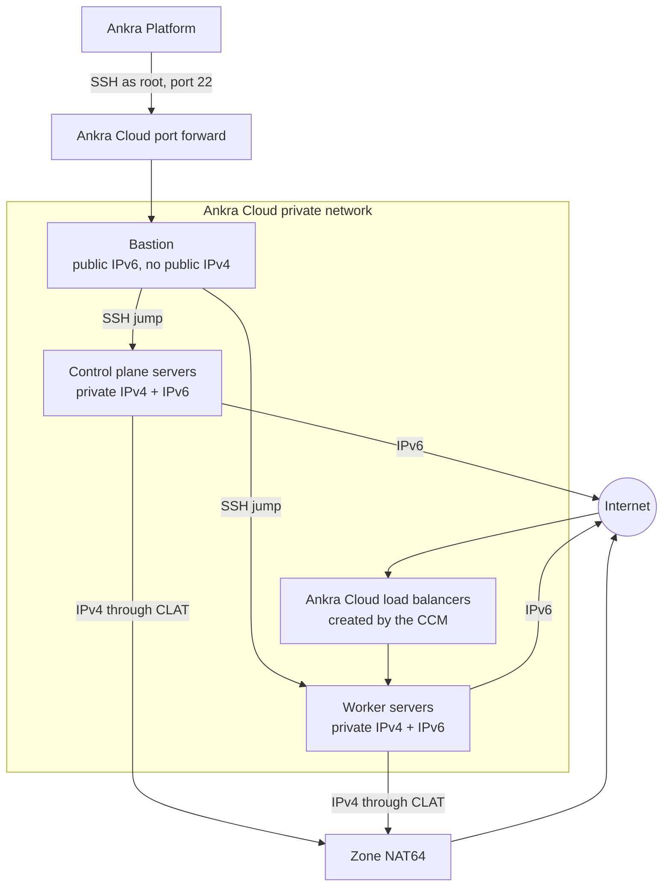

import { CliVersion } from "/snippets/cli-version.jsx";

Ankra builds **Ankra Managed** Kubernetes clusters on [Ankra Cloud](https://cloud.ankra.app) servers: a private network, a bastion server, control plane and worker servers on the private network, kubeadm or k3s installed over SSH, and the Ankra Cloud cloud controller manager and CSI driver deployed as a stack. By default the cluster is IPv6-only, with no NAT router and no public IPv4 address; `network_mode: ipv4_nat` adds a NAT router and gives the bastion a public IPv4 address instead (see [Network design](#network-design)). You own the control plane and every server; Ankra provisions, upgrades and repairs them.

<Warning>
**Closed beta.** Ankra Cloud as a cluster provider is in closed beta. The workflow is stable but the surface may still change, and it is enabled per organisation on request - until it is, Ankra Cloud does not appear in the create-cluster dialog or among the credential providers, and its endpoints are not served. [Contact support](/platform/support) to have it turned on for your organisation.
</Warning>

This is the self-managed lane. If you want the Ankra team to run the control plane for you, use [Ankra Cloud Kubernetes](/guides/ankra-cloud-kubernetes) instead; the [comparison table](/guides/managed-kubernetes#cloud-managed-or-ankra-managed) sets the two side by side.

---

## Before you start

<CardGroup cols={2}>
  <Card title="Ankra Cloud Credential" icon="key">
    An Ankra Cloud API token (`act_...`) from a user allowed to create servers, networks and routers. The same credential serves both self-managed clusters and Ankra Cloud Kubernetes. See [Ankra Cloud Credentials](/platform/credentials/ankra-cloud).
  </Card>
  <Card title="SSH Key Credential" icon="lock">
    An SSH public key for server access. You can provide your own or let Ankra generate one. See [SSH Key Credentials](/platform/credentials/ssh-key).
  </Card>
</CardGroup>

---

## Create the cluster

### Dashboard

<Steps>
  <Step title="Open the create dialog">
    Go to **Clusters**, click **Create cluster** and pick **Ankra Cloud** under **Ankra Managed** (kubeadm or k3s on Ankra Cloud servers).
  </Step>
  <Step title="Credentials & Zone">
    Pick the Ankra Cloud credential, or add one inline with **Add Ankra Cloud credential**. Choose the **Runtime credential** the in-cluster cloud controller and CSI driver use: the default reuses the provisioning credential, and a separate, dedicated credential limits what those components can reach. Pick an SSH key, then the zone. Zones, plans and templates load live from your Ankra Cloud account; a zone that runs no servers (a network-only location such as Stockholm) is refused.
  </Step>
  <Step title="Private Network & Bastion">
    Choose **Create a dedicated network** (Ankra creates and owns the network, and in `ipv4_nat` mode its router; the wizard proposes `10.64.0.0/20`) or **Use an existing network** in the zone. The wizard has no network-mode control, so a cluster it creates is `ipv6_only`; choose `ipv4_nat` through the API or the CLI. Pick the bastion plan, and optionally restrict **Bastion allowed IPs** to the CIDRs that may reach the bastion over SSH; on an `ipv6_only` bastion only the IPv6 entries apply, and empty allows any address only in `ipv4_nat` mode. **Storage retention on teardown** decides whether persistent volumes are kept (the default) or deleted when the cluster is deprovisioned.
  </Step>
  <Step title="Compute">
    Set the control-plane count (the wizard offers 1, 3 or 5; the API accepts any count from 1 to 9) and plan, then one or more worker node groups, each with its own plan, count, labels and taints. The cost summary prices every server from the live plan catalog, plus public IPv4. The router, storage, load balancers and transfer are not in the total; see [Cost](#cost).

    On kubeadm, a node group labelled `ankra.cloud/sandbox-runtime=gvisor` gets the gVisor sandbox runtime installed on its nodes before they join. Ankra AI runs code on its own, to fix a build or regenerate a lockfile, only behind a sandbox, so give the cluster that will run CI or Ankra AI's workspaces one such group; one node is enough to start. Keep ordinary workers beside it, because image builds cannot run under gVisor. On the CLI, `ankra cluster ankracloud create --sandbox-nodes 1` adds that group, named `sandbox` and on the worker plan unless `--sandbox-node-plan` names another, beside a `workers` group; it refuses a k3s cluster and a cluster with no workers, and `preflight` takes the same flags.

    <CliVersion since="0.71.0" command="cluster ankracloud create --sandbox-nodes" />
  </Step>
  <Step title="Kubernetes">
    Choose the server template (default `debian-13`), the distribution and the Kubernetes version:
    - **kubeadm** (default) - vanilla Kubernetes with containerd and Cilium. Cilium is the only CNI kubeadm accepts on Ankra Cloud. etcd runs stacked on the control-plane nodes, or on 3 or 5 dedicated external etcd servers with their own plan.
    - **k3s** - a single binary with batteries included, with a choice of CNI.
  </Step>
  <Step title="GitOps">
    Optionally connect a Git repository, and Ankra commits the cluster's stacks to it. Two checkboxes are on by default:
    - **Include Networking Stack** - Traefik, cert-manager and a Let's Encrypt ClusterIssuer, with Traefik behind an Ankra Cloud load balancer. To serve Gateway and HTTPRoute resources from the same Traefik as well, see [Gateway API](/guides/gateway-api).
    - **Include DNS Integration** - external-dns, so Ingress hostnames publish their DNS records automatically.

    Skipping GitOps still deploys the cloud controller manager and CSI driver; the `ankracloud-cloud-provider` stack is then not committed to Git.
  </Step>
  <Step title="Preflight & Review">
    Name the cluster and click **Run preflight**. The checks run against your account: the credential authenticates, the zone offers compute, every plan and the template exist, an existing network lives in the chosen zone, kubeadm is paired with Cilium, and the zone can serve the default `ipv6_only` network mode. Any failing check blocks creation and says why. Then click **Create cluster**; a progress view tracks the network, the router of an `ipv4_nat` cluster, the firewall, the bastion, the servers, the Kubernetes installation and the Ankra Agent.
  </Step>
</Steps>

### API

```bash
curl -X POST https://platform.ankra.app/api/v1/clusters/ankracloud \
  -H "Authorization: Bearer $ANKRA_API_TOKEN" \
  -H "Content-Type: application/json" \
  -d '{
    "name": "my-cluster",
    "credential_id": "<ankra-cloud-credential-id>",
    "ssh_key_credential_id": "<ssh-key-credential-id>",
    "zone": "de-fsn1",
    "bastion_plan": "<plan>",
    "control_plane_count": 1,
    "control_plane_plan": "<plan>",
    "worker_count": 2,
    "worker_plan": "<plan>",
    "distribution": "kubeadm"
  }'
```

Plans are account-wide; list them, and the zones, templates and networks the wizard offers, with `GET /api/v1/clusters/ankracloud/plans?credential_id=<id>` (and `/zones`, `/templates`, `/networks?zone=<zone>` alongside). `POST /api/v1/clusters/ankracloud/preflight` takes the same body and answers the checks without creating anything.

| Field | Default | Description |
|-------|---------|-------------|
| `zone` | | Ankra Cloud zone the servers are built in, for example `de-fsn1` |
| `template` | `debian-13` | Public server template: `debian-13`, `debian-12` or `ubuntu-24.04` |
| `distribution` | `kubeadm` | `kubeadm` or `k3s` |
| `kubernetes_version` | latest stable | Kubernetes version for the chosen distribution |
| `cni` | | CNI for k3s; kubeadm accepts only Cilium |
| `k3s_disabled_components` | | k3s only. Packaged components the k3s install leaves out (`k3s --disable`), on top of `servicelb` and `traefik`, which Ankra's k3s shape on Ankra Cloud already disables: any of `coredns`, `servicelb`, `traefik`, `local-storage`, `metrics-server`, `runtimes`, for example `["local-storage"]` on a cluster whose volumes all come from the Ankra Cloud CSI driver. A list on a `kubeadm` cluster is refused with a `400` (`k3s_disabled_components is only supported for the k3s distribution.`); an entry outside those six or an entry listed twice is a `422` validation error pointing at the entry |
| `etcd_topology` | `stacked` | kubeadm only: `stacked` or `external`, with `etcd_node_count` (3 or 5) and `etcd_plan` |
| `network_ip_range` | a derived `/20` | RFC 1918 range, `/16` to `/29`, for the network Ankra creates |
| `private_network_id` | | Adopt an existing network in the zone instead; mutually exclusive with `network_ip_range` |
| `network_mode` | `ipv6_only` | `ipv6_only`: no NAT router and no public IPv4 address; Ankra reaches the bastion through the Ankra Cloud port forward, and the nodes reach IPv4 through the zone's NAT64. `ipv4_nat`: a NAT router for the nodes' IPv4 egress and a bastion with a public IPv4 address, a paid add-on under a per-account quota. The preflight refuses `ipv6_only` in a zone without public IPv6, NAT64 or port forwarding, and `ipv4_nat` in a zone with no public IPv4 left or no IPv4 for a NAT router, naming the other mode each time. See [Network design](#network-design) |
| `bastion_plan` | | Plan of the bastion server |
| `bastion_allowed_ips` | any in `ipv4_nat` | IPv4 or IPv6 addresses or CIDRs allowed to reach the bastion over SSH. An `ipv6_only` bastion applies only the IPv6 entries, beside the port forward's sources and the private network; see [Network design](#network-design) |
| `control_plane_count` | | 1 to 9 control-plane servers. The wizard offers 1, 3 and 5 |
| `control_plane_plan` | | Plan of the control-plane servers |
| `worker_count`, `worker_plan` | | A single worker group; use `node_groups` (each with `name`, `instance_type`, `count`, labels and taints) for several |
| `runtime_credential_id` | the provisioning credential | Ankra Cloud credential the in-cluster CCM and CSI use |
| `retention_policy` | `retain` | `retain` or `delete` persistent volumes on deprovision |
| `include_networking`, `include_dns` | `true` | Networking stack and DNS integration |
| `gateway_api` | `false` | Also serve the Kubernetes Gateway API from the networking stack's Traefik; needs `include_networking`. See [Gateway API](/guides/gateway-api) |
| `gitops_credential_name`, `gitops_repository`, `gitops_branch` | branch `master` | Optional GitOps repository |

A cluster has at most 100 workers across its node groups, and at most 64 nodes in all, control planes included, because of the pod range it is given (see [Network ranges and their limits](/platform/cluster-mesh#network-ranges-and-their-limits)). A request that plans more, counting each node group's autoscaling maximum, is refused before anything is provisioned.

---

## Verify

1. The cluster moves from **Provisioning** to **Online** in the clusters list once the Ankra Agent has connected.
2. Point `kubectl` at it through Ankra (this needs a [Cluster Access](/guides/cluster-access) grant) and check the nodes:

   <CliVersion since="0.3.0" command="cluster kubeconfig add" />

   ```bash
   ankra cluster kubeconfig add my-cluster --use
   kubectl get nodes
   ```

   Every control plane and worker should be `Ready`. See [Accessing Clusters with kubectl](/guides/kubeconfig).

---

## Network design

A cluster is built in one of two network modes, chosen at create with `network_mode` (`--network-mode` on the CLI). The default, `ipv6_only`, takes no public IPv4 address at all: the nodes reach IPv4 through the zone's NAT64, and Ankra reaches the bastion through the Ankra Cloud port forward. `ipv4_nat` adds a NAT router for the nodes' IPv4 egress and gives the bastion a public IPv4 address, a paid add-on under a per-account quota. Clusters created before 2026-11-03, when `ipv6_only` became the default, keep the `ipv4_nat` layout. The preflight says whether a zone can serve the mode you chose: `ipv6_only` needs public IPv6, NAT64 and port forwarding in the zone, `ipv4_nat` a public IPv4 address for the bastion and IPv4 for a NAT router, and each refusal names the other mode.

<CliVersion since="0.35.0" command="cluster ankracloud create --network-mode" />

The default layout:



In `ipv4_nat` mode Ankra connects to the bastion's public IPv4 address directly, and a router with NAT on the private network carries the nodes' IPv4 egress instead of the NAT64.

| Component | What Ankra creates |
|-----------|--------------------|
| **Private network** | An RFC 1918 network, named after the cluster, that every server joins. Kubernetes runs on it: each kubelet's node IP is its private IPv4 address. An adopted network is used as it is and left in place on deprovision. |
| **Bastion** | A plain server. Ankra connects to it as `root` on port 22 and jumps through it to every other server to install Kubernetes, run upgrades and reconcile. In `ipv6_only` mode it holds a public IPv6 address and no public IPv4, and Ankra reaches it through the Ankra Cloud port forward with the cluster's own credential. In `ipv4_nat` mode it holds a public IPv4 address. |
| **Router with NAT** | `ipv4_nat` only: a router attached to the private network with NAT enabled. It is the nodes' IPv4 path to the internet, and only that - it is never an SSH hop. An `ipv6_only` cluster has no router. |
| **Control plane and workers** | Servers on the private network. They keep the public IPv6 address every Ankra Cloud server gets, behind the firewall, and have no public IPv4 address in either mode. The Kubernetes API is not published: Ankra reaches it through the bastion, and the Ankra Agent in the cluster connects out to Ankra. |
| **Firewall** | Ankra Cloud has no security groups, so Ankra applies a firewall to each server: inbound traffic is dropped by default and the private network is trusted as a whole. An `ipv4_nat` bastion accepts SSH from `bastion_allowed_ips`, or from anywhere when it is empty. An `ipv6_only` bastion accepts SSH only from the port forward's sources, the IPv6 entries of `bastion_allowed_ips` and the private network, never from the internet at large. |

Ankra Cloud servers are IPv6-first. In `ipv6_only` mode the nodes have no IPv4 route to the internet of their own: IPv4 traffic from nodes and pods leaves through the server's IPv4 translation (CLAT) and the zone's NAT64, and kubelet hands pods the IPv4 resolvers `1.1.1.1` and `8.8.8.8`, reached the same way, because the zone's DNS64 resolvers are IPv6 and IPv4-only pods cannot reach them. In `ipv4_nat` mode the nodes do not use the CLAT; pod and node IPv4 traffic leaves through the router's NAT instead. Kubernetes runs IPv4 single-stack on the private network in both modes.

Every server Ankra creates carries the labels `platform.ankra.io/managed-by=ankra-platform`, `platform.ankra.io/cluster-id=<cluster-id>` and `platform.ankra.io/role`, so you can find a cluster's servers in the Ankra Cloud console.

### Cost

Ankra Cloud bills the cluster's resources to your Ankra Cloud account. A cluster is made of:

- **Servers** - the bastion, the control planes and the workers, each at its plan price.
- **Public IPv4** - none in `ipv6_only` mode. In `ipv4_nat` mode one address, held by the bastion. The nodes hold none in either mode, and IPv6 is not billed.
- **The router with NAT** - `ipv4_nat` mode only: one for each cluster, billed monthly while NAT is enabled.
- **Load balancers** - the ones the cloud controller creates for `LoadBalancer` Services, the networking stack's Traefik included.
- **Persistent volumes** - the storages the CSI driver provisions, by tier and size.
- **Transfer** - outbound traffic beyond what each server includes.

The wizard's estimate covers the servers and a public IPv4 address for the bastion only; a cluster the wizard creates is `ipv6_only` and takes no public IPv4 address, so that line does not apply to it. For the current price of every line, see [Billing](https://cloud.ankra.app/docs/billing) in the Ankra Cloud documentation.

To choose plans, CPU pools, root disk sizes and tiers, and to check the account quota before you build, see [Ankra Cloud Servers, Disks and Quota](/guides/ankra-cloud-servers-and-disks).

---

## Cloud controller and storage

After the Ankra Agent is installed, Ankra deploys the `ankracloud-cloud-provider` stack into `kube-system`: the `ankra-cloud-ccm` and `ankra-cloud-csi` charts, sharing the runtime credential's token through the Secret `ankra-cloud` (SOPS-encrypted when the stack is committed to Git). Every kubelet runs with `--cloud-provider=external`, and the controller links each node to its server as `ankracloud://<zone>/<server-id>`. The charts' own behaviour, values and annotations are documented by Ankra Cloud: [Kubernetes cloud controller manager](https://cloud.ankra.app/docs/kubernetes-ccm) and [Kubernetes CSI driver](https://cloud.ankra.app/docs/kubernetes-csi).

**LoadBalancer Services.** `ankra-cloud-ccm` gives each Service of type `LoadBalancer` an Ankra Cloud load balancer on the cluster's private network, with the nodes' private addresses as members. The networking stack's Traefik uses one, with `externalTrafficPolicy: Local` so the client address is preserved. Deleting the Service deletes its load balancer; Ankra itself never deletes one, so remove your `LoadBalancer` Services before you [terminate the cluster](#operate-it), or a load balancer still bound then stays in your Ankra Cloud account.

**Persistent volumes.** `ankra-cloud-csi` provisions Ankra Cloud storages. It installs four StorageClasses:

| StorageClass | Tier | Use |
|--------------|------|-----|
| `ankra-standard` (default) | `standard` | General purpose, replicated |
| `ankra-maxiops` | `maxiops` | Databases and other latency-sensitive workloads |
| `ankra-hdd` | `hdd` | Bulk data |
| `ankra-local-nvme` | `local-nvme` | The compute node's own disks: fastest, single copy, pinned to one server |

Volumes are ReadWriteOnce and created in the zone of the node their pod is scheduled on.

---

## Operate it

Day-2 tasks work as on every Ankra Managed provider, from the dashboard, the API or the CLI. The `ankra cluster ankracloud` commands below are the Ankra Cloud ones; provider-neutral commands such as `ankra cluster upgrade` find the provider from the cluster.

<CliVersion since="0.21.0" command="cluster ankracloud" />

- [Node groups](/guides/operate-ankra-managed-clusters#node-groups) - **Nodes → Node groups**
- [Control plane](/guides/operate-ankra-managed-clusters#control-plane) with `ankra cluster ankracloud control-plane set-count` and `set-instance-type`, [restart a node](/guides/operate-ankra-managed-clusters#restart-a-node) with `ankra cluster ankracloud nodes restart`, and [the bastion](/guides/operate-ankra-managed-clusters#bastion) with `ankra cluster ankracloud bastion status`, `diagnose` and `resize`
- [Upgrade Kubernetes](/guides/operate-ankra-managed-clusters#upgrade-kubernetes) with `ankra cluster upgrade`; `ankra cluster ankracloud k8s-version` shows the version it runs now
- [Stop and start](/guides/operate-ankra-managed-clusters#stop-and-start) with `ankra cluster ankracloud stop` and `start` - a stop powers the servers off and keeps them with their disks; a start powers them on again. When the control-plane servers are lost with their host, `ankra cluster state-snapshots latest` shows the newest snapshot a start may restore, and `ankra cluster ankracloud start <cluster> --restore-snapshot-id <id> --restore-over-kept-etcd` restores it on that start, the second flag confirming that the kept control planes and their etcd are gone; see [Restore a named snapshot](/guides/kubernetes-upgrades#restore-a-named-snapshot)
- [Terminate a cluster](/guides/operate-ankra-managed-clusters#terminate-a-cluster) with `ankra cluster ankracloud deprovision` - deletes the servers, the bastion, the router of an `ipv4_nat` cluster, the firewall rules and the network Ankra created. A network you adopted with `private_network_id` is left in place, and persistent volumes follow the retention policy, deleted only once you accept it

### Disabled k3s components

| Endpoint | Method | Description |
|----------|--------|-------------|
| `/api/v1/clusters/ankracloud/{id}/k3s-disabled-components` | GET | The stored `k3s_disabled_components` (empty when nothing is stored), the k8s node `resource_ids` carrying it, `control_plane_count` and `applies` |
| `/api/v1/clusters/ankracloud/{id}/k3s-disabled-components` | PUT | Replace the stored list on a running k3s cluster, for example `{"k3s_disabled_components": ["local-storage"]}` |

The `k3s_disabled_components` list set at create can grow on a running k3s cluster. The body is the complete list and has to contain every entry already stored; an unknown or repeated entry is a `422` validation error pointing at the entry. `applies` answers: "The platform's maintenance read lane compares each control plane's k3s server config against this list within about five minutes and flags the ones missing an entry; the reconcile lane then patches the config and restarts k3s on one control plane at a time, in the cluster's k8s update chain. Control planes already carrying every entry are not touched. The list only grows: re-enabling a bundled component is not supported yet, so a change that removes a stored entry is refused, and so is any change while a node update, version upgrade or node restart is still in progress on the cluster." These refusals answer `409` with the detail shown:

| Request | Detail |
|---------|--------|
| The cluster runs kubeadm (the read is refused too) | `k3s_disabled_components is only supported for the k3s distribution.` |
| The cluster has no Kubernetes node resources (the read is refused too) | `No Kubernetes node resources found for this cluster` |
| The list drops a stored entry, here `local-storage` | `k3s_disabled_components: re-enabling a bundled component is not supported yet, so a stored entry cannot be removed: local-storage. Send the stored list plus any additions.` |
| The list adds `coredns` | `k3s_disabled_components: coredns cannot be disabled on a running cluster. It is load-bearing for in-cluster DNS, and k3s removes it on the first control plane that restarts with the entry.` |
| A node update, version upgrade or node restart is in progress | `k3s_disabled_components cannot be changed while a Kubernetes node update, version upgrade or node restart is in progress on this cluster. Retry once it has finished.` |

## Troubleshooting

| Issue | Solution |
|-------|----------|
| Preflight: `zone "..." is a network-only location and runs no servers` | Pick a zone that offers compute, for example `de-fsn1` |
| Preflight: `plan "..." is not available to this account` | Pick a plan from the live catalog in the wizard |
| Preflight: `template "..." is not a public Ankra Cloud template` | Use `debian-13`, `debian-12` or `ubuntu-24.04`; custom templates are not supported |
| Preflight: `kubeadm supports only Cilium on Ankra Cloud` | Choose Cilium, or switch to k3s for another CNI |
| Preflight: `network ... lives in zone ..., not ...` | Adopt a network in the cluster's zone, or let Ankra create one |
| Preflight: `zone "..." has no NAT64, so IPv6-only nodes could not reach IPv4-only registries or the Ankra platform; set network_mode ipv4_nat to create it with a NAT router and a bastion with a public IPv4` (or the same about public IPv6, port forwarding, or a zone that does not report its networking) | The zone cannot serve the default `ipv6_only` layout. Pass `network_mode: ipv4_nat`, or pick another zone |
| Preflight: `zone "..." has no public IPv4 left for the bastion; create the cluster with network_mode ipv6_only` (or `has no IPv4 for a NAT router`) | The zone cannot serve `ipv4_nat`. Leave `network_mode` at its default, `ipv6_only`, or pick another zone |
| Create fails with a quota error | Ankra Cloud enforces account quotas when servers are created; raise them in the Ankra Cloud console or pick smaller plans |
| Credential refused | Check the token in the Ankra Cloud console and [rotate it](/platform/credentials/ankra-cloud) |

## Related

- [Ankra Cloud Kubernetes](/guides/ankra-cloud-kubernetes)
- [Ankra Cloud Credentials](/platform/credentials/ankra-cloud)
- [Cluster settings](/platform/cluster-settings)
