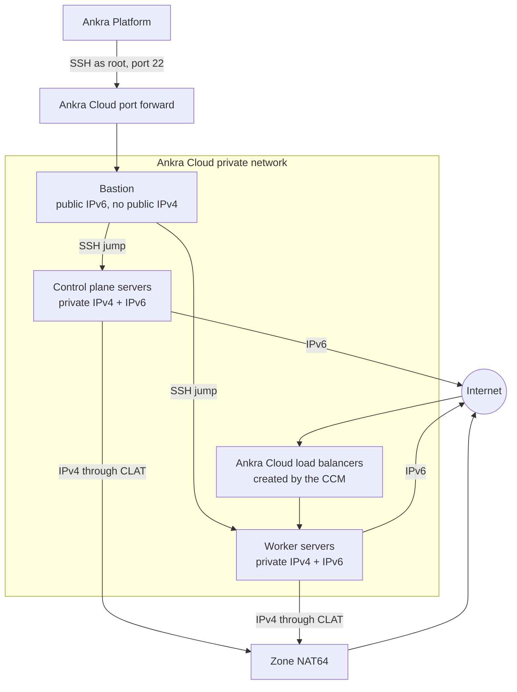

import { CliVersion } from "/snippets/cli-version.jsx";

Ankra builds **Ankra Managed** Kubernetes clusters on [Ankra Cloud](https://cloud.ankra.app) servers: a private network, a bastion server, control plane and worker servers on the private network, kubeadm or k3s installed over SSH, and the Ankra Cloud cloud controller manager and CSI driver deployed as a stack. By default the cluster is IPv6-only, with no NAT router and no public IPv4 address; `network_mode: ipv4_nat` adds a NAT router and gives the bastion a public IPv4 address instead (see [Network design](#network-design)). You own the control plane and every server; Ankra provisions, upgrades and repairs them.

<Warning>
**Closed beta.** Ankra Cloud as a cluster provider is in closed beta. The workflow is stable but the surface may still change, and it is enabled per organisation on request. Until it is, **Ankra Cloud** is not among the providers under **Add a cluster**, and its endpoints answer `404`. [Contact support](/platform/support) to have it turned on for your organisation.
</Warning>

This is the self-managed lane. If you want the Ankra team to run the control plane for you, use [Ankra Cloud Kubernetes](/guides/ankra-cloud-kubernetes) instead; the [comparison table](/guides/managed-kubernetes#cloud-managed-or-ankra-managed) sets the two side by side.

---

## Before you start

- A **payment method** on the organisation. Without one, **Create cluster** is refused with "The cluster was not created" and a link to **Open Plan and billing**. See [Credit and payment method](/platform/billing#credit-and-payment-method).
- The `clusters.create` permission. See [Roles and access](/guides/roles-and-access).
- An **Ankra Cloud credential**: an Ankra Cloud API token (`act_...`) from a user allowed to create servers, networks and routers. The same credential serves both self-managed clusters and Ankra Cloud Kubernetes. See [Ankra Cloud Credentials](/platform/credentials/ankra-cloud). Where the organisation has Ankra Cloud servers included, the create form says "Ankra Cloud runs this cluster on the servers included with your organisation. No credential is needed." and you skip this.
- An **SSH key credential** is optional. Without one, the cluster uses an SSH key Ankra generates for it. See [SSH Key Credentials](/platform/credentials/ssh-key).

---

## Create the cluster

<Tabs>
  <Tab title="Portal">
    The create form is the same for every provider Ankra builds on; [Create a cluster](/guides/create-a-cluster) walks through it section by section. What is particular to Ankra Cloud:

    <Steps>
      <Step title="Pick Ankra Cloud">
        Go to **Infrastructure → Clusters**, click **Add a cluster**, pick **Ankra Cloud**, then **Ankra managed** under **Who runs Kubernetes on Ankra Cloud?**. The form **Add an Ankra Cloud cluster** opens.
      </Step>
      <Step title="Where it runs">
        Pick the **Ankra Cloud credential** (or read "No credential is needed" where your organisation has servers included), optionally an **SSH key (optional)**, and the **Zone**; each zone is listed with its country. Once a zone is chosen, the **Operating system image** list loads with `debian-13` preselected, and so do the plans the zone offers.
      </Step>
      <Step title="Control plane, management server and worker nodes">
        Choose **Single node** or **High availability** (three control plane nodes), then a plan for the control plane, the **Management server** (the bastion) and each node group. Plans carry their monthly price from the zone's catalogue.

        On kubeadm, a node group labelled `ankra.cloud/sandbox-runtime=gvisor` gets the gVisor sandbox runtime installed on its nodes before they join. In the form, open **Placement, labels and taints** under the node group, enter that key and value under **Node label key** and **Node label value**, and click **Add node label**. Ankra AI runs code on its own, to fix a build or regenerate a lockfile, only behind a sandbox, so give the cluster that will run CI or Ankra AI's workspaces one such group; one node is enough to start. Keep ordinary workers beside it, because image builds cannot run under gVisor.
      </Step>
      <Step title="Kubernetes">
        Keep **kubeadm** (vanilla Kubernetes with containerd and Cilium; Cilium is the only CNI kubeadm accepts on Ankra Cloud) or pick **k3s** and its **Network plugin**. On kubeadm, **Run etcd on separate nodes** under **Advanced configuration** puts etcd on 3 or 5 dedicated servers with their own plan.
      </Step>
      <Step title="Cluster configuration in Git and Advanced configuration">
        Optionally tick **Keep the configuration in a Git repository**; Ankra commits the cluster's stacks to it. Without it, the `ankracloud-cloud-provider` stack is still deployed, just not committed.

        Under **Advanced configuration**, **Private network range** takes an RFC 1918 range from `/16` to `/29` (`10.64.0.0/20` when left empty). **Install the networking stack** (Traefik, cert-manager and a Let's Encrypt ClusterIssuer, with Traefik behind an Ankra Cloud load balancer) and **Give the cluster a public domain** are ticked by default. To serve Gateway and HTTPRoute resources from the same Traefik as well, tick **Add the Kubernetes Gateway API**; see [Gateway API](/guides/gateway-api).

        **Addresses allowed to reach the management server** takes IPv4 ranges only. A cluster the form creates is `ipv6_only`, whose bastion applies only IPv6 entries (see [Network design](#network-design)), so restrict SSH to the bastion with IPv6 entries through `--bastion-allowed-ips` or the API instead.
      </Step>
      <Step title="Review and create">
        Click **Review cluster**. Under **Checks before creating**, Ankra asks Ankra Cloud whether the account can create this cluster: the credential authenticates, the zone offers compute, every plan and the template exist, kubeadm is paired with Cilium, and the zone can serve the `ipv6_only` network mode. A failing check says why. Click **Create cluster**. The page **Creating `<name>`** follows the setup; it reads **`<name>` is ready** when the Ankra agent has connected.
      </Step>
    </Steps>

    The form does not offer every Ankra Cloud option. Use the CLI or API for these:

    | Option | What the form sends | CLI flag |
    |--------|---------------------|----------|
    | Network mode | `ipv6_only` (the server default) | `--network-mode ipv4_nat` |
    | Runtime credential | The provisioning credential | `--runtime-credential-id` |
    | Teardown retention | `retain` | `--retention-policy` |
    | Private network | A new one | `--private-network-id` to adopt an existing one |
    | Root disk size and tier | Each plan's included disk on the zone's default tier | `--worker-disk-gib`, `--worker-disk-tier` and the same pair for the bastion, control plane and etcd |
    | Sandbox node group | None, unless you label a group as above | `--sandbox-nodes` |
    | Control plane nodes | 1 or 3 | `--control-plane-count` (1 to 9) |

    The **Estimated monthly cost** card prices the servers from the zone's plan catalogue. The router, storage, load balancers and transfer are not in the total; see [Cost](#cost).
  </Tab>
  <Tab title="CLI">
    <CliVersion since="0.21.0" />

    ```bash
    # What the credential can use
    ankra cluster ankracloud zones --credential-id <ankra-cloud-credential-id>
    ankra cluster ankracloud plans --credential-id <ankra-cloud-credential-id>
    ankra cluster ankracloud templates --credential-id <ankra-cloud-credential-id>

    # Check the request first; preflight takes the same flags as create
    ankra cluster ankracloud preflight \
      --name my-cluster \
      --credential-id <ankra-cloud-credential-id> \
      --ssh-key-credential-id <ssh-key-credential-id> \
      --zone <zone> \
      --bastion-plan <plan> \
      --control-plane-plan <plan> \
      --worker-count 2 \
      --worker-plan <plan>

    ankra cluster ankracloud create \
      --name my-cluster \
      --credential-id <ankra-cloud-credential-id> \
      --ssh-key-credential-id <ssh-key-credential-id> \
      --zone <zone> \
      --bastion-plan <plan> \
      --control-plane-plan <plan> \
      --worker-count 2 \
      --worker-plan <plan>
    ```

    `--distribution k3s` with `--cni`, `--etcd-topology external` with `--etcd-node-count` and `--etcd-plan`, `--network-mode`, `--network-ip-range` or `--private-network-id`, `--bastion-allowed-ips`, `--runtime-credential-id`, `--retention-policy`, `--include-networking=false`, `--include-dns=false`, `--gateway-api` and the `--gitops-*` flags cover the other choices; every field is in the table below.

    `--sandbox-nodes 1` adds a `sandbox` node group with the gVisor runtime, on the worker plan unless `--sandbox-node-plan` names another, beside a `workers` group. It refuses a k3s cluster and a cluster with no workers.

    <CliVersion since="0.71.0" command="cluster ankracloud create --sandbox-nodes" />
  </Tab>
  <Tab title="API">
    ```bash
    curl -X POST https://platform.ankra.app/api/v1/clusters/ankracloud \
      -H "Authorization: Bearer $ANKRA_API_TOKEN" \
      -H "Content-Type: application/json" \
      -d '{
        "name": "my-cluster",
        "credential_id": "<ankra-cloud-credential-id>",
        "ssh_key_credential_id": "<ssh-key-credential-id>",
        "zone": "<zone>",
        "bastion_plan": "<plan>",
        "control_plane_count": 1,
        "control_plane_plan": "<plan>",
        "worker_count": 2,
        "worker_plan": "<plan>",
        "distribution": "kubeadm"
      }'
    ```

    List the zones, plans, templates and networks with `GET /api/v1/clusters/ankracloud/zones?credential_id=<id>` (and `/plans`, `/templates`, `/networks?zone=<zone>` alongside). `POST /api/v1/clusters/ankracloud/preflight` takes the same body and answers the checks without creating anything.
  </Tab>
</Tabs>

### Create request fields

| Field | Default | Description |
|-------|---------|-------------|
| `zone` | | Ankra Cloud zone the servers are built in; `ankra cluster ankracloud zones` lists the zones your credential can use |
| `template` | `debian-13` | Public server template: `debian-13`, `debian-12` or `ubuntu-24.04` |
| `distribution` | `kubeadm` | `kubeadm` or `k3s` |
| `kubernetes_version` | latest stable | Kubernetes version for the chosen distribution |
| `cni` | | CNI for k3s; kubeadm accepts only Cilium |
| `k3s_disabled_components` | | k3s only. Packaged components the k3s install leaves out (`k3s --disable`), on top of `servicelb` and `traefik`, which Ankra's k3s shape on Ankra Cloud already disables: any of `coredns`, `servicelb`, `traefik`, `local-storage`, `metrics-server`, `runtimes`, for example `["local-storage"]` on a cluster whose volumes all come from the Ankra Cloud CSI driver. A list on a `kubeadm` cluster is refused with a `400` (`k3s_disabled_components is only supported for the k3s distribution.`); an entry outside those six or an entry listed twice is a `422` validation error pointing at the entry |
| `etcd_topology` | `stacked` | kubeadm only: `stacked` or `external`, with `etcd_node_count` (3 or 5) and `etcd_plan` |
| `network_ip_range` | a derived `/24` | RFC 1918 range, `/16` to `/29`, for the network Ankra creates. The portal form sends `10.64.0.0/20` when its field is left empty |
| `private_network_id` | | Adopt an existing network in the zone instead; mutually exclusive with `network_ip_range` |
| `network_mode` | `ipv6_only` | `ipv6_only`: no NAT router and no public IPv4 address; Ankra reaches the bastion through the Ankra Cloud port forward, and the nodes reach IPv4 through the zone's NAT64. `ipv4_nat`: a NAT router for the nodes' IPv4 egress and a bastion with a public IPv4 address, a paid add-on under a per-account quota. The preflight refuses `ipv6_only` in a zone without public IPv6, NAT64 or port forwarding, and `ipv4_nat` in a zone with no public IPv4 left or no IPv4 for a NAT router, naming the other mode each time. See [Network design](#network-design) |
| `bastion_plan` | | Plan of the bastion server |
| `bastion_allowed_ips` | any in `ipv4_nat` | IPv4 or IPv6 addresses or CIDRs allowed to reach the bastion over SSH. An `ipv6_only` bastion applies only the IPv6 entries, beside the port forward's sources and the private network; see [Network design](#network-design) |
| `control_plane_count` | `1` | 1 to 9 control-plane servers. The portal form offers 1 and 3 |
| `control_plane_plan` | | Plan of the control-plane servers |
| `worker_count`, `worker_plan` | | A single worker group; use `node_groups` (each with `name`, `instance_type`, `count`, labels and taints) for several |
| `runtime_credential_id` | the provisioning credential | Ankra Cloud credential the in-cluster CCM and CSI use |
| `retention_policy` | `retain` | `retain` or `delete` persistent volumes on deprovision |
| `include_networking`, `include_dns` | `true` | Networking stack and DNS integration |
| `gateway_api` | `false` | Also serve the Kubernetes Gateway API from the networking stack's Traefik; needs `include_networking`. See [Gateway API](/guides/gateway-api) |
| `gitops_credential_name`, `gitops_repository`, `gitops_branch` | branch `master` | Optional GitOps repository |

A cluster has at most 100 workers across its node groups, and at most 64 nodes in all, control planes included, because of the pod range it is given (see [Network ranges and their limits](/platform/cluster-mesh#network-ranges-and-their-limits)). A request that plans more, counting each node group's autoscaling maximum, is refused before anything is provisioned.

---

## Verify

1. Under **Infrastructure → Clusters**, the cluster's status reads **In progress** while it is set up and **Online** once the Ankra agent has connected.
2. Point `kubectl` at it through Ankra (this needs a [Cluster Access](/guides/cluster-access) grant) and check the nodes:

   <CliVersion since="0.3.0" command="cluster kubeconfig add" />

   ```bash
   ankra cluster kubeconfig add my-cluster --use
   kubectl get nodes
   ```

   Every control plane and worker should be `Ready`. See [Accessing Clusters with kubectl](/guides/kubeconfig).

---

## Network design

A cluster is built in one of two network modes, chosen at create with `network_mode` (`--network-mode` on the CLI). The default, `ipv6_only`, takes no public IPv4 address at all: the nodes reach IPv4 through the zone's NAT64, and Ankra reaches the bastion through the Ankra Cloud port forward. `ipv4_nat` adds a NAT router for the nodes' IPv4 egress and gives the bastion a public IPv4 address, a paid add-on under a per-account quota. Clusters created before 2026-11-03, when `ipv6_only` became the default, keep the `ipv4_nat` layout. The preflight says whether a zone can serve the mode you chose: `ipv6_only` needs public IPv6, NAT64 and port forwarding in the zone, `ipv4_nat` a public IPv4 address for the bastion and IPv4 for a NAT router, and each refusal names the other mode.

<CliVersion since="0.35.0" command="cluster ankracloud create --network-mode" />

The default layout:



In `ipv4_nat` mode Ankra connects to the bastion's public IPv4 address directly, and a router with NAT on the private network carries the nodes' IPv4 egress instead of the NAT64.

| Component | What Ankra creates |
|-----------|--------------------|
| **Private network** | An RFC 1918 network, named after the cluster, that every server joins. Kubernetes runs on it: each kubelet's node IP is its private IPv4 address. An adopted network is used as it is and left in place on deprovision. |
| **Bastion** | A plain server. Ankra connects to it as `root` on port 22 and jumps through it to every other server to install Kubernetes, run upgrades and reconcile. In `ipv6_only` mode it holds a public IPv6 address and no public IPv4, and Ankra reaches it through the Ankra Cloud port forward with the cluster's own credential. In `ipv4_nat` mode it holds a public IPv4 address. |
| **Router with NAT** | `ipv4_nat` only: a router attached to the private network with NAT enabled. It is the nodes' IPv4 path to the internet, and only that - it is never an SSH hop. An `ipv6_only` cluster has no router. |
| **Control plane and workers** | Servers on the private network. They keep the public IPv6 address every Ankra Cloud server gets, behind the firewall, and have no public IPv4 address in either mode. The Kubernetes API is not published: Ankra reaches it through the bastion, and the Ankra Agent in the cluster connects out to Ankra. |
| **Firewall** | Ankra Cloud has no security groups, so Ankra applies a firewall to each server: inbound traffic is dropped by default and the private network is trusted as a whole. An `ipv4_nat` bastion accepts SSH from `bastion_allowed_ips`, or from anywhere when it is empty. An `ipv6_only` bastion accepts SSH only from the port forward's sources, the IPv6 entries of `bastion_allowed_ips` and the private network, never from the internet at large. |

Ankra Cloud servers are IPv6-first. In `ipv6_only` mode the nodes have no IPv4 route to the internet of their own: IPv4 traffic from nodes and pods leaves through the server's IPv4 translation (CLAT) and the zone's NAT64, and kubelet hands pods the IPv4 resolvers `1.1.1.1` and `8.8.8.8`, reached the same way, because the zone's DNS64 resolvers are IPv6 and IPv4-only pods cannot reach them. In `ipv4_nat` mode the nodes do not use the CLAT; pod and node IPv4 traffic leaves through the router's NAT instead. Kubernetes runs IPv4 single-stack on the private network in both modes.

Every server Ankra creates carries the labels `platform.ankra.io/managed-by=ankra-platform`, `platform.ankra.io/cluster-id=<cluster-id>` and `platform.ankra.io/role`, so you can find a cluster's servers in the Ankra Cloud console.

### Cost

Ankra Cloud bills the cluster's resources to your Ankra Cloud account. A cluster is made of:

- **Servers** - the bastion, the control planes and the workers, each at its plan price.
- **Public IPv4** - none in `ipv6_only` mode. In `ipv4_nat` mode one address, held by the bastion. The nodes hold none in either mode, and IPv6 is not billed.
- **The router with NAT** - `ipv4_nat` mode only: one for each cluster, billed monthly while NAT is enabled.
- **Load balancers** - the ones the cloud controller creates for `LoadBalancer` Services, the networking stack's Traefik included.
- **Persistent volumes** - the storages the CSI driver provisions, by tier and size.
- **Transfer** - outbound traffic beyond what each server includes.

The **Estimated monthly cost** card in the create form adds up the servers: the management server, the control plane, any etcd nodes and each node group, at their plan prices. A cluster the form creates is `ipv6_only` and takes no public IPv4 address. For the current price of every line, see [Billing](https://cloud.ankra.app/docs/billing) in the Ankra Cloud documentation.

To choose plans, CPU pools, root disk sizes and tiers, and to check the account quota before you build, see [Ankra Cloud Servers, Disks and Quota](/guides/ankra-cloud-servers-and-disks).

---

## Cloud controller and storage

After the Ankra Agent is installed, Ankra deploys the `ankracloud-cloud-provider` stack into `kube-system`: the `ankra-cloud-ccm` and `ankra-cloud-csi` charts, sharing the runtime credential's token through the Secret `ankra-cloud` (SOPS-encrypted when the stack is committed to Git). Every kubelet runs with `--cloud-provider=external`, and the controller links each node to its server as `ankracloud://<zone>/<server-id>`. The charts' own behaviour, values and annotations are documented by Ankra Cloud: [Kubernetes cloud controller manager](https://cloud.ankra.app/docs/kubernetes-ccm) and [Kubernetes CSI driver](https://cloud.ankra.app/docs/kubernetes-csi).

**LoadBalancer Services.** `ankra-cloud-ccm` gives each Service of type `LoadBalancer` an Ankra Cloud load balancer on the cluster's private network, with the nodes' private addresses as members. The networking stack's Traefik uses one, with `externalTrafficPolicy: Local` so the client address is preserved. Deleting the Service deletes its load balancer. When you [terminate the cluster](#operate-it), Ankra deletes the load balancers on the cluster's network that carry its `ankra-cloud-ccm`'s label for this cluster, so they stop billing. A load balancer on that network without the label, one you made by hand for example, is left alone and stays in your Ankra Cloud account. A stop deletes no load balancer.

**Persistent volumes.** `ankra-cloud-csi` provisions Ankra Cloud storages. It installs five StorageClasses:

| StorageClass | Tier | Use |
|--------------|------|-----|
| `ankra-default` (default) | the zone's default tier | Any claim that names no StorageClass |
| `ankra-standard` | `standard` | General purpose, replicated |
| `ankra-maxiops` | `maxiops` | Databases and other latency-sensitive workloads |
| `ankra-hdd` | `hdd` | Bulk data |
| `ankra-local-nvme` | `local-nvme` | The compute node's own disks: fastest, single copy, pinned to one server |

`ankra-default` is the default from `ankra-cloud-csi` 0.2.0 on. A cluster still on the 0.1.0 chart has the other four classes, with `ankra-standard` as its default.

Volumes are ReadWriteOnce and created in the zone of the node their pod is scheduled on.

---

## Operate it

Day-2 tasks work as on every Ankra Managed provider, from the portal, the API or the CLI. The `ankra cluster ankracloud` commands below are the Ankra Cloud ones; provider-neutral commands such as `ankra cluster upgrade` find the provider from the cluster.

<CliVersion since="0.21.0" command="cluster ankracloud" />

- [Node groups](/guides/operate-ankra-managed-clusters#node-groups) - the cluster's node management page (`/next/clusters/<cluster-id>/node-groups`)
- [Control plane](/guides/operate-ankra-managed-clusters#control-plane) with `ankra cluster ankracloud control-plane set-count` and `set-instance-type`, [restart a node](/guides/operate-ankra-managed-clusters#restart-a-node) with `ankra cluster ankracloud nodes restart`, and [the bastion](/guides/operate-ankra-managed-clusters#bastion) with `ankra cluster ankracloud bastion status`, `diagnose` and `resize`
- [Upgrade Kubernetes](/guides/operate-ankra-managed-clusters#upgrade-kubernetes) with `ankra cluster upgrade`
- [Stop and start](/guides/operate-ankra-managed-clusters#stop-and-start) with `ankra cluster ankracloud stop` and `start` - a stop powers the servers off and keeps them with their disks; a start powers them on again. When the control-plane servers are lost with their host, `ankra cluster state-snapshots latest` shows the newest snapshot a start may restore, and `ankra cluster ankracloud start <cluster> --restore-snapshot-id <id> --restore-over-kept-etcd` restores it on that start, the second flag confirming that the kept control planes and their etcd are gone; see [Restore a named snapshot](/guides/kubernetes-upgrades#restore-a-named-snapshot)
- [Terminate a cluster](/guides/operate-ankra-managed-clusters#terminate-a-cluster) with `ankra cluster ankracloud deprovision` - deletes the servers, the bastion, the router of an `ipv4_nat` cluster, the firewall rules and the network Ankra created. A network you adopted with `private_network_id` is left in place, and persistent volumes follow the retention policy, deleted only once you accept it

### Disabled k3s components

| Endpoint | Method | Description |
|----------|--------|-------------|
| `/api/v1/clusters/ankracloud/{id}/k3s-disabled-components` | GET | The stored `k3s_disabled_components` (empty when nothing is stored), the k8s node `resource_ids` carrying it, `control_plane_count` and `applies` |
| `/api/v1/clusters/ankracloud/{id}/k3s-disabled-components` | PUT | Replace the stored list on a running k3s cluster, for example `{"k3s_disabled_components": ["local-storage"]}` |

The `k3s_disabled_components` list set at create can grow on a running k3s cluster. The body is the complete list and has to contain every entry already stored; an unknown or repeated entry is a `422` validation error pointing at the entry. `applies` answers: "The platform's maintenance read lane compares each control plane's k3s server config against this list within about five minutes and flags the ones missing an entry; the reconcile lane then patches the config and restarts k3s on one control plane at a time, in the cluster's k8s update chain. Control planes already carrying every entry are not touched. The list only grows: re-enabling a bundled component is not supported yet, so a change that removes a stored entry is refused, and so is any change while a node update, version upgrade or node restart is still in progress on the cluster." These refusals answer `409` with the detail shown:

| Request | Detail |
|---------|--------|
| The cluster runs kubeadm (the read is refused too) | `k3s_disabled_components is only supported for the k3s distribution.` |
| The cluster has no Kubernetes node resources (the read is refused too) | `No Kubernetes node resources found for this cluster` |
| The list drops a stored entry, here `local-storage` | `k3s_disabled_components: re-enabling a bundled component is not supported yet, so a stored entry cannot be removed: local-storage. Send the stored list plus any additions.` |
| The list adds `coredns` | `k3s_disabled_components: coredns cannot be disabled on a running cluster. It is load-bearing for in-cluster DNS, and k3s removes it on the first control plane that restarts with the entry.` |
| A node update, version upgrade or node restart is in progress | `k3s_disabled_components cannot be changed while a Kubernetes node update, version upgrade or node restart is in progress on this cluster. Retry once it has finished.` |

## Troubleshooting

A cluster that stays in **Provisioning**, a setup that stopped, or a node that does not join: see [A cluster or node that will not come up](/guides/cluster-will-not-come-up).

| Issue | Solution |
|-------|----------|
| "The cluster was not created" with **Open Plan and billing** | Save a payment method under **Settings → Plan and billing**, then click **Create cluster** again |
| Preflight: `zone "..." is a network-only location and runs no servers` | Pick a zone that offers compute; `ankra cluster ankracloud zones` lists the zones |
| Preflight: `plan "..." is not available to this account` | Pick a plan the create form lists for the zone, or one from `ankra cluster ankracloud plans` |
| Preflight: `template "..." is not a public Ankra Cloud template` | Use `debian-13`, `debian-12` or `ubuntu-24.04`; custom templates are not supported |
| Preflight: `kubeadm supports only Cilium on Ankra Cloud` | Choose Cilium, or switch to k3s for another CNI |
| Preflight: `network ... lives in zone ..., not ...` | Adopt a network in the cluster's zone, or let Ankra create one |
| Preflight: `zone "..." has no NAT64, so IPv6-only nodes could not reach IPv4-only registries or the Ankra platform; set network_mode ipv4_nat to create it with a NAT router and a bastion with a public IPv4` (or the same about public IPv6, port forwarding, or a zone that does not report its networking) | The zone cannot serve the default `ipv6_only` layout. Pass `network_mode: ipv4_nat`, or pick another zone |
| Preflight: `zone "..." has no public IPv4 left for the bastion; create the cluster with network_mode ipv6_only` (or `has no IPv4 for a NAT router`) | The zone cannot serve `ipv4_nat`. Leave `network_mode` at its default, `ipv6_only`, or pick another zone |
| Create fails with a quota error | Ankra Cloud enforces account quotas when servers are created; raise them in the Ankra Cloud console or pick smaller plans |
| Credential refused | Check the token in the Ankra Cloud console and [rotate it](/platform/credentials/ankra-cloud) |

## Related

- [Ankra Cloud Kubernetes](/guides/ankra-cloud-kubernetes)
- [Ankra Cloud Credentials](/platform/credentials/ankra-cloud)
- [Cluster settings](/platform/cluster-settings)
