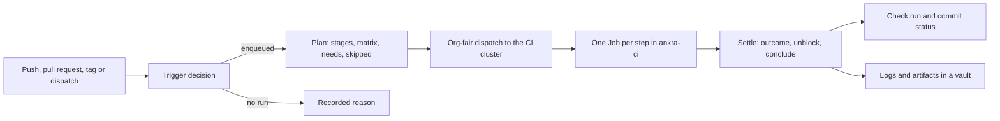

import { CliVersion } from "/snippets/cli-version.jsx";

Ankra Pipelines runs a repository's CI as Kubernetes Jobs inside a cluster you already operate through Ankra. One file, `.ankra/pipeline.yaml`, declares the triggers and the stages. A push, a pull request or a tag starts a run, every in-cluster stage runs as a hardened Job in the `ankra-ci` namespace of your CI cluster, and the result lands as an `Ankra pipeline` check on the commit.

This page takes one repository from connected to a finished run, then covers what you need while it runs: capacity, placement, failures and limits. For a shorter first walk-through, follow [Get started with Ankra CI](/get-started/ankra-ci). For how the parts fit together, read [How Ankra Pipelines works](/pipelines/how-it-works). Every key of the file is in the [pipeline.yaml reference](/guides/pipeline-reference).

## Before your first run

Three of these stop a run before anything is dispatched. The fourth lets the run go ahead and strips every protected section out of it.

- **A connected repository.** The repository reaches Ankra through the [Ankra GitHub App](/integrations/github), GitLab or [Bitbucket Cloud](/integrations/bitbucket-cloud), so Ankra receives its webhooks. A Bitbucket Cloud repository starts pull request runs only once its credential grants Bitbucket's `pullrequest` scope - see [Granting the pull request permission](/integrations/bitbucket-cloud#granting-the-pull-request-permission). An [Application](/concepts/applications) connects its repository to Ankra Pipelines by itself; a repository with no application connects with one command (step 1).
- **A cluster that runs pipelines.** Ankra picks the cluster for each run in this order: the cluster the repository overrides it to, a member of the organisation's CI pool, the organisation's pipeline cluster (`ci_cluster_id`), the staging cluster the organisation nominated for AI work, a cluster a person confirmed as non-production, then the organisation's playground. With none of them, a provider event records `no_ci_cluster` and nothing runs.
- **Pipeline-step workers on that cluster.** The cluster's agent runs pipeline steps only when its `ci_worker_count` is above `0`. An agent at `0` does not advertise the pipeline job names, so Ankra refuses a step for that cluster before it is dispatched (step 2). A playground starts at `2`. So does a new cluster of the organisation's own when all three of these hold:
  - A person chose its environment when creating it, for example in the portal, or with `--environment` from their own CLI login or API token.
  - Neither the environment nor the criticality is production. With `--environment`, a name of your own counts as production unless you also pass `--criticality`.
  - No other cluster of the organisation's own has a pipeline worker count above `0` when the new cluster is set up. Playgrounds do not count. Stopped clusters do.

  Otherwise a new cluster starts at `0`. That includes a cluster created without naming its environment, and one created over MCP or by a service account, because nobody confirmed what those are for (rule 5 in [Where pipelines run](/pipelines/where-pipelines-run)). Confirming what a cluster is for later does not add workers. Neither does naming the environment in a file for `ankra cluster apply`, which sets it after the import. Add them with `ankra cluster agent ci set` (step 2).
- **An approved definition.** A pipeline's protected sections (its `secrets`, `credentials`, `permissions`, network tier, placement, resources, timeout, caches, `services`, a stage's `with:`, a `kind: deploy` stage's `environment` and `deploy` block, `publish.promote_from` and a `kind: environment` stage's `test_environment` and `matrix`) carry no authority until a member with `pipelines.manage` approves the definition on the default branch. Until then a run executes with **none** of them, and the check run and the pull request comment say: "No administrator has approved any authority for this repository yet, so this run executes with none." (step 5).
- **For check runs, `checks:write`.** Without it the GitHub App cannot create a check run, and the run's status goes into a comment on the pull request instead. The comment names the missing permission.
- **Permissions.** Connecting a repository, storing a definition and approving it need `pipelines.manage`. Running, cancelling and re-running need `pipelines.operate`. Changing the organisation's CI settings needs an organisation owner or admin: the **Builds and clusters** page tells everyone else "Your role in &lt;organisation&gt; can look at these settings but not change them. Owners and admins can."

You do not need a bucket. A `scan` stage's reports, the findings a `gate` reads, the complete step log and every declared artifact are objects, and an organisation with no ready [backup vault](/concepts/backup-vaults) of its own keeps them in an Ankra-managed default vault, under a key prefix of its own, with the same retention and the same download links. A ready vault of your own takes over from the next step onward; register one when the objects must live in a bucket you own, and see [Backups](/guides/backups) for how.

## Connect a repository, push, see the run

<CliVersion since="0.74.0" />

<Steps>
  <Step title="Connect the repository">
    An Ankra Application connects its repository when you create it, and its setup pull request commits `.ankra/pipeline.yaml` unless the repository already carries an Ankra-authored workflow or you asked for `github_actions`. A monorepo gets one file, with each component's stages suffixed by its name. To connect an existing application, or a repository with no application:

    <Tabs>
      <Tab title="Portal">
        1. Open **Applications → &lt;your application&gt; → Pipelines**.
        2. In **Connect this repository to pipelines**, choose the **Source connection** that reads the repository and press **Review pipeline connection**.
        3. In **Connect pipeline repository**, press **Confirm pipeline connection**.

        The view now shows **Repository connected**. Connecting reads `.ankra/pipeline.yaml` and reports whether it is ready to run; it does not run a pipeline.
      </Tab>
      <Tab title="CLI">
        ```bash
        ankra pipeline repositories connect --provider github --owner my-org --name my-repo --credential my-github
        ankra pipeline repositories list
        ```

        `--application <id>` links the repository to an existing application without changing what that application deploys. `--cluster <cluster-id>` sends this repository's runs to one cluster instead of the organisation's, and turns that cluster's pipeline workers on when it has none; change it later with `ankra pipeline repositories set-cluster <repository-id> --cluster <cluster>`, which does the same.
      </Tab>
      <Tab title="API">
        ```bash
        curl -X POST https://platform.ankra.app/api/v1/org/pipelines/repositories \
          -H "Authorization: Bearer <your-token>" \
          -H "Content-Type: application/json" \
          -d '{"provider": "github", "owner": "my-org", "name": "my-repo", "default_branch": "main"}'
        ```

        For Bitbucket Cloud, send `"provider": "bitbucket_cloud"`, the workspace as `owner`, the repository slug as `name` and the Bitbucket credential as `credential_name`; Ankra registers the repository's webhook with that credential.
      </Tab>
    </Tabs>

    For a **GitHub** repository, Ankra reads the committed `.ankra/pipeline.yaml` on the default branch in the same call and stores a valid file as the definition of record. GitLab and Bitbucket Cloud repositories connect with no definition; store one with `ankra pipeline definition put` (step 4). Connecting a repository the organisation already connected answers `409` with the existing repository's id. `ankra pipeline repositories disconnect <repository-id>` removes it, and is refused while a run is live.

    **Check:** `ankra pipeline repositories list` lists the repository. A repository with no application has its own page at `/next/pipelines/<repository-id>`.
  </Step>
  <Step title="Choose the cluster that runs pipelines and turn on its workers">
    <Tabs>
      <Tab title="Portal">
        1. Open **Build & delivery → Builds and clusters**.
        2. Under **Where pipelines run**, choose the **Cluster**, set **Runs at the same time** and **Steps at the same time, in one run**, and press **Save changes**. The page says "Saved. The next pipeline run uses these settings. Runs already going finish where they are."
        3. If the cluster's agent runs no pipeline workers, Ankra turns two on when you save. The cluster's row in **CI clusters** says **Starting** until its agent reports them.

        **CI clusters** lists each cluster with its **Build slots**, **CPU on CI nodes** and **Memory on CI nodes**. **Add a cluster** adds another cluster to share the work, and turns its pipeline workers on the same way. Once you pick one, the dialog says whether it can take runs now, how many pipeline workers its agent runs, which nodes its steps run on (a production cluster without a CI node label shares its nodes with what it serves), and its share of new runs at that weight. A cluster without an Ankra agent cannot be added. Each row's **Change weight…** sets its share of new runs, **Make it the main cluster…** makes it the cluster pipelines run on, and **Stop running pipelines here…** takes it out; runs already going there finish there. Taking out the main cluster makes the next cluster main, one that can run steps first. A row whose agent runs no pipeline workers has **Turn on pipeline workers**.
      </Tab>
      <Tab title="CLI">
        ```bash
        ankra org ci-settings set --cluster my-cluster
        ankra cluster agent ci get --cluster my-cluster
        ```

        If the cluster's agent runs no pipeline workers, Ankra turns two on. To run more steps at once, `ankra cluster agent ci set --workers 8 --cluster my-cluster`.

        `ankra org ci-settings pool add <cluster> --weight 100` adds a cluster to the organisation's CI pool instead, and turns its workers on the same way; new runs go to the least loaded member for its weight. `ankra org ci-settings pool remove <cluster>` takes one out, the pipeline cluster included: the next member then becomes the pipeline cluster.
      </Tab>
    </Tabs>

    The worker count is a setting Ankra holds for the agent, not a chart value you apply yourself: Ankra hands it to the agent through the agent's own upgrade lane. An agent that can resize live applies it within seconds; an older one re-renders its release, at once when it is online and at its next upgrade otherwise, and `ankra cluster agent ci set` says which happened. Never `helm upgrade` the agent to set it, because the next reconcile overwrites a hand-set value. The agent creates the `ankra-ci` and `ankra-ci-build` namespaces on first use, with their Pod Security labels, a `ResourceQuota` and a `LimitRange`; see the [agent Helm values](/reference/agent-helm-values).

    **Check:** `ankra cluster agent ci get --cluster my-cluster` shows a worker count above `0`, and the cluster's row in **CI clusters** shows its build slots.
  </Step>
  <Step title="Write and validate .ankra/pipeline.yaml">
    A pipeline for a Go service that tests, builds, scans, gates and publishes. `build` produces a digest in a rootless BuildKit pod, `scan` runs Trivy, Semgrep and Checkov against that digest and your source, `gate` judges what they found against your organisation's policy, and `publish` re-tags the one digest `gate` approved into your real repository. For the file Ankra writes for an application, see [Generated pipelines](/pipelines/generated-pipelines).

    ```yaml
    apiVersion: ankra.io/v1
    kind: Pipeline
    metadata:
      name: "orders-api"
    on:
      push:
        branches:
          - "main"
      pull_request:
        branches:
          - "main"
        fork_policy: "read_only"
    concurrency:
      group: "${{ ankra.repository.provider }}:${{ ankra.repository.owner }}/${{ ankra.repository.name }}-${{ ankra.ref }}"
      cancel_in_progress: true
    workspace:
      size: "10Gi"
      access: "rwo"
    defaults:
      image: "golang:1.26"
      timeout: "30m"
      network: "egress-https"
    permissions:
      contents: "read"
    stages:
      - name: "checkout"
        kind: "checkout"
      - name: "test"
        kind: "run"
        image: "golang:1.26"
        run: "go run gotest.tools/gotestsum@v1.13.0 --format testname --jsonfile test-results.json -- ./..."
        needs:
          - "checkout"
        test_results:
          - format: "go-test"
            path: "test-results.json"
      - name: "build"
        kind: "build"
        needs:
          - "test"
        build:
          dockerfile: "Dockerfile"
          platforms:
            - "linux/amd64"
          provenance: true
          sbom: true
      - name: "scan"
        kind: "scan"
        needs:
          - "build"
        scan:
          scanners:
            - "semgrep"
            - "checkov"
            - "trivy"
          fail_on:
            semgrep: "error"
      - name: "gate"
        kind: "gate"
        needs:
          - "scan"
        gate:
          require_stages:
            - "scan"
      - name: "publish"
        kind: "publish"
        with:
          image: "registry.example.com/my-org/orders-api"
        needs:
          - "gate"
        when:
          events:
            - "push"
    ```

    `fail_on` reads per scanner and only tightens the gate: `semgrep: "error"` raises Semgrep's floor to `error`. Nothing a pull request writes there can loosen the organisation's `ci_image_gate` policy.

    ```bash
    ankra pipeline validate --application my-service
    ```

    `validate` reads `.ankra/pipeline.yaml` from the current directory (or the file you name), plans it for a synthetic push and a synthetic pull request, and prints the steps that would run, the stages that would be skipped and why, and every diagnostic. `--repository <repository-id>` validates for a repository with no application. Ankra AI's `cicd_validate_pipeline_yaml` tool, in chat or through the [MCP server](/platform/mcp-server), answers the same way.

    **Check:** the output's `Severity:` line reads `ok`, `advice` or `warn`. The fourth severity, `fatal`, means the file cannot be planned: the command ends with "the pipeline definition has fatal violations", so fix it before you commit. `advice` never blocks a run. A `warn` is worth reading: a stage whose `kind` has no executor reports one, and that stage will be skipped.
  </Step>
  <Step title="Store the definition, commit and push">
    ```bash
    ankra pipeline definition put .ankra/pipeline.yaml --application my-service
    git add .ankra/pipeline.yaml && git commit -m "Add the Ankra pipeline" && git push
    ```

    `definition put` needs `pipelines.manage` and stores the definition in Ankra; it does not touch the repository. On **GitHub**, a run plans its logic from `.ankra/pipeline.yaml` at its own head commit, so editing the file in a pull request takes effect on that pull request's next run. On **GitLab** and **Bitbucket Cloud** the stored definition is what runs, so keep it identical to the committed file. Either way the run's *authority* comes from the default branch's approved definition, never from the head file (see [Logic is open, authority is closed](#logic-is-open-authority-is-closed)).

    **Check:** `ankra pipeline definition get --application my-service` prints the file you stored.
  </Step>
  <Step title="Approve the definition's protected authority">
    Do this once per definition, and again whenever a protected section changes on the default branch. A run whose definition asks for protected settings nobody approved raises an **authority request**.

    <Tabs>
      <Tab title="Portal">
        1. Open **Build & delivery → Builds and clusters**. **Pipeline settings waiting for approval** lists every request, with the **Repository** and who asked.
        2. Press **Review** on the request. The dialog compares each protected setting under **Approved now** and **Asks for**.
        3. Press **Approve these settings**, or **Dismiss** with a reason under **Why these settings should not be used**.

        From a run, **Review authority for approval** opens **Review pipeline authority**, where **Approve for future runs** does the same. It then reads "Approved. Future runs on the default branch use these protected settings." An administrator whose GitHub account is linked to their Ankra profile can also press **Approve authority** on the GitHub check run.
      </Tab>
      <Tab title="CLI">
        ```bash
        ankra pipeline authority list
        ankra pipeline authority get <request-id>
        ankra pipeline definitions get <definition-id>
        ankra pipeline definitions approve <definition-id>
        ```

        `authority get` prints the definition id to approve. `definitions get` prints the definition's protected hash and whether it is the approved one. `ankra pipeline authority dismiss <request-id> --reason "<why>"` declines a request; the run's check and run page then show the reason.
      </Tab>
    </Tabs>

    Approving needs `pipelines.manage` and a **human actor**: a token of an organisation service account is refused with `403` "A pipeline definition's authority can only be approved by a human administrator", and so is Ankra AI or any automation acting through one, because approving grants the permissions, credentials, secrets, network tier and compute the definition declares. The CLI signed in as you approves as you. Only the repository's *current* default-branch definition can be approved, and only once; a definition the default branch has moved past, or one already approved, answers `409`. A run does not wait for an approval: until one lands it runs without the protected sections. Approving re-runs the newest such run of each open pull request and each branch, never a merge train car's run. A definition that declares no protected section needs no approval.

    **Check:** the request leaves **Pipeline settings waiting for approval**, and `ankra pipeline get <run-id>` prints `Authority: approved` for the next run.
  </Step>
  <Step title="Watch the run">
    The push you made starts a run. To start one by hand:

    <Tabs>
      <Tab title="Portal">
        Open **Applications → &lt;your application&gt; → Pipelines**, press **Run pipeline**, enter the **Branch or reference** (and, under **Commit and inputs**, an optional **Commit SHA (optional)**), press **Review pipeline run** and confirm. The run appears at the top of **Runs**; open it for its steps, logs, tests and evidence.
      </Tab>
      <Tab title="CLI">
        ```bash
        ankra pipeline run --wait
        ankra pipeline list
        ankra pipeline logs <run-id> --step test --follow
        ```

        Inside a checkout, the CLI reads the application bound to your `origin` remote and the commit at `HEAD`, and says which it used. Outside a checkout, or for another commit, name them: `ankra pipeline run --application my-service --sha "$(git rev-parse HEAD)" --wait`. `--wait` follows the run to its conclusion and exits non-zero on anything but `success`.
      </Tab>
    </Tabs>

    Ankra resolves the reference through the repository's own host before writing anything, and accepts a commit only when it is that reference's current tip or, on GitHub, a provable ancestor of it. GitLab and Bitbucket Cloud have no compare read, so a commit you name there must be the exact tip.

    `ankra pipeline logs` prints a concluded step's complete log in one shot, from its archive or else from the platform's retained log stream. A running step is followed live; `--follow` reconnects through a dropped stream, and `--replay` prints what the step already produced before following it.

    **Check:** on GitHub the commit carries an `Ankra pipeline` check with a step table and a **Cancel** button, and on a pull request the run fills the `pipeline` section of Ankra's status comment. A repository with no application shows the run at `/next/pipelines/<repository-id>/runs/<run-id>`.
  </Step>
  <Step title="Wait on a run a push or pull request started">
    A push or pull request webhook starts most runs, so a CI job that waits for the result holds no run id. `ankra pipeline get` selects the run by what the job does know: `--head-sha` (the full sha), `--branch` and `--trigger` narrow it, and `--latest` takes the newest match. Several matches without `--latest` are refused and listed (exit `2`); no match is exit `3`.

    ```bash
    ankra pipeline get --head-sha "$(git rev-parse HEAD)" --trigger pull_request --latest --wait --timeout 45m
    ```

    `--wait` blocks until the run concludes and prints its final detail. Under `--wait` or `--watch` a selection that matches nothing yet waits for the run to appear, up to `--timeout` or ten minutes. On GitHub Actions, a `pull_request` job's checkout is a merge commit, so pass `${{ github.event.pull_request.head.sha }}` there instead of `git rev-parse HEAD`.

    `--watch` prints each run and step state change until the run concludes; with `-o json` that is one JSON object per line (`event`, `observed_at`, `pipeline_run_id`, `run_number`, `step_key`, `status`, `previous_status`, `outcome`, and the whole `run` or `step` object), and the run's conclusion is always the last line.

    **Check:** with `--wait` or `--watch` the exit code is the verdict: `0` when the run succeeded, `1` when it concluded any other way or the platform could not be read, `5` when `--timeout` ran out. A plain `get` exits `0` whatever the outcome; add `--exit-code` to branch on it without waiting.
  </Step>
</Steps>

To deploy what `publish` produced after a merge, follow [Deploy on merge from an Ankra pipeline](/pipelines/deploy-on-merge).

## How a run happens



1. **Trigger.** A verified delivery from GitHub, GitLab or Bitbucket Cloud, or a dispatch from the portal, the CLI, the API or an agent, is decided in a fixed order: is the repository connected, is the head trusted, is there a cluster, is there a definition, does `on:` accept the event. Every answer is recorded, so a push that started nothing still says why ([the reason tokens](/guides/pipeline-reference#triggers-and-reasons)).
2. **Plan.** On GitHub the planner reads `.ankra/pipeline.yaml` at the run's head commit for the run's logic, and falls back to the stored definition with a diagnostic if the read fails; on GitLab and Bitbucket Cloud the stored definition runs. A dispatch that carries its own definition (`--spec-file`) outranks both. Protected authority is resolved separately, never from the head file or an override. The planner then builds the step graph: which stages survive the filters, how a matrix fans out (at most 64 legs per stage), what each step needs. A filtered stage is recorded with its reason, and a run whose every stage is filtered out concludes `skipped`.
3. **Dispatch.** Steps are claimed fairly across organisations, never first in, first out (see [Capacity and concurrency](#capacity-and-concurrency)). Dispatch evaluates a step's deferred `if:` and interpolates its `${{ steps.<key>.outputs.<name> }}` and `needs.<stage>.*` references; a false condition concludes the step `skipped` and an unresolvable reference concludes it `infra_error`, both before any secret is revealed. Declared secrets and credentials become one-time, per-step reveal grants, never part of the payload.
4. **Run.** The agent renders the step's own Kubernetes objects from the signed payload and runs a hardened Job. Output streams live; the complete log and the declared artifacts are uploaded when the step concludes, to the organisation's oldest ready backup vault or the Ankra-managed default vault.
5. **Settle.** The settle loop records the verdict, unblocks what waited and concludes the run. Only Ankra's own failures are retried, once. A concluded `build` step's digest becomes the application's build observation, so push-to-deploy and previews read a pipeline-built image. `gate` reads the run's persisted findings against your policy and records the digest it judged; `publish` re-tags that digest as `sha-<7>` and refuses if the build's digest differs or the gate recorded none.
6. **Report.** The `Ankra pipeline` check run (or commit status) is updated on every change. On Bitbucket Cloud each kind of run keeps its own commit status key: `ankra/pipeline` for a push, `ankra/pipeline/pull-request`, `ankra/pipeline/tag`, `ankra/pipeline/dispatch` and `ankra/pipeline/schedule`. `pipeline_run_failed`, `pipeline_run_succeeded`, `image_gate_blocked`, `preview_ready` and `preview_failed` are notification kinds your [routing rules](/guides/notification-routing) can send anywhere.

<Note>
**A build you start by hand does not go through the gate.** A pipeline build stages the digest under `ankra-ci/<application>/<component>`, and `publish` re-tags it into `<application>/<component>` only after `gate` has judged it. `ankra application build start` publishes straight to `<application>/<component>`, with no `scan` and no `gate`. Use it as the recovery route when the pipeline itself is broken, and let the pipeline publish anything you intend to keep.
</Note>

### Which component a build belongs to

A `kind: build` stage of an application's pipeline belongs to one of the application's components, and that decides where it pushes and where `publish` re-tags it. Ankra reads it in this order:

1. **`build.component`**, when the stage declares it. The value is the name of a component the application records.
2. **The stage name**, otherwise: a stage called `build-<component>` belongs to that component.
3. **The application's one component**, for a single-component application, whatever the stage is called.

Declare `build.component` when one component has more than one build, or when you want to name a stage for what it builds. A typical case is a component that ships both a container image and a release bundle:

```yaml
stages:
  - name: build-portal          # release bundle for host deploys, attributed by its name
    kind: build
    build:
      bundle:
        path: dist/portal
        manifest: deploy/portal/ankra-release.yaml
  - name: build-portal-image    # container image for Kubernetes, attributed explicitly
    kind: build
    build:
      component: portal
      dockerfile: portal/Dockerfile
      context: portal
  - name: build-node-agent      # release bundle that belongs to no component
    kind: build
    build:
      bundle:
        path: dist/node-agent
        manifest: deploy/node-agent/ankra-release.yaml
```

Each stage pushes to its own repository, so an image and a bundle of the same commit never overwrite each other's `sha-<7>` tag:

| The stage builds | It publishes to |
| --- | --- |
| an image of a component | the component's repository, `<application>/<component>` |
| a release bundle of a component | the component's bundle repository, `<application>/<component>-bundle` |
| a release bundle that belongs to no component | `<repository>/<stage suffix>`, for example `<repository>/node-agent` |

An image has to belong to a component, because a deploy of the application only reads component repositories. In a repository with no linked application, `build.component` has no effect, and every stage publishes as `<repository>/<stage suffix>`.

`ankra pipeline validate` checks the stages against the application before a run. It reports a stage that belongs to no component, a `build.component` the application does not record, and two stages that would publish to the same repository: fatal when both always run, a warning when one runs only under a condition. The components come from the application's [`.ankra/ankra.yaml`](/reference/application-descriptor#components) when it declares them. A run that reaches a stage it cannot attribute concludes the step `step_refused`, listing the components the application records.

### Monorepo: PR-only checks, full builds on push

A monorepo usually wants a pull request to check only the components it touches, while a push to the default branch builds everything. Write **one stage per component**, and give each stage an [event-scoped `when`](/guides/pipeline-reference#event-scoped-filters) block: the pull request filters on paths, and the push does not.

```yaml
on:
  push:
    branches: [main]
  pull_request:
    branches: [main]

stages:
  - name: checkout
    kind: checkout
  - name: test-web
    kind: run
    image: node:22
    run: pnpm -C web test
    needs: [checkout]
    when:
      pull_request:
        paths: ["web/**", "packages/ui/**", ".ankra/**"]
      push: {}
  - name: test-api
    kind: run
    image: golang:1.26
    run: go test ./...
    working_directory: api
    needs: [checkout]
    when:
      pull_request:
        paths: ["api/**", "go.work", ".ankra/**"]
      push: {}
  - name: report
    kind: run
    image: alpine:3
    run: ./scripts/summarise.sh
    needs: [test-web, test-api]
    if: always()
```

A pull request that touches only `web/` runs `checkout` and `test-web`; `test-api` is skipped as `path_filter`. A push to `main` runs every stage. Put the pipeline file (`.ankra/**`) in each list so a change to the pipeline checks everything.

- A pull request's changed files are read from your provider when the run is triggered, up to 300 paths. When they cannot be read, or the change is larger, no stage is skipped for its paths, and the run's `paths_unverified` says why.
- A stage that needs a skipped stage is skipped too. To run it anyway, name the skipped stage in [`skippable_needs`](/guides/pipeline-reference#fields-common-to-every-stage), or give it an `if:` with a status function such as `always()`, so `needs.test-api.result` reads `skipped`.
- `ankra pipeline validate --changed-file web/app.ts` prints each stage against push and pull request for that change.
- Write each list once under [`path_sets:`](/guides/pipeline-reference#path-sets) and use `{set: <name>}` where the list was.

### Affected-only stages: skip what a change did not touch

A stage with `paths:` is **affected-only**: when no changed file matches, it is skipped as `path_filter` and the stages that need it run without it, waiting on what it waited on. A change to `web/` then skips the API's tests and still builds, scans, gates and, on a push, publishes.

```yaml
stages:
  - name: checkout
    kind: checkout
  - name: test-web
    kind: run
    image: node:24
    run: pnpm -C web test
    needs: [checkout]
    paths: ["web/**", "packages/ui/**", ".ankra/**"]
  - name: test-api
    kind: run
    image: golang:1.26
    run: go test ./...
    working_directory: api
    needs: [checkout]
    paths: ["api/**", "go.work", ".ankra/**"]
  - name: build
    kind: build
    needs: [test-web, test-api]
    build:
      dockerfile: Dockerfile
  - name: scan
    kind: scan
    needs: [build]
    scan:
      scanners: [semgrep, trivy]
  - name: gate
    kind: gate
    needs: [scan]
    gate:
      require_stages: [scan]
  - name: publish
    kind: publish
    needs: [gate]
    with:
      image: registry.example.com/my-org/shop
    when:
      events: [push]
```

- **`paths:` or `when.paths`.** `when.paths` also skips the stages behind the stage it leaves out, which suits a component's whole chain (build, scan, gate and publish together). `paths:` is for a stage whose absence should hold nothing back. A stage declares one of them, never both.
- **Every event.** `paths:` applies to pushes as well as pull requests. For "pull requests check what they touch, pushes check everything", use the [event-scoped `when`](#monorepo-pr-only-checks-full-builds-on-push) recipe.
- **What it refuses.** `ankra pipeline validate` refuses (`pipeline_paths:`) `paths:` on a stage whose outputs another reads, on a `build` another stage needs, on a `checkout`, `gate` or `approval`, and on a scan a gate names in `require_stages`. It warns about an affected-only scan and an affected-only `deploy`, `publish` or `preview` that another stage needs.
- **When the change cannot be seen** (no change list, or more than 300 files), no stage is left out, and `paths_unverified` says why.

How much time skipping saves is on **Build & delivery → Builds and clusters** under **CI time saved by skipping unchanged work**, and in `ankra pipeline time-saved`. See [Fast CI](/pipelines/fast-ci) for the other ways to shorten a run.

### Affected from the dependency graph: `affected:`

Path globs miss a package a stage's tests import from elsewhere in the repository. `affected:` names the packages instead of the files, and Ankra follows their imports.

```yaml
stages:
  - name: checkout
    kind: checkout
  - name: test-api
    kind: run
    image: golang:1.26
    run: go test ./...
    working_directory: api
    needs: [checkout]
    affected:
      go: ["./..."]
    paths: ["migrations/**"]
  - name: test-web
    kind: run
    image: node:24
    run: corepack enable && pnpm install --frozen-lockfile && pnpm --filter @acme/web... test
    needs: [checkout]
    affected:
      pnpm: ["@acme/web"]
  - name: build
    kind: build
    needs: [test-api, test-web]
    build:
      dockerfile: Dockerfile
```

A stage with `affected:` runs when a changed file is in the dependency graph of what it names, its tests included, or matches its `paths:`. Otherwise it is skipped as **not affected**, and the stages that need it run without it.

- **`go`** names Go packages the way the stage's own `go test` does: `./...` and `./internal/api` are read from the stage's `working_directory`, and an import path such as `example.com/shop/libs/...` works too. Ankra reads every `go.mod` in the repository, so a module another pulls in through a local `replace` directive counts. A change to `go.mod`, `go.sum` or `vendor/` reaches every package of that module.
- **`pnpm`** names workspace packages by name (`@acme/web`) or by directory (`./apps/web`). A dependency on another workspace package, by name, `workspace:` alias or `file:` path, is followed. A change to a root file such as `pnpm-lock.yaml`, the root `package.json` or `pnpm-workspace.yaml`, or to a pnpm patch (any file under `patches/` and any `.patch` file), reaches every pnpm stage. These root files do not: `*.md`, any file whose name starts with `LICENSE`, `LICENCE` or `CHANGELOG` in any case, `.gitignore`, `.gitattributes`, `*.go`, `go.mod`, `go.sum`, `go.work` and `go.work.sum`.
- **`paths:` beside `affected:`** adds files no import graph sees: migrations, fixtures a test opens by path, a script the stage runs.
- **Where the graph comes from.** The run's checkout step reads the graph of the exact commit it checked out and records an answer for each stage. The planner decides only what it can without the code: a change list it could not read in full, a change to `.ankra/pipeline.yaml` or a matching `paths:` glob runs the stage.
- **A skip needs an answer.** No answer (a pattern that names nothing, an analysis that failed or took over two minutes) runs the stage, and the checkout's log says why. A pipeline with no checkout stage never reads the graph: its `affected:` stages run on every change, and `ankra pipeline validate` warns (`pipeline_paths:`).
- **A skip never waits for capacity.** A not-affected stage concludes as soon as the checkout has answered, and the time it saved is recorded with reason `not_affected`.
- **Promotion.** A merge that [promotes](/guides/pipeline-reference#promote-a-tested-image-instead-of-rebuilding) the pull request run's image counts a stage that run skipped as not affected, when the merge changes no file that run's graph was not asked about.
- **The same refusals as `paths:`.** `affected:` makes a stage affected-only, so it is refused where a skip would be unsafe.
- Inside your checkout, `ankra pipeline validate --changed-file libs/auth/token.go` reads the same graph from your working tree and shows which stages the change reaches.

### Newest commit wins

A `concurrency.group` decides which runs serialise. `cancel_in_progress` decides what happens when a newer one arrives: with it, the new commit supersedes the run it replaces; without it, the new run waits for the older one to finish.

A definition with no `concurrency` block runs under a group Ankra gives it, one per repository and reference, so two pushes to one branch run one after the other while runs on different branches never wait on each other. Declaring a `group` replaces that default.

```yaml
concurrency:
  group: "${{ ankra.repository.provider }}:${{ ankra.repository.owner }}/${{ ankra.repository.name }}-${{ ankra.ref }}"
  cancel_in_progress: true
```

Every pipeline Ankra generates ships exactly that. A definition you wrote keeps whatever it says, and Ankra tells you when a branch would queue behind itself:

- `ankra pipeline validate` reports `pipeline_concurrency_queues_behind:` at severity `advice`, naming the group and the line that changes it.
- A queued run whose `Waiting:` line names an older run of the *same* branch or pull request carries the same recommendation.
- A pipeline [converted from a GitHub Actions workflow](/guides/migrate-from-github-actions) keeps the workflow's own queueing, with a conversion note recommending the flag.

A branch whose every commit must end in a verdict, such as the default branch that deploys, wants the opposite of a pull request. Each flag can be one expression settled per run, for example `cancel_in_progress: "${{ event.kind != 'push' }}"` with `cancel_queued: "${{ event.kind == 'push' }}"`. See [A concurrency policy per event](/guides/pipeline-reference#a-concurrency-policy-per-event).

Superseding is a soft stop. The older run concludes as cancelled and shows as **Superseded**, the commit status it leaves is neutral rather than failed, and no failure notification is raised for it.

## What a pull request gets

A connected pull request carries one comment from Ankra, with `pipeline`, `preview` and `review` sections that each update in place: the run's own state (plus the authority sentence whenever the run executed under anything but the plainly approved definition), the throwaway environment deployed from the run's digest, and Ankra AI's verdict on the diff. See [AI in pull requests](/pipelines/ai-in-pull-requests).

### The review reads your pipeline, not just GitHub Actions

Ankra's pull request review reads the newest pipeline run of the reviewed commit first, and falls back to GitHub's own check runs only for an application whose build authority is its own CI or the generated workflow, or for a head no pipeline run has touched. From a pipeline run, the review reads:

- the failing step's name, kind and error message, when the run is failing (not its log, which stays behind `ankra pipeline logs`)
- the run's scan findings, by tool and severity, with the highest-severity findings named
- the `gate` step's verdict and blocking count, once one has concluded
- the `build` step's image digest, once one has concluded
- the authority sentence, when the run executed under anything other than the plainly approved definition

The branch **Code review** lane (no pull request, see [Application AI Settings](/platform/application-ai)) does not read these; only the pull request review does.

### A human can say "merge when green"

Mention **`@ankraai merge when green`** in a pull request comment, ask Ankra AI in chat, or call the API, and Ankra watches the pull request and squash-merges it the moment every condition holds:

- the requester is an active member holding **`pipelines.operate`**, and the binding's [AI mode](/integrations/github#ask-ankra-in-a-comment) is **Agent**; in **Ask** mode the request is refused, naming the setting
- the GitHub login that commented is linked to that member through an **OAuth-verified** identity; a login claimed by hand, or filled in from an Auth0 GitHub sign-in, does not count, and a service principal is refused
- the requester still holds `pipelines.operate`, is still a member and still verified when the merge happens, not only when the comment was written
- the pull request's head is not a fork
- the newest pipeline run for the head succeeded, and its `gate` step, if the definition declares one, passed
- the run executed under plainly approved authority
- Ankra's own review has not requested changes on that commit
- no human reviewer's most recent review is **Changes requested**, on any earlier push too, until that reviewer clears it

The request expires 24 hours after it is made, and a new push invalidates it. Every refusal is posted once, naming the condition that failed. Merge when green works on GitHub only: a request against GitLab or Bitbucket Cloud is accepted and then refused.

### The merge train: test every pull request as it will merge

The merge train tests each pull request **as the commit its merge will produce**, on top of everything ahead of it, and then merges it through GitHub's own squash merge. Turn it on and add a pull request:

```bash
ankra pipeline train enable --application orders-api
ankra pipeline train add 412 --application orders-api
ankra pipeline train list --application orders-api
```

A car's run is planned as a pull request into the base branch, so `on.pull_request` must match the base branch, and push-only `publish` and deploy stages do not run on it. A `publish` that declares [`promote_from: pull_request`](/guides/pipeline-reference#promote-a-tested-image-instead-of-rebuilding) re-tags the car's tested image on the merge instead of building again. Ankra posts an **Ankra merge train** check on every pull request it holds; make it required on the base branch so every merge goes through the train. The train works on GitHub only.

[The merge train](/pipelines/merge-train) is the canonical page: cars and batches, what happens when a car fails or someone merges around the train, auto-admit, stacked pull requests, moving a pull request to the front, and merges GitHub declines.

### Chat watches a run, and a failed build gets a fix

Ask Ankra AI to watch a run, or to dispatch one, and the `watch_pipeline_run` tool wakes the same conversation when the run concludes, with the failing step, a bounded tail of its log, the findings and the gate verdict. Separately, a failed `build` step (a genuine script failure, not `infra_error`, a stranded step or a policy refusal) on a **direct push** to the tracked branch, in **Agent** mode, dispatches an auto-fix mission with a log excerpt as evidence. A failed build on a **pull request** never gets an unattended commit: its diagnosis goes into the status comment's `pipeline` section, pointing at Agent mode's **Propose a fix** on the [pull request review](/integrations/github#ask-ankra-in-a-comment).

A red run is not always a verdict on the change. A run can be stopped before any step tests it: no node had room for a step, the build cluster's agent had stopped checking in, or Ankra ended a step before it ran. Ankra AI is then told so, with the step and the cause, and asked to commit nothing: no fix, and no change to the pipeline definition to get past it. It tells you the checks could not run and why. Run the same commit again once the cause is cleared.

An [agent run](/guides/agent-runs) that watches a run waits for it. It gets no new turn until the run concludes, and its next turn starts with the result. When the newest run for its commit tested nothing, the agent run is told to stop and report what stopped the checks, so a person can clear the cause.

## What is in place today

These stage kinds execute: `checkout`, `run`, `build`, `scan`, `gate`, `publish`, `deploy` and `environment`. Every other kind validates with a warning (severity `warn`) and is skipped with reason `kind_unavailable`, so a run that declares one still concludes:

| Stage kind | What happens |
| --- | --- |
| `checkout`, `run` | A hardened Job in `ankra-ci` on your CI cluster |
| `build` | A rootless BuildKit pod in `ankra-ci-build`, pushing by digest to the organisation's CI staging repository, or [Ankra platform builders](#ankra-platform-builders) when your cluster cannot build |
| `scan` | Trivy, Semgrep and Checkov, one step per tool, from pinned images |
| `gate`, `publish` | Settled by Ankra: `gate` judges the run's findings, `publish` re-tags the digest the gate judged |
| `deploy` | Releases the run's signed release bundle to host targets outside Kubernetes (see [`ankra targets`](/reference/cli/targets)); it does not deploy to a Kubernetes cluster |
| `environment` | A [test environment](/pipelines/test-environments) per matrix leg, inspected with `ankra pipeline environments` |
| `preview`, `verify`, `agent`, `approval`, `webhook`, `automation`, `ankra`, `external` | Skipped as `kind_unavailable`. An `approval` stage does **not** hold a run for a human: it is skipped and everything after it runs |

Not available on any surface:

- **`uses:`** - any `uses:` reference is fatal at validate time: "Reusable steps are not available yet; write the step as `run:`".
- **A step's own `retry:` block** is validated and stored, and never applied. Only Ankra's own failure classes retry (see [When something fails](#when-something-fails)).
- **Dynamic matrices** that fan out over a previous step's output; write every axis in the file.
- **A per-run identity from `permissions`**, so a step cannot call the `ankra` CLI with the run's own authority, and `cloud` and `object_storage` credentials are refused by name. `secrets: [{from: credential}]` validates and is not delivered.
- **Attestations on the deployed digest.** `build`'s `provenance` and `sbom` attest the digest it pushes to the CI staging repository; `publish` copies the image manifest only. Trivy's SBOM is an artifact in the vault, not an OCI referrer.
- **`::ankra::` annotations and metrics** in step output are not read. `$ANKRA_OUTPUT` key=value lines are, and so are [test reports](#test-results).
- **On GitLab and Bitbucket Cloud**: a run plans from the stored definition, never from the committed file at its own commit, and merge when green and the merge train are refused.

## When a run does not fit: the CI playground

When a run's largest step fits no node of its CI cluster, or a stage of the same repository failed on that cluster in the last seven days because it had no room (never scheduled, or killed at its memory limit) and has not succeeded there since, Ankra moves the run to a **CI playground**: a short-lived Ankra Cloud cluster it builds for the organisation's pipelines. Every run that needs one shares the organisation's one playground and queues for room on it like on any CI cluster.

- **What stays put.** A playground is one plain node with no runtime class. A run is never moved when one of its stages selects a node label the playground does not carry (`runs_on.node_selector`, such as a node pool of your own cluster, or another `runs_on.arch`) or names a `runs_on.runtime_class`. That stage could never be scheduled there.

- **What it costs.** A run whose largest step fits Ankra Cloud's trial plan goes to the organisation's free trial playground, one already running or a new one for an account that cannot pay but still has a trial; a trial is left to its own expiry. Otherwise, when the organisation's Ankra Cloud account can pay, it gets a billed playground at the smallest plan whose node fits the largest step, billed at that plan's price for as long as it exists and never more in a month than the plan's monthly price, and grows by one plan when a step still cannot be scheduled. When Ankra Cloud refuses the playground, such as an account with no card and no trial left, the run stays on its own cluster.
- **When it goes away.** A billed playground is torn down once no run has used it for `ci_playground_idle_minutes` (default 5, 0 to 1440).
- **Turning it off.** `ci_auto_playground` is on by default. Turn it off with `ankra org ci-settings set --auto-playground=false` (CLI 0.78.0 or later), or set it to `false` with `PUT /api/v1/org/ci-settings`, to keep every run on the cluster it resolved to. `--playground-idle-minutes` sets the idle time the same way. The portal has no field for either setting.

## Test results

A stage that runs tests can declare the reports its test command writes, and Ankra reads every test's outcome from them:

```yaml
  - name: "e2e"
    kind: "run"
    run: "pnpm test:e2e"
    artifacts:
      - name: "junit"
        paths:
          - "reports/junit"
    test_results:
      - format: "junit"
        path: "reports/junit"        # a file, or a directory of report files
```

After the step, the agent uploads each report like an artifact (named `ankra-tests.<n>.<format>` in the run's artifact list), and Ankra parses it. The step's exit code stays its verdict: a report Ankra cannot read never fails or passes the step.

| `format` | What to point it at |
|---|---|
| `junit`, `pytest` | JUnit XML: `go-junit-report` and `gotestsum --junitfile`, pytest `--junitxml`, Jest's `jest-junit`, Vitest's `junit` reporter, Maven Surefire, Playwright's `junit` reporter. A directory is read for every `.xml` file in it. |
| `playwright` | Playwright's JSON reporter (`reporter: [['json', { outputFile: 'results.json' }]]`). |
| `go-test` | `go test -json` output, or `gotestsum --jsonfile`. |

- **Your command writes the report.** `test_results` only names where it is: `gotestsum --jsonfile test-results.json -- ./...`, `pytest --junitxml=reports/junit.xml`, `vitest run --reporter=junit --outputFile=reports/junit.xml`. A path is relative to the workspace, not to the stage's `working_directory`.
- **List the same path under `artifacts:`.** Ankra uploads a declared report only when the stage also lists its path under `artifacts:`, as above. A report declared only under `test_results` is not uploaded, and the run's test summary says so.
- **Flaky tests.** A test that failed and then passed on a retry is recorded as `flaky`, with its attempts. Ankra reads retries from Playwright's JSON reporter, from Surefire's `flakyFailure`/`rerunFailure` elements, and from a test that appears more than once in one report (`gotestsum --rerun-fails`). Playwright's `junit` reporter writes retries only with `includeRetries: true`.

The run's **Tests** section lists failed tests first, then flaky ones, then the slowest. `ankra pipeline tests <run>` prints the same summary, `ankra pipeline tests history` one test's outcomes on the default branch with its flaky rate, and `ankra pipeline tests timings` each file's or test's mean duration, for balancing shards.

**Limits.** A report is at most 32 MiB, and a directory at most 256 report files and 64 MiB unpacked. At most 100,000 tests are read from one report, and 20,000 per report and 50,000 per run are stored, failed and flaky ones first. Failure messages are kept to 2,000 characters, and anything that looks like a credential is redacted. A report with a `DOCTYPE` is refused. Test results are kept as long as their run.

### Quarantining a flaky test

A quarantined test still runs and is still reported; a step whose **only** failed tests are quarantined passes. Quarantine is off on every repository until you turn it on, and only a member with `pipelines.manage` can change it.

A failing step passes because of the quarantine only when all of these hold:

1. It is a `kind: run` step that failed on its own (`step_failed`). A timeout, an infrastructure error, a refusal, and any build, scan, publish, deploy or verify step fail as before.
2. Quarantine is on for the repository.
3. The step declared at least one test report, and every one was uploaded and read whole.
4. The reports hold at least one failed test, and every failed test is quarantined.

A forgiven step reads as passed with a note of how many quarantined tests failed in it, and the run's test summary lists them under **Quarantined failures**. Write test steps so that a failure after the tests (a `;` instead of `&&`) fails the step on its own.

A test qualifies when, over your default branch's runs in the last 30 days, it ran in at least `min_samples` runs and was `flaky` in at least `min_flaky_rate` of them. It is released by hand, or on its own after `release_after_passes` default-branch passes in a row.

| Setting | Default | Range |
|---|---|---|
| `enabled` | `false` | |
| `min_flaky_rate` | `0.1` (10%) | above 0, up to 1 |
| `min_samples` | `20` | 3 to 1000 |
| `release_after_passes` | `10` | 1 to 100 |

```bash
ankra pipeline tests quarantine settings --enable
ankra pipeline tests quarantine candidates
ankra pipeline tests quarantine add <test-key> --reason "flaky since the cache change"
ankra pipeline tests quarantine list
ankra pipeline tests quarantine release <test-key> --reason "fixed in #42"
```

Quarantining a test that does not qualify, or while quarantine is off, is refused with the test's flaky rate and runs against your settings. Every change is recorded in the organisation's audit log.

## Organisation CI settings

Every pipeline runs under the organisation's CI settings. Every member can read them; changing them needs an organisation owner or admin. Change them on **Build & delivery → Builds and clusters**, with `ankra org ci-settings set`, or with `PUT /api/v1/org/ci-settings`, which changes only the members you send.

| Setting | Default | Portal field | Meaning |
|---------|---------|--------------|---------|
| `ci_cluster_id` | none | **Where pipelines run → Cluster** | The cluster pipeline steps run on. Unset, Ankra falls back as listed in [Before your first run](#before-your-first-run). `ankra org ci-settings pool add` spreads runs over several clusters instead. |
| `ci_max_parallel_runs` | `16` | **Runs at the same time** | Runs of this organisation in flight at once (1 to 64). |
| `ci_max_parallel_steps` | `8` | **Steps at the same time, in one run** | Steps of **one run** in flight at once (1 to 256). Not an organisation-wide total. |
| `ci_build_fallback` | `platform_builders` | **Build rules → Build on Ankra when your cluster cannot** | Whether [Ankra platform builders](#ankra-platform-builders) may build when your cluster cannot. `none` refuses the build instead, for source that may not leave your infrastructure. |
| `platform_builds_enabled` | `true` | | Read-only: whether Ankra allows platform builds for your organisation. A `PUT` naming it is refused. |
| `ci_image_gate` | `app` | **Build rules → Stop a build on vulnerabilities** | Which image findings block a `publish`: `app` blocks on fixable CRITICAL and HIGH findings in your own dependencies, `all` also on what the base image carries, `off` on nothing. Only the built image is gated; filesystem findings are reported and never block. A `gate` stage's `with:` may only make it stricter. |
| `ci_ignore_unfixed` | `true` | **Build rules → Let builds through when no fix exists** | Whether a finding with no published fix is left out of the gate's verdict. `false` makes every unfixed finding block, whatever a pipeline asks for. |
| `ci_allowed_image_prefixes` | empty | **Build rules → Images steps may use** | Image prefixes a step may name, matched at a path boundary (up to 50 of up to 200 characters). Empty means images are not checked, and each run records that. |
| `ci_egress_allowed_cidrs` | empty | **Build rules → Private addresses steps may reach** | Private ranges a step on the `egress-https` tier may still reach on 443 (at most 32). Each entry is a network address inside `10.0.0.0/8`, `172.16.0.0/12`, `192.168.0.0/16` or `fd00::/8` that covers no cloud metadata endpoint, so `fd00::/8` itself is refused. |
| `ci_always_run_stages` | empty | **When pipelines skip work → Stages that always run** | Stages that run whatever their path filters say, with every stage they need (at most 50). See [Setting path filters aside](/guides/pipeline-reference#setting-path-filters-aside). |
| `ci_full_run_on_default_branch` | `false` | **When pipelines skip work** | Run every push to a repository's default branch in full; each such run records `organisation_policy`. |
| `ci_skip_markers` | `except_default_branch` | **When pipelines skip work** | Where a `[skip ci]` marker skips a pushed run: `except_default_branch`, `everywhere` or `never`. See [Skipping a push with [skip ci]](/guides/pipeline-reference#skipping-a-push-with-skip-ci). |
| `ci_artifact_retention_days` | `30` | **How long to keep pipeline results** | How long step logs and artifacts are kept (1 to 365). |
| `ci_cache_retention_days` | `14` | **How long to keep pipeline results** | How long a cache nothing restored is kept (1 to 365). |
| `ci_run_retention_days` | `90` | **How long to keep pipeline results** | How long a concluded run and its steps are kept (7 to 365). An hourly sweep never removes a live run, a repository's newest concluded run, or a run whose artifacts the vault still holds. |
| `ci_auto_playground` | `true` | | Whether a run that does not fit moves to a [CI playground](#when-a-run-does-not-fit-the-ci-playground). No portal field: `--auto-playground` from CLI 0.78.0, or the API. |
| `ci_playground_idle_minutes` | `5` | | How long a billed CI playground stays up after its last run (0 to 1440). No portal field: `--playground-idle-minutes` from CLI 0.78.0, or the API. |

```bash
ankra org ci-settings get
ankra org ci-settings set --egress-allowed-cidr 10.42.0.0/16 --egress-allowed-cidr 192.168.10.0/24
```

The pipeline *policy* (`ankra pipeline policy get|set`, `pipelines.manage`) is the ceiling above these: allowed network tiers, credentials, node selectors, tolerations and runtime classes, the most CPU, memory and GPU per step, the largest cache a stage may declare (`max_cache_size`), the hosts a `webhook` stage may post to, and the external CI providers a pipeline may wait on.

### Capacity and concurrency

Two organisation limits and one property of the cluster decide how much pipeline work runs at once. The narrowest one wins.

| Limit | Bounds | Default | Range | Change it |
|-------|--------|---------|-------|-----------|
| `ci_max_parallel_runs` | Runs of the organisation in flight at once | `16` | 1 to 64 | **Runs at the same time**, or `ankra org ci-settings set --max-parallel-runs N` |
| `ci_max_parallel_steps` | Steps of **one run** in flight at once | `8` | 1 to 256 | **Steps at the same time, in one run**, or `ankra org ci-settings set --max-parallel-steps N` |
| `ci_worker_count` | CI slots: steps the cluster's agent runs at once, across every run on that cluster | `0` (pipelines off). `2` on a playground, on a new non-production cluster when the conditions in [Before your first run](#before-your-first-run) hold, and on a cluster with none that you choose as the pipeline cluster or add to the CI pool | 0 to 128 (0 to 32 on older agents) | `ankra cluster agent ci set --workers N --cluster <name>` |

The run limit caps throughput: every run past it waits as `queued`. The step limit only shapes how wide one run fans out, so raising it never drains a queue of other runs.

**Which queued run starts next.** When a run under **Runs at the same time** finishes, pushes to a repository's default branch and merge train cars start first, oldest first. Every other queued run takes its turn by repository: the repository with the fewest runs in flight goes next, so one repository's burst of pull request runs takes one slot at a time while another repository's run gets the next. Within a turn the oldest run goes first. A re-run waits by the queue time of the run it repeats, in its repository's turn: a re-run of a default-branch push or a merge train car does not start first. `queued_ahead` counts the runs that start before this one in that order, so it can grow when a default-branch push is queued or another repository's runs finish.

**A CI slot is not a node.** A slot is one step the agent watches at once, from creating its Job until it concludes. Nodes come from the cluster's node-group autoscaler, which adds nodes up to the group's maximum when steps ask for more CPU and memory than the nodes have free. A cluster with plenty of slots and a node group at its maximum still queues, and so does a large node group behind a small slot count.

**Ankra does not over-fill a cluster.** Ankra stops handing a cluster steps once its agent has as many in flight as it has slots; the rest wait in Ankra's queue, where organisations are served fairly. A step's timeout and its duration count from when the agent begins it; the wait shows separately as the step's queue wait.

**Steps of one run share a node.** A run's workspace is one `rwo` volume, so every step of one run, and the helpers that restore caches and upload artifacts, is pinned to the node that volume is attached to. A step that cannot fit there waits for its siblings to finish. When the node is gone, cordoned or not Ready the pin is dropped and the step log says so. After a minute waiting on a full node, the agent gives the slot back and the step returns to the queue; the run page and `ankra pipeline get` count how often.

**A pipeline can give every step a workspace of its own.** `workspace.mode: per_step` asks for one workspace claim per step: before a step runs its workspace is filled from the checkout and from what earlier stages handed on, so a run can spread over many nodes. Turn it on per cluster with `ankra cluster agent ci set --step-workspaces on --cluster <name>` (`shadow` records the mode each run would have taken; `off` is the default). It needs an agent that advertises step workspaces and a vault to carry the files between steps, its own or the Ankra-managed default. A run that cannot get per-step workspaces runs on the shared volume and is still correct. `workspace.handoff: declared` with a stage's `produces:` narrows what a stage hands on, and `workspace_from:` picks what it restores.

**What a step reserves.** A step reserves half of its `resources.cpu` and all of its `resources.memory` (250m and 1Gi when the stage sets no `resources`), and may use CPU up to its declared figure while the node has it free. An image `build` that declares no `resources` gets a ceiling of 2 CPU and 6Gi, held under what the cluster and policy allow. Memory is set aside in full, so on most nodes it decides how many steps fit: padded `memory` costs a step's worth of concurrency, and too little is killed with exit status 137.

**Sizing a stage from what it used.** `ankra pipeline get <run> -o json` carries each step's requests and usage (`memory_peak_bytes`, `cpu_usage_usec`, `memory_request_bytes`, `cpu_request_millicores` and more). `ankra pipeline resource-suggestions <run>` turns them into one suggestion per stage from its latest 20 successful attempts under the same definition: the 95th percentile plus 25% headroom, once a stage has at least 5 attempts. A stage whose memory peak reached its limit is reported `at_limit` with no suggestion, because page cache fills whatever room a step has. Nothing is applied for you.

**A run can reserve its room before it starts.** With `ankra cluster agent ci set --run-reservation on --cluster <name>`, Ankra works out from the plan how much CPU and memory the run's steps need side by side at their peak, and holds that room on one node with a placeholder pod before the first step starts. While a reserved run is in progress it keeps that room between steps, which can **add a node** or **keep one from scaling down**. `shadow` records each run's reservation without holding room; `off` reserves nothing. The run page shows it under **Reservation**.

**A step that can never be scheduled fails fast.** If no node the step may use is large enough, and the autoscaler cannot add one, the step fails after about two minutes with the scheduler's reason. Lower the stage's `resources`, add a node group with larger nodes, or let the [CI playground](#when-a-run-does-not-fit-the-ci-playground) take the run. A stage whose `runs_on.arch` no node in the cluster has fails the same way, and the message names the architecture it asks for and the ones the cluster's nodes have.

#### Why a run is waiting

A queued run says which limit it is behind: on the run page under its status, on the `Waiting:` line of `ankra pipeline get`, and as `queue_reason` with a sentence in `queue_reason_message`.

| `queue_reason` | What it means | What moves it |
|----------------|---------------|---------------|
| `planning` | Ankra has not planned the run's steps yet. Clears within a few seconds | Nothing to do |
| `waiting_on_concurrency_group` | Another run holds the run's concurrency group, and the message names it | `cancel_in_progress: true` (see [Newest commit wins](#newest-commit-wins)), or wait |
| `waiting_on_run_cap` | The organisation already has `ci_max_parallel_runs` runs in flight. The message and `queued_ahead` say how many of its runs start before this one, `0` when it is next | Raise **Runs at the same time** |
| `waiting_on_step_cap` | The run already has `ci_max_parallel_steps` steps running | Raise **Steps at the same time, in one run** |
| `waiting_on_ci_workers` | The CI cluster's agent runs no pipeline steps, is offline, or is missing. Or Ankra is still building the cluster and its agent is not up yet | The message names the fix, usually `ankra cluster agent ci set --workers N`. A cluster that is still starting needs nothing: the steps start when its agent is up. When the message says the cluster's setup has stopped and needs a person, open the cluster, see why and retry it |
| `waiting_on_ci_slots` | Every CI slot on the cluster is taken | Raise `ci_worker_count`, and check the node group can grow to match |
| `waiting_for_room_on_cluster` | With the run reservation on, the cluster is at the number of runs it admits while their reservations are placed | It is admitted as earlier reservations are placed |
| `waiting_on_run_node` | The node the run's workspace lives on has no room for its next step. The step's own row says what fills the node | It starts when the run's other steps on that node finish, or when other work there leaves room. See [A step that waits for the node of its run](#a-step-that-waits-for-the-node-of-its-run) |
| `waiting_on_capacity` | The run's steps are queued behind other work on the cluster | They start as slots free up |

Once a run's first step has started, the one wait it still shows this way is `waiting_on_run_node`. A run that is waiting for a node with room for its reservation is already admitted, so it carries `reservation_wait` instead, and the run page shows **Waiting for a node with room for this run** with the room it needs and what the autoscaler is doing. If no node has room within 10 minutes, the first step goes back to the queue (`returned_to_queue`). The step carries the diagnosis `run_reservation_pending` (see [Diagnosis codes](#diagnosis-codes)).

#### A step that waits for the node of its run

All steps of one run share one workspace volume, so a later step can only run on the node that holds it. When that node has no room, Ankra keeps the step off the cluster instead of leaving a pod pending there, and the step's row on the run page says what it needs, which node it has to run on and what ends the wait:

- **The run's own steps fill the node.** The step starts when one of them finishes. Lower the stage's `resources` to fit more steps on one node.
- **Other runs' steps fill the node, and none of this run's steps is running.** The step starts when they leave room. The row names the time, 15 minutes after the step became ready, when Ankra sends it to the node anyway.
- **The cluster's own workloads fill the node.** No step finishing would make room, so Ankra does not hold the step at all. It is sent at once, and if the node really has no room for it the step fails about a minute later as one that can never be scheduled, naming what it asks for and what the node has left. Lower the stage's `resources`, or move some of those workloads off that node.

#### The way out of a wait for room

When a step waits for room that one more node of its cluster's kind would give (`run_node_full`, `insufficient_capacity` or `node_group_at_max`, see [Diagnosis codes](#diagnosis-codes)), the run page offers what ends the wait under the diagnosis. The organisation's pipeline page offers the same beside the **CI clusters** table, once per cluster. What it offers depends on the cluster:

- **Your playground.** The page names a cluster of your own only where Ankra would place pipelines itself: online, with an environment label someone chose that is not production, and a criticality of staging, development or disposable. **Run pipelines on** that cluster makes it the organisation's pipeline cluster (`ci_cluster_id`) once you confirm. The confirmation says how many steps its agent runs at once, and turns on 2 pipeline workers if it runs none. New runs go there. Runs already going finish on the playground, and a repository set to run on a cluster of its own keeps running there. This needs permission to manage the organisation; an organisation with a CI pool chooses under **Where pipelines run** instead. When no cluster qualifies, the page offers **Choose where pipelines run** and **Create a cluster**, or **Create a cluster** and **Connect one you have** when you have no other cluster.
- **A cluster whose nodes Ankra runs.** **Add a node** asks you to confirm one more node in a node group pipeline steps can be placed on, naming the cluster, the group, its size and its monthly price. A dedicated pool counts when the agent's CI placement selects it and tolerates its taints. Nothing changes before you confirm, and when the price cannot be read the offer links to the cluster's Nodes page instead. A group that autoscales says it adds room by itself. A step held for its run's node (`run_node_full`) stays on that node, because its workspace is there, so the new node is room for your other runs.
- **An imported cluster.** Ankra does not run its machines. Add room with its provider, or add another cluster to share the runs.

The other waits get no offer, because one more node of the same kind does not end them. `no_node_group_fits` and `stage_exceeds_node_size` need a larger node type; `deadline_exceeded_waiting` and `run_reservation_pending` can have several causes, which the diagnosis names; and a provider limit (`provider_quota_exceeded`) has to be raised before any node can be added. Clusters Ankra builds for pipelines, such as a billed CI playground, get no offer either: Ankra sizes them.

#### Seeing and raising capacity

**Build & delivery → Builds and clusters** shows, under **Where pipelines run**, the **CI clusters** table with each cluster's **Build slots**, **CPU on CI nodes** and **Memory on CI nodes**, and **CI usage over time** below it. `ankra org ci-settings get -o json` carries, per pool member, `scale_up_blockers`: what stops the cluster running your waiting steps, as a code from [Diagnosis codes](#diagnosis-codes), with `scale_up_blockers_state` saying whether an empty list means nothing is wrong (`none_observed`) or the events could not be read (`unknown`).

To raise capacity, change the limit that is full:

- **Runs queue as `waiting_on_run_cap`.** Raise **Runs at the same time** (up to 64).
- **Runs queue as `waiting_on_ci_slots`.** `ankra cluster agent ci set --workers N --cluster <name>` (up to 128 on current agents), or **Add a cluster** to the CI pool.
- **Steps are slow to start although slots are free.** The cluster has no room for the pods: raise the node group's autoscaling maximum (`ankra cluster node-group autoscaling get` shows it), or use larger nodes.

When a cluster's steps in flight stay at or above its CI slots for fifteen minutes, Ankra raises a saturation alert for that cluster.

### Step placement

By default a pipeline pod runs on any node of the CI cluster that will take it. To keep CI on nodes of its own, such as a tainted node group, give the cluster a **step placement**. The portal has no field for it; use the CLI:

```bash
ankra cluster agent ci set --cluster my-cluster --node-group pipelines
```

Every pipeline pod of that cluster then carries it: the step pods, their cache helpers, the artifact uploader, and image builds in `ankra-ci-build`. On a cluster Ankra built, naming a node group is enough: the pods select the group's nodes by the `ankra.cloud/node-group` label and tolerate every taint the group has. A group the cluster does not have is refused, with the groups it does have. On a cluster without Ankra node groups, name the nodes yourself:

```bash
ankra cluster agent ci set --cluster my-cluster --node-selector pool=ci --toleration dedicated=ci:NoSchedule
```

`--node-selector key=value` and `--toleration key[=value]:Effect` repeat, and add to `--node-group`. The effect is `NoSchedule`, `PreferNoSchedule` or `NoExecute`.

| Mode | What the pods do |
|------|------------------|
| `required` (default) | Run only on nodes carrying the selector. When none has room they wait, and the group's autoscaler adds a node if it can. |
| `preferred` | Favour those nodes, and run elsewhere when they have no room. |

Set the mode with `--placement required|preferred`, and remove the placement with `--clear-placement`. A placement flag replaces the whole placement and leaves the worker count and storage class alone. The change applies to the next step, with no agent restart. `ankra cluster agent ci get` prints the placement and how many Ready nodes it admits.

The placement is set by whoever may manage the cluster's agent, outside any pipeline definition, so it needs no [authority approval](#logic-is-open-authority-is-closed). A stage's `runs_on` applies on top of it: its node selector is merged with a `required` placement's, and a stage asking for a different value of a key the placement sets is refused before it runs. To create such a group, `ankra cluster node-group add <cluster> --name pipelines --instance-type <type> --taints dedicated=ci:NoSchedule` taints it from its first node. An agent older than the placement ignores it, so upgrade it (`ankra cluster agent upgrade`) before relying on it.

### Workspace storage

Every run takes a new workspace volume. Which StorageClass it comes from is decided for each CI cluster, in this order:

1. **The class you named** with `ankra cluster agent ci set --storage-class <class>`. It is used as named.
2. **The cluster's default StorageClass**, when its provisioner creates volumes.
3. **The disk of the node the run is placed on**, when the cluster has neither. Each run's workspace is then a directory on that node, so pipelines run on a cluster with no storage driver and no StorageClass.

The third is node-local storage. The cluster's agent sets it up the first time a step needs it: a small volume provisioner in namespace `ankra-ci-node-local` and a StorageClass of the same name. You install and configure nothing. What to know:

- **The class is for pipelines only.** An admission policy refuses a PersistentVolumeClaim that names `ankra-ci-node-local` outside the pipeline namespaces, so nothing else can fill a node's disk through it. The policy needs Kubernetes 1.30 or later; on an older cluster the agent installs nothing and the run fails with `node_local_storage_not_ready`.
- **A workspace lives on one node**, under `/var/lib/ankra-ci-node-local`, and every step that uses it runs on that node. The directory is removed when the workspace's volume is deleted.
- **Ankra keeps 15% of the node's disk free.** A step whose workspace would leave less waits for room, and fails with `node_local_disk_full` when none comes in time. A workspace larger than the node's disk can ever give fails with `node_local_volume_refused`.
- **Caches are not kept on the nodes.** A step's caches run without a volume and the step reports `cache_volume_fallback`, unless the organisation's pipelines have a ready [backup vault](/concepts/backup-vaults) and the agent keeps caches there as archives.

An agent older than node-local storage cannot set it up, and the run fails because its workspace gets no volume. Upgrade the agent (`ankra cluster agent upgrade`), then run the pipeline again. To keep workspaces off the nodes, or caches between runs, install a storage driver and name its class. See [Set up storage on a cluster you connect](/guides/storage-on-your-own-cluster), and [Node-local storage is not ready](/guides/ankra-ci-troubleshooting#node-local-storage-is-not-ready) when the setup fails.

### Ankra platform builders

Ankra platform builders are the Ankra-operated build lane a `build` step falls back to when the pipeline cluster cannot build. The fallback covers two causes:

- **The cluster's agent does not run pipeline steps.** `build` runs on Ankra platform builders, the `checkout` in front of it is settled for that build, and the run's `scan` stages run on Ankra's platform scanner. Stages that need your cluster, such as your own tests, are refused with a sentence naming the agent to upgrade.
- **The cluster's node runtime confines the rootless image builder.** Typical for AppArmor on k3s or Ubuntu nodes, and a kubelet that defaults seccomp to `RuntimeDefault`. Only `build` is routed away; see [`build_runtime_confined`](#when-something-fails).

The fallback needs `ci_build_fallback: platform_builders` (the default, **Build on Ankra when your cluster cannot** under **Build rules**), platform builds allowed for the organisation (the default), and a stage the lane can accept. With platform builds switched off, the step concludes `build_fallback_none`. `ankra org ci-settings get` prints `Platform builds enabled: yes` or `no`; if it reads `no`, [open a support ticket](/platform/support) naming the organisation and the pipeline cluster.

- **Sharing the pool.** One organisation runs at most three builds on Ankra platform builders at a time; a fourth waits in order and is not failed. See [Waiting for a builder](/concepts/applications#waiting-for-a-builder).
- **What you see.** The step's `executor` records `platform_builders`. There is no live log stream, because the step was never sent to an agent; the archived log appears when the build concludes. The image is pushed by digest to the organisation's CI staging repository, so your pipeline's own `scan`, `gate` and `publish` still decide whether it is promoted.
- **When Ankra cannot see its builders.** A build waits in the queue while Ankra cannot read whether its builders are running, during a brief platform outage for example, and is not failed for it; the step's own time limit still applies. A build is concluded for lack of a builder only when Ankra reads that none is running. The step of a queued build then says "None of Ankra's platform builders was running to take this build." A build stopped before it was queued says instead why it went to the builders and that none is running. Scans on Ankra's platform scanner are treated the same way.
- **Scans of a run handed to the builders.** Each scanner runs the same pinned image and script on Ankra's platform scanner, against the commit and the image the builders built, and the `gate` judges the reports under the same policy. A scan the platform scanner cannot run concludes `infra_error` (`platform_scanner_unavailable`), so nothing unscanned is published.
- **What the lane refuses.** In a multi-component application, a build stage must belong to a component the application records ([which component a build belongs to](#which-component-a-build-belongs-to)), or it is refused as `platform_build_unavailable`; a repository with no linked application is refused the same way. Every `build_args` entry must carry a literal value, `NAME=value`; a bare `NAME` is refused as `build_fallback_unsupported`. BuildKit's own platform arguments (`TARGETOS`, `TARGETARCH`, `TARGETPLATFORM`, `TARGETVARIANT` and the four `BUILD` ones) are the exception: the builder sets them itself, so a bare one is left out and the stage builds.

## Logic is open, authority is closed

Anyone who can push can change what a pipeline *does*: add stages, rewrite scripts, pick any image the organisation's policy allows, change conditions, matrices, `needs` and artifacts. What a run may *touch* is not the pull request's to decide. These sections are protected - they come from the organisation's policy and the definition on the default branch, never from a pull request's copy of the file:

- `permissions` - the API scopes the run identity is minted with.
- `secrets` and `credentials` - each declared binding, by name, source and key.
- `on.pull_request.fork_policy`.
- `defaults.network` and a stage's `network` when it is above `egress-https`.
- `runs_on` on every stage - cluster, node selector, tolerations, runtime class - and the whole of `resources`: `gpu`, `cpu` and `memory`.
- A stage's `timeout`.
- A stage's `cache` block - `key`, `paths`, `size`, `restore_keys` and `fallback`.
- A stage's `with:` block, which is where a `gate` stage's scan-tool configuration lives.
- The `services` block - each sidecar's image, environment and ports.
- A `gate` stage's approval roles and required stages, an `approval` stage's roles and minimum approvals, an `agent` stage in `agent` mode and its tool profile, a `webhook` stage's URL, an `external` stage's provider and workflow.
- The `environments` block - data policy, verification, rollout and gate per environment.
- A `kind: deploy` stage's `environment` and its `deploy` block - which `publish` stage's image rolls out, as which release, to which of the environment's targets.
- A `publish` stage's `publish.promote_from` - whether a merge may publish the image its pull request run already tested, without building it again.
- A `kind: environment` stage's `test_environment` block and its `matrix` - the clusters a run builds, which your organisation pays for, how many of them, and what runs on them. On every other kind of stage the `matrix` is logic.

A stage the default-branch definition does not have gets no authority at all: adding a stage is free, adding a privileged stage is impossible.

Every run plans under one trusted authority, resolved in order: the default branch's own definition, once it declares no protected section or an administrator approved that exact protected hash; failing that, the newest authority an administrator ever approved on this repository; failing that, none. A pull request's *logic* executes as written, but its *authority* is whichever of those three the resolution landed on:

- **`approved`** - the head declares exactly the trusted authority. An ordinary pull request that changed no protected section reads this way.
- **`unapproved`** - a push to the default branch changed a protected section nobody has approved; the run executes under the last approved authority (or none) until someone does.
- **`changed_on_head`** - a pull request added a credential, widened its egress, or moved a step onto another node pool. The change is ignored for this run and surfaced.

The check run's summary and the commit status lead with the authority sentence whenever a run is not `approved`, naming what changed and what to do. Approve as in [step 5](#connect-a-repository-push-see-the-run): from **Pipeline settings waiting for approval** on **Build & delivery → Builds and clusters**, from **Review authority for approval** on the run, with **Approve authority** on the GitHub check run, or with `ankra pipeline definitions approve <definition-id>`. On the API it is `POST /api/v1/org/pipelines/definitions/{definition_id}/approve`, and `POST /org/applications/{id}/pipeline/approve-definition` is the same act addressed by the application, with the same checks. Narrowing the image allow-list afterwards does not invalidate an approval, because the policy is applied at plan time and is not part of the hash.

### The scan takes its settings from the platform

The gate judges what the platform scanned, not what the repository allowed it to see. So the `scan` stage's Trivy leg ignores any Trivy settings the repository carries:

- a `.trivyignore`, `trivy.yaml` or `trivy-secret.yaml` committed anywhere in the checkout
- any `TRIVY_*` variable a stage's `env` or secrets declare

The step log names each variable it dropped, for example `[scan] ignoring TRIVY_SEVERITY: Trivy takes no settings from the pipeline`.

To stop a finding blocking a run:

- **Trivy:** fix it, by upgrading the package or the base image. How strict the gate is belongs to the organisation's `ci_image_gate` and `ci_ignore_unfixed` [settings](#organisation-ci-settings).
- **Semgrep:** the repository's `.semgrepignore` and inline `nosemgrep` comments still apply, because a reviewer sees them in the diff.
- **Semgrep or Checkov, without changing the code:** record a code finding disposition with [`ankra security code-dispositions create`](/reference/cli/security#ankra-security-code-dispositions-create). It covers one rule in one file, is audited, and an accepted risk expires. A CRITICAL finding is never waived.

### What a step runs as

Every step is a hardened batch/v1 Job in the `ankra-ci` namespace, which enforces the Pod Security Standards' Restricted profile: uid and gid 65532, the `RuntimeDefault` seccomp profile, no privilege escalation, a read-only root filesystem, every capability dropped, no service account token, one attempt, an explicit deadline and a TTL. A pipeline cannot ask for host privilege, host namespaces, host paths or control-plane placement. The one relaxation is the rootless BuildKit pod a `build` stage runs, in its own `ankra-ci-build` namespace under the Baseline profile - never privileged, never root, and no pipeline can name its own build or checkout image: both are Ankra's own, pinned by digest.

With the root filesystem read-only, a step can write to three places:

- **`/workspace`** is the run's shared volume: the checkout lands there, and it carries files from one step to the next.
- **`/tmp`** is a 256 MiB memory-backed tmpfs, private to the step and counted against its memory. Point `TMPDIR` into the workspace for big temporary files: `export TMPDIR=/workspace/.tmp && mkdir -p "$TMPDIR"` at the top of the step's `run` script.
- **`/dev/shm`** is 64 MiB unless the stage sets `shm_size`.

Every step gets `USER` and `LOGNAME` set to `ankra`, and `HOME` is `/tmp`. `HOME` and `TMPDIR` cannot be set in a stage's `env`, so export them in the `run` script when a tool needs them elsewhere.

- **Network tiers.** `none` denies all egress, and is what a stage gets when neither it nor `defaults` names a tier - except `checkout`, `build` and `scan`, which default to `egress-https` ([the tier a stage gets by default](/guides/pipeline-reference#the-tier-a-stage-gets-by-default)). `egress-https` permits DNS to the cluster's own resolver (the `kube-system` namespace, plus `169.254.0.0/16` for NodeLocal DNSCache) and 443/TCP to public addresses only: RFC1918, `169.254.0.0/16`, `100.64.0.0/10`, `fd00::/8`, `fe80::/10` and AWS's `fd00:ec2::254` are excluded, so a step reaches neither your private networks nor a cloud metadata endpoint. A `build` step on the tier also reaches the same public addresses on 80/TCP, with the same exclusions, so a Dockerfile's `apt-get update` from a plain-HTTP mirror works; `ci_egress_allowed_cidrs` reopens private ranges on 443 only. `services` is deny-all plus the run's own pods and the same DNS rule.
- **Image policy.** A `run` or `scan` stage's image, and a named service's image, are checked against `ci_allowed_image_prefixes` on the platform and again by the agent before anything runs; a sidecar outside the policy refuses the whole step. `checkout` and `build` always run Ankra's own pinned images.
- **Resources.** A stage's `cpu` and `memory` are the step's limits. It may ask for at most 8 CPU cores, 32 GiB of memory and 4 GPU devices, and a GPU step must name a `runs_on.node_selector`.
- **Reserved names.** A step or a service it names may not set environment variables beginning `ANKRA_`, the loader and `PATH` variables, `HOME`, `TMPDIR`, `XDG_RUNTIME_DIR` and `XDG_CACHE_HOME`, or the image builder's `BUILDKIT*`, `BUILDCTL`, `ROOTLESSKIT` and `DOCKER_CONFIG`.
- **Secrets and credentials.** A declared binding is revealed once, to a file under `/run/agent-secrets` named after the binding, by the agent calling back with its own session token - never written into the step's payload, and never logged by Ankra. If the step itself prints a value, the agent replaces it with `[redacted]` before the line is streamed or uploaded, but only an exact copy of a value at least 8 characters long: a shorter value, or one printed encoded (base64, URL-escaped) or split across lines, reaches the log as printed. A `checkout` step's git credential is read by a credential helper that answers only for the host it was minted for.
- **Forks.** A pull request whose head lives in a fork, or whose provenance the delivery could not establish, runs with no secrets, no credentials and no identity beyond reading itself (`fork_policy: read_only`, the default). `checkout` and `build` clone the fork's head anonymously; `build` renders with no push target, so nothing it produces reaches a registry. Every stage but `checkout`, `build` and `scan` runs with no network at all. Such a run is also budgeted: at most 8 matrix legs per stage, a 60-minute step timeout, 2 CPU and 4Gi per step, no sidecar services, no shared cache, and 256 MiB of artifacts and logs for the whole run. A `plan_fork_budget:` diagnostic names the ceilings.
- **Permissions.** `pipelines.read` covers reading runs, logs, artifacts, the stored definition, schedules and validation; `pipelines.operate` covers dispatch, cancel and re-run; `pipelines.manage` covers connecting a repository, replacing the stored definition, schedules, the pipeline policy and its approvals, and a dispatch with a `--spec-file` override.

## When something fails

Every failed step carries an error class, and the class decides whose failure it is.

- **Yours, never retried.** `step_failed` (the script exited non-zero), `step_refused` (the definition asked for something the policy or the renderer refuses - an image outside the allow-list, a missing script, too much compute, or a `build` whose push target cannot be resolved), and `timeout`. A non-zero exit is final.
- **An image with no build for your nodes.** When the step's image, or a service's, has no variant for the node's platform (the runtime says `no matching manifest for linux/arm64/v8`), the step fails on the first try, naming the image and the platform, and is not retried. Use an image published for that platform, or run on a cluster whose nodes match.
- **Ankra's, retried once.** `agent_infra` (the cluster could not create the namespace, bind the volume or pull the image, or the step's pod ended before its container started, so none of the step's commands ran: the message starts "This step never ran"), `worker_lost`, `result_malformed`, `agent_offline`, `agent_never_started` (no agent claimed the step inside its timeout - check that the cluster is connected and `ci_worker_count` is above zero), `build_runtime_confined`, `execution_vanished` and `stranded`. The second failure concludes the step as `infra_error`, and the check run settles as `action_required` naming the class.
- **`build_runtime_confined`: your nodes confine the image builder.** The build pod names no seccomp or AppArmor profile, because the Baseline profile the `ankra-ci-build` namespace enforces forbids `Unconfined`. On a node whose runtime turns that into a confining profile (containerd's default AppArmor profile on Ubuntu, or a kubelet defaulting seccomp to `RuntimeDefault`), rootlesskit cannot start and the builder dies before your Dockerfile is read. With `ci_build_fallback: platform_builders` and platform builds allowed, the retry and every later build on that cluster go to [Ankra platform builders](#ankra-platform-builders). The verdict is remembered per cluster against the agent version and builder image, so a cluster pays this failure once. With the fallback set to `none` the build is refused, naming the containment. `ankra cluster agent ci set --build-apparmor-profile <profile>` names a node-installed AppArmor profile for the builder instead.
- **Ankra's, never retried.** `step_stranded` - a step still `pending` after its run outlived the sum of every step's `timeout` (capped at 6 hours plus a grace window) - concludes as `infra_error`. Its message names what the run was still waiting on: the cluster's agent when nothing could claim the step (no agent, an agent that stopped checking in, or no pipeline workers), CI capacity when every worker was busy with other runs or the organisation was at `ci_max_parallel_runs`, and both when Ankra cannot tell. See [Why a run is waiting](#why-a-run-is-waiting). `report_unreadable` - a `scan` step that succeeded but whose report Ankra could not download or parse - is revised to `infra_error` with "Ankra could not read the *`<report>`* report this step produced, so its findings were not recorded." With no ready vault on either side, a `scan` step is refused before it runs with `artifact_store_unavailable`.
- **Timeouts.** A stage runs under its `timeout`, or `defaults.timeout`, or 30 minutes; the ceiling is 6 hours and a longer value is clamped. The agent stops a step at its deadline with a 60-second grace.
- **Cancel.** **Cancel run** on the run (or **Force cancel**), `ankra pipeline cancel <run>`, or the **Cancel** button on the check run. A cancelled run concludes with outcome `cancelled`.
- **Re-run.** **Re-run → Re-run failed steps** or **Re-run all steps** on the run, `ankra pipeline rerun <run>` (add `--failed-only`), or GitHub's **Re-run** button on the check. A re-run is a new run with `rerun_of_run_id` pointing at the old one, and re-plans from the **original run's own definition**. A re-run of a push is planned as that push, so its push-only stages such as `publish` run again and the image it publishes can still become the application's deployment candidate.
- **Failed-only re-runs start from an empty workspace.** `--failed-only` re-runs the checkout and every upstream step whose output a repeated step reads, together with the failed steps and their dependents. Steps that succeeded and that nothing repeated needs are not repeated.

### Diagnosis codes

A step that failed for a reason Ankra recognises, or that has waited more than two minutes for its pod to start, carries a `diagnosis`: a stable `code`, a `title`, a `next_step` and, where there is one, the cluster's or provider's own words in `detail` (cleaned of anything that looks like a credential, cut to 300 characters). The run carries the one to act on first, and the run page shows it above the steps. A step that failed in its own script has no diagnosis, because its log is the answer. Ankra reads only evidence it already has: the step's error class, the Kubernetes events on its pod and volume, the Cluster Autoscaler's events, and its own record of node creates a provider refused.

**Why a step, or a CI cluster, is waiting**

| `code` | What it means | What to do |
|--------|---------------|------------|
| `provider_quota_exceeded` | The cloud provider refused a new node for a project or account limit | Raise the limit with the provider; the `next_step` field names it. Or add another CI cluster with `ankra org ci-settings pool add <cluster>` |
| `provider_volume_quota_exceeded` | The provider refused the step's workspace or cache volume for a volume limit | Delete detached volumes nothing uses, raise the volume limit, or add a pool member |
| `provider_server_type_unavailable` | The cloud provider no longer sells the node group's server type in its location, so no node can be added | Move the node group to a server type its location sells, lower the stage's `resources` to fit the nodes the cluster has, or add a pool member |
| `scale_up_failed` | The autoscaler asked for a node and it was not added, for a reason that is not a known quota | Check the CI cluster's node groups, or add a pool member. A node Ankra refused for the trial limit says so in `next_step`. The limit counts vCPUs across all the organisation's clusters, and an organisation owner lifts it by approving paid usage in Plan and billing |
| `node_group_at_max` | Every node group that could run the step is at its maximum size | Raise the node group's autoscaling maximum, or add a pool member |
| `no_node_group_fits` | No node group's node type has enough CPU or memory for the step | Lower the stage's `resources`, or add a node group with a larger node type |
| `insufficient_capacity` | No node has room for the step and nothing is adding one | Add nodes, turn on autoscaling for the CI node group if it is off, or add a pool member |
| `run_node_full` | The step must run on the node that holds the run's workspace, and that node is full | It starts when the run's other steps finish |
| `image_pull_auth` | The registry refused the step's image to the cluster's credentials | Check the image name, then add the registry's credential to the organisation, or use a public image |
| `image_pull_failed` | The cluster could not pull the image for another reason | Check that the image and tag exist and that the registry is reachable from the cluster |
| `volume_unavailable` | The step's volume could not be provisioned, attached or mounted | Check the CI cluster's StorageClass and CSI driver |
| `scale_up_in_progress` | The autoscaler is adding a node for the step | Nothing; a new node usually joins in one to three minutes |
| `run_reservation_pending` | The run's first step is waiting for a node with room for the run's reservation | Nothing while a node is being added. To stop holding room, `ankra cluster agent ci set --run-reservation off` |

**How long a refusal stays the reason.** A failed or refused request for a node (`scale_up_failed`, `provider_quota_exceeded` or `provider_volume_quota_exceeded`) stays a waiting step's reason for 30 minutes, or until a later request for a node of the same group is accepted (for a node Ankra's own create failed, until a later create succeeds). On a cluster where Ankra autoscales a node group, the autoscaler asking again does not clear the reason, because that request can be refused too. A `provider_server_type_unavailable` that Ankra recorded itself counts while Ankra confirmed it in the last hour and the group still uses that server type in that location: moving the group to another type ends it at once. On a cluster where no node group can grow for that reason, a build stage that declares no `resources` is sized to the room the cluster's nodes have left, rather than to a new node that will not come.

**Why a step or run failed**

| `code` | What it means | What to do |
|--------|---------------|------------|
| `out_of_memory` | The kernel killed the step at its memory limit | Raise the stage's `resources.memory`. When the run did not take the stage's resources because the definition is not approved, approve it |
| `stage_exceeds_node_size` | The stage asks for more CPU or memory than any node of the CI cluster offers | Lower the stage's `resources`, or add a node group with a larger node type |
| `build_runtime_confined` | The cluster's node runtime stops the rootless image builder | Keep `--build-fallback platform_builders`, or build on a cluster whose runtime allows the builder |
| `image_pull_auth`, `image_pull_failed` | As above, for a step that gave up on its image | As above |
| `deadline_exceeded` | The step ran longer than its `timeout` | Raise the stage's `timeout`, or make the step faster |
| `deadline_exceeded_waiting` | The step's whole time budget went on waiting for its pod to start | Fix what held it (see the waiting codes), then run again. A step that found no node with room says only that: its record does not say whether the cluster tried to add one |
| `volume_provisioning_refused` | The cluster refused the step's workspace or cache volume and gives the same answer on every retry, or nothing on the cluster creates that volume | Fix what the detail names, or name a StorageClass that creates volumes with `ankra cluster agent ci set --storage-class <class>`. When the run's page says to upgrade the agent, do that: see [Workspace storage](#workspace-storage) |
| `node_local_storage_not_ready` | The cluster keeps each run's workspace on the disk of its node, and the agent could not set that up | The `detail` field names the cause, and `next_step` the way out. See [Node-local storage is not ready](/guides/ankra-ci-troubleshooting#node-local-storage-is-not-ready) |
| `node_local_volume_refused` | The node refused the step's workspace, for a reason that does not change on retry | Ask for a smaller workspace, give the pipeline steps nodes with larger disks, or fix what the detail names |
| `node_local_disk_full` | The step's workspace would have left less of its node's disk free than Ankra keeps, and no room came in time | Run the pipeline again; the space frees as other runs finish. To wait less, give the CI nodes larger disks or ask for a smaller workspace |
| `no_ci_cluster` | The organisation has no CI cluster | `ankra org ci-settings set --cluster <cluster>`, then run again |
| `definition_needs_approval` | Nobody has approved the pipeline definition, so the run did not execute its protected sections | Approve it (step 5), then run again |

**A notice on a passing step**

| `code` | What it means | What to do |
|--------|---------------|------------|
| `cache_volume_fallback` | The step's caches ran without a persistent volume, so the next run starts cold | Give the CI cluster a default StorageClass. Runs from forks and tags never share caches |

The codes are a fixed vocabulary that monitoring and scripts can key on; the sentences may be reworded. For symptoms and fixes, see [Troubleshoot Ankra CI](/guides/ankra-ci-troubleshooting).

### Status is the lifecycle, outcome is the verdict

A run and each of its steps carry two fields. `status` is where the work is in its life; `outcome` is how it finished, and it is `null` until `status` is `concluded`. A monitor that filters steps on `status == "failure"` matches nothing: read `outcome`.

| Field | On a run | On a step |
|-------|----------|-----------|
| `status` | `queued`, `running`, `concluded` | `blocked` (waiting on its dependencies), `pending` (not yet claimed), `running`, `concluded` |
| `outcome` | `null` until `concluded`, then one of the values below | the same |

| `outcome` | Meaning |
|-----------|---------|
| `success` | The work did what was asked |
| `failure` | Your own work failed - a non-zero exit, a refused definition, a gate that blocked |
| `cancelled` | Stopped on purpose |
| `timed_out` | The work exceeded its `timeout` |
| `skipped` | The work never ran: a dependency did not succeed, an `if:` excluded it, or every stage was filtered out |
| `infra_error` | Ankra failed, not your work |

A run's outcome is `success` when every step succeeded or was skipped, otherwise the worst of what its steps reported. A run also records the authority it executed under, as `authority_state` (the `Authority:` line in `ankra pipeline get`):

| `authority_state` | Meaning |
|-------------------|---------|
| `approved` | The run executes the authority its head declares |
| `unapproved` | A default-branch run whose definition changed protected authority nobody approved. It executes under the last approved authority, or none, and merge when green will not merge on it. `ankra pipeline get` lists the sections taken from trusted authority and the approve command |
| `changed_on_head` | A run of another head whose definition declares different authority. It executes under the default branch's |
| `null` | Authority was never resolved: the run is still `queued`, or it concluded `skipped` before planning. It means "not recorded", never "no authority" |

## Limits and defaults

| Limit | Value |
|-------|-------|
| Step timeout | 30 minutes when neither the stage nor `defaults` sets one; at most 6 hours, longer values are clamped |
| Automatic retry | One, for Ankra's own failure classes only |
| User-declared retry | `retry.max_attempts` at most 5; validated and not applied |
| Matrix | At most 64 legs per stage after exclusions; a larger matrix is refused, not truncated |
| Step compute | 500m CPU and 1Gi memory by default, and a 2 CPU and 6Gi ceiling for an image `build` that declares none; at most 8 cores, 32 GiB and 4 GPUs |
| `shm_size` | 64Mi unless the stage sets it |
| Workspace | One `rwo` volume per run, shared by every step; `rwx` is refused at dispatch. `workspace.mode: per_step` gets one claim per step on a cluster with step workspaces on |
| Caches | Kept per repository and trust scope; at most 4 GiB per saved path and 10 GiB per repository, least recently used first. A restricted fork run and a tag run get none. See [Caching](/pipelines/caching) |
| Fork budgets | At most 8 matrix legs per stage, a 60-minute step timeout, 2 CPU and 4Gi per step, no sidecar services, no shared caches, and 256 MiB of artifacts and logs per run |
| Parallelism | 16 runs per organisation and 8 steps per run by default, up to 64 and 256; at most `ci_worker_count` steps per CI cluster (0 to 128, or 0 to 32 on older agents) |
| Artifacts | 512 MiB per object, 2 GiB per run, 20 uploads per step; download links are valid for 5 minutes |
| Retention | Artifacts and step logs 30 days by default (1 to 365), caches 14 days (1 to 365), concluded runs 90 days (7 to 365) |
| Secret and credential grants | At most 32 bindings per step; each revealed once, alive for the step's own timeout plus 15 minutes, capped at 7 hours |
| Step outputs | `$ANKRA_OUTPUT` takes `key=value` lines, at most 64 KiB |
| Live log | 1,024 lines are queued; when the reader falls behind the agent drops lines and writes a `… N lines dropped` marker; the uploaded log keeps the last 8 MiB |
| Expressions | A template of at most 8,192 bytes with at most 64 expressions, each at most 2,048 bytes and 24 levels deep |

## Bring your own CI (GitHub Actions)

You do not have to delete your existing CI to try Ankra Pipelines. The [generated GitHub Actions workflow](/guides/cicd-pipeline) keeps building and publishing, and a pipeline run on the same commit is a second check, `Ankra pipeline`, beside the workflow's own. Connecting is not inert: once `.ankra/pipeline.yaml` is the definition of record and the organisation has a CI cluster, the application's pull request **previews** deploy the pipeline's digest. A merge to the default branch is more forgiving, because your own CI's build observation outranks the pipeline's, so the workflow stays what deploys production until you retire it. Ankra never deletes a workflow for you.

Review [what to check after conversion](/guides/migrate-from-github-actions#what-to-review-after-conversion) and watch the pipeline publish correctly a few times before you retire the workflow. [Migrate from GitHub Actions](/guides/migrate-from-github-actions) explains the conversion, including how to move an application already on Ankra.

## Commands and API

Every command addresses one pipeline with `--application <name-or-id>` or `--repository <repository-id>`; inside a checkout both are optional. `ankra application pipeline …` is the same set with a leading `<application-id>` argument. Every flag is in the [CLI reference](/reference/cli/pipeline).

| Command | What it does |
|---------|--------------|
| `ankra pipeline repositories connect\|list\|get\|disconnect` | Connect, read and disconnect a repository |
| `ankra pipeline repositories set-cluster <id> --cluster <cluster>` | Override the CI cluster for one repository; an empty `--cluster` clears it |
| `ankra pipeline repositories set-mode <id> workspaces-only\|pipelines` | Stop runs on a repository while keeping Ankra Workspaces, or start them again |
| `ankra pipeline run [--sha <sha>] [--ref <ref>] [--input k=v] [--wait]` | Dispatch a run at a commit the repository owns. `--spec-file` runs a definition of your own (`pipelines.manage`) |
| `ankra pipeline list` and `get <run>` | List runs, and read one with its step table |
| `ankra pipeline logs <run> --step <key> [--follow] [--replay]` | A concluded step's complete log, or a running step's live output |
| `ankra pipeline cancel <run>` and `rerun <run> [--failed-only]` | Stop a run, or open a new run from a concluded one |
| `ankra pipeline artifacts <run>` and `artifacts download <artifact-id>` | List a run's stored logs and artifacts, and fetch one |
| `ankra pipeline findings <run>` | A run's persisted scan findings by tool and severity |
| `ankra pipeline validate [file]` | Validate and dry-run a definition without writing anything |
| `ankra pipeline definition get\|put` and `definitions get\|approve` | Read or replace the stored definition, and approve its authority |
| `ankra pipeline authority list\|get\|dismiss` | Authority requests waiting for an administrator |
| `ankra pipeline schedules list\|create\|update\|delete` | Cron schedules |
| `ankra pipeline train …` | The [merge train](/pipelines/merge-train) |
| `ankra pipeline tests …` | Test summaries, history, timings and quarantine |
| `ankra pipeline caches`, `time-saved`, `resource-suggestions` | Caches, time saved by skipping, and per-stage sizing |
| `ankra pipeline environments <run>` | A run's test environments |

The same operations are on the API under `/api/v1/org/applications/{application_id}/pipeline-runs`, `/api/v1/org/pipeline-repositories/{repository_id}/pipeline-runs` and `/api/v1/org/pipelines/repositories`, with a bearer [token](/reference/tokens). Creating a run answers `202` with the run id and its number.

## Next steps

<CardGroup cols={2}>
  <Card title="pipeline.yaml reference" icon="book" href="/guides/pipeline-reference">
    Every key, the expression language, the trigger table and the diagnostics the validator reports.
  </Card>
  <Card title="Deploy on merge" icon="rocket" href="/pipelines/deploy-on-merge">
    Build once, promote the tested image and get it onto a cluster when a pull request merges.
  </Card>
  <Card title="Migrate from GitHub Actions" icon="arrow-right-arrow-left" href="/guides/migrate-from-github-actions">
    Convert a workflow, GitLab CI file, Bitbucket pipeline or CircleCI config and review what changed.
  </Card>
  <Card title="Backup vaults" icon="vault" href="/concepts/backup-vaults">
    Optional: where pipeline logs, artifacts and scan reports live when you bring your own bucket.
  </Card>
</CardGroup>
