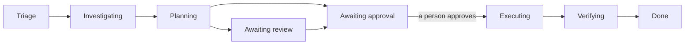

import { CliVersion } from "/snippets/cli-version.jsx";

The [AI board](/platform/ai-board) is not only for Ankra's agents. Any MCP client you connect - Claude Code, Cursor, Codex, or an agent you wrote - can read the board, file tickets, investigate, draft a plan, and carry it out once a person approves it. The ticket keeps one timeline whoever does the work, so your team sees the same history, Slack or Teams thread and [Jira or Linear issue](/guides/ticket-sync) either way.

There are four ways to combine Ankra's AI with your own. This guide covers the first.

| You want | Where it is covered |
|----------|---------------------|
| Your own agent works board tickets | This guide |
| Ankra's agents run on your own model (Anthropic, OpenRouter, an OpenAI-compatible endpoint) | [Models and Cost](/platform/ai-provider) |
| Ankra's agents call your own tools | [AI Connections - MCP Tool Servers](/platform/ai-connections#mcp-tool-servers) |
| Board tickets show up in your own tracker or automation | [Sync board tickets to Jira, Linear, or a webhook](/guides/ticket-sync) |

## How your agent fits the board

Your agent acts **as you**. Every comment, status change and plan it writes is recorded on the timeline under the user who owns the token or the OAuth connection, stamped as written by a model. The same gates apply to it as to Ankra's own agents, and one applies more strictly:

- **It can** list and read tickets, file new ones, comment, move a ticket through its statuses, draft and revise the plan, ask for review, request changes on a plan, answer a blocked ticket's question, and close a ticket with a resolution.
- **It cannot approve a plan.** Plan approval is a human action in the product or a Slack or Teams thread, and an MCP token cannot reach it by any route. Until a person approves, the ticket cannot move to **Executing**.
- **It cannot be the assignee.** `ticket_assign` hands a ticket to one of Ankra's agents, which then starts working it. Your agent owns a ticket by working it, and you show the board it is yours by assigning the ticket to yourself.
- **Its comments do not wake Ankra's agents.** Only a person's comment re-admits a parked ticket to Ankra's dispatcher, so a model cannot keep an Ankra agent spinning.



**Awaiting review** applies only when a reviewer agent is configured in the ticket desk settings; otherwise a plan goes straight to **Awaiting approval**.

## Prerequisites

- The AI board is available in your organisation (**AI** → **Board** in the sidebar). The ticket tools do not appear over MCP while it is not.
- Your role includes the `ai.execute` permission - the built-in **owner**, **admin**, **operator** and **member** roles do, **viewer** does not. See [Roles and Access](/guides/roles-and-access).
- An MCP client connected to Ankra with **write** access. Reading the board needs `mcp:read`; every ticket change needs `mcp:write`. See [MCP Server](/platform/mcp-server).
- Someone who can approve the plans your agent drafts.

## Step 1: Connect your agent

Follow [MCP Server](/platform/mcp-server) for your client. Claude connects over OAuth and asks you to approve `mcp:read` or `mcp:write` access; Cursor and other clients take a token:

<CliVersion since="0.6.0" />

```bash
ankra tokens create my-board-agent --scopes mcp:read,mcp:write
```

To confirm the board is reachable, ask the agent to list the open tickets. It should call `ticket_list` and return them with their numbers, such as `T-412`.

<Tip>
When the agent runs unattended, create the token for a dedicated member account rather than your own. Its comments and status changes are then attributed to that account rather than to a person.
</Tip>

## Step 2: Pick up a ticket

Find work with `ticket_list`, which filters by `status`, `kind`, `priority`, `cluster_id`, `resolution` and free-text `search`. Then read one in full with `ticket_get`, which takes a `ticket_number` (`412` for `T-412`) or a `ticket_id` and returns its body, plan, review state, links and newest timeline events.

To file a ticket instead, call `file_ticket` with a `title` and a `body`, and optionally:

| Parameter | Values | Default |
|-----------|--------|---------|
| `kind` | `incident`, `insight`, `gap`, `automation`, `request`, `chore` | `request` |
| `priority` | `urgent`, `high`, `medium`, `low` | `medium` |
| `cluster_id` | The cluster the work targets | none |

Filing the same `condition` again is folded into the open ticket rather than creating a second one.

**Move the ticket out of Triage as soon as your agent takes it.** Ankra's dispatcher assigns unowned **Triage** tickets to its own board workers, so a ticket left there can be claimed by an Ankra agent while yours is reading it. Ask your agent to call `ticket_update_status` with `status: investigating`; the dispatcher does not claim tickets outside **Triage**. Then assign the ticket to yourself from its assign menu (`a` on the board), so the board shows a person owns it rather than escalating it as unstaffed.

Example prompt:

```text
Take T-412 off the Ankra board: move it to investigating and comment that I'm working it from Claude Code.
```

## Step 3: Investigate and record findings

Your agent investigates with Ankra's read tools - `get_pods`, `get_pod_logs`, `get_events`, `query_prometheus`, `get_stack_details` and the rest in the [MCP Tool Reference](/platform/mcp-tools) - and with whatever else it can reach, such as your repository checkout.

Have it post what it finds with `ticket_comment`. The timeline is what the approver reads, and it is relayed as comments to any [sync connection](/guides/ticket-sync), so findings written there reach Jira, Linear and the ticket's Slack or Teams thread too.

If the ticket names no cluster, or the wrong one, `ticket_set_cluster` binds it.

## Step 4: Draft the plan and send it for approval

<Steps>
  <Step title="Move to Planning">
    `ticket_update_status` with `status: planning`.
  </Step>
  <Step title="Write the plan">
    `ticket_draft_plan` stores the plan as markdown on the ticket. Write it for the person who approves it: what will change, on which cluster and stack, how to verify it, and how to roll it back. Calling it again revises the plan.
  </Step>
  <Step title="Ask for review">
    `ticket_request_review` moves the ticket to **Awaiting review** when your organisation has a reviewer agent, and straight to **Awaiting approval** when it does not. A reviewer that requests changes sends the ticket back to **Planning** with its rationale on the timeline.
  </Step>
</Steps>

At **Awaiting approval** Ankra raises **Plan awaits your approval** for the people who decide, and the ticket appears in the **Needs a human** view.

## Step 5: A person approves

Approve the plan on the ticket's page - the decision panel at the top offers **Approve** and **Reject** - or with **Approve plan** on the escalation card in the ticket's Slack or Teams thread. Approving moves the ticket to **Executing**. Rejecting asks for a reason and sends it back to **Planning**, where your agent reads the reason and revises the plan.

Your agent can wait by polling `ticket_get` until `plan_status` reads `human_approved` and `status` reads `executing`. A rejection shows as `status: planning` with your reason as the newest timeline event.

<Note>
Approval is a gate on the ticket, not a grant of access. Your agent carries out the plan with its own token, so what it may change is whatever that token and your role allow - an `mcp:write` client runs a write as soon as it calls the tool, with no second confirmation from Ankra. Grant write access only to an agent you trust to stay inside the approved plan.
</Note>

## Step 6: Carry out the plan, verify, and close

<Steps>
  <Step title="Execute">
    The agent carries out the approved plan with Ankra's write tools. Writes that start platform work answer at once with an `operation_id`; `wait_for_execution` blocks until it settles. Have it comment each step it runs, so the timeline shows what changed.
  </Step>
  <Step title="Verify">
    `ticket_update_status` with `status: verifying`, then check the fix held against live state - the pod is ready, the alert stopped firing, the error rate dropped.
  </Step>
  <Step title="Close">
    `ticket_update_status` with `status: done` and a `resolution`: `fixed`, `no_action`, `duplicate`, `wont_fix` or `escalated`.

    `fixed` needs evidence: an `evidence_kind` and an `evidence_reference` together. From your own agent that is normally `observation` (the tool it called and the values it read, quoted so a reader can re-check them) or `link` (a URL to a dashboard, a CI run or a pull request).
  </Step>
</Steps>

Example prompt:

```text
The fix for T-412 is applied. Verify the payments-api pods are ready and have not restarted in 10 minutes, then close T-412 as fixed with what you observed as evidence.
```

## When a ticket is blocked on a choice

When an Ankra agent parks a ticket at **Blocked** with a question and options, `ticket_get` shows it under `decision_request`, and `ticket_decide` records the answer - an `option_key`, an `answer` in your own words, or both - and resumes the agent.

<Warning>
Ankra records a decision made through `ticket_decide` as relayed from the token's user, and does not check that a person chose it. Have your agent relay only decisions you made, never pick an option on its own.
</Warning>

## Start your agent from new tickets

To have new tickets reach your agent without anyone asking, add a **webhook** [sync connection](/guides/ticket-sync) that points at a receiver you run. Each matching ticket arrives first as a signed `ticket.created` request carrying the full ticket - its number, kind, priority, cluster and body. Your receiver verifies the signature and starts your agent on that ticket number; from there the agent works it through the steps above. Narrow the connection's **Kinds** and **Minimum priority** filters to the tickets you want your agent on.

A new connection picks up the tickets that are live when you add it and everything that changes afterwards. It never writes back to the board: everything your agent does goes through MCP.

## Limits

- Each token may make 120 read calls and 20 write calls per minute. A rate-limited call says so; wait a minute and retry.
- Every tool call has a 55-second deadline. A write that timed out may still have run, so read the ticket before repeating it.
- A human gate that times out closes the ticket as `expired`. Nothing is executed and nothing is recorded as fixed.

## Troubleshooting

| What your agent sees | What it means |
|----------------------|---------------|
| `Plan approval is a human action: ask the user to approve the plan on the AI board ...` | An MCP client tried to approve its own plan. A person approves it on the ticket page or in its thread. |
| `A human must approve the ticket's plan on the AI board before execution begins ...` | The agent tried to move a ticket to **Executing** before approval. Wait for the approval to move it there. |
| `The ticket has no plan to approve. Draft one with ticket_draft_plan ...` | **Awaiting approval** needs a plan. Draft one first. |
| `This desk requires a peer review before the human gate ...` | Your organisation requires the reviewer agent's verdict. Call `ticket_request_review` and wait for it. |
| `Cannot move a ticket from 'triage' to 'verifying'.` | Statuses move one hop at a time along the board's lifecycle. Go through the statuses in between. |
| `This ticket is not waiting on a decision.` | `ticket_decide` only answers a ticket at **Blocked** with a pending question. |
| `No ticket with that ticket_number exists in this organisation.` | The number is wrong, or the client is connected to another organisation. MCP access is bound to the organisation chosen when the token or connection was created. |
| No ticket tools in the client's tool list | The AI board is not available in the organisation, or the token has no MCP scope. Ticket changes also need `mcp:write`. |
| A tool reports that it needs `mcp:write` | The client holds read-only access. Reconnect with write access. |
| An Ankra agent started working the same ticket | The ticket was still in **Triage** when the dispatcher swept it, or someone assigned it to that agent. Move tickets out of **Triage** as soon as your agent takes them. |

## Related pages

- [AI Board](/platform/ai-board) - statuses, plans, review and approval
- [MCP Server](/platform/mcp-server) - connecting a client, scopes and how calls behave
- [MCP Tool Reference](/platform/mcp-tools) - every ticket tool, under **Tickets & Collaboration**, and the scope it needs
- [`ankra tickets`](/reference/cli/tickets) - work the board from a terminal
- [Sync board tickets to Jira, Linear, or a webhook](/guides/ticket-sync) - mirror tickets out to your tracker
