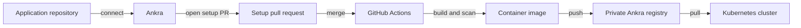

import { CliVersion } from "/snippets/cli-version.jsx";

Ankra Applications get their container images built, scanned and published in one of two ways. [Ankra Pipelines](/guides/ankra-pipelines) runs the pipeline as hardened Jobs inside a cluster you already operate through Ankra, from one committed file, `.ankra/pipeline.yaml`; it is the primary path, and a new application's setup pull request commits `.ankra/pipeline.yaml` by default. When that cluster cannot build an image (its agent does not run pipeline steps, or its node runtime confines the image builder), the build runs on Ankra's platform builders instead, while **Build on Ankra when your cluster cannot** is on under **Build & delivery → Builds and clusters** (it is on by default). Ankra also builds on its platform builders by itself, whatever that switch says: the setup commit of a new application, a branch a preview finds no image for, a tracked-branch commit whose generated GitHub Actions build failed, and commits of a pull request the [PR shepherd](/concepts/applications#the-pr-shepherd) is following. The builders fetch your source and build it on Ankra's infrastructure. Platform builders are on for every organisation unless Ankra has turned them off for it; to have them turned off for yours, contact Ankra support. The generated GitHub Actions workflow below is for a repository that must keep building on GitHub, and for applications set up before the pipeline became the default. To pick between these and your own CI, see [Ship Your App](/guides/deliver-your-app).

<CardGroup cols={2}>
  <Card title="Ankra Pipelines" icon="diagram-project" href="/guides/ankra-pipelines">
    CI in your cluster: triggers, a Job per stage, check runs, artifacts, and what a pull request can and cannot change.
  </Card>
  <Card title="Migrate from GitHub Actions" icon="arrow-right-arrow-left" href="/guides/migrate-from-github-actions">
    Convert a workflow, GitLab CI file, Bitbucket pipeline or CircleCI config and review the notes.
  </Card>
</CardGroup>

## Bring your own CI (GitHub Actions)

Ankra Applications generates a GitHub Actions pipeline that builds your source repository, scans the image, and publishes it to your organisation's private registry. The generated Kubernetes manifests already reference that image and the matching pull secret. Nothing about it changes when you add an Ankra pipeline to the same repository: the workflow's checks keep their names, the pipeline's is `Ankra pipeline`, and Ankra keeps reading the workflow's results for publish readiness, push-to-deploy and previews.

<Note>
The Ankra registry is private. Ankra provisions its project, GitHub Actions credentials, and Kubernetes pull credentials automatically.
</Note>

### How it works



<Steps>
  <Step title="Connect the repository">
    Create an Application from a GitHub repository. Ankra analyses the source and prepares the missing Dockerfile, Kubernetes manifests, and workflow.
  </Step>
  <Step title="Review the setup pull request">
    The pull request adds `.github/workflows/build-and-publish.yml` and manifests under `.ankra/manifests/`. Monorepos get one scoped workflow per application.
  </Step>
  <Step title="Merge and build">
    Merging the pull request runs the workflow. It tests the source, builds the image, scans it with Trivy, and only then pushes it to your organisation's project on `registry.ankra.cloud`.
  </Step>
  <Step title="Pull requests build but do not publish">
    The workflow also runs on `pull_request`, where it tests, scans the source, builds the image and scans it with Trivy, but skips the push - so an unmerged branch never puts artifacts in your registry. Because nothing is pushed, a pull request gets no image a [PR preview](/guides/pr-preview-environments#applications-built-by-github-actions) could deploy.
  </Step>
  <Step title="Deploy">
    Deploy the Application to a cluster. Ankra checks that an image was published before starting the deployment.
  </Step>
</Steps>

## Registry authentication

Ankra installs these encrypted GitHub Actions secrets on the application repository:

| Secret | Purpose |
|--------|---------|
| `ANKRA_REGISTRY_USERNAME` | Username of the application's own push robot on the organisation registry project (`robot$<project>+app-<application-id>`) |
| `ANKRA_REGISTRY_PASSWORD` | That robot's secret |

The robot is minted per application when the application is set up, so no two applications share a registry login. Rotate or revoke it under **Applications → &lt;your application&gt; → Settings → Registry** with **Rotate publishing login** or **Revoke publishing login**, or with `ankra application registry robot rotate|revoke` - see [Robot accounts](/concepts/applications#robot-accounts).

The generated workflow uses the secrets with `docker/login-action`. It does not use `GITHUB_TOKEN` package permissions and does not publish a public package.

For Kubernetes pulls, Ankra creates an `ankra-registry-pull` Docker registry secret in each managed namespace. Generated Deployments include:

```yaml
spec:
  template:
    spec:
      imagePullSecrets:
        - name: ankra-registry-pull
```

The same pull credential is injected into short-lived Application preview environments.

### Your own registry

An Application that [declares its own registry](/concepts/applications#using-your-own-registry) publishes there instead. The workflow logs in with the secret names the declaration gives (defaulting to the `ANKRA_REGISTRY_*` pair), the generated Deployments reference the pull Secret it names, and Ankra creates that Secret in the deploy namespace from the registry credential the declaration names.

Ankra does not write the login secrets for a registry you operate unless you hand it robot management there: the robots are yours to administer, and overwriting a push robot with the credential Ankra holds would deny every later build. Publish readiness reports whether the named secrets exist. Name an `admin_credential_name` on the declaration to have Ankra mint a push robot for the application on your registry and write that into the secrets, or opt in with `manage_actions_secrets: true` to have it write the declared credential.

## Registry storage

Every project on your organisation's Ankra registry has a storage limit, **50 GiB by default**, and a full project refuses every image push, so builds stop publishing. The limit is per registry project: an [extra project](/reference/cli/registry#ankra-registry-projects) has the same limit as your own. A build whose image a full project refuses fails at its push with nothing wrong about the build itself; free space (it comes back at the weekly garbage collection, see below) or ask for more storage, then re-run the pipeline.

Read how full the registry is under **Build & delivery → Registry storage** (`/next/organisation/registry-storage`), which also lists the repositories that take the space, or from the CLI:

<CliVersion since="0.24.0" />

```bash
ankra registry storage                # usage against the limit, per project
ankra registry storage repositories   # what takes the space, largest first
```

The `ankra-ci/` repositories hold the images Ankra builds and scans in CI, one per pipeline run and pull request, and are usually what fills the registry; the others hold the images your applications publish. Sizes are approximate, because a layer shared by several images is counted for each of them: rank repositories by them, do not add them up. From 80 % full the CLI, and a notice on the **Applications** list and the **Build & delivery** overview, point at the ways out; the **Registry storage** page always lists them under **Make room**. **Plan and billing** shows the same meter, and so does an application's **Settings** → **Registry** when it publishes to the Ankra registry. Reading needs `credentials.read`; retention and storage are organisation settings, so a member or token confined to one project is refused.

### Image retention

The registry does not keep every image forever. A retention policy runs once a day: an image is kept while it was pushed within the policy's days, and the newest tagged images of every repository are kept whatever their age. The platform default keeps images pushed in the last **30 days** and the **3 newest** of each repository. Everything else is deleted at the daily run, and the space comes back at the registry's garbage collection, weekly on Sunday 03:00 UTC, so the usage figure drops then rather than at once.

The policy is yours to set, for the whole organisation and per repository pattern - typically a short one for CI build images, which every pipeline run adds to:

```bash
ankra registry storage retention                                     # the policy, its rules, the daily time
ankra registry storage retention set --keep-days 14 --keep-latest 5
ankra registry storage retention rule add 'ankra-ci/**' --keep-days 7 --keep-latest 2
ankra registry storage retention run                                 # clean up now instead of at the daily time
```

- A rule replaces the organisation policy for the repositories its pattern matches in your organisation's own registry project (an extra project follows the organisation policy alone); where rules overlap, the most specific pattern decides. Patterns are lower-case letters, digits and `. _ / -`, with `*` matching within one path segment and `**` across segments; braces and commas are not accepted, so write one rule per pattern. A rule added with `--application` is tied to that application and shows with it.
- Two protections hold whatever you choose: the newest tagged image of every repository is never deleted (`--keep-latest` is at least 1; untagged images, such as the leftovers of an overwritten tag, are kept only by the days), and a policy you set also keeps every image pulled in the last 7 days, so an image a workload started from recently is not deleted under it.
- A change that keeps fewer images asks first: the portal measures it against the rule that governs each repository, the CLI against the organisation policy (`--yes` skips the prompt), because what it no longer keeps is deleted at the next run. `--reset` goes back to the platform default.
- The registry runs at most 15 retention rules per project. The policy and each rule take one for the days (when above 0) and one for the newest, the pulled-recently protection takes one, and rules with the same keep value share one where that cannot change which rule decides a repository. The page and `ankra registry storage retention` (from CLI v0.26.0) show how many are used; a save that would need more is refused and nothing is written.
- A save from the portal, or from the CLI from v0.25.1, carries the version it read. When someone else changed retention in between, the platform refuses the save: the portal shows who changed what and saves nothing of yours, and the CLI reads the new retention and applies your change to it once. A save over the API or an MCP tool is checked only when it sends that version as `expected_version`.

Two consequences worth planning for:

- A rollback can only reach a version that is still in the registry: one of the newest kept, one pushed within the policy's days, or, under a policy you set, one pulled in the last 7 days.
- A workload still running an image older than that keeps running, because the image is cached on its node, but it cannot be rescheduled onto a fresh node once the image is gone. Redeploy long-lived workloads from a recent build.

Changing or running retention needs `credentials.write`. A registry you operate yourself is never touched: retention there is yours to configure.

### Ask for more storage

When tighter retention is not enough, ask Ankra for a bigger limit from the **Registry storage** page or the CLI, naming the limit you need per project (more than today's, at most 10240 GiB) and why. Ankra staff review it, you are notified when it is decided, and an approved limit applies to the registry within about 5 minutes. One request per limit waits at a time; `ankra org limits list` shows its state. Asking needs `billing.manage`.

```bash
ankra registry storage request --size 100 --reason "Three services now publish nightly images"
```

[Ankra AI](/platform/ai-assistant) and the [MCP tools](/platform/mcp-tools) read storage and retention, change and run retention, and request more, under the same permissions.

## Existing applications

Reconcile an Application after the registry cutover. Ankra updates its image URL, replaces a legacy build workflow or manifest with the private registry version, and restores missing repository secrets.

Inspect readiness under **Applications → &lt;your application&gt; → Technical details → Source**, in the **Publishing readiness** card (**Check publishing readiness** runs the checks again), or from the CLI:

<CliVersion since="0.9.0" />

```bash
ankra application publish-readiness <application-id>
```

Readiness checks the organisation registry project, both repository secrets, the workflow login target, and whether an image has been published.

## Converting an existing workflow

Ankra converts a GitHub Actions workflow, a GitLab CI file, a Bitbucket Pipelines file or a CircleCI config into `.ankra/pipeline.yaml`. Ask Ankra AI in the portal chat or through the MCP server: `cicd_convert_workflow_to_pipeline` answers with the pipeline, a note for everything it could not map one to one, and a validation verdict; `cicd_validate_pipeline_yaml` checks a definition you wrote or edited. Steps that only installed cloud credentials or a registry login are dropped with a note, because the pipeline gets those from Ankra, and a third-party step the mapping table does not know becomes a stage that fails until you replace it.

For an application already connected to Ankra, `GET`/`POST .../pipeline` and `.../pipeline/migrate` do this in one call instead: read what builds it today, convert, and open the pull request - see [Migrate an existing application with one call](/guides/migrate-from-github-actions#migrate-an-existing-application-with-one-call). The disposition itself only switches once that pull request merges, and a later push that adds or removes `.ankra/pipeline.yaml` or a workflow file on the default branch re-evaluates it automatically on GitHub.

The [migration guide](/guides/migrate-from-github-actions) carries the full mapping table, what each source format loses, what to review afterwards, and how to run both side by side until you trust the pipeline. The [pipeline.yaml reference](/guides/pipeline-reference) documents every key.

## Troubleshooting

<AccordionGroup>
  <Accordion title="The workflow cannot log in">
    Open **Applications → &lt;your application&gt; → Technical details → Source** and read the **Publishing readiness** card. Click **Review publishing repairs** to have Ankra restore what it manages. If the outcome says **Repository administrator access is still required.**, approve the updated Ankra GitHub App **Secrets** permission and run the repair again.
  </Accordion>
  <Accordion title="The registry project is not ready">
    Registry projects are provisioned automatically. The background reconciler retries missed provisioning. If readiness remains blocked after a few minutes, contact support.
  </Accordion>
  <Accordion title="The image push is denied">
    Confirm that the workflow logs in to the host shown in the Application image URL and uses `ANKRA_REGISTRY_USERNAME` and `ANKRA_REGISTRY_PASSWORD`. Reconcile the Application to replace a legacy workflow.
  </Accordion>
  <Accordion title="Pods report ImagePullBackOff">
    Reconcile the Application and check the target namespace for `ankra-registry-pull`. Ankra rotates and reapplies pull credentials automatically.
  </Accordion>
  <Accordion title="Deploy is blocked">
    Ankra blocks deployment until it can verify a published image in the organisation registry. Check the latest GitHub Actions run, then retry after the image push succeeds.
  </Accordion>
</AccordionGroup>

## Next steps

<CardGroup cols={2}>
  <Card title="Ankra Pipelines" icon="diagram-project" href="/guides/ankra-pipelines">
    Run the same lifecycle inside your own cluster.
  </Card>
  <Card title="Applications" icon="box" href="/concepts/applications">
    Connect a repository and follow the Application lifecycle.
  </Card>
  <Card title="GitHub integration" icon="github" href="/integrations/github">
    Review the GitHub App permissions used by Ankra.
  </Card>
  <Card title="Pipeline Agents" icon="robot" href="/guides/pipeline-agents">
    Add read-only deployment and health reporting to your CI workflows.
  </Card>
  <Card title="SOPS Encryption" icon="lock" href="/guides/sops">
    Encrypt other secrets stored in GitOps.
  </Card>
</CardGroup>
