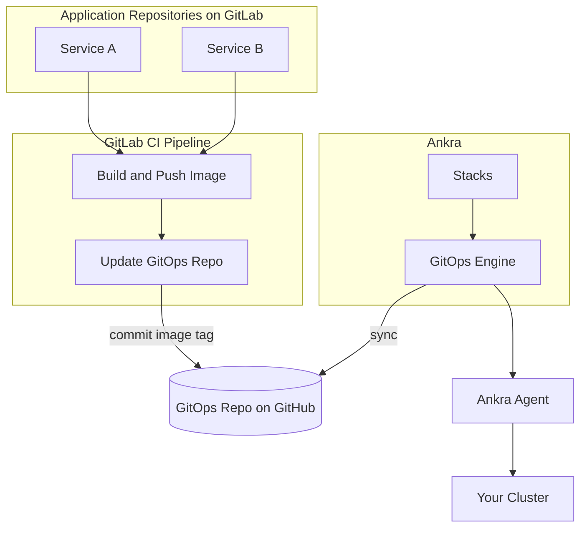

import { CliVersion } from "/snippets/cli-version.jsx";

This guide connects a GitLab CI pipeline to a cluster that Ankra runs. Your pipeline builds a container image and commits the new image tag to the cluster's GitOps repository. Ankra notices the commit and rolls the change out.

<Warning>
**The GitOps repository cannot be on GitLab.** Ankra syncs a cluster's GitOps repository from GitHub or Bitbucket Cloud only. Your application code and GitLab CI stay on GitLab; the pipeline in this guide commits the new image tag to a GitOps repository on GitHub. For the other routes from a repository to a running application, see [Ship Your App](/guides/deliver-your-app). If you would rather not run GitLab CI, a GitLab repository can run [Ankra Pipelines](/guides/ankra-pipelines) instead - see [Git Providers](/integrations/git-providers).
</Warning>

## How it fits together



1. **You push code** to your GitLab application repository.
2. **GitLab CI builds and pushes** a container image to your registry.
3. **GitLab CI commits** the new image tag to the GitOps repository.
4. **Ankra syncs** the commit and starts a deployment.
5. **The Ankra agent applies** the updated manifest to your cluster.

| Component | Purpose |
|-----------|---------|
| **Application repository** | Your app code with a Dockerfile and `.gitlab-ci.yml`, on GitLab |
| **GitOps repository** | The cluster's configuration, written and synced by Ankra, on GitHub or Bitbucket Cloud |
| **Container registry** | Stores your built images (GitLab Container Registry, Google Artifact Registry, Amazon ECR and so on) |
| **GitLab CI** | Builds images and commits the new tag to the GitOps repository |

## Before you start

- A cluster in Ankra whose agent is connected. See [Import a Cluster](/guides/import-cluster).
- A GitHub or Bitbucket Cloud connection in your organisation, so the cluster can use a repository there. See [GitHub](/integrations/github) or [Bitbucket Cloud](/integrations/bitbucket-cloud).
- A container registry your GitLab pipeline can push to.
- An application repository on GitLab with a Dockerfile.

## Step 1: Connect a GitOps repository to the cluster

Connect the repository that will hold the cluster's configuration. It must be on GitHub or Bitbucket Cloud.

<Steps>
  <Step title="Open the cluster's GitOps settings">
    Go to **Clusters → &lt;your cluster&gt; → Settings → GitOps** (`/next/clusters/<cluster-id>/settings/gitops`).

    With no repository connected, the **Repository** section reads **No repository connected**.
  </Step>
  <Step title="Choose the repository">
    Click **Connect a repository**. Choose the **Connection**, then the **Repository** and the **Branch**, and click **Review change**. If the dialog says **Connect GitHub or Bitbucket first**, add a connection on the Credentials page and come back.

    <Tip>
    Use a dedicated repository (for example `my-org/infrastructure-gitops`) to keep cluster configuration apart from application code.
    </Tip>
  </Step>
  <Step title="Connect it">
    Check the change in **Connect this repository?** and click **Connect repository**.

    The **Repository** section now names the repository and branch, and the **Sync** section shows the sync status.
  </Step>
</Steps>

Once connected, Ankra writes the cluster's configuration to a `clusters/<cluster-name>-<short-id>/` folder in the repository and keeps it in sync. The folder layout is described in [GitOps](/concepts/gitops).

## Step 2: Create a Stack for your application

In Ankra, manifests are grouped into **Stacks**: related Kubernetes resources that deploy together. See [Stacks](/concepts/stacks).

<Steps>
  <Step title="Open the cluster's Stacks">
    Go to **Clusters → &lt;your cluster&gt; → Technical details → Stacks** and click **Create a stack**.
  </Step>
  <Step title="Name the Stack">
    Choose **Compose a stack**. Under **Name the stack**, enter a **Stack name** such as `backend-services` (lowercase letters, digits and hyphens, at most 63 characters) and click **Start the draft**.

    The Stack editor opens on a draft. Nothing deploys until you review it.
  </Step>
  <Step title="Write the Deployment manifest">
    Write the Deployment for your service, or press `⌘+J` (or `Ctrl+J`) to open **Ask Ankra** and describe it:

    ```
    Create a deployment manifest for my backend service:
    - Image: registry.gitlab.com/my-group/my-app/backend:sha-1a2b3c4d
    - Namespace: production
    - 2 replicas
    - Port 8080
    - Health check on /health
    - 256Mi memory, 100m CPU requests
    ```
  </Step>
  <Step title="Add the manifest to the draft">
    In the editor, click **Add → Manifest**. Enter a **Resource name** such as `backend-deployment`, paste the manifest into **Manifest source** (it needs `apiVersion`, `kind` and `metadata.name`), and click **Add to draft**.

    The manifest appears in the Stack's graph.
  </Step>
  <Step title="Deploy the Stack">
    Click **Review changes**, read the change list, then click **Create and deploy stack**.

    The editor reports **Deployment accepted. Follow the operation for its outcome.** Ankra commits the Stack to your GitOps repository and deploys its members in dependency order.
  </Step>
</Steps>

<Tip>
The manifest is now in the GitOps repository at `clusters/<cluster-name>-<short-id>/stacks/<stack-name>/manifests/<resource-name>.yaml`. That is the file your pipeline updates in Step 4.
</Tip>

## Step 3: Give GitLab CI write access to the GitOps repository

Your GitLab CI pipeline needs write access to the GitOps repository to commit new image tags.

<Steps>
  <Step title="Generate an SSH key">
    On your local machine, generate a deploy key:

    ```bash
    ssh-keygen -t ed25519 -C "ci-deploy-key" -f deploy_key -N ""
    ```

    This creates `deploy_key` (private) and `deploy_key.pub` (public).
  </Step>
  <Step title="Add the public key to the GitOps repository">
    In your GitOps repository on GitHub, go to **Settings** → **Deploy keys** → **Add deploy key**.

    Add the contents of `deploy_key.pub` and check **Allow write access**.

    <Note>
    On Bitbucket Cloud, repository access keys are read-only, so they cannot push. Use a repository access token with write permission over HTTPS instead.
    </Note>
  </Step>
  <Step title="Add the private key to the application repository">
    In your GitLab application repository, go to **Settings** → **CI/CD** → **Variables** and add a variable:
    - **Key:** `GITOPS_DEPLOY_KEY`
    - **Value:** contents of `deploy_key`
    - **Type:** File
    - **Flags:** check **Mask variable** and **Protect variable**

    Delete the local `deploy_key` file once it is stored.
  </Step>
</Steps>

## Step 4: Create the GitLab CI pipeline

Add a `.gitlab-ci.yml` file at the root of your application repository. It builds the image and commits the new tag to the GitOps repository.

<Steps>
  <Step title="Write the pipeline">
    Start from one of the examples below, or open **Ask Ankra** (`⌘+J`) and describe your pipeline:

    ```
    Generate a GitLab CI pipeline that:
    - Triggers on push to main branch
    - Builds a Docker image from my Dockerfile
    - Pushes to GitLab Container Registry
    - Tags with the git SHA, never latest
    - Updates my GitOps repo at github.com/my-org/infrastructure-gitops
    - Updates the image tag in clusters/my-cluster-<short-id>/stacks/backend-services/manifests/backend-deployment.yaml
    ```
  </Step>
  <Step title="Add registry variables">
    If you push to a registry other than GitLab Container Registry, add these under **Settings** → **CI/CD** → **Variables**:

    | Variable | Description |
    |----------|-------------|
    | `REGISTRY_USERNAME` | Registry username (or `_json_key` for Google Cloud) |
    | `REGISTRY_PASSWORD` | Registry password or service account key |
    | `GITOPS_DEPLOY_KEY` | The SSH private key from Step 3 |

    <Tip>
    GitLab Container Registry needs no extra variables: GitLab CI provides `$CI_REGISTRY`, `$CI_REGISTRY_USER` and `$CI_REGISTRY_PASSWORD`.
    </Tip>
  </Step>
</Steps>

<Accordion title="Example pipeline: GitLab Container Registry">
This pipeline uses GitLab's built-in container registry. It tags every image with the commit SHA, never `latest`, so each deploy names exactly one build.

```yaml
stages:
  - build
  - deploy

variables:
  IMAGE_NAME: $CI_REGISTRY_IMAGE/backend
  GITOPS_REPO: git@github.com:my-org/infrastructure-gitops.git
  MANIFEST_PATH: clusters/my-cluster-<short-id>/stacks/backend-services/manifests/backend-deployment.yaml

build:
  stage: build
  image: docker:27
  services:
    - docker:27-dind
  rules:
    - if: $CI_COMMIT_BRANCH == "main"
      changes:
        - src/**/*
        - Dockerfile
  script:
    - docker login -u $CI_REGISTRY_USER -p $CI_REGISTRY_PASSWORD $CI_REGISTRY
    - docker build -t $IMAGE_NAME:$CI_COMMIT_SHA .
    - docker push $IMAGE_NAME:$CI_COMMIT_SHA

update-gitops:
  stage: deploy
  image: alpine:3.20
  needs: [build]
  rules:
    - if: $CI_COMMIT_BRANCH == "main"
      changes:
        - src/**/*
        - Dockerfile
  before_script:
    - apk add --no-cache git openssh-client sed
    - eval $(ssh-agent -s)
    - chmod 600 $GITOPS_DEPLOY_KEY
    - ssh-add $GITOPS_DEPLOY_KEY
    - mkdir -p ~/.ssh
    - ssh-keyscan github.com >> ~/.ssh/known_hosts
  script:
    - git clone $GITOPS_REPO gitops-repo
    - cd gitops-repo
    - "sed -i \"s|image: .*backend:.*|image: ${IMAGE_NAME}:${CI_COMMIT_SHA}|\" $MANIFEST_PATH"
    - git config user.name "GitLab CI"
    - git config user.email "gitlab-ci@users.noreply.gitlab.com"
    - git add $MANIFEST_PATH
    - git commit -m "Deploy backend: $CI_COMMIT_SHA"
    - git push origin main
```
</Accordion>

<Accordion title="Example pipeline: Google Artifact Registry">
This pipeline pushes to Google Artifact Registry:

```yaml
stages:
  - build
  - deploy

variables:
  IMAGE_NAME: europe-west1-docker.pkg.dev/my-project/docker-images/backend
  GITOPS_REPO: git@github.com:my-org/infrastructure-gitops.git
  MANIFEST_PATH: clusters/my-cluster-<short-id>/stacks/backend-services/manifests/backend-deployment.yaml

build:
  stage: build
  image: docker:27
  services:
    - docker:27-dind
  rules:
    - if: $CI_COMMIT_BRANCH == "main"
      changes:
        - src/**/*
        - Dockerfile
  script:
    - echo "$GCP_SERVICE_ACCOUNT_KEY" | docker login -u _json_key --password-stdin https://europe-west1-docker.pkg.dev
    - docker build -t $IMAGE_NAME:$CI_COMMIT_SHA .
    - docker push $IMAGE_NAME:$CI_COMMIT_SHA

update-gitops:
  stage: deploy
  image: alpine:3.20
  needs: [build]
  rules:
    - if: $CI_COMMIT_BRANCH == "main"
      changes:
        - src/**/*
        - Dockerfile
  before_script:
    - apk add --no-cache git openssh-client sed
    - eval $(ssh-agent -s)
    - chmod 600 $GITOPS_DEPLOY_KEY
    - ssh-add $GITOPS_DEPLOY_KEY
    - mkdir -p ~/.ssh
    - ssh-keyscan github.com >> ~/.ssh/known_hosts
  script:
    - git clone $GITOPS_REPO gitops-repo
    - cd gitops-repo
    - "sed -i \"s|image: .*backend:.*|image: ${IMAGE_NAME}:${CI_COMMIT_SHA}|\" $MANIFEST_PATH"
    - git config user.name "GitLab CI"
    - git config user.email "gitlab-ci@users.noreply.gitlab.com"
    - git add $MANIFEST_PATH
    - git commit -m "Deploy backend: $CI_COMMIT_SHA"
    - git push origin main
```
</Accordion>

## Step 5: Let the cluster pull from a private registry

If your registry is private, the cluster needs credentials to pull images.

<Steps>
  <Step title="Get a read-only registry credential">
    - For GitLab: a [deploy token](https://docs.gitlab.com/ee/user/project/deploy_tokens/) with the `read_registry` scope
    - For Google Cloud: a service account JSON key with the `Artifact Registry Reader` role
    - For Amazon ECR: an IAM access key with pull permission
  </Step>
  <Step title="Write the image pull secret">
    Write a `kubernetes.io/dockerconfigjson` Secret named `gitlab-pull-secret` in the `production` namespace, or describe it in Ask Ankra:

    ```
    Create an image pull secret for my private registry:
    - Registry: registry.gitlab.com
    - Namespace: production
    - Name: gitlab-pull-secret
    ```
  </Step>
  <Step title="Add it to the Stack and reference it">
    Add the Secret to the Stack with **Add → Manifest**, then add `imagePullSecrets: [{name: gitlab-pull-secret}]` to the Deployment's pod spec, and deploy the draft as in Step 2.

    <Warning>
    A manifest you add to a Stack is committed to the GitOps repository. Encrypt the Secret's values with [SOPS](/guides/sops) so the credential is not stored in Git in plaintext.
    </Warning>
  </Step>
</Steps>

## Step 6: Test the pipeline

<Steps>
  <Step title="Push a code change">
    Change your application code and push to `main`:

    ```bash
    git add .
    git commit -m "Add new feature"
    git push origin main
    ```
  </Step>
  <Step title="Watch GitLab CI">
    In your GitLab project, go to **Build** → **Pipelines**. Both jobs, `build` and `update-gitops`, finish green.
  </Step>
  <Step title="Check the GitOps commit">
    In your GitOps repository, the latest commit reads `Deploy backend: <sha>` and changes the image tag in the manifest.
  </Step>
  <Step title="Watch the rollout in Ankra">
    Go to **Clusters → &lt;your cluster&gt; → Technical details → Operations**. A new operation for the Stack appears and runs to success.
  </Step>
</Steps>

## Verify

Check that the cluster applied the commit your pipeline made.

<Tabs>
  <Tab title="Portal">
    Go to **Clusters → &lt;your cluster&gt; → Settings → GitOps**. In the **Sync** section, **Status** reads **In sync** and **Last commit applied** shows the short SHA of the pipeline's commit. **Sync history** lists the sync with its commit and result.

    Ankra syncs by itself when the branch changes. Click **Sync now** to check the repository right away.
  </Tab>
  <Tab title="CLI">
    <CliVersion since="0.18.0" />

    ```bash
    ankra cluster select my-cluster
    ankra cluster gitops status
    ankra cluster operations list --name backend-services --watch
    ```

    `ankra cluster gitops status` shows the last synced commit, any pending commit and any sync error. `ankra cluster operations list --watch` refreshes until every operation reaches a final state.
  </Tab>
</Tabs>

Then check the pods run the new image:

```bash
ankra cluster get pods -n production
```

## Add more services

<Steps>
  <Step title="Add the service to a Stack">
    Open the Stack in **Clusters → &lt;your cluster&gt; → Technical details → Stacks**, click **Start a draft**, and add the new service's Deployment with **Add → Manifest**. Or create a new Stack for it as in Step 2.
  </Step>
  <Step title="Add a pipeline to the service's repository">
    Copy the example pipeline into the new repository and change `IMAGE_NAME` and `MANIFEST_PATH` to the new service's image and manifest file.
  </Step>
  <Step title="Add the variables">
    Copy the same CI/CD variables (`GITOPS_DEPLOY_KEY` and any registry credentials) to the new project.
  </Step>
</Steps>

## Troubleshooting

To get help from Ankra AI, press `⌘+J` on the cluster's page and describe the problem. Opened on a cluster's page, Ask Ankra includes that cluster and the page you are on with your question.

<AccordionGroup>
  <Accordion title="GitLab CI cannot push to the GitOps repository">
    Common causes:
    - The deploy key does not have **Allow write access** on the GitOps repository
    - The `GITOPS_DEPLOY_KEY` variable is not of type **File**
    - The `ssh-keyscan github.com` line is missing, so the host key check fails
    - The variable is **Protected** and the pipeline runs on an unprotected branch
  </Accordion>
  <Accordion title="The commit landed but the pods did not change">
    Go to **Clusters → &lt;your cluster&gt; → Settings → GitOps**:
    - If **Status** reads **Last sync failed**, the **The last sync failed** message says what Ankra could not read or apply.
    - If **Commit waiting to be applied** is shown, the sync has not finished; it updates by itself.
    - If **Merge conflicts** lists a resource, Git and Ankra disagree on it and the sync waits until you choose a version. See [GitOps](/concepts/gitops).

    Also check that your pipeline pushed to the branch the cluster syncs, shown in the **Repository** section.
  </Accordion>
  <Accordion title="Pods are stuck in ImagePullBackOff">
    The cluster cannot pull the image. Check that the Deployment names the pull secret under `imagePullSecrets`, that the Secret is in the same namespace, and, for GitLab Container Registry, that the deploy token has the `read_registry` scope.
  </Accordion>
  <Accordion title="The Docker build fails in GitLab CI">
    Your GitLab Runner must support Docker-in-Docker:
    - Use `docker:27` as the job image
    - Add `docker:27-dind` as a service
    - On Kubernetes executors, enable privileged mode or build with Kaniko instead
  </Accordion>
</AccordionGroup>

## Next steps

<CardGroup cols={2}>
  <Card title="Ship Your App" icon="rocket" href="/guides/deliver-your-app">
    Compare the routes from a repository to a running application.
  </Card>
  <Card title="GitOps" icon="git-alt" href="/concepts/gitops">
    The files Ankra writes and the cluster directory.
  </Card>
  <Card title="SOPS Encryption" icon="lock" href="/guides/sops">
    Encrypt secrets in your GitOps repository.
  </Card>
  <Card title="Operations" icon="list-check" href="/platform/operations">
    Follow deployment progress and history.
  </Card>
</CardGroup>
