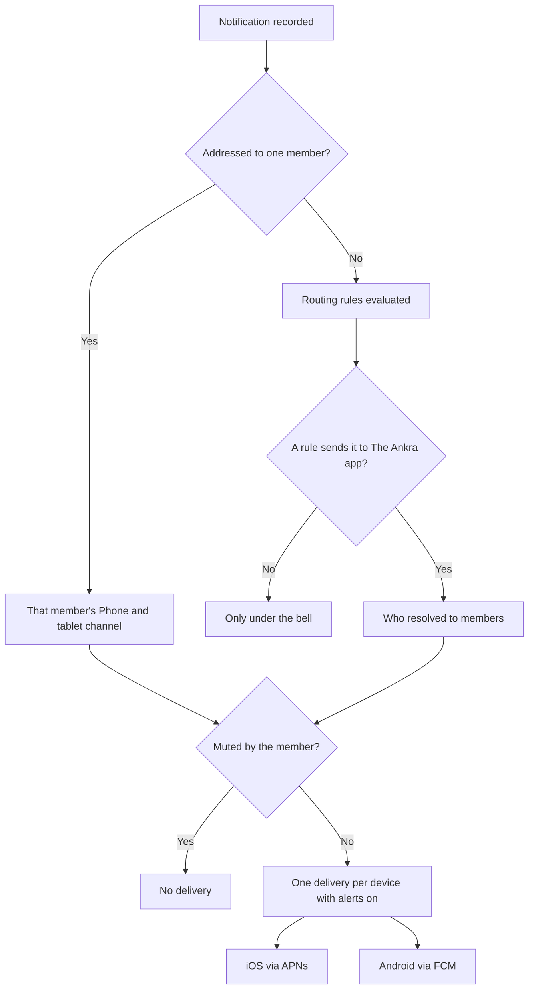

The Ankra app receives notifications on iOS and Android. A notification reaches a phone in one of two ways:

- **It is addressed to you**, such as a failed pipeline run you started or pushed. It reaches your phones through your own **Phone and tablet** channel under **Your account → Notifications**, with no routing rule. The channel is on for every member who has not changed it, at **Critical and warnings**.
- **It is for the organisation**, such as a firing alert or a failed operation. It reaches phones only when a [routing rule](/guides/notification-routing) sends it to **The Ankra app**, the way another rule sends to a Slack channel.

## Register a phone

Devices add themselves. Install the Ankra app, sign in, and accept the notification prompt. The device appears under **Your account → Notifications → Phone and tablet** (`/next/account/notifications`). Until then that section reads **No phone or tablet yet**.

There is no "add device" action and no credential to copy: the app holds none of its own. It hands its token to the signed-in page, which registers it against your session. A device therefore always belongs to the member who signed in on it, and signing in on a shared phone moves that device to you.

Each row shows the device's name, its system and app version, and when Ankra last saw it. On the row:

- **The switch** turns alerts on that device on or off, without signing out of it or removing it. The page confirms **Alerts off for** the device's name.
- **Send a test**, in the row's menu, sends a test alert straight to that device without going through any routing rule. The page says **A test alert is on its way to** the device. It works only while the device's alerts are on, and it proves the device and the platform's push credentials work before any rule exists.
- **Remove**, in the same menu, stops delivery to that install. The page says the device **was removed. It stops getting alerts.**

You manage only your own devices. There is no organisation-wide view of who has push turned on, and an administrator cannot remove someone else's phone.

**You should see** your phone in the list, and the test alert on its lock screen.

## Choose what reaches you

The **How you are notified** section on the same page has a row per channel: **Email**, **Phone and tablet** and **Browser**. Each has a switch and a choice of **Critical only**, **Critical and warnings** or **Everything**. A channel you have not changed says **You have not changed this.**

These rows decide only what is addressed to you. Notifications for the whole organisation follow its routing rules instead.

## Send organisation notifications to phones

An administrator who manages alerts adds the rule:

1. Open **Integrations & alerts → Notification routes** and click **Add rule**.
2. Under **Send to**, choose **The Ankra app**.
3. Under **Who**, choose the people:

| Who | Reaches |
|---|---|
| **Everyone on the cluster** | Everyone who is a member of the cluster the notification is about |
| **Organisation admins** | Every administrator of the organisation |
| **One member** | The member chosen under **Member** |
| **Some members** | The members ticked under **Members** |

4. Narrow it with **Which notifications** and **Severity** as for any other rule, then click **Add rule**.

**You should see** the rule in the list with a line starting **To Push to everyone on the cluster**, **To Push to organisation admins**, or **To Push to** and the members' names.

A rule filters on kind and severity exactly as any other routing rule does, so "every critical" and "only Agent unreachable" are each a single rule. The same de-duplication and mutes apply, and a notification addressed to one member reaches only that member's devices.

<Note>
Start narrower than you think you want. A rule for every critical notification can mean many pushes a day on a busy fleet. One or two kinds for a week tells you what the volume feels like.
</Note>

## What decides whether a notification interrupts

Severity, and it behaves differently on each platform because the platforms differ.

| Severity | iOS | Android |
|---|---|---|
| Critical | Sound, time-sensitive - breaks through Focus | Sound, high priority - delivered immediately, even in Doze |
| Warning | Sound, active | Sound, default importance |
| Info | Silent, passive - will not light the screen | Delivered quietly |

On Android the importance comes from the **notification channel**, not from the message. The app creates three - *Critical alerts*, *Warnings* and *Updates* - and Android hands them to you afterwards: change *Warnings* to silent in system settings and it stays silent, through app updates. Ankra cannot override that, which is the point.

Tapping a notification opens the page it is about, on both platforms.

## When a device registers but nothing arrives

The device row is proof that registration worked. It is not proof that delivery will. In order of likelihood:

- **The notification is not addressed to you, and no routing rule sends it to The Ankra app.** **Send a test** still works, which is why this is confusing. Check **Integrations & alerts → Notification routes** for a rule whose line starts **To Push to**.
- **Your own channel is off or set higher.** On **Your account → Notifications**, check that **Phone and tablet** is switched on and that its choice lets the severity through: **Critical only** holds back warnings.
- **The device's own switch is off.** Switch it on in the device's row.
- **You muted it.** **Integrations & alerts → Muted notifications** lists what you muted, with **Unmute**. Mutes are applied before delivery is queued, so a muted notification is silent everywhere at once.
- **The row says Off with a reason.** When Apple or Google reports that a token is dead - the app was removed, or the token rotated - Ankra switches that device off and records why, so a stale install is visible rather than a silent gap. Signing in again registers a fresh token.

## What the platform needs configured

Push delivery is a deployment-level capability, and the two platforms are independent: configuring one does not require the other, and a device whose platform has no credential fails only its own deliveries.

| Platform | Secret | Contents |
|---|---|---|
| iOS | `ankra-cluster-apns-secret` | An APNs provider key (`.p8`), its key id, and the team id |
| Android | `ankra-cluster-fcm-secret` | A Firebase service account for the project the app is registered in |

Absent either secret, that platform's deliveries fail with an explanatory status and every other destination - webhook, Slack, Teams - keeps working.

## Related

- [Notification routing](/guides/notification-routing) - how rules choose who is told
- [Notifications and Needs you](/platform/activity-inbox) - the bell, a notification's page, and muting
