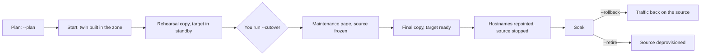

import { CliVersion } from "/snippets/cli-version.jsx";

<Warning>
**Closed beta.** Zone moves are part of [Ankra Cloud clusters](/guides/ankra-cloud-clusters), which is in closed beta. The workflow is stable but the surface may still change, and it is enabled per organisation on request. [Contact support](/platform/support) to have it turned on for your organisation.
</Warning>

A zone move takes an Ankra Cloud cluster to another Ankra Cloud zone. Ankra builds a twin of the cluster in the new zone, copies your stacks and their data to it, and moves your public hostnames over when you say so. The source keeps serving until then, and it is kept after the cutover, so you can go back.

The same command moves a cluster to another organisation with `--organisation`. That is a different move: see [Cluster settings](/platform/cluster-settings#general). The two cannot be combined.



## Before you start

- **Both clusters are on Ankra Cloud.** The source is an Ankra Cloud cluster, and the target is built in, or already exists in, another Ankra Cloud zone.
- **Your hostnames are proxied records in Ankra Cloud hosted DNS.** Those are cut over for you. A hostname you point at an IP address yourself, or a load balancer address something dials directly, is yours to repoint at the cutover. The plan lists every load balancer that serves no hostname, so you can find them.
- **A backup vault the move can use.** The data travels through a [backup vault](/concepts/backup-vaults). For each stack, the move uses the vault of the stack's backup policy, and otherwise the organisation's only ready vault. With several ready vaults and no policy that names one, the plan warns and the move is refused before it writes anything. Give the stack a backup policy that names its vault first, for example `ankra cluster stacks protect shop --vault production-backups`. See [Protect a stack](/guides/backups#protect-a-stack).
- **Permissions.** Planning needs `stacks.read` on the source. Starting the move needs `stacks.write` and `clusters.operate` on the source, `backups.operate`, and `clusters.create` when Ankra builds the target (Admin or Owner). The cutover and the rollback need `stacks.write` and `clusters.operate`. Retiring the source needs `clusters.delete`. See [Roles and access](/guides/roles-and-access).

## 1. Plan the move

<CliVersion since="0.85.0" command="cluster move --zone" />

```bash
ankra cluster move my-cluster --zone se-sto1 --plan
```

The plan writes nothing. It shows:

- **The target cluster**: its name (`<cluster>-<zone>` by default), network mode, storage tier, control plane, bastion and node groups. The shape is derived from the source.
- **Stacks carried and stacks not carried.** Platform stacks are installed fresh on the target and are not copied: networking, Cilium, the cloud provider, the backup data plane and the security baseline. The source's external-dns is not copied either (see [What moves and what does not](#what-moves-and-what-does-not)).
- **Data volumes copied**, each with its size, the total requested, and the storage class it lands on.
- **Not carried**: everything the move leaves behind, such as the source's registry pull secrets, and why.
- **Hostnames cut over**: each public hostname, how it is cut over, and its origin on the source and on the target.
- **Warnings**, for example a stack whose database is copied only at the cutover.

Change the shape with these flags, on the plan and on the start:

| Flag | What it sets |
|---|---|
| `--control-plane-count` | Control plane nodes of the target |
| `--control-plane-plan` | Server plan of the target's control plane nodes |
| `--worker-plan` | Server plan of the target's workers |
| `--worker-count` | Workers of the target |
| `--storage-tier` | Storage tier of the target's volumes: `local-nvme`, `standard`, `maxiops` or `hdd` |
| `--target-name` | Name of the cluster the move builds |
| `--soak-days` | Days the move soaks after the cutover before the source may be retired (default 7) |

Volumes on a local NVMe class (`ankra-local-nvme`, or `ankra-default` in a zone whose default tier is local NVMe) land on the zone's replicated Ankra Storage tier, `ankra-standard`, unless you pass `--storage-tier`. The storage classes are listed in [Ankra Cloud Clusters](/guides/ankra-cloud-clusters).

## 2. Start the move

```bash
ankra cluster move my-cluster --zone se-sto1 --wait
```

Ankra builds the twin in the zone and copies the stacks and their data to it as a rehearsal. The target stays in standby: none of the moved stacks' workloads run there, so nothing writes twice. The source keeps serving. A stack whose data is only volumes is copied in the rehearsal. A database run by an operator is copied once, at the cutover, from the frozen source.

To move into a cluster you built yourself, name it with `--target-cluster`. It must be an empty Ankra Cloud cluster in the target zone, with none of the namespaces the moved stacks use:

```bash
ankra cluster move my-cluster --zone se-sto1 --target-cluster my-cluster-stockholm --wait
```

The shape flags do not apply with `--target-cluster`.

When the rehearsal is done, the move rests at `ready_for_cutover` and waits for you. Check it at any time:

```bash
ankra cluster move my-cluster --status
```

`--status` shows the move, its status and each step with its message. `--wait` follows the move until it rests (up to `--timeout`, three hours by default), and `-o json` or `-o yaml` prints it for scripts. Every step that changes something asks for confirmation unless you pass `--yes`.

## 3. Cut over

The cutover is always a command you run. It never starts by itself.

```bash
ankra cluster move my-cluster --cutover --wait
```

In order:

1. The edge shows a maintenance page for the moved hostnames.
2. The source's writers scale to zero and its CronJobs are suspended. Its external-dns stops, so it cannot write the old addresses back.
3. A fresh copy of the data is taken from the frozen source, and the stacks are deployed on the target.
4. The target is gated on readiness: its workloads must come up.
5. Every proxied hostname is repointed from the source's load balancer to the target's in one call.
6. The source cluster is stopped. It is kept, not deleted.

Your downtime is the final copy plus the readiness gate. In our first move, copying 80 GiB of requested volumes took about 7 minutes.

If the cutover fails before traffic moves, Ankra puts the source back by itself: the target goes back to standby, the source's writers return, and the maintenance page comes down. The move ends `failed` and `--status` says why.

Repoint any hostname that is not a proxied record in Ankra Cloud hosted DNS now.

## 4. Soak, then roll back or retire

After the cutover the move soaks for `--soak-days` (7 by default). The stopped source keeps its place on its host, so a rollback can always start it again. Stopped Ankra Cloud servers bill at their plan price while stopped.

To go back:

```bash
ankra cluster move my-cluster --rollback --wait
```

Traffic returns to the source and the source starts again. Writes made on the target since the cutover are not copied back.

When you are sure, retire the source:

```bash
ankra cluster move my-cluster --retire
```

<Warning>
Retiring deprovisions the source cluster and its servers. It cannot be undone, and after it there is nothing to roll back to.
</Warning>

## What moves and what does not

| Item | On a zone move |
|---|---|
| Your stacks (add-ons, manifests, applications) | Copied to the target and deployed at the cutover |
| Data volumes owned by a stack | Copied, in the rehearsal and again from the frozen source at the cutover |
| Operator-run databases owned by a stack | Copied once, at the cutover |
| Volumes on a local NVMe class | Land on `ankra-standard`, or the tier you pass with `--storage-tier` |
| Proxied hostnames in Ankra Cloud hosted DNS | Repointed to the target's load balancer in one call |
| Other DNS records and raw load balancer addresses | Not changed. Repoint them yourself at the cutover |
| Networking, Cilium, cloud provider, backup data plane, security baseline | Not copied. The target installs its own |
| The source's external-dns | Not copied. It is stopped with the writers and restored on rollback. Give the target its own DNS writer once the source is retired |
| SOPS key, registry pull secrets, Git repository connection, metrics and log source | Not copied. The plan lists each one the source has. Set them up on the target. A stack with encrypted values needs the SOPS key on the target before it deploys |
| Data no stack member owns | Not copied. The plan names it |
| Writes made on the target after the cutover | Not copied back on rollback |

## The Ankra Cloud pieces

The cutover uses two Ankra Cloud load balancer operations, and you can call them yourself outside a zone move:

- `POST /v1/load-balancers/{id}/proxied-records/repoint` with `{"target_load_balancer_id": "<id>"}` moves every proxied record of one load balancer to another in one transaction. See [Moving proxied hostnames to another load balancer](https://cloud.ankra.app/docs/concepts/load-balancers#moving-proxied-hostnames-to-another-load-balancer).
- `PUT /v1/load-balancers/{id}/edge-maintenance` with `{"enabled": true, "message": "..."}` shows a maintenance page (`503`, `Retry-After: 120`) for the load balancer's proxied hostnames. See [Maintenance page](https://cloud.ankra.app/docs/concepts/load-balancers#maintenance-page).

These are Ankra Cloud API routes on `cloud.ankra.app`, called with an Ankra Cloud API token.

## Troubleshooting

Start with the move itself. The open step's message says what it waits on:

```bash
ankra cluster move my-cluster --status
```

| Symptom | What to do |
|---|---|
| The move stays in `provisioning` | The target is being built and its agent has not connected yet. Follow it with `ankra cluster operations list --cluster my-cluster-se-sto1` |
| The move stays in `seeding` or `final_copy` | The data copies are running. List them with `ankra runs list --cluster my-cluster-se-sto1 --kind clone` |
| The plan warns about backup vaults, or the start is refused over a vault | The organisation has several ready vaults and the stack names none. Give the stack a backup policy with `ankra cluster stacks protect <stack> --vault <vault>` |
| The start or the cutover is refused naming a stack, a namespace and a workload | A moved stack runs a writer in a system namespace, or in a namespace a stack left behind shares. The freeze could not stop it. Move that workload into the stack's own namespace |
| The start is refused because the target already has namespaces the moved stacks use | `--target-cluster` must be empty. Remove those namespaces from the target, or let Ankra build the target |
| The start is refused because the target's agent is too old | Upgrade the agent on the target, then start again |
| The cutover is refused because a maintenance page cannot be put on every load balancer | Ankra Cloud cannot show the page on every origin of the source's hostnames, so writes during the freeze would be lost. Contact [support](/platform/support) |
| A workload on the target does not become ready | Look at it with `ankra cluster get pods -n <namespace> --cluster my-cluster-se-sto1`, `ankra cluster events --cluster my-cluster-se-sto1` and `ankra cluster logs <pod> -n <namespace> --cluster my-cluster-se-sto1`. A cutover that fails before traffic moves puts the source back by itself |
| A hostname still reaches the old address after the cutover | It is not a proxied record in Ankra Cloud hosted DNS. Repoint it yourself |
| `--cutover`, `--rollback` or `--retire` says the move is in another status | Each step runs only from one status: `--cutover` from `ready_for_cutover`, `--rollback` and `--retire` from `soaking`. The message names the next step |

## Related

<CardGroup cols={2}>
  <Card title="Clone a Cluster" icon="copy" href="/guides/clone-cluster">
    Copy stacks, with or without data, to another cluster without moving traffic.
  </Card>
  <Card title="Backups" icon="database" href="/guides/backups">
    Backup vaults, stack protection and restore points.
  </Card>
  <Card title="Ankra Cloud Clusters" icon="cloud" href="/guides/ankra-cloud-clusters">
    Create and operate clusters on Ankra Cloud.
  </Card>
  <Card title="CLI reference" icon="terminal" href="/reference/cli/cluster#ankra-cluster-move">
    Every flag of `ankra cluster move`.
  </Card>
</CardGroup>
