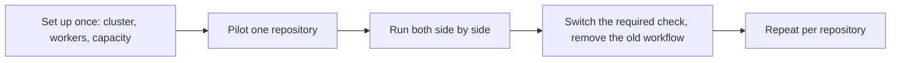

[Get started with Ankra CI](/get-started/ankra-ci) moves one repository. This page is the plan for the rest of them: what to set up once for the whole organisation, how to prove Ankra CI on one repository before you depend on it, and the checklist to repeat for every repository after that.

## The plan at a glance

Most teams move a repository in an afternoon once the organisation is set up. The side-by-side period is what takes calendar time - give it at least a few days of normal pull requests, so you see the flaky tests and the slow ones before anyone depends on the new check.

## 1. Set up once for the organisation

These are organisation-wide and an administrator does them once. Steps 1 and 2 of [Get started with Ankra CI](/get-started/ankra-ci) walk through the first two.

- **Choose the pipeline cluster** - `ankra org ci-settings set --cluster <cluster-name>`, or **Settings → Pipelines → Pipeline cluster**.
- **Give its agent pipeline workers** - `ankra cluster agent ci set --workers <n> --cluster <cluster-name>`. Each worker runs one step at a time. Size it to how many steps you expect at once across all your repositories at a busy moment, and raise it later - the run page says when a step waited for a free worker.
- **Let the cluster grow under load.** Steps reserve the CPU and memory they ask for, so a busy hour needs nodes, not just workers. Turn on autoscaling for the node group your steps run on, so the cluster adds a node rather than queueing steps. When a step is waiting, the run says why - a provider quota, a node group at its maximum, or a node scaling up - and what to do about it.
- **Decide your image policy.** By default a step may use any image. To limit steps to images you trust, set `ankra org ci-settings set --allowed-image-prefix <prefix>` once per registry or path you allow.
- **Check the image gate.** `ankra org ci-settings get` shows the gate policy that decides which scan findings block a publish. The default, `app`, blocks fixable critical and high findings in your own dependencies.

`ankra org ci-settings get` shows all of this, and how many CI slots are in use right now.

<Tip>
When one cluster is no longer enough, add another to the organisation's CI pool and runs go to the least loaded one: `ankra org ci-settings pool add <cluster-name>`, CLI v0.28.0 or later.
</Tip>

## 2. Pilot one repository

Pick a repository that is active enough to give you real pull requests every day, has tests that mostly pass today, and is not the one every release depends on. Then get its pipeline the fastest way that fits:

| The repository today | The fastest way to a pipeline |
| --- | --- |
| An Ankra application that builds with a GitHub Actions workflow | `ankra application pipeline convert <application-id> --keep-workflows` converts the workflow and opens a pull request with `.ankra/pipeline.yaml`. See [Migrate from GitHub Actions](/guides/migrate-from-github-actions). |
| Any repository with GitHub Actions, GitLab CI, Bitbucket Pipelines or CircleCI | Ask Ankra AI in the portal chat to convert the workflow files, then review every note it leaves. See [Convert with Ankra AI](/guides/migrate-from-github-actions#convert-with-ankra-ai). |
| A repository with simple test commands | Copy a [starter pipeline](/guides/ankra-ci-starter-pipelines) and change the test command. |

A converted pipeline is a starting point a person reviews. Anything the converter cannot map is either a stage that fails with an explanation, or a note naming the step it came from - never dropped silently.

## 3. Run both side by side

Keep the old CI running while the Ankra pipeline runs on the same pull requests, and leave the old check as the required one for now. Compare:

- **Does the Ankra pipeline fail where the old CI passes?** Usually it is one of the [three rules every step follows](/guides/ankra-ci-starter-pipelines#three-rules-every-step-follows) - a tool writing into `HOME`, a step that needs the network, or a missing image tool that the old runner had preinstalled. [Troubleshooting](/guides/ankra-ci-troubleshooting) has the fixes.
- **Is it fast enough?** Add [caches](/guides/ankra-ci-starter-pipelines#make-it-faster-with-caches) for your package manager and give heavy steps the CPU and memory they need. `ankra pipeline get <run-id>` prints, per step, how long it waited for a slot, how long its pod took to start, and its memory and CPU peaks against what it asked for - so you can see whether to ask for more or less.
- **Are the secrets right?** Move each secret into Ankra once and declare it in the pipeline - see [Use a secret in a step](/guides/ankra-ci-starter-pipelines#use-a-secret-in-a-step).

<Warning>
**Publish an image from one system at a time.** While both run, let only one of them push images and deploy - otherwise two builds of the same commit race for the same tag. Leave publishing in the old CI during the comparison, or leave the `publish` stage out of the Ankra pipeline until you switch.
</Warning>

## 4. Switch over

When the Ankra pipeline has been green on a week of pull requests, or as long as your team needs to trust it:

1. **Approve the pipeline on the default branch** if it declares secrets, caches, resources, services or other protected settings, so every run gets them. `ankra pipeline validate` lists any protected setting that is not approved yet.
2. **Make `Ankra pipeline` the required check.** On GitHub that is the branch protection rule or ruleset on your default branch. Remove the old CI's checks from the required list in the same change.
3. **Remove the old workflow** - delete `.github/workflows/*.yml` or `.gitlab-ci.yml` - so every commit is built once.
4. **Add publishing back** to the Ankra pipeline if you held it out, with the `build`, `scan`, `gate` and `publish` stages from [Build, scan and publish an image](/guides/ankra-ci-starter-pipelines#build-scan-and-publish-an-image).
5. **Tell the team what changed** - below.

## 5. Repeat for each repository

Once the organisation is set up, each repository needs only this:

- [ ] Repository connected to Ankra Pipelines
- [ ] `.ankra/pipeline.yaml` committed, validated and approved
- [ ] Green on several pull requests while the old CI still runs
- [ ] `Ankra pipeline` required, old CI checks no longer required
- [ ] Old workflow files removed
- [ ] Publishing and deploys come from the Ankra pipeline

## What changes for developers

Share this with the team when a repository switches:

- **The check is called `Ankra pipeline`.** It has a table of steps and a link to the run in Ankra. GitHub's **Re-run** button on it starts a new run, and **Cancel** stops one.
- **Logs and test results are in Ankra.** Open the run from the check, or use the CLI: `ankra pipeline logs <run-id> --step <step> --follow`.
- **Re-run only what failed** with **Re-run failed steps** on the run page, or `ankra pipeline rerun <run-id> --failed-only`.
- **Pipeline changes in a pull request run on that pull request.** Changing a stage or a script takes effect immediately. Adding a secret, a cache, more memory or a service takes effect after it is merged and an administrator approves it.

## GitHub Actions to Ankra CI

| GitHub Actions | Ankra CI |
| --- | --- |
| `.github/workflows/*.yml`, one file per workflow | One `.ankra/pipeline.yaml` per repository |
| `on: push`, `pull_request` | `on.push`, `on.pull_request`, with `branches` and `paths` |
| `on: workflow_dispatch` with `inputs` | `on.manual` with `inputs` |
| `on: schedule` | `on.schedule`, plus `ankra pipeline schedules create` |
| `jobs.<id>` | A stage in `stages`, with a `kind` |
| `runs-on` | Your pipeline cluster. `runs_on.node_selector` places a step on particular nodes |
| `actions/checkout` | A `kind: checkout` stage |
| `actions/setup-node`, `setup-python`, `setup-go` | The stage's `image`, for example `node:24-alpine` |
| `steps[].run` | The stage's `run` script, run with `sh -eu` |
| Marketplace actions (`uses:`) | A `run` script that does the same thing; the converter writes these for common actions |
| `needs` | `needs` |
| `if:` | `if:`, with `success()`, `failure()`, `always()` and `cancelled()` |
| `strategy.matrix` | `matrix`, with `include` and `exclude` |
| `services` | A top-level `services` block, named on each stage that uses it |
| `env` | `env` on a stage, or `defaults.env` |
| `secrets.X` | A declared `secrets` entry, delivered as a file under `/run/agent-secrets/` |
| `actions/cache` | A stage's `cache` block |
| `actions/upload-artifact` | A stage's `artifacts` list |
| JUnit or test report actions | A stage's `test_results` list (`junit`, `go-test`, `pytest`, `playwright`) |
| `docker/build-push-action` | The `build`, `scan`, `gate` and `publish` stages |
| `concurrency`, `cancel-in-progress` | `concurrency.group`, `concurrency.cancel_in_progress` |
| `timeout-minutes` | A stage's `timeout`, such as `"45m"` |
| `permissions` | `permissions`, approved by an administrator |

GitLab CI maps the same way: each job becomes a stage, `image` and `script` become the stage's `image` and `run`, `needs` stays `needs`, `services` becomes the `services` block, and `rules` become the stage's `when` and `if`. [Migrate from GitHub Actions](/guides/migrate-from-github-actions) covers what the converter does with each format.

## Related

- [Get started with Ankra CI](/get-started/ankra-ci)
- [Starter pipelines](/guides/ankra-ci-starter-pipelines)
- [Troubleshooting](/guides/ankra-ci-troubleshooting)
- [Organisation CI settings](/guides/ankra-pipelines#organisation-ci-settings) and [capacity](/guides/ankra-pipelines#capacity-and-concurrency)
