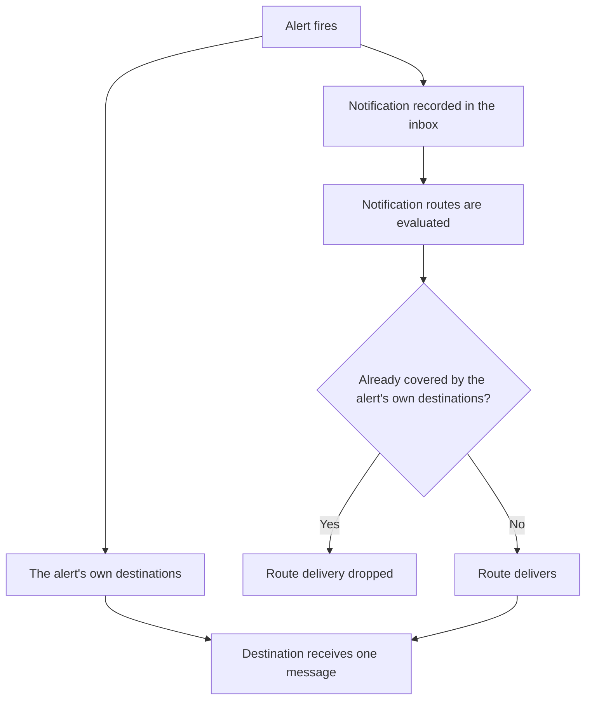

import { CliVersion } from "/snippets/cli-version.jsx";

A notification can reach a destination by two independent paths:

- **An alert's own destinations.** On an alert rule, **Tell these destinations** ticks destinations directly (see [Alerts](/guides/alerts)). When the alert fires, Ankra delivers to every destination ticked there.
- **A notification route.** Under **Integrations & alerts → Notification routes** (`/next/organisation/notification-routes`), a routing rule in one project or organisation-wide matches notifications by kind, severity, cluster, source, application and branch or pull request, and sends them to one destination, or to people's phones through the Ankra app. Routes cover every notification kind, not only alerts.

The destinations themselves (Slack, Microsoft Teams, Discord, PagerDuty or another webhook) are listed under **Integrations & alerts → Notification destinations**, see [Webhooks](/guides/webhooks).

Both paths can point at the same destination at the same time. That is a supported configuration, and it delivers once.



## One delivery per destination

**A notification is delivered at most once per destination.** This is a guarantee, not a timing accident.

Before it queues anything, Ankra subtracts the destinations the alert's own list already covers from the destinations the routing rules resolved. A destination that both paths point at is queued once, by the alert.

Two consequences follow, and both matter when you are deciding how to configure routing:

- **You do not need to detach destinations from your alerts** to avoid duplicates, and you do not need to delete the routing rule either. Keeping both is safe.
- **The subtraction only runs one way.** Routing rules are netted against the alert's destinations. The alert's own destinations are never netted against anything, so no routing rule - include or exclude, at any priority - can add to them or take them away.

The netting happens before anything is queued, so a de-duplicated rule never produces a delivery at all. The one case where a destination can see the same firing twice is if the alert's trigger record has already been removed by the time routing runs: Ankra then cannot tell what the alert covered, and delivers rather than risk staying silent. It errs towards a duplicate, never towards a missed alert.

## How a rule matches

A routing rule sets any combination of six filters. Every filter it sets must match; a filter it leaves empty matches everything.

| Filter | Empty means | Matches when |
|---|---|---|
| Kind | All kinds | The notification's kind is in the rule's kind list (or, for a negated list, is not in it) |
| Severity | All severities | The notification's severity is exactly the rule's severity |
| Cluster | All clusters | The notification is about that cluster |
| Source | All sources | The notification's source id is exactly the rule's source id - for alert firings, the alert id |
| Application | All applications | The notification is about that application. A notification that names no application never matches a rule that sets this filter |
| Reference pattern | All branches, tags and pull requests | The branch, tag or pull request the notification is about matches the rule's glob, see [Scope a route to one application and its default branch](#scope-a-route-to-one-application-and-its-default-branch). A notification that names no reference never matches a rule that sets this filter |

A rule with no filters at all matches every notification. Disabled rules are skipped entirely.

## Add a rule in the portal

Adding, changing and deleting rules needs a role that manages alerts; without it the page reads **Your role can look at routing rules but not change them. Someone who manages alerts can.**

1. Open **Integrations & alerts → Notification routes** and click **Add rule**.
2. Under **Send to**, choose **A destination** and pick it under **Destination**, or **The Ankra app** for a push to phones and choose **Who** (see [Send to phones](#send-to-phones)).
3. Under **Which notifications**, choose **Every kind**, **Only these kinds** or **Every kind except these**, and tick the kinds.
4. Narrow it, if you like, with **Severity**, **Cluster**, **Application** and **Branch or reference**.
5. Under **When it matches**, keep **Send it there**, or choose **Keep it away from there**.
6. Set **Priority** (lower numbers are checked first; a new rule starts at 100) and, if this rule should end the walk, switch on **Stop here when it matches**.
7. Click **Add rule**.

**You should see** the rule in the list under **Routing rules**, titled with its kinds (for example **Every kind**), with a line such as **To Platform alerts · Any severity · every cluster · Priority 100**. A **Keep it away from there** rule wears **Keeps it away**.

To check it, open the rule's options menu (**…**) and choose **Send a test**. The page says **Test sent** and **A sample is on its way to** the destination; check it there in a minute. **Send a test** is on rules that send, not on rules that keep notifications away. Then check where real notifications go with [Where would it go?](#preview-what-would-be-delivered).

## Routes per project

On top of those filters, a rule is either in one [project](/concepts/projects) or organisation-wide:

- **In a project** - it matches only notifications of that project, never an organisation-level one such as billing. A notification's project is the project of the thing it is about (its ticket, application, pipeline run, repository, automation, workspace, incident, environment or cluster), read when it is delivered, so a moved cluster's notifications follow it.
- **Organisation-wide** - it matches every project's notifications and the organisation's own.

You choose under **Which notifications it delivers**, **This project** or **Whole organisation**, when you create a rule, and the list shows each rule's project, or **Whole organisation**, beside it. Rules from before projects were released are organisation-wide. A rule created with projects on and without a choice (in the portal before the form asked, or through the API without `project_id`) is in the project it was created in, as [Projects](/concepts/projects#what-lives-where) explains, and delivers only that project's notifications; move it to the whole organisation from the rule's menu if it should hear everything. A project rule also counts as more specific in the [evaluation order](#evaluation-order).

### Example: one channel per project

An organisation has projects `core` and `tools`, and wants each project's notifications in its own channel, `#ankra-core` and `#ankra-tools`, on Slack or Teams.

1. Add a destination for each channel under **Integrations & alerts → Notification destinations**.
2. In project `core`, create one rule with no filters, **This project**, sending to `#ankra-core`. Do the same in `tools` for `#ankra-tools`.
3. For AI board threads (plan sign-offs, approvals and decisions), bind each project's channel under **Project channels** on the **Ticket desk** (**Ankra AI → Settings → Configure work routing**). See [Project channels](/platform/ai-board#project-channels).

Anything organisation-level, and any project without a rule, still reaches the organisation's own routes and the [home channel](#the-home-channel-fallback).

<Note>
Two things do not follow the project. When you ask Ankra AI something in `#ankra-tools`, it works in your own current project, not the project of the channel. Remediation approval cards go to the organisation's one **Slack webhook for approvals**, set under **Ankra AI → Autonomy and approvals**, whatever the project.
</Note>

## Scope a route to one application and its default branch

A pipeline run outcome, an image gate verdict or an authority approval belongs to the organisation, not to a cluster, so the **Cluster** filter can never narrow them (a PR preview does name the cluster it was published on). Two filters can:

- **Application** - the rule matches only notifications about that application. In the rule form it is the **Application** picker; in the CLI, `--application <name-or-id>`; in the API, `application_id`.
- **Reference pattern** - a glob over the branch, tag or pull request the notification is about. In the rule form it is **Branch or reference**; in the CLI, `--reference-pattern <glob>`; in the API, `reference_pattern`. `*` matches within one path segment, `**` across segments and `?` one character other than `/`. No whitespace, and `!`, `+`, `[` and `]` are refused. At most 255 characters.

A branch's reference is `refs/heads/<branch>`, and a pattern is tried against it both whole and without that prefix, so `main` and `refs/heads/main` both match a push to `main`. A pull request's reference is `pull/<number>`, so `main` never matches a pull request into `main`, and `pull/*` matches every pull request and nothing else: a branch literally named `pull/55` does not match it. A tag's reference is `refs/tags/<tag>`, so `refs/tags/v*` follows releases and a bare `v*` does not.

The kinds that carry a reference are the pipeline run outcomes (`pipeline_run_failed`, `pipeline_run_succeeded`), the pipeline authority's approval request and approval (`pipeline_authority_approval_requested`, `pipeline_authority_approved`), the image gate (`image_gate_blocked`) and PR previews (`preview_ready`, `preview_failed`). Each names its application when the repository has one; a run of a repository connected without an application names none, so only a reference pattern can scope it. A rule that sets either filter never matches a notification without the value: an alert firing or a GitOps sync is not about every branch, the same way an organisation-wide notification is not about every cluster.

The rule behind a `#cicd-notify` channel - every failed run and every blocked image gate on one application's default branch, nothing from pull requests. The pattern names the branch literally, so write `master` where that is the default:

<CliVersion since="0.24.0" />

<CodeGroup>

```bash CLI
ankra alerts routes create --destination-id <destination-id> --kinds pipeline_run_failed,image_gate_blocked \
  --application <application-name-or-id> --reference-pattern main
ankra alerts routes preview --kind pipeline_run_failed --severity warning --application <application-name-or-id> --reference refs/heads/main
ankra alerts routes preview --kind pipeline_run_failed --severity warning --application <application-name-or-id> --reference pull/55
```


```bash cURL
curl -X POST https://platform.ankra.app/api/v1/org/notifications/routes \
  -H "Authorization: Bearer <your-token>" \
  -H "Content-Type: application/json" \
  -d '{"kinds": ["pipeline_run_failed", "image_gate_blocked"], "application_id": "<application-id>", "reference_pattern": "main", "destination_id": "<destination-id>"}'
```

</CodeGroup>

With the rule in the application's project or organisation-wide, the first preview reaches the channel and the second does not, because `pull/55` is not `main`. Both filters add to a rule's [specificity](#evaluation-order), one point each.

## Kinds: one, several, or everything except

**Kind** takes a list, and the list can be inverted. In the rule form it is **Which notifications**:

- **Every kind** - no kind filter.
- **Only these kinds** - tick them under **Kinds to route**. "Operation failed and Reconciliation failing, nothing else" is one rule, not two.
- **Every kind except these** - tick the kinds to leave out under **Kinds to leave out**. "Route everything except Alert firing to this channel, because alerts already have their own destinations" is one rule, not ten.

Negating a list is not the same as an Exclude rule. A negated list changes which notifications the rule *matches*; Exclude changes what the rule *does* when it matches. See the next section.

<Note>
The API accepts both spellings. `kinds` is the list, and `kinds_negated: true` inverts it. The older single-value `kind` field still works, and a rule whose list is exactly one kind continues to report that kind in `kind`, so existing API clients and scripts keep working unchanged.
</Note>

## Opt-in kinds

A few notification kinds are **opt-in**: a rule only matches them if it *names* them. **Every kind** does not cover an opt-in kind, and neither does **Every kind except these**, because that spelling says what a rule skips rather than what it covers. The home channel fallback never picks one up either, whatever its severity.

These kinds report routine, successful work rather than something that needs attention, and they can fire often. Leaving them out of the catch-all rules an organisation already has is what keeps a channel worth reading.

| Kind | What it reports |
|---|---|
| `gitops_repository_write` | Ankra committed to your GitOps repository: the reconciler converging drift, or a save in the portal, the API, the CLI, chat, or a cloud provider publish. The notification names the repository, the branch, the commit, who or what wrote, and the files it re-encrypted, wrote and removed. |
| `backup_run_succeeded` | A backup run succeeded. |
| `node_group_autoscaled` | A node group was autoscaled. The rule form offers it as **Node group autoscaled**, under **Only these kinds** only. |

To subscribe, create a rule that names the kind:

<CodeGroup>

```bash CLI
ankra alerts routes create --destination-id <destination-id> --kinds gitops_repository_write
ankra alerts routes preview --kind gitops_repository_write --severity info --cluster-id <cluster-id>
```

```bash cURL
curl -X POST https://platform.ankra.app/api/v1/org/notifications/routes \
  -H "Authorization: Bearer <your-token>" \
  -H "Content-Type: application/json" \
  -d '{"kinds": ["gitops_repository_write"], "destination_id": "<destination-id>"}'
```

</CodeGroup>

Add a `cluster_id` filter to follow one cluster's repository rather than every cluster in the organisation.

<Note>
The kinds offered on the **Notification routes** page are a shorter list than the API accepts. A rule for a kind the page does not offer is created through the CLI, the API, or Ankra chat, and then reads and edits normally on that page.
</Note>

## Cluster access kinds

Two kinds report changes to who can reach your clusters with `kubectl`. Both are `warning` severity and are **not** opt-in: they reach catch-all rules ("All kinds") and, when no rule matches, the [home channel](#the-home-channel-fallback), with no configuration.

| Kind | What it reports |
|---|---|
| `cluster_access_policy_changed` | Every accepted change to the [organisation access policy](/guides/cluster-access#organisation-access-policy): who changed it, and the policy before and after. |
| `cluster_access_elevated_grant` | Every [break-glass elevation](/guides/cluster-access#break-glass-elevation), at any role, and every `admin` or `cluster-admin` grant, including extensions of one. |

To send them somewhere specific, such as a security channel, create a rule that names them:

```bash
ankra alerts routes create --destination-id <destination-id> --kinds cluster_access_policy_changed,cluster_access_elevated_grant
```

## Evaluation order

Rules are evaluated in ascending **priority** - 10 runs before 100. Rules sharing a priority are broken by **specificity**: the rule that names more values runs first.

Specificity counts the filters that name a value:

| Filter | Adds specificity |
|---|---|
| A kind, or a list of kinds | Yes |
| **Every kind except these** | No - it names what the rule skips, not what it covers |
| Severity | Yes |
| Cluster | Yes |
| Source | Yes |
| Application | Yes |
| Reference pattern | Yes |
| Project | Yes |

The walk keeps a running set of destinations, starting empty. Each matching rule adds to it or removes from it, and the set that survives is what gets delivered.

## Include and Exclude

In the rule form the mode is **When it matches**; the API and CLI call it `mode`:

| Mode | In the portal | Effect when the rule matches |
|---|---|---|
| Include | **Send it there** | Adds its destination to the running set |
| Exclude | **Keep it away from there** | Removes its destination from the running set - **if an earlier rule put it there** |

**Exclude is not mute.** An Exclude rule can only take back what a higher-precedence rule in the same walk already added. An Exclude rule that runs before anything has added its destination removes nothing.

**Exclude never touches an alert's own destinations.** The walk described here resolves routing rules only. An alert's own destinations are delivered by the alert itself and are not in the running set, so no Exclude rule can remove them - whatever its priority, and whether or not it stops the walk.

Worked example, for a rule at priority 10 that matches everything, is set to Exclude, and has **Stop on match** on:

| What happens | Result |
|---|---|
| The walk starts, running set is empty | - |
| The Exclude rule matches and tries to remove its destination | Nothing to remove; the set stays empty |
| Stop on match halts the walk | Lower-priority Include rules are never evaluated |
| Routing rules deliver | Nothing |
| The alert's own destinations deliver | Unaffected - still delivered |
| The home channel fires | No - a rule matched, so this is a deliberate mute, not an unhandled event |

So that rule is a global mute for route-driven delivery, and only for route-driven delivery. If you want to silence an alert entirely, remove its destinations on the alert itself or disable the alert.

## Stop on match

**Stop on match** (**Stop here when it matches** in the rule form, `--stop-on-match` in the CLI) halts the walk at the first matching rule that carries it. Rules with a lower priority are never evaluated, whatever their mode. Combined with priority it gives you a first-match-wins rule: put the specific rule at a low priority with Stop on match, and let the catch-all sit at priority 100.

Stop on match does not by itself deliver or suppress anything - it only ends the walk. The running set at that moment is what gets delivered.

## Send to phones

A rule whose **Send to** is **The Ankra app** pushes the notification to the phones and tablets of the people under **Who**:

| Who | Reaches |
|---|---|
| **Everyone on the cluster** | Everyone who is a member of the cluster the notification is about |
| **Organisation admins** | The organisation's administrators |
| **One member** | The member you choose under **Member** |
| **Some members** | The members you tick under **Members** |

A rule can push to phones even when the organisation has no destination. How the push arrives, and how each person turns it down, is in [Push notifications on your phone](/guides/mobile-push).

## Notifications addressed to one person, and mutes

Routes are the organisation's decision. Two things are each member's own:

- **Notifications addressed to you**, such as a failed pipeline run you started or pushed, reach you through your own channels under **Your account → Notifications** (`/next/account/notifications`), with no routing rule. Each channel, **Email**, **Phone and tablet** and **Browser**, has its own switch and a choice of **Critical only**, **Critical and warnings** or **Everything**.
- **Mutes.** **Mute on this cluster** on a notification's page stops new notifications like it from that cluster showing for you. **Integrations & alerts → Muted notifications** lists what you muted, with **Unmute**. Only you stop getting them; everyone else, and every destination and routing rule, still does.

## The home channel fallback

If your organisation has a [home channel](/guides/webhooks#home-channel) and a critical or warning notification matches **no** routing rule at all, Ankra posts it to the home channel so nothing important is lost silently.

The fallback is deliberately narrow:

- It fires only when no rule matched. A rule that matched and netted the destinations to nothing is a mute, and the home channel stays quiet.
- It never fires for informational notifications.
- It never fires for an [opt-in kind](#opt-in-kinds), which reaches a destination only through a rule that names it.
- It never fires for an alert firing that already delivers to the alert's own destinations.

## Preview what would be delivered

Rather than reasoning through the walk, ask Ankra. **Where would it go?** on the **Notification routes** page takes a **Kind**, a **Severity**, and optionally a **Cluster**, an **Application**, a **Project** and a **Reference**; **Check where it goes** evaluates that hypothetical notification against your organisation's rules and lists the destinations it would reach, the destinations it would not, and the reason for each - including which rules matched, which were skipped by a Stop on match, and which route deliveries were dropped because an alert's own destination already covers them.

The preview is a dry run. It delivers nothing and changes nothing.

The preview reads the notification's project from the cluster or application you give it. Delivery also reads the ticket, pipeline run, repository, automation, workspace, incident and environment a notification is about, each before its cluster. For a notification about one of those, name the project: the portal's preview has a **Project** field, which starts at your current project, and in the API you send `project_id`. Both the preview and delivery look the project up only while at least one rule is in a project, because otherwise it cannot change the result. The response says which project it evaluated (`null` for the organisation).

<CliVersion since="0.13.0" />

<CodeGroup>

```bash CLI
ankra alerts routes preview --kind alert_trigger_fired --severity critical
ankra alerts routes preview --kind alert_trigger_fired --severity critical --alert-id <alert-id>
ankra alerts routes preview --kind gitops_sync_failed --severity warning --cluster-id <cluster-id> -o json
```

```bash cURL
curl -X POST https://platform.ankra.app/api/v1/org/notifications/routes/preview \
  -H "Authorization: Bearer <your-token>" \
  -H "Content-Type: application/json" \
  -d '{"kind": "alert_trigger_fired", "severity": "critical", "alert_id": "<alert-id>"}'
```

</CodeGroup>

Pass `--alert-id` (or `alert_id`) whenever you are previewing an alert firing: without it the preview cannot know which destinations the alert itself covers, and will show the route deliveries that de-duplication would drop.

For a pipeline, gate or preview notification, pass `--application` and `--reference` (`application_id` and `reference` in the API, such as `refs/heads/main` or `pull/12`) : a rule scoped to an application does not match a preview without one, and a rule with a reference pattern does not match a preview without a reference.

## Managing rules from the CLI

<CodeGroup>

```bash CLI
ankra alerts routes list
ankra alerts routes create --destination-id <destination-id> --kinds execution_failed,resource_reconcile_failed
ankra alerts routes create --destination-id <destination-id> --exclude-kinds alert_trigger_fired
ankra alerts routes create --destination-id <destination-id> --kinds pipeline_run_failed,image_gate_blocked --application <application-name-or-id> --reference-pattern main
ankra alerts routes update <route-id> --priority 10 --stop-on-match
ankra alerts routes preview --kind execution_failed --severity critical
ankra alerts routes delete <route-id>
```

</CodeGroup>

`--kinds` takes a comma-separated list and `--exclude-kinds` takes the same list negated; the two are mutually exclusive. The single-value `--kind` flag still works and is equivalent to `--kinds` with one entry. `--application` takes an application name or id and `--reference-pattern` a glob; both work on `create` and `update`.

## Related

<CardGroup cols={2}>
  <Card title="Alerts" icon="bell" href="/guides/alerts">
    Alert rules, conditions, and the destinations an alert notifies directly.
  </Card>
  <Card title="Webhooks" icon="webhook" href="/guides/webhooks">
    Destinations, payload templates, and the organisation home channel.
  </Card>
</CardGroup>
