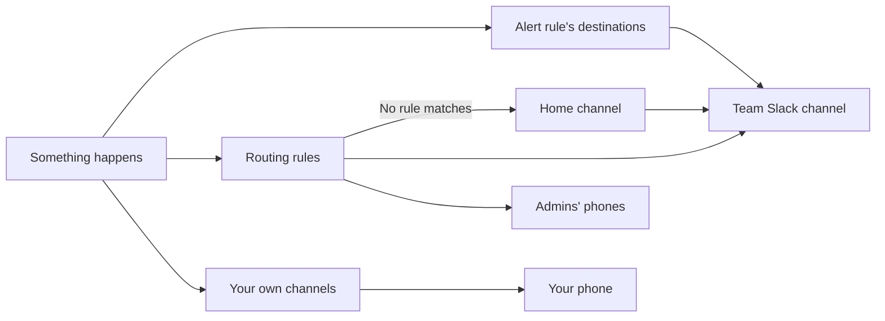

This tutorial sets up notifications for a team from nothing. Each step ends with something you can see, so you know it worked before you move on. It follows one path; the pages it links to hold every option.

You end up with:

- the team's Slack channel as a **notification destination**, and as Ankra's **home channel** for anything nobody routed
- an **alert rule** that tells the channel when a cluster goes offline
- a **routing rule** that sends failed operations to the channel, and one that pushes critical notifications to the administrators' phones
- your own phone set up, and a noisy notification muted for you alone

## Before you start

- **A role that manages alerts**, to add destinations, alert rules and routing rules. See [Roles and access](/guides/roles-and-access).
- **The Ankra Slack app** installed under **Ankra AI → Gateway connections**, for the home channel and the channel picker. See [AI Connections](/platform/ai-connections).
- **The Ankra app** on your phone, signed in to your organisation, for step 6.
- **At least one cluster** connected to Ankra.

## 1. Look at what Ankra already tells you

Click the bell. **Notifications** lists what Ankra reported: **Inbox** for what is current, **Needs you** for open warnings and critical notifications, **History** for what resolved or you archived. In the sidebar, **Needs you** lists the approvals, fixes and alerts that wait on a person.

**You should see** the notification views and, if anything is open, its notifications. Nothing in this tutorial changes what is listed there; it decides who else hears about it. [Notifications and Needs you](/platform/activity-inbox) explains both pages.

## 2. Add the team channel as a destination

Open **Integrations & alerts → Notification destinations** and click **Add destination**. Keep **Kind** on **Slack** and **How Ankra posts** on **To a channel**, pick the team's channel in **Channel**, name it `Team channel`, leave **Payload** empty, and click **Add destination**. Then choose **Send a test** in the row's options menu (**…**).

**You should see** **Test sent to Team channel** and a sample card in the channel. Other kinds and your own payloads are in [Webhooks](/guides/webhooks).

## 3. Make it the home channel

Open **Ankra AI → AI workspaces**. Under **Ankra’s home channel in Slack**, pick the same channel and click **Save home channel**.

**You should see** **Saved. Ankra posts in** and the channel's name. From now on a critical or warning notification that no routing rule matches goes to this channel, so nothing important is lost before you have written any rule. See [The home channel fallback](/guides/notification-routing#the-home-channel-fallback).

## 4. Add an alert rule

Open **Integrations & alerts → Alert rules** and click **Add alert rule**. Name it `Cluster offline`, keep **Watch** on **Clusters**, set **What to check** to **Cluster connection**, **State** to **Offline** and **Comparison** to **Is**. Keep **Where** on **Every cluster**, set **Severity** to **Critical**, leave **Wait before firing (minutes)** empty, tick `Team channel` under **Tell these destinations**, and click **Add alert rule**.

**You should see** **Critical · The cluster is offline on every cluster** and **Tells Team channel** on the new row. With **Wait before firing** empty, Ankra waits 5 minutes of a cluster being offline before the alert fires, so a short blip does not wake anyone. Every condition and timing field is in [Alerts](/guides/alerts).

## 5. Route the rest

Alert rules cover alerts. Failed operations, agent notices, cost and security notices reach people through routing rules.

1. Open **Integrations & alerts → Notification routes** and click **Add rule**.
2. Keep **Send to** on **A destination** and choose `Team channel`.
3. Under **Which notifications**, choose **Only these kinds** and tick **Operation failed** and **Reconciliation failing**.
4. Click **Add rule**.

Then add a second rule for the administrators' phones:

1. Click **Add rule** again.
2. Under **Send to**, choose **The Ankra app**, and under **Who**, **Organisation admins**.
3. Keep **Every kind**, set **Severity** to **Critical**, and click **Add rule**.

**You should see** two rules under **Routing rules**: **Operation failed, Reconciliation failing** with a line starting **To Team channel · Any severity**, and **Every kind** with a line starting **To Push to organisation admins · Critical only**. How rules are ordered, and what **Keep it away from there** and **Stop here when it matches** do, is in [Notification routing](/guides/notification-routing).

## 6. Set up your own phone

Open **Your account → Notifications** (`/next/account/notifications`). Under **Phone and tablet**, find your phone (it appears once you sign in to the Ankra app), open its menu and choose **Send a test**.

**You should see** **A test alert is on its way to** your phone, and the alert on its lock screen. Above it, **How you are notified** decides what is addressed to you personally, such as a failed pipeline run you started: each of **Email**, **Phone and tablet** and **Browser** has a switch and **Critical only**, **Critical and warnings** or **Everything**. See [Push notifications on your phone](/guides/mobile-push).

## 7. Mute one noisy notification for yourself

Open a notification about a cluster from the bell and click **Mute on this cluster**.

**You should see** **Muted for you on** the cluster's name. New notifications like it from that cluster stop showing for you, and everyone else, the team channel and the routing rules still get them. **Integrations & alerts → Muted notifications** lists what you muted; **Unmute** ends it.

## 8. Check where a notification would go

On **Integrations & alerts → Notification routes**, scroll to **Where would it go?**. Set **Kind** to **Operation failed** and **Severity** to **Critical**, and click **Check where it goes**. Then try **Kind** **Agent unreachable** with **Severity** **Warning**.

**You should see** for the first: `Team channel` and the administrators' push, each **through a routing rule**. For the second, which neither rule matches: **No rule matched, so it goes to the organisation’s home destination.** Nothing is sent by the check.

To send a real sample through a rule, choose **Send a test** in its options menu. The page says **Test sent**; check the channel in a minute.

## What can go wrong

- **The destination test did not arrive.** The result says why. See [Testing a destination](/guides/webhooks#testing-a-destination).
- **The dialog cannot pick a Slack channel.** It says **Install the Ankra Slack app from Integrations to pick a channel, or paste an incoming webhook address.** Install the app under **Ankra AI → Gateway connections**, or paste an incoming webhook address.
- **Where would it go? says It would not be delivered anywhere. No rule sends it, and there is no home destination.** Set the home channel (step 3), or add a rule for that kind.
- **Your phone gets nothing.** See [When a device registers but nothing arrives](/guides/mobile-push#when-a-device-registers-but-nothing-arrives).

## Next

- [Alert in Slack when a manifest fails to deploy](/guides/webhook-integrations) - an alert rule on what runs on your clusters
- [Send your Alertmanager alerts to Ankra](/guides/alertmanager-to-ankra) - bring in the alerts you already have
- [Routes per project](/guides/notification-routing#routes-per-project) - one channel per project
