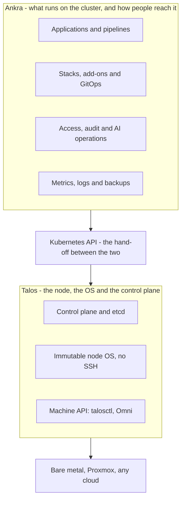

[Talos Linux](https://www.talos.dev) is an operating system built only to run Kubernetes. It is immutable, has no shell or SSH, and is managed entirely through an API. Ankra runs everything that goes on top of it. Talos stops at a healthy, conformant Kubernetes API, and that API is where Ankra starts.

The two share a philosophy. Both are declarative and API-driven, and both take hand-run commands out of production: Talos removes SSH from the node, and Ankra changes the cluster only from Git through its own engine and governed access. Together, no layer of the estate is changed by hand.

A Talos cluster joins Ankra as an [imported cluster](/guides/import-cluster#import-an-existing-cluster). Nothing about how you run Talos has to change.

## How the layers fit



The Kubernetes API is the only contract between the two layers. Talos keeps it healthy and secure; the [Ankra Agent](/concepts/cluster-agent) uses it for everything Ankra deploys and observes.

## What Talos gives you

- **Immutable and minimal.** A read-only root filesystem, no package manager, no shell and no SSH, so there is very little on a node to patch or attack.
- **API-managed.** Every node is configured from a machine config through the `talosctl` API, authenticated with mutual TLS.
- **A declarative node lifecycle.** Bootstrapping, joining nodes, OS upgrades and Kubernetes upgrades all go through the same API.
- **Secure defaults.** Hardened kernel and services, KubeSpan for encrypted node-to-node networking, and disk encryption.
- **Runs anywhere.** Bare metal, VMs, Proxmox and the major clouds, often managed at scale with Sidero Omni.

When Talos has done its job you have a hardened, conformant and empty Kubernetes cluster. What goes into it, and how it is run day to day, is out of its scope.

## What Ankra adds that Talos leaves out

Each row is something a Talos team otherwise has to build and run itself.

| Capability | Talos on its own | What Ankra adds |
| --- | --- | --- |
| Platform add-ons (ingress, cert-manager, DNS, monitoring, policy) | Not in scope. You install and upgrade Helm charts yourself. | [Stacks](/concepts/stacks) of pinned Helm add-ons and manifests, deployed in dependency order with `parents` and deploy waves. |
| GitOps for workloads | Not in scope. You bring and operate your own GitOps controller. | A built-in [GitOps](/concepts/gitops) engine: Stacks live in your Git repository, Ankra syncs them and shows drift. |
| Deploying your own code | Not in scope. | [Applications](/concepts/applications): connect a repository and get a generated Dockerfile, chart and pipeline, deployed to one or many clusters. |
| CI/CD | Not in scope. | [Ankra Pipelines](/pipelines/overview) run `.ankra/pipeline.yaml` on your own CI cluster: rootless builds, Semgrep, Checkov and Trivy scans, immutable `sha-` tags and promotion. |
| Secrets in Git | Not in scope beyond Kubernetes Secrets. | [SOPS and AGE encryption](/guides/sops) with `ankra cluster encrypt`, decrypted at deploy time through `encrypted_paths`. |
| Observability | Node logs and kernel messages through `talosctl`. No metrics stack or dashboards. | [Central metrics and logs](/guides/monitoring-stack) across clusters, metrics pages, log history, `ankra cluster top` and PromQL queries. |
| Backups and restore | etcd snapshots through `talosctl etcd snapshot`. No application data. | [Backup vaults](/guides/backups), scheduled protection per Stack, restore in place, and cloning a Stack with its data onto another cluster. |
| People's access to workloads | An admin kubeconfig and talosconfig, shared by whoever holds them. | The kube gateway with SSO, roles, time-boxed grants, break-glass elevation and an audit log. See [Cluster Access](/guides/cluster-access). |
| Debugging without a shell | No SSH and no shell on the node. | [Debug pods](/platform/debug-pods) that impersonate a workload under a tools image, with recorded terminal sessions, and `ankra cluster exec`. |
| One view of the fleet | Per cluster, or per Omni instance. | One organisation across Talos, managed and cloud clusters: inventory, operations, cost and security posture. |
| Reuse across clusters | Machine config patches, for the OS only. | [Stack profiles](/concepts/stack-profiles): a parameterised Stack published once and rolled out across the fleet. |
| Vulnerabilities in workloads | Hardens the OS only. | [Security reports](/guides/security-reports) with fleet-wide CVE findings and exploitation intelligence. |
| AI operations | None. | [Ankra's AI](/platform/ai-overview) for troubleshooting, incident summaries, pull request reviews and fix pull requests, governed by roles. |

Talos secures and runs the machine; Ankra runs what the machine is for.

## Connect a Talos cluster

<Steps>
  <Step title="Build the cluster with Talos">
    Create it as you normally would - `talosctl gen config`, `talosctl apply-config` and `talosctl bootstrap`, or a cluster in Omni - and confirm the Kubernetes API is healthy.
  </Step>
  <Step title="Import it into Ankra">
    Go to **Clusters**, click **Import Cluster**, and run the agent install command the dialog shows against the Talos cluster. [Import an existing cluster](/guides/import-cluster#import-an-existing-cluster) walks through the dialog. `ankra cluster agent token` prints the cluster's agent token again if you need it.
  </Step>
  <Step title="Check the connection">
    ```bash
    ankra cluster select my-talos-cluster
    ankra cluster agent status
    ankra cluster info
    ```
    The agent reports as connected and the cluster's nodes and Kubernetes version appear in the portal.
  </Step>
  <Step title="Declare the platform in Git">
    Write an `ImportCluster` file that points at your GitOps repository and declares your first Stack:

    ```yaml
    apiVersion: v1
    kind: ImportCluster
    metadata:
      name: my-talos-cluster
    spec:
      git_repository:
        provider: github
        credential_name: my-git-credential
        repository: my-org/my-repo
        branch: main
      stacks:
        - name: ingress
          deploy_wave: 1
          manifests:
            - name: namespace-traefik
              parents: []
              from_file: "manifests/traefik-namespace.yaml"
          addons:
            - name: traefik
              chart_name: traefik
              chart_version: 37.1.1
              registry_name: traefik
              registry_url: https://traefik.github.io/charts
              namespace: traefik
              parents:
                - kind: manifest
                  name: namespace-traefik
    ```

    Check it, stage it for review, then apply it:

    ```bash
    ankra cluster validate -f cluster.yaml
    ankra cluster draft -f cluster.yaml
    ankra cluster apply -f cluster.yaml
    ankra cluster operations list
    ```
  </Step>
  <Step title="Add the rest as Stacks">
    Monitoring, cert-manager, storage, policy and your applications each go in their own small Stack, with every chart version pinned.
  </Step>
</Steps>

## Who owns what on day 2

Each recurring task has exactly one owner, so the two never fight over the same object.

| Task | Owner | How |
| --- | --- | --- |
| Talos OS upgrades | Talos | `talosctl upgrade` or Omni |
| Kubernetes version upgrades | Talos | `talosctl upgrade-k8s` or Omni |
| Adding or replacing nodes | Talos | The machine config and `talosctl apply-config`, or Omni |
| etcd snapshots | Talos | `talosctl etcd snapshot` on a schedule |
| Cordon and drain before node work | Either | `ankra cluster cordon` and `ankra cluster drain`, or Talos during an upgrade |
| Add-on upgrades | Ankra | Bump `chart_version` in Git and let Ankra reconcile |
| Application releases | Ankra | Pipelines build once and promote the same `sha-` tag |
| Secrets | Ankra | SOPS-encrypted in the GitOps repository |
| Application data backup and restore | Ankra | Backup vaults and Stack protection |
| Who can reach the cluster | Ankra | Kube gateway grants, roles and the audit log |
| Troubleshooting workloads | Ankra | `ankra cluster logs`, `describe` and `events`, debug pods, and Ankra's AI |

Keep the talosconfig with a small infrastructure group and give everyone else access through Ankra, so developers and on-call engineers never need cluster-admin credentials.

## Things to know

<Warning>
Ankra does not build or upgrade Talos clusters. Ankra builds kubeadm and k3s clusters on its [Ankra Managed](/guides/import-cluster#ankra-managed) providers, and `ankra cluster upgrade` applies only to those. On Talos, the OS and the Kubernetes version stay with `talosctl` or Omni.
</Warning>

- **Pod Security admission.** Talos enforces the `baseline` Pod Security level by default. A workload that needs more - a CNI or storage agent, or a debug pod that needs host access - needs its namespace labelled `pod-security.kubernetes.io/enforce: privileged`. Put that label on the namespace manifest in the Stack, so it is in Git with everything else.
- **The CNI.** Talos ships Flannel by default. To run Cilium instead, turn off the default CNI in the machine config and install Cilium as an Ankra add-on in deploy wave 0, so every other Stack waits for networking.
- **No second GitOps controller.** Ankra's engine syncs your Stacks from Git, so you do not need to run another one beside it.
- **Omni works alongside Ankra.** Omni manages Talos machines and clusters; Ankra manages what runs inside them. They sit on different layers.
