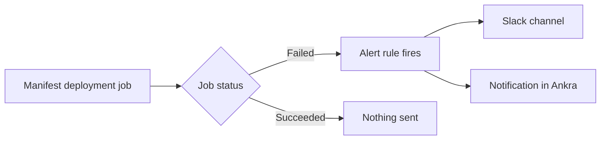

import { CliVersion } from "/snippets/cli-version.jsx";

This tutorial connects one Slack channel to Ankra and adds one alert rule that watches the jobs deploying your manifests. When a deployment job fails on a cluster you chose, Ankra posts to the channel and the firing shows under **Ankra AI → Watching**.

You end up with:

- a Slack **notification destination**, tested from Ankra
- an **alert rule** that fires when a manifest's deployment job fails
- a way to check both before a real failure happens



## Before you start

- **A role that manages alerts.** Adding destinations and alert rules needs it. Without it the pages read **Your role can look at destinations but not change them. Someone who manages alerts can.** See [Roles and access](/guides/roles-and-access).
- **A cluster with manifests** deployed through a [Stack](/concepts/stacks).
- **A way into Slack**, one of:
  - the Ankra Slack app installed in your workspace, under **Ankra AI → Gateway connections** ([Chat and code connections](/platform/ai-connections)). With it you pick a channel from a list.
  - permission to create a Slack app with an incoming webhook in your workspace.

## 1. Add the Slack destination

A destination is a place Ankra sends alerts and notifications to: a Slack or Teams channel, or any webhook.

<Tabs>
  <Tab title="Portal">
    1. Open **Integrations & alerts → Notification destinations** (`/next/organisation/notification-destinations`) and click **Add destination**.
    2. In **Kind**, keep **Slack**.
    3. If the Ankra Slack app is installed, **How Ankra posts** offers **To a channel**. Keep it and choose the channel in **Channel**. If it is not installed, the dialog says **Install the Ankra Slack app from Integrations to pick a channel, or paste an incoming webhook address.** Paste the address from the next tab into **Webhook address**.
    4. In **Name**, enter `Deployment failures`.
    5. Leave **Payload** empty. An empty payload sends Ankra's own card.
    6. Click **Add destination**.
  </Tab>
  <Tab title="Slack incoming webhook">
    Use this when the Ankra Slack app is not installed.

    1. Go to [api.slack.com/apps](https://api.slack.com/apps), click **Create New App**, choose **From scratch**, name it and pick your workspace.
    2. Open **Incoming Webhooks**, switch **Activate Incoming Webhooks** on, and click **Add New Webhook to Workspace**.
    3. Choose the channel, for example `#deployments`, and click **Allow**.
    4. Copy the webhook URL. It starts with `https://hooks.slack.com/services/`.

    Paste it into **Webhook address** in Ankra. Ankra keeps the address encrypted and never shows it again, only its host.

    <Warning>
    Anyone who has the webhook URL can post to the channel. Do not commit it or paste it into a ticket.
    </Warning>
  </Tab>
  <Tab title="CLI">
    <CliVersion since="0.73.0" />

    ```bash
    ankra alerts destinations create --name deployment-failures \
      --url https://hooks.slack.com/services/<your-webhook-path>
    ankra alerts destinations list
    ```

    With the Ankra Slack app installed, list the channels it can post to and create the destination from a channel id instead of a URL:

    ```bash
    ankra alerts destinations channels --provider slack
    ankra alerts destinations create --name deployment-failures --channel-id <channel-id>
    ```
  </Tab>
</Tabs>

**You should see** a row named `Deployment failures` with a **Slack** badge. Under the name it shows the channel (`#deployments`) or the address's host (`Posts to hooks.slack.com`).

## 2. Send a test

1. On the `Deployment failures` row, open the options menu (**…**) and choose **Send a test**.
2. Check the result above the list.

**You should see** **Test sent to Deployment failures** with a line such as **The receiver took it (HTTP 200)**, and a sample card in the Slack channel. From the CLI, `ankra alerts destinations test <destination-id>` does the same and exits non-zero when the delivery fails.

If it reads **The test to Deployment failures did not arrive**, see [What can go wrong](#what-can-go-wrong).

## 3. Add the alert rule

1. Open **Integrations & alerts → Alert rules** (`/next/organisation/alert-rules`) and click **Add alert rule**.
2. Fill in the dialog **Add an alert rule**:

| Field | Value |
|-------|-------|
| **Name** | `Manifest deployment failed` |
| **Description** | Optional. Shown with the alert when it fires. |
| **Watch** | **What runs on clusters** |
| **Kinds to watch** | Tick **Manifests** only. Leaving every kind unticked watches every kind. |
| **Name contains** | Leave empty, or enter text to watch only manifests whose name contains it. |
| **What to check**, under **Condition 1** | **Deployment job status** |
| **State**, under **Condition 1** | **Failed** |
| **Comparison**, under **Condition 1** | **Is** |
| **Where** | **Only the clusters or environments I choose**, then tick the clusters under **Clusters** (or an environment under **Environments**). **Every cluster** also covers clusters added later. |
| **Severity** | **Critical** |
| **Wait before firing (minutes)** | Leave empty. For a deployment job status there is no default wait, so the alert fires as soon as the condition matches. |
| **Quiet time after firing (minutes)** | `15`. After it fires, the alert does not fire or tell anyone again for this long. |
| **Tell these destinations** | Tick `Deployment failures`. |

3. Click **Add alert rule**.

**You should see** a row named `Manifest deployment failed` with the line **Critical · A deployment job’s status is failed on** and your cluster's name, and under it **Tells Deployment failures**. The switch on the row is on.

To fire on a timed-out job as well, click **Add condition** before you save. In the new condition, set **Together with the condition before** to **Or: either one is enough**, **What to check** to **Deployment job status** and **State** to **Timed out**.

<Note>
Ankra checks each rule about once a minute, so a failure can take a minute to show up.
</Note>

## 4. Verify with a real failure

1. Deploy a manifest that cannot apply, for example one whose `kind` does not exist on the cluster, to a cluster the rule covers.
2. Open the cluster's **Operations** page and wait for the manifest's job to read failed. See [Operations](/platform/operations).
3. Check the Slack channel for the alert card.
4. In Ankra, open **Integrations & alerts → Alert rules**, open the rule's options menu and choose **Open the alert**.

**You should see** the alert page with **The platform reports this signal firing**, a line saying how long it has fired and when it was last found firing, and the sections **Firings**, **Work on this alert**, **Related agent runs** and **Signal details**. Every alert is also listed under **Ankra AI → Watching → All signals**, where the **Firing** view shows only the ones firing now. The bell lists the firing as a notification, see [Notifications and Needs you](/platform/activity-inbox).

Remove or fix the broken manifest when you are done.

## Watch a manifest's health instead

A deployment job can succeed while the manifest's resources never become healthy. To be told about that too, add a second rule the same way with **What to check** set to **Resource state**, **State** set to **Down** and **Comparison** set to **Is**.

## What can go wrong

**The test did not arrive.** The result says why:

- **Ankra could not reach the address. Check it, then try again.** The webhook address is wrong or unreachable. Open the row's menu, choose **Change…**, and paste the address again.
- **The receiver refused it with HTTP** followed by a status code: Slack rejected the post. A revoked webhook or an app removed from the channel answers this way. Make a new webhook in Slack and paste it with **Change…**.

**The dialog cannot list Slack channels.** It says one of:

- **Ankra’s Slack app needs more permissions to list channels. Reinstall it from Integrations, or use a webhook address.**
- **Ankra could not list Slack channels just now. A webhook address works meanwhile.**

**Nothing reaches the channel when the alert fires.**

- The destination row shows **Off**: nothing is sent to it while it is off. Switch it on.
- The rule row shows **Off**: switch it on.
- The cluster is not in **Where**. Open **Change…** on the rule and check the clusters or environments.
- The alert fired less than **Quiet time after firing** ago. It does not tell anyone again until that time has passed.

**Too many messages.** Raise **Quiet time after firing**, narrow **Kinds to watch** or **Name contains**, or watch fewer clusters. To send the alert to more places, or to keep some notifications away from a channel, use [notification routes](/guides/notification-routing).

## Next

- [Alerts](/guides/alerts) - every condition an alert rule can check, and the CLI
- [Webhooks](/guides/webhooks) - payload variables and your own payload for each destination kind
- [Notification routing](/guides/notification-routing) - send notifications to more places, or keep them away
- [Get the right notifications to the right people](/guides/notifications-to-the-right-people) - destinations, routes, mutes and your phone, end to end
