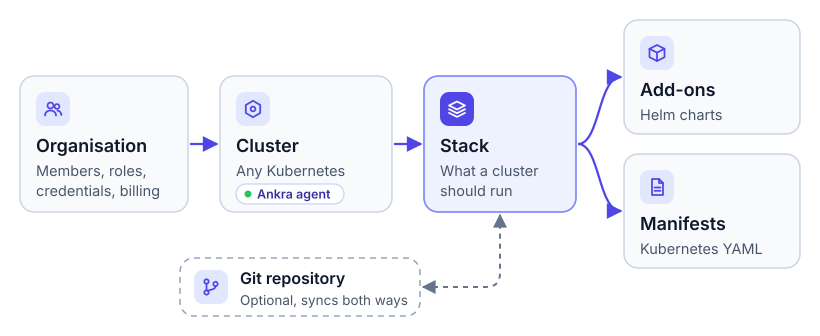
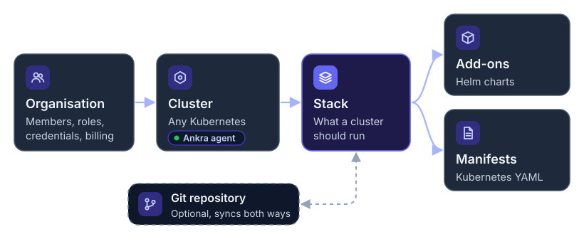

import { CliVersion } from "/snippets/cli-version.jsx";

Running Kubernetes well usually means a pile of Helm values, a GitOps tool to babysit, a runbook per failure, and one person who knows how it all fits together. Ankra is the AI platform engineer that takes that pile off your team: you describe what a cluster should run, Ankra deploys it and keeps it in sync, and its AI reads your logs, events and deploy history to tell you why something broke and how to fix it.

It is built for platform engineers and developers who want production Kubernetes without hand-maintaining the machinery around it.

<Frame caption="Connect a cluster and deploy a first Stack">
  <video
    controls
    autoPlay
    muted
    loop
    playsInline
    className="w-full aspect-video rounded-xl"
    src="https://fsn1.your-objectstorage.com/ankra-vod/import-cluster.mp4"
  ></video>
</Frame>

## Choose where to start

The first time you sign in, Ankra asks **Where do you want to start?** and offers four choices. Pick the one that matches what you have today. [Choose where to start](/get-started/start-here) compares them: what each gives you, how long it takes, what it needs and what it costs.

<CardGroup cols={2}>
  <Card title="Connect my AI agent" icon="robot" href="/get-started/connect-your-ai-agent">
    You use Claude Code, Cursor, Codex or another MCP client. Add Ankra to it, then ask it for what you need. About a minute.
  </Card>
  <Card title="Try a playground" icon="flask" href="/get-started/playground">
    You have no cluster. Ankra runs one for you and puts a starter website on it. Two to four minutes, free for 24 hours, no card.
  </Card>
  <Card title="Put my app online" icon="globe" href="/get-started/put-your-app-online">
    Your code is in a GitHub repository. Ankra builds it and gives it a live HTTPS address. A few minutes, free for 24 hours, no card.
  </Card>
  <Card title="Connect my own cluster" icon="server" href="/get-started/connect-your-cluster">
    You already run Kubernetes. One Helm command connects it. About a minute, and a payment method is needed first.
  </Card>
</CardGroup>

## What you can do with Ankra

<CardGroup cols={2}>
  <Card title="Get a cluster" icon="server" href="/guides/import-cluster">
    Connect the cluster you already run (EKS, GKE, AKS, k3s, on-prem, even minikube) with one helm command, or have Ankra build a new one on your own cloud account.
  </Card>
  <Card title="Put your app online" icon="globe" href="/concepts/applications">
    Pick a GitHub repository. Ankra Pipelines builds and checks it on every push, and Ankra deploys it to your clusters at an HTTPS address.
  </Card>
  <Card title="Deploy what it runs" icon="layer-group" href="/concepts/stacks">
    Compose Helm charts and manifests into a Stack, visually or by asking the AI, and deploy the same Stack to every cluster that needs it.
  </Card>
  <Card title="Find out why it broke" icon="magnifying-glass" href="/platform/ai-assistant">
    Ask "why is this pod failing?" on any page. The AI already has the logs, events, manifests and recent deploys, and proposes a fix you approve.
  </Card>
  <Card title="Automate it" icon="terminal" href="/integrations/ankra-cli">
    Everything in the UI is also available from the `ankra` CLI, from your AI assistant over MCP, and from your CI pipelines.
  </Card>
</CardGroup>

## How it fits together

<Frame>
  
  
</Frame>

- An **organisation** is your team's account: members, roles, credentials and billing.
- A **cluster** is any Kubernetes cluster running the lightweight [Ankra agent](/concepts/cluster-agent). The agent connects out to Ankra, so it works behind firewalls and NAT.
- A **Stack** is what a cluster should run: [add-ons](/concepts/addons) (Helm charts) and [manifests](/concepts/stacks#manifests) (your own YAML), with [variables](/concepts/variables) for what differs between clusters.
- An **application** is your own code from a GitHub repository. Ankra Pipelines builds, checks and publishes it, and Ankra deploys it to one or more clusters - see [Applications](/concepts/applications).
- **Git is optional.** Stacks deploy straight through the agent. Connect a repository when you want every change reviewed and versioned, and edits flow both ways - see [GitOps](/concepts/gitops).

## Start in 15 minutes

The [Quickstart](/get-started/quickstart) takes you from nothing to a running cluster, a deployed Stack and your first answer from Ankra AI. You do not need a cluster to follow it: a free [playground](/get-started/playground) gives you a real one in two to four minutes, free for 24 hours without a card.

<Card title="Open the Quickstart" icon="rocket" href="/get-started/quickstart" horizontal>
  One path, a visible result at every step.
</Card>

## Find your way around

After the first screen, **Skip to Home** (or **Go to Home**, once you have finished one of the four choices) takes you into the portal at `/next`.

- **Home** is **Ask Ankra**: a conversation box where you ask Ankra AI about your organisation. Below it, **Needs you** lists what waits on you, **In** *your organisation* lists what you already have, and **Starting points** lists the choices from the first screen you have not finished.
- **Needs you**, under **Find** at the top of every menu, counts what waits on you. Under it the sidebar has three groups. **Workspace** holds **Home**, **Applications**, **Clusters**, **Managed services**, **Cost** and **Security**. **Platform** folds open and holds **Infrastructure** (where **Cluster meshes** are), **Build & delivery**, **Integrations & alerts** and **Ankra AI**. **Settings and help** holds **Identity & access**, **Settings** and **Support**. An area's pages open under its row.
- A cluster's own menu opens when you open the cluster from **Clusters**. It starts with pages such as **Overview**, **Health**, **Metrics**, **Security** and **Settings**, and keeps **Stacks**, **Operations**, **Kubernetes**, **Kubectl access** and **Audit log** under **Technical details**.
- Press <kbd>⌘</kbd> + <kbd>J</kbd> (<kbd>Ctrl</kbd> + <kbd>J</kbd> on Windows and Linux) on any page to open Ask Ankra.

## Run your CI on your own clusters

Ankra CI runs a repository's tests, image builds and security scans as Kubernetes Jobs on a cluster you already connected, and reports back as a check on every pull request. [Get started with Ankra CI](/get-started/ankra-ci) moves your first repository in about 20 minutes.

<Card title="Get started with Ankra CI" icon="gears" href="/get-started/ankra-ci" horizontal>
  From GitHub Actions or GitLab CI to a green Ankra pipeline check.
</Card>

## Work from your own tools

The web UI, the CLI, the MCP server and the in-product AI all use the same tools and the same permissions, so anything you can do in one you can do in the others.

<CliVersion since="0.71.0" />

<Tabs>
  <Tab title="CLI">
    ```bash
    curl -fsSL https://ankra.ai/install | sh   # installs the CLI, then signs you up or in
    ankra chat "why is the payments pod crashing?" --cluster prod
    ```

    See the [Ankra CLI](/integrations/ankra-cli) guide for Windows, Homebrew and the other ways to install.
  </Tab>
  <Tab title="AI assistants (MCP)">
    Connect Claude, Cursor or any other MCP client to Ankra's remote MCP server. For Claude Code, Cursor or Codex, one command creates a read-only token, registers the server and offers to install the Ankra skills that teach the assistant Ankra's conventions:

    ```bash
    ankra mcp connect --client claude-code
    ```

    Add `--write` when the assistant should change things, not only read. Setup for every client is in the [MCP Server](/platform/mcp-server) guide, and the [MCP Tool Reference](/platform/mcp-tools) lists every tool.
  </Tab>
  <Tab title="CI/CD">
    Your pipeline builds and pushes an image, commits the new tag to your GitOps repository, and Ankra deploys it - [Ship Your App](/guides/deliver-your-app) compares this with letting Ankra build and redeploy on every merge. Plain CI jobs can also call `ankra chat` and `ankra cluster apply` - see [Use the ankra CLI in CI](/guides/pipeline-agents).
  </Tab>
</Tabs>

<Note>
**Automating Ankra or building an agent on it?** Use the [MCP server](/platform/mcp-server) or the [CLI](/integrations/ankra-cli) rather than driving the web UI with a browser. Both use scoped tokens, and every call lands in your organisation's audit log.
</Note>

## Where to go next

<CardGroup cols={3}>
  <Card title="Add a cluster" icon="plus" href="/guides/import-cluster">
    Import one you have, or pick a provider for a new one.
  </Card>
  <Card title="How Stacks work" icon="layer-group" href="/concepts/stacks">
    The model behind everything you deploy.
  </Card>
  <Card title="AI Assistant" icon="robot" href="/platform/ai-assistant">
    What the AI can see, and what it may change.
  </Card>
  <Card title="Security" icon="shield" href="/security/overview">
    What Ankra can access, and how to restrict it.
  </Card>
  <Card title="Cloud Cost" icon="coins" href="/platform/cloud-cost">
    What each cluster, namespace and Stack costs.
  </Card>
  <Card title="API Reference" icon="code" href="/api-reference/introduction">
    The REST API behind every surface.
  </Card>
</CardGroup>

Need a hand? [Contact support](/platform/support) or ask in the [Ankra community Slack](https://join.slack.com/t/ankra-community/shared_invite/zt-3a5rem8f8-cUho4epX2MoLT83bFf~VSA).
