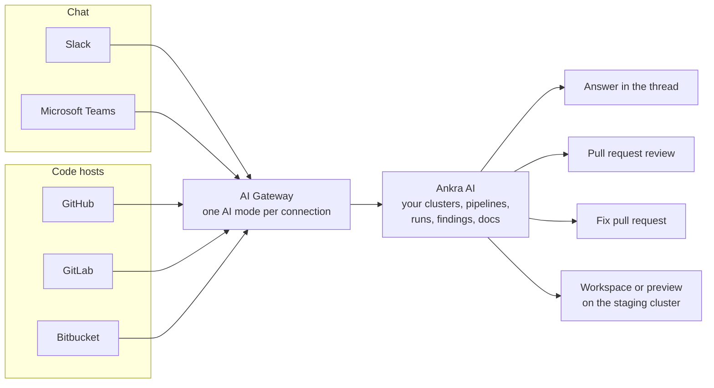
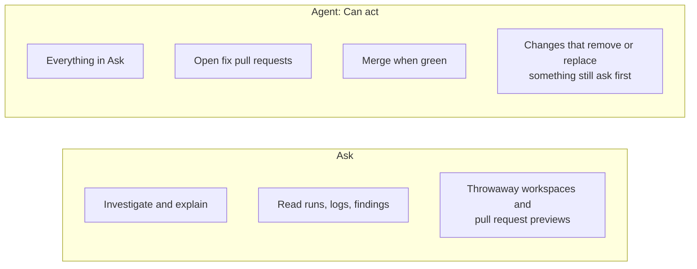
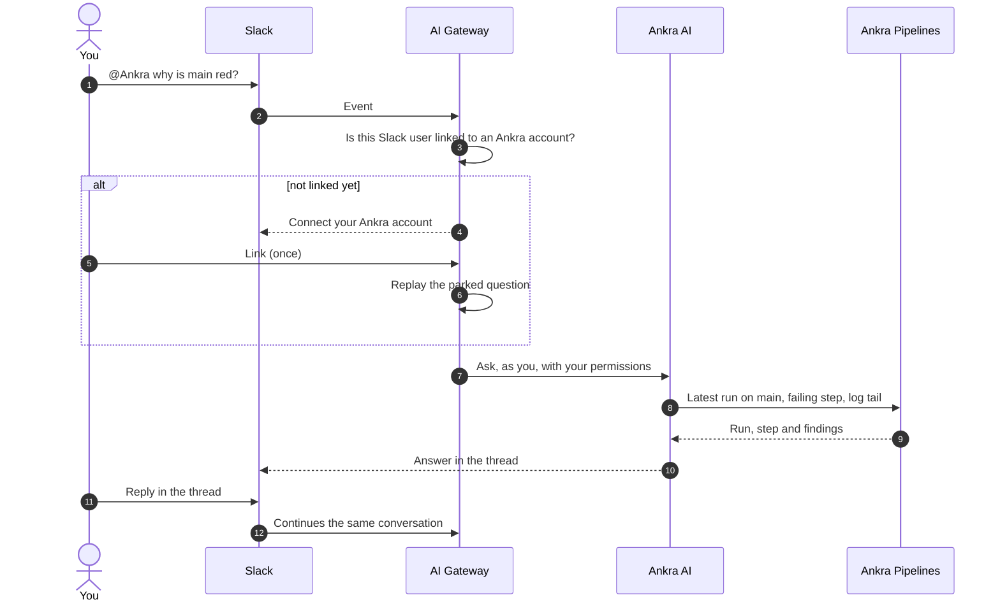
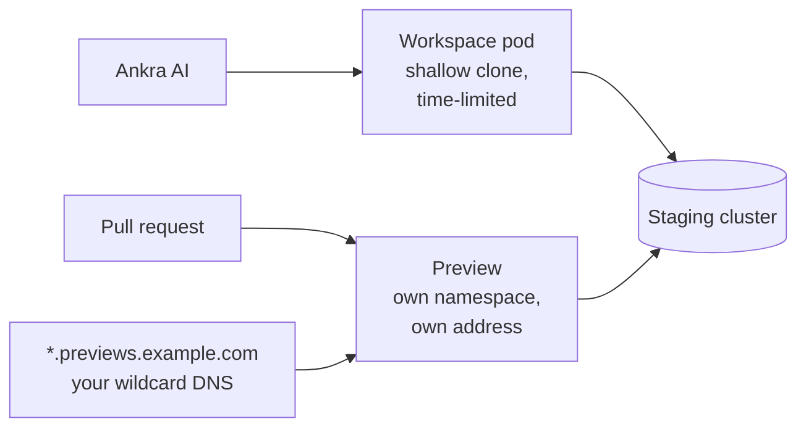

import { CliVersion } from "/snippets/cli-version.jsx";

The AI Gateway is how Ankra AI meets your team where it already works. A question in Slack, an `@ankraai` in a pull request, a push that needs a review: each arrives through one gateway, is answered by the same Ankra AI with the same knowledge of your clusters and pipelines, and goes back to where it came from.

This page explains how the gateway works. To connect a chat app step by step, see [AI connections](/platform/ai-connections). To set up pull request reviews, see [AI Code Review](/platform/ai-code-review).



## The Gateway page

**Ankra AI → Gateway** (`/next/ai/gateway`) shows, under **Where your team works with Ankra**, each place Ankra AI is connected and whether it is **Connected** or **Partly connected**:

| Surface | What it carries |
|---|---|
| **Slack** | Questions in a channel or a direct message, and the investigation in its thread |
| **Microsoft Teams** | Questions in your team's channels, and investigation summaries |
| **Pull requests** | An AI review on every pull request in the repositories you choose, and answers when someone mentions `@ankraai` |
| **Watch and alert delivery** | The Slack, Teams and webhook destinations that watches and alerts are delivered to. Notify only |
| **Email and your own updates** | Your own notifications and summaries. Notify only: replying to an email does not instruct Ankra |

The button at the top reads **Set up the gateway** with how many surfaces are done, or **Review the setup** when every one is. Each surface links to where it is changed: **Change in Gateway connections**, **Manage destinations** or **My notification preferences**.

## Ask and Agent

Every chat and code host connection runs in one of two AI modes. You choose it per connection in **Ankra AI → Gateway connections** (`/next/ai/settings/gateway`). Owners and admins can change it; other roles can look but not change.



| | Ask | Agent |
|---|---|---|
| Explain a failing pipeline run | Yes | Yes |
| Start a throwaway workspace or pull request preview | Yes | Yes |
| Change existing infrastructure | No | Yes. A change that removes or replaces something asks first |
| Open a fix pull request | No | Yes, and the pull request is where you review it |
| Merge when green | Refused: "Merge-when-green requires the binding to be in Agent mode; this binding is in Ask mode." | Yes, with **Merge when green** switched on |

- **Ask is the fallback.** A connection with no mode of its own follows the organisation's default mode, and that default falls back to Ask.
- **A mode never grants more than the person's own access.** Every request runs as the person who asked.
- **Automatic reviews are read-only in either mode.** A review comments. A fix arrives as a separate pull request that a person merges.

The organisation's default mode is **How new chat connections start**, in **Ankra AI → AI workspaces** (`/next/organisation/ai-workspaces`), under **Where workspaces and previews run**. New Slack and Teams connections start in that mode unless they choose for themselves. Git connections always start read-only, with every capability off until you turn it on. From the CLI:

<CliVersion since="0.41.0" command="org ai-environment set --default-gateway-mode" />

```bash
ankra org ai-environment set --default-gateway-mode ask
```

The same two modes exist in the CLI (`ankra chat --mode ask` or `--mode agent`) and on the MCP server, where `mcp:read` and `mcp:write` tokens play the same parts. See [CLI and MCP](/pipelines/cli-and-mcp).

## From a Slack question to an answer



- **Ankra AI answers as you.** Each person links their Slack or Teams account to their Ankra account once. From then on Ankra AI has exactly that person's permissions, never more.
- **Threads are conversations.** Mention the bot to start one, and reply in the thread to continue it.
- **Ticket threads sync with the board.** A reply that starts with `Decision:` answers a pending choice on a board ticket.
- **`/ankra status`** shows your connection and **`/ankra logout`** disconnects your account, in Slack.

Prompts that work from Slack or Teams:

> @Ankra is the pipeline for my-org/my-repo green on main, and if not, what broke?

> @Ankra show me the failing step's log for the last pipeline run on pull request 412 in my-org/my-repo.

## From a pull request event to a review

A code host connection does nothing until someone switches it on. In **Ankra AI → Gateway connections**, each GitHub installation, GitLab instance and Bitbucket workspace has a **Repositories** table with a default row (**All repositories**) and a row per repository you add. Its columns are **AI review**, **Review drafts**, **Automatic reviews per pull request**, **Replies to mentions**, **Pull request previews** and **Review model**. A GitHub installation also has a **Merge when green** switch beside its AI mode.

What each column does is on [AI Code Review](/platform/ai-code-review). What each lane posts on a pull request is on [AI in pull requests](/pipelines/ai-in-pull-requests).

## The staging cluster

AI workspaces, pull request previews and PR demos run on one cluster your organisation nominates for AI work: the **staging cluster**. An organisation that has chosen no CI cluster of its own also runs its pipeline steps there. [Where your pipeline runs](/pipelines/where-pipelines-run) explains the order Ankra picks a cluster in.



<Tabs>
  <Tab title="Portal">
    Open **Ankra AI → AI workspaces** (`/next/organisation/ai-workspaces`). Under **Where workspaces and previews run**:

    - **Staging cluster**: the cluster workspaces and previews run on.
    - **How long a workspace lives**: in hours, 1 to 168.
    - **How long a preview lives at first**: in hours, 1 to 720.
    - **The longest each role may keep a preview running**: **Admins and owners**, **Operators** and **Members**, in hours, 1 to 720.

    Under **Domains for previews**, **Preview domain** is the domain previews are published under. **Workspaces and previews running now** lists what runs, and you can end one early.
  </Tab>
  <Tab title="CLI">
    <CliVersion since="0.41.0" command="org ai-environment set --staging-cluster" />

    ```bash
    ankra org ai-environment get
    ankra org ai-environment set --staging-cluster my-cluster
    ankra org ai-environment set --workspace-ttl-hours 12 --demo-ttl-hours 48
    ankra org ai-environment set --demo-ttl-role-cap member=24 --demo-ttl-role-cap operator=96
    ankra org ai-environment set --demo-base-domain previews.example.com
    ```

    `--demo-ttl-role-cap` takes `<role>=<hours>` for `admin`, `operator` or `member`, and can be repeated.
  </Tab>
</Tabs>

For previews on your own domain, point a wildcard DNS record for it at the staging cluster's ingress. See [Use your own domain](/guides/use-your-own-domain).

## Who can change what

| Action | Who |
|---|---|
| Connect Slack, Teams, GitHub, GitLab or Bitbucket | Organisation owner or admin |
| Change a connection's AI mode or repository rules | Organisation owner or admin |
| Ask Ankra AI in chat | Any linked member, with their own permissions |
| Ask Ankra to merge when green | A member with the `pipelines.operate` permission and a verified GitHub identity, on an Agent-mode connection with **Merge when green** on |

## Related

- [AI connections](/platform/ai-connections): connect Slack and Microsoft Teams step by step.
- [AI Code Review](/platform/ai-code-review): every switch in the repository table, and what a review posts.
- [GitHub](/integrations/github), [GitLab](/integrations/gitlab) and [Bitbucket Cloud](/integrations/bitbucket-cloud): the code host integrations and their permissions.
- [AI workspaces](/platform/ai-workspaces): what a workspace can and cannot do.
