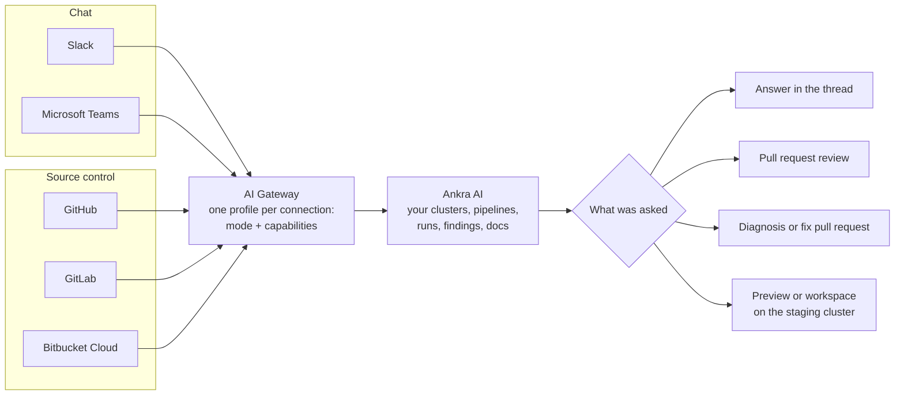
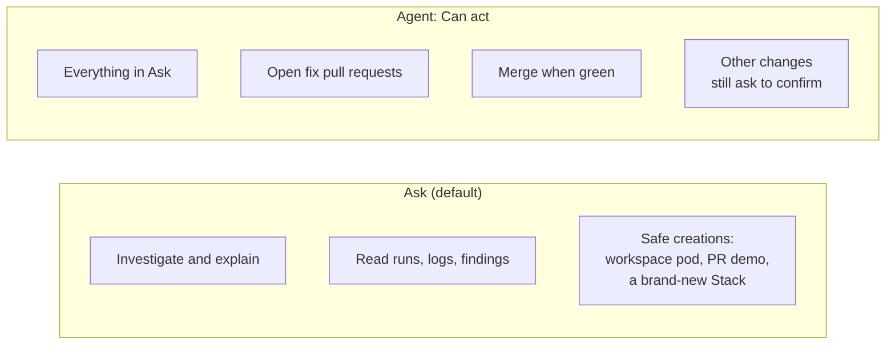
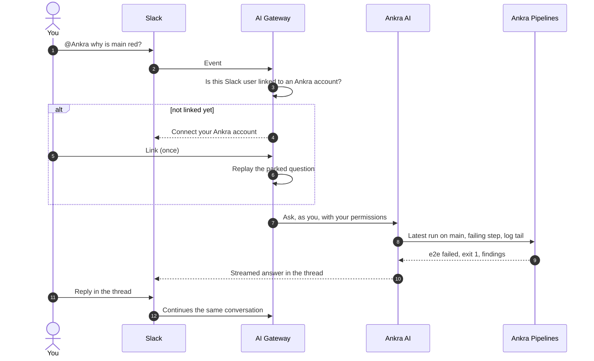
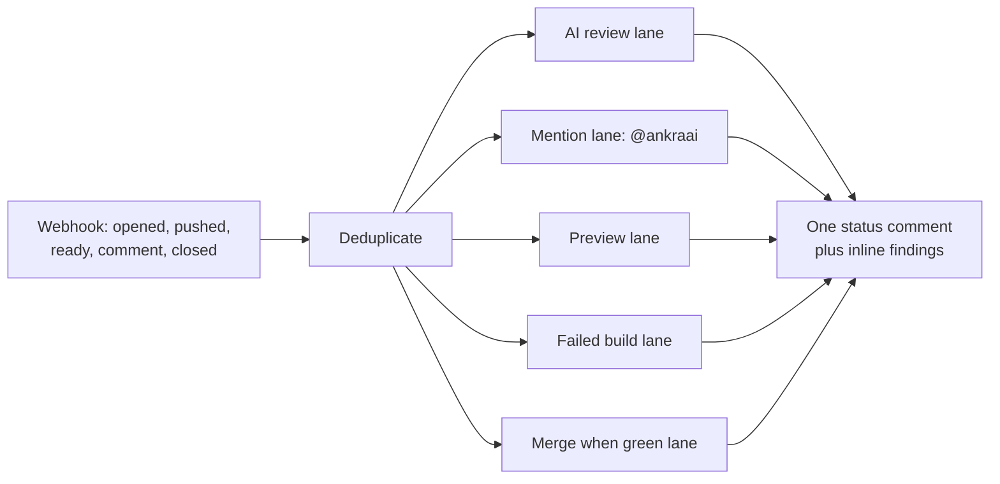
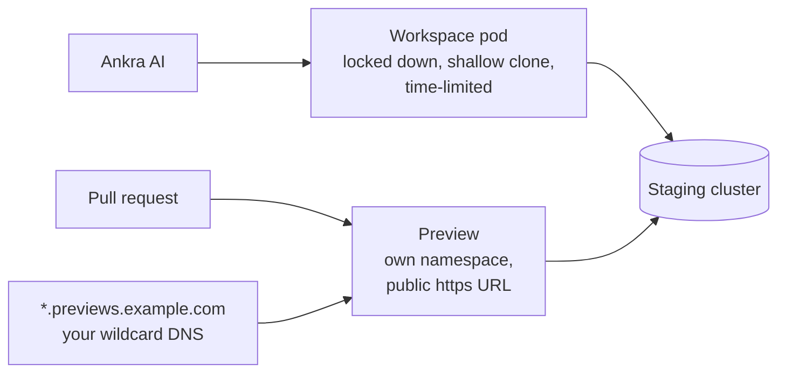

import { CliVersion } from "/snippets/cli-version.jsx";

The AI Gateway is how Ankra's AI meets your team where it already works. A question in Slack, an `@ankraai` in a pull request, a push that needs a review, a failed build that needs a diagnosis: each arrives through one gateway, is answered by the same AI with the same knowledge of your clusters and pipelines, and goes back to where it came from.



## Every connection has a profile

Each connection (a Slack workspace, a Teams tenant, a GitHub App installation, a GitLab token, a Bitbucket workspace) carries a **profile**: a safety mode, and the capabilities switched on for it.

| Connection | Starts with | Capabilities you switch on |
|---|---|---|
| Slack, Microsoft Teams | Chat, alert actions and notifications. Anything that changes something asks first | Follows the organisation's default mode |
| GitHub, GitLab, Bitbucket Cloud | **Everything off.** Installing an app or connecting a token grants access, nothing more | AI review, review drafts, mention replies, PR previews, push code review, failed-build review, skills review, merge when green |

Source-control connections start off because a pull request is a shared, public place. Nothing should post there until someone decides it should.

## Ask and Agent

The mode bounds **how far** an answer may go. The capability switches decide **whether** the AI answers at all.



| | Ask | Agent |
|---|---|---|
| Explain a failing pipeline run | Yes | Yes |
| Spin up a throwaway workspace or PR demo | Yes | Yes |
| Change existing infrastructure | No | With confirmation |
| Open a fix pull request | No | Yes, and the pull request is the review gate |
| Merge when green | Refused, naming the setting | Yes |

- **Ask is the default**, and the fallback for a connection with no mode set.
- **Automatic events stay read-only in either mode.** A review comments. A proposed fix arrives as a separate pull request you review like any other.
- **An unconfigured chat connection** inherits the organisation's default mode:

<CliVersion since="0.41.0" command="org ai-environment set --default-gateway-mode" />

```bash
ankra org ai-environment set --default-gateway-mode ask
```

The same two modes exist everywhere: `ankra chat --mode ask|agent` in the CLI, and `mcp:read` and `mcp:write` tokens on the [MCP server](/pipelines/cli-and-mcp).

## From a Slack question to an answer



- **The AI answers as you.** Each person links their Slack or Teams account to their Ankra account once. From then on the AI has exactly that person's permissions, never more.
- **Threads are conversations.** Mention the bot to start one, and reply in the thread to continue it.
- **Ticket threads sync with the board.** A reply that starts with `Decision:` answers a pending choice on a board ticket.
- **`/ankra status`, `/ankra logout` and `/ankra help`** work in Slack.

Prompts that work from Slack or Teams:

> @Ankra is the pipeline for my-org/my-repo green on main, and if not, what broke?

> @Ankra show me the failing step's log for the last pipeline run on pull request 412 in my-org/my-repo.

> @Ankra the nightly e2e failed again. Is it the same test as yesterday?

## From a pull request event to a review

Provider webhooks feed separate lanes, each with its own switch. Every event is deduplicated, so a redelivered webhook never reviews twice.



What each lane does is on [AI in pull requests](/pipelines/ai-in-pull-requests). What each switch means is on [AI Code Review](/platform/ai-code-review).

## The staging cluster

Workspaces, pull request previews and PR demos run on one cluster your organisation nominates for AI work: the **staging cluster**. If your organisation has no separate CI cluster, Ankra Pipelines runs there too.



<CliVersion since="0.13.0" />

```bash
ankra org ai-environment get
ankra org ai-environment set --staging-cluster staging
ankra org ai-environment set --workspace-ttl-hours 12 --demo-ttl-hours 48
ankra org ai-environment set --demo-ttl-role-cap member=24 --demo-ttl-role-cap operator=96
ankra org ai-environment set --demo-base-domain previews.example.com
```

- **Workspaces** are locked-down, time-limited pods that shallow-clone a repository so the AI can read and test code. `--workspace-ttl-hours` takes 1 to 168.
- **Previews and demos** run in their own namespace with a public https URL. `--demo-ttl-hours` takes 1 to 720, and `--demo-ttl-role-cap` caps it per role.
- **The preview domain is yours.** Ankra publishes no DNS for `--demo-base-domain`: point a wildcard record at the staging cluster's ingress. The command tells you when a setting would leave previews on plain http.

## Who can change what

| Action | Who |
|---|---|
| Connect Slack, Teams, GitHub, GitLab or Bitbucket | Organisation administrator |
| Change a connection's mode or capabilities, per connection or per repository | Organisation administrator |
| Set the staging cluster and its time limits | Organisation administrator |
| Ask the AI in chat | Any linked member, with their own permissions |
| Request merge when green | A member with `pipelines.operate` and a verified GitHub identity, on an Agent-mode connection |
| Turn an application's auto-fix off | Deploy permission on that application |

## Related

- [AI connections](/platform/ai-connections): connecting Slack and Teams step by step.
- [GitHub](/integrations/github), [GitLab](/integrations/gitlab) and [Bitbucket Cloud](/integrations/bitbucket-cloud): the source-control integrations and their permissions.
- [AI workspaces](/platform/ai-workspaces): what a workspace can and cannot do.
