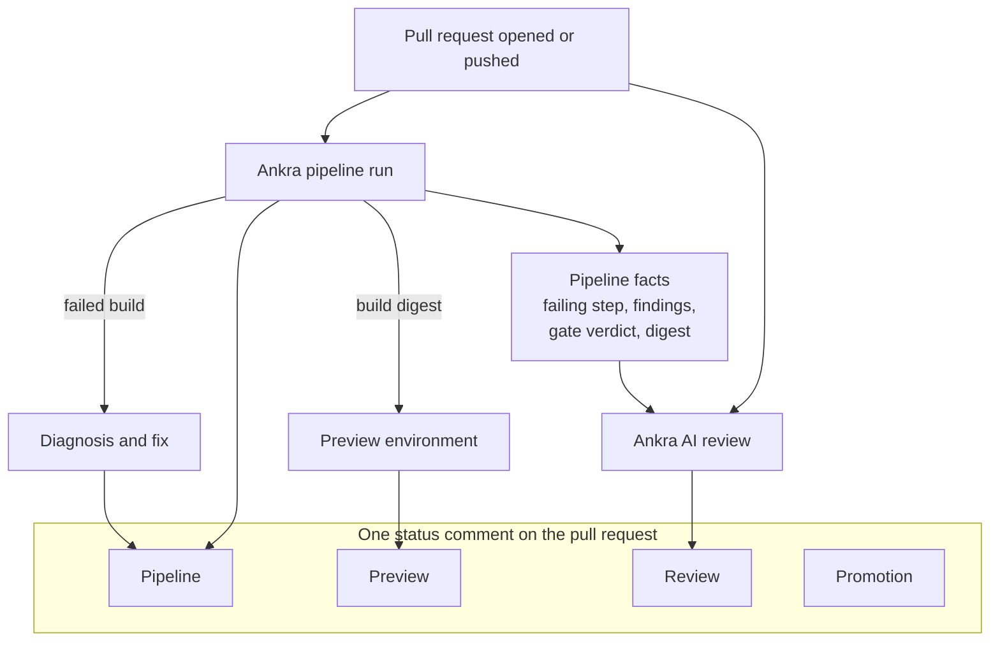
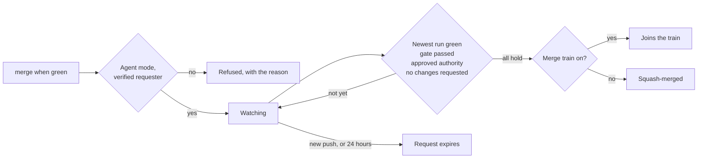
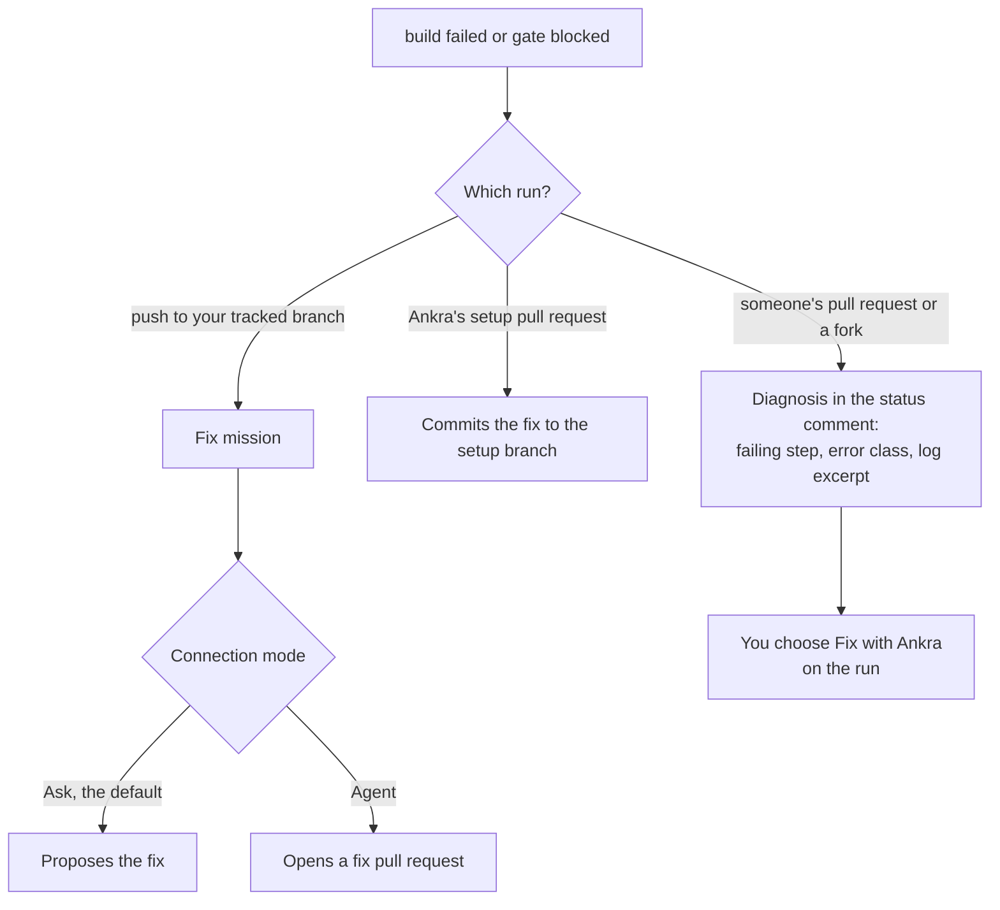

import { CliVersion } from "/snippets/cli-version.jsx";

A pull request on Ankra Pipelines gets more than a check mark. Ankra's AI reads the change and what the pipeline found, explains a failure in plain words, proposes or commits a fix, deploys a preview you can click, and merges when everything is green. All of it lands in **one** comment that updates in place. There is no stream of bot comments to scroll past.



Everything starts switched off. An organisation administrator turns each capability on per connection, or per repository, under **AI** → **Settings** → **Connections** → **Source control & AI review**. See [AI Code Review](/platform/ai-code-review) for every switch.

## The review

### When it runs

| Event | Review? |
|---|---|
| Pull request opened or reopened | Yes |
| A push to the pull request | Yes, for the new head |
| Draft marked ready for review | Yes |
| A draft pull request | No by default. **Review drafts** turns it on |
| A head commit already reviewed | No: one review per commit |
| Past the per-pull-request cap (default 5) or the daily cap | No, and the check run says why |
| `@ankraai review` in a comment | Always. A review someone asks for runs even on a draft or once the cap is reached, and it is added to the pull request's count, so fewer automatic reviews are left after it |

A skipped review is never silent. The **Ankra AI review** check run says why it did not run. The check is advisory: it concludes neutral and never blocks a merge.

### What it reads

The review is more than a diff summary, because it sees what your pipeline saw:

- **The diff**, with line numbers, and the pull request's title and description.
- **Callers of the changed code** in the same repository.
- **Related repositories** you declared, and their references to what changed. A `Depends-on: my-org/other-repo#123` line links a companion pull request. See [Cross-repository review](/platform/ai-code-review-cross-repo).
- **Your pipeline's result for that commit**: the failing step and its error, the scan findings by tool and severity, the gate's verdict and blocking count, and the image digest. Each fact is sourced separately, so a missing one never reads as a clean one.
- **Your organisation's review instructions**, up to 4,000 characters per installation: what to weigh heavily, which conventions to enforce, which language to write in.

The review has no tools and cannot act. Instructions written inside a diff are treated as text to review, never as instructions to follow.

### What it posts

```markdown
## Ankra AI review

**Verdict: <looks good | comments | changes requested | no findings>.**

<two to four sentences on the change as a whole>

### Findings

- **[<high | medium | low>] <finding title>** (`<file>:<line>`)
  <what is wrong and why it matters>

---
_Reviewed commit <sha>. This review is read-only and advisory._
```

- **Verdict:** looks good, comments, changes requested, or no findings.
- **Findings:** at most eight, each `high`, `medium` or `low`, each pinned to its line as an inline comment as well. A finding that needs more context is checked against the file and restated or dropped, rather than posted as a guess.
- **One comment, edited in place.** A re-review updates it, and its footer names the commit it reviewed.

## Talk to it: `@ankraai`

With **Mention replies** on, anyone in the pull request can ask:

| You write | It does |
|---|---|
| `@ankraai review` | A full review, now |
| `@ankraai why did the build fail?` | Reads the run and the failing step's log, and explains |
| `@ankraai how would you fix the finding on line 88?` | In **Ask** mode, explains the fix. In **Agent** mode, proposes a ready-to-apply fix and, on GitHub, offers to open it as a pull request |
| `@ankraai merge when green` | Records a merge request (below) |

On GitLab and Bitbucket Cloud, an Agent-mode reply proposes the fix with a branch name and commit message, because Ankra does not open pull requests there.

## Merge when green

Comment **`@ankraai merge when green`**, press the button in the portal, or ask Ankra AI in chat or through MCP. Ankra records the request and merges (squash) the moment every condition holds:



- The connection is in **Agent** mode, and the requester is a member with `pipelines.operate` whose GitHub identity is OAuth-verified. That is re-checked at merge time, not only when the comment was written.
- The newest pipeline run for the head succeeded, and its `gate` passed.
- The run executed under plainly approved authority.
- Ankra's review did not request changes on that commit, and no human reviewer's latest review is **Changes requested**.
- The head is not a fork.

A new push invalidates the request, and it expires after 24 hours. Every refusal is posted once, naming the condition that failed. On a repository with a [merge train](/pipelines/merge-train), the request puts the pull request on the train instead. Merge when green works on GitHub today.

## When a build fails

A failed `build` step, or a `gate` that blocked the image, gets attention routed by who owns the branch. Ankra's own infrastructure failures are excluded: they are retried, not "fixed".



- **Nobody's pull request gets an unattended commit.** A failed build on a pull request gets a diagnosis, and a person decides whether to ask for the fix.
- **Every fix is a pull request a human merges.** The fix mission tries deterministic fixes first, then the AI. It runs at most once per application per day.
- **Auto-fix is on by default per application,** and turning it off needs deploy permission on that application. To ask for a fix by hand: `ankra application demo fix-build <application-id>`.

## Previews you can click

With **PR previews** on, every pull request deploys to a throwaway environment on your organisation's staging cluster, from the exact digest its pipeline built, never from a mutable tag. The status comment's preview section shows it building, then a **Visit Preview** link, and it is torn down when the pull request closes.

Previews work on GitHub, and on GitLab and Bitbucket Cloud for applications on Ankra Pipelines. See [PR preview environments](/guides/pr-preview-environments) and [AI Gateway](/pipelines/ai-gateway#the-staging-cluster) for where previews run and how they get a public URL.

## Configure it from the terminal

<CliVersion since="0.21.1" />

```bash
ankra org ai-review repos list --reachable
ankra org ai-review repos set my-org/my-repo --review --mentions --previews --max-reviews-per-pr 5
ankra org ai-review repos set my-org/my-repo --review-drafts=false
ankra org ai-review related-repos add my-org/api my-org/web
ankra org ai-review repos unset my-org/my-repo
```

`set` changes only the switches you pass, and keeps the rest of the repository's rule. Listing needs membership; `set`, `unset` and related repositories need an organisation administrator.
