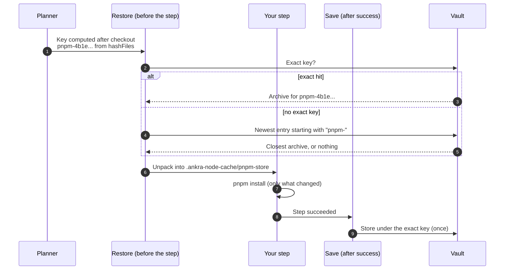
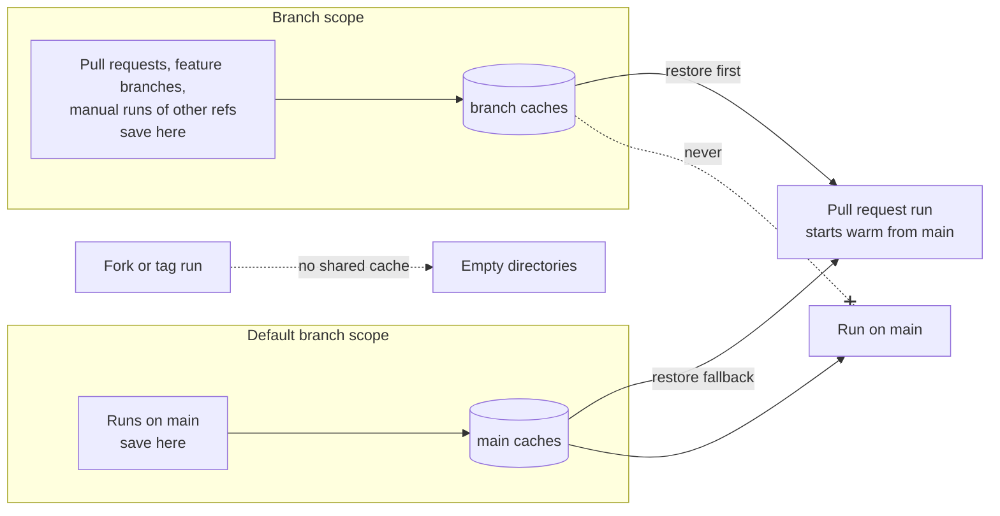

import { CliVersion } from "/snippets/cli-version.jsx";

A cache keeps directories of the workspace from one run to the next: the pnpm store, the Go module and build caches, a Cargo `target/`, pip wheels. Declare it on the stage that fills it, and the next run of that stage starts warm.

```yaml
- name: test
  kind: run
  image: node:24
  needs: [checkout]
  env:
    PNPM_STORE_DIR: /workspace/.ankra-node-cache/pnpm-store
  run: |
    corepack enable
    pnpm install --frozen-lockfile --store-dir "$PNPM_STORE_DIR"
    pnpm test
  cache:
    - key: "pnpm-${{ hashFiles('pnpm-lock.yaml') }}"
      paths: [".ankra-node-cache/pnpm-store"]
      restore_keys: ["pnpm-"]
      fallback: "none"
```

That is all a stage needs. The rest of this page explains what happens around it, so you can trust a cache instead of guessing about it.

## The life of a cache



1. **The key is computed after checkout.** `${{ hashFiles('pnpm-lock.yaml') }}` becomes the SHA-256 of the matching files, read in the stage's `working_directory`. The key changes exactly when the lock file does.
2. **Restore runs before the step.** The exact key wins. Otherwise each `restore_keys` prefix is tried in order, and the newest stored entry that starts with it is restored. A cache that changed slightly still starts nearly warm.
3. **Save runs only after the step succeeds.** A failed, cancelled or timed-out step saves nothing, so a broken install never becomes the next run's starting point.
4. **A key with `hashFiles` is saved once.** When the exact key was restored, its content is already stored. A key with no `hashFiles` is saved again after every successful step, and the newest save wins.

## Trust scopes: a branch can never poison main

A cache is a way for one run to put files into another run's workspace. Ankra treats that as a security boundary, not just a performance feature.



- **A run on the default branch** restores only what default-branch runs saved.
- **Any other run** (a feature branch, a pull request, a manual run of another ref) looks in its own scope first and then falls back to the default branch's. A new pull request starts warm from `main`.
- **Nothing a branch saves ever reaches a default-branch run.** A less-trusted ref cannot plant a poisoned dependency in what your release build restores.
- **A restricted fork run and a tag run get no shared cache at all.** Every declared path starts empty, and the step records `caches are not shared with fork runs` or `caches are not shared with tag runs`.
- **Scopes are per repository and cluster.** One repository never restores another's cache.

`cache` is a [protected section](/pipelines/how-it-works#logic-is-open-authority-is-closed). A pull request can rewrite its scripts, but it cannot change which earlier output is restored into the workspace until the change reaches the default branch and an administrator approves it.

## Writing good keys

| You want | Write |
|---|---|
| A cache that follows a lock file | `key: "pnpm-${{ hashFiles('pnpm-lock.yaml') }}"` |
| Several files in one key | `key: "go-${{ hashFiles('go.mod', 'go.sum') }}"` |
| Every lock file in a monorepo | `key: "go-${{ hashFiles('**/go.sum') }}"` |
| A warm start when the lock file changed | `restore_keys: ["pnpm-"]` |
| One cache per toolchain version | `key: "cargo-1.85-${{ hashFiles('Cargo.lock') }}"` |
| To start over | Change the prefix: `pnpm-v2-...`. Old entries age out. There is no purge. |

`hashFiles` patterns are relative and `/`-separated. At most one `**` may stand immediately before the file name, and the file name may use `*`. One call takes up to eight patterns, and files under `.git` are never hashed. A pattern that matches no file adds nothing to the key. A key Ankra cannot read this way is used as written, and the step's cache note says so.

<Tip>
**Point the toolchain at the workspace.** A cache path is relative to the workspace (`/workspace`). Set the tool's own cache variable in the stage's `env`, for example `GOMODCACHE=/workspace/.ankra-go/mod`, `GOCACHE=/workspace/.ankra-go/cache`, `PNPM_STORE_DIR`, `npm_config_cache`, `UV_CACHE_DIR`, `PIP_CACHE_DIR` or `CARGO_HOME`. A tool that writes to `$HOME` writes outside the workspace, and nothing is kept.
</Tip>

## What Ankra generates for you

The pipeline a new application's setup pull request commits already declares its test stage's caches. They use `fallback: "none"`, live in directories under `.ankra-` that the scan step skips, and point the toolchain at them through `env`. A pipeline you already committed is never rewritten. Copy the block below into it to get the same.

| Toolchain | Key | Paths |
| --- | --- | --- |
| pnpm | `pnpm-${{ hashFiles('pnpm-lock.yaml') }}` | `.ankra-node-cache/pnpm-store`, `.ankra-node-cache/corepack` |
| Yarn | `yarn-${{ hashFiles('yarn.lock') }}` | `.ankra-node-cache/yarn`, `.ankra-node-cache/yarn-global`, `.ankra-node-cache/corepack` |
| npm | `npm-${{ hashFiles('package-lock.json') }}` | `.ankra-node-cache/npm` |
| Go | `go-${{ hashFiles('go.mod', 'go.sum') }}` | `.ankra-go/mod`, `.ankra-go/cache` |
| uv | `uv-${{ hashFiles('uv.lock') }}` | `.ankra-python-cache/uv` |
| Poetry | `poetry-${{ hashFiles('poetry.lock') }}` | `.ankra-python-cache/pip`, `.ankra-python-cache/poetry/cache`, `.ankra-python-cache/poetry/artifacts` |
| Pipenv | `pipenv-${{ hashFiles('Pipfile.lock') }}` | `.ankra-python-cache/pip`, `.ankra-python-cache/pipenv` |
| pip | `pip-${{ hashFiles('requirements.txt') }}` | `.ankra-python-cache/pip` |
| Rust | `cargo-registry-${{ hashFiles('Cargo.toml', 'Cargo.lock') }}` and `cargo-target-` the same | `.ankra-cargo/home/registry`, `.ankra-cargo/home/git`; `.ankra-cargo/target` |

Each key's `restore_keys` is its own prefix (`pnpm-`, `go-`, and so on). In a monorepo, each component's directories carry the component's name (`.ankra-node-cache-web/...` for `web/`), because its test stage runs beside its siblings'.

## Recipes

<Tabs>
  <Tab title="Go">
    ```yaml
    - name: test
      kind: run
      image: golang:1.26
      needs: [checkout]
      env:
        GOMODCACHE: /workspace/.ankra-go/mod
        GOCACHE: /workspace/.ankra-go/cache
      run: go test ./... -race
      cache:
        - key: "go-${{ hashFiles('go.mod', 'go.sum') }}"
          paths: [".ankra-go/mod", ".ankra-go/cache"]
          restore_keys: ["go-"]
          fallback: "none"
    ```

    `GOCACHE` holds compiled packages and test results. Restoring it is what lets `go test` print `(cached)` for packages your change did not touch.
  </Tab>
  <Tab title="pnpm">
    ```yaml
    - name: test
      kind: run
      image: node:24
      needs: [checkout]
      env:
        PNPM_STORE_DIR: /workspace/.ankra-node-cache/pnpm-store
        COREPACK_HOME: /workspace/.ankra-node-cache/corepack
      run: |
        corepack enable
        pnpm install --frozen-lockfile --store-dir "$PNPM_STORE_DIR"
        pnpm test
      cache:
        - key: "pnpm-${{ hashFiles('pnpm-lock.yaml') }}"
          paths: [".ankra-node-cache/pnpm-store", ".ankra-node-cache/corepack"]
          restore_keys: ["pnpm-"]
          fallback: "none"
    ```
  </Tab>
  <Tab title="Python (uv)">
    ```yaml
    - name: test
      kind: run
      image: ghcr.io/astral-sh/uv:python3.13-bookworm
      needs: [checkout]
      env:
        UV_CACHE_DIR: /workspace/.ankra-python-cache/uv
      run: |
        uv sync --frozen
        uv run pytest --junitxml=reports/junit.xml
      cache:
        - key: "uv-${{ hashFiles('uv.lock') }}"
          paths: [".ankra-python-cache/uv"]
          restore_keys: ["uv-"]
          fallback: "none"
    ```
  </Tab>
  <Tab title="Rust">
    ```yaml
    - name: test
      kind: run
      image: rust:1.85
      needs: [checkout]
      env:
        CARGO_HOME: /workspace/.ankra-cargo/home
        CARGO_TARGET_DIR: /workspace/.ankra-cargo/target
      run: cargo test --locked
      cache:
        - key: "cargo-registry-${{ hashFiles('Cargo.toml', 'Cargo.lock') }}"
          paths: [".ankra-cargo/home/registry", ".ankra-cargo/home/git"]
          restore_keys: ["cargo-registry-"]
          fallback: "none"
        - key: "cargo-target-${{ hashFiles('Cargo.toml', 'Cargo.lock') }}"
          paths: [".ankra-cargo/target"]
          restore_keys: ["cargo-target-"]
          fallback: "none"
    ```

    Two caches, so a new dependency invalidates the target directory without throwing away the registry download.
  </Tab>
</Tabs>

## Did my cache work?

Every step records one result for all its caches, and one entry per cache. `ankra pipeline get` shows the result in the **CACHE** column, and the portal's run timeline shows it as a chip on the step.

<CliVersion since="0.15.0" />

```bash
ankra pipeline get <run-id>                    # CACHE column per step
ankra pipeline get <run-id> --step test        # one row per cache: outcome, bytes, time, saved
```

| `cache_result` | Meaning |
| --- | --- |
| `hit` | Every declared cache was restored, by its exact key or a `restore_keys` prefix |
| `partial` | Some caches were restored and others were not |
| `miss` | Nothing was stored yet for any declared cache. Normal on a first run or a new key |
| `restore_failed` | No cache was restored and at least one restore failed. The step ran cold because something broke |
| `disabled` | No cache was shared with the step, for example a fork run, or `fallback: none` on an older agent |
| `unknown` | Nothing was reported. Never read it as a miss |

A failed restore never fails the step. The step starts cold and logs a line starting `[ankra] cache` that says why: the key could not be computed (`key_unresolvable`), the archive did not download or unpack, or the restore pod was not scheduled or timed out.

## Limits and retention

| Limit | Value |
|---|---|
| One saved path | 4 GiB. A larger one is not kept |
| Per repository | 10 GiB across both trust scopes, least recently used removed first |
| Retention | An entry nothing restored for `ci_cache_retention_days` (default 14, 1 to 365) is removed |
| Largest declared cache | `max_cache_size` on the organisation's pipeline policy, when an administrator sets one |

**On an older agent.** Caches are stored as archives in the vault on clusters whose agent supports it. On an older agent, `fallback: volume` (the default) gives each path one 5Gi volume shared by runs of the same trust scope on that cluster, and `fallback: none` gives the step an empty directory. Prefer `none` for a cache that is only an optimisation: a shared volume attaches to one node at a time, so two overlapping runs could wait on each other. Upgrade the agent (`ankra cluster agent upgrade`) to get archives.

## Image builds cache their layers for you

A `build` stage needs no `cache:` block. Every image build imports and exports a BuildKit **layer cache** in your organisation's CI staging repository, next to the images it builds, one per component. An unchanged `RUN pnpm install` layer is pulled, not rebuilt.

- The cache is written only by runs that may push. A restricted fork run neither reads nor writes it.
- A failed cache write never fails the build.
- `build.cache_to` in your pipeline is used only when no organisation cache could be resolved.

To get the most from it, order your Dockerfile so what changes least comes first: copy the lock file and install dependencies before you copy the source.

## Set a cache once for every stage

`defaults.cache` applies to every stage that declares no `cache` of its own, the same way `defaults.image` and `defaults.network` do.

## Caching is one of three ways to save time

A warm cache makes the work you run faster. Two other features stop you running work at all:

- **[Affected-only stages](/pipelines/fast-ci#run-only-what-a-change-touches)** skip tests that a change cannot reach, using your Go or pnpm dependency graph.
- **[Promotion](/pipelines/fast-ci#build-once-promote-on-merge)** publishes the image a pull request already built and tested, instead of rebuilding it on merge.

Every run records the time all three saved. `ankra pipeline time-saved` totals it for your organisation.
