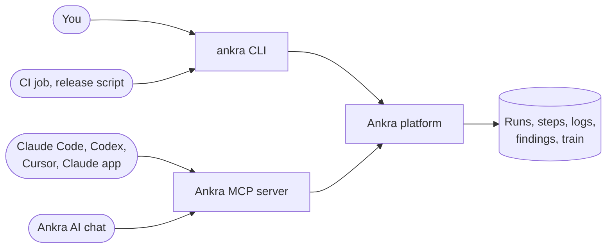

import { CliVersion } from "/snippets/cli-version.jsx";

Everything you can see on a run page, you can get from the `ankra` CLI and from the Ankra [MCP server](/platform/mcp-server). The CLI is for you and your scripts. MCP is for the AI you work with: Claude Code, Codex, Cursor, the Claude app, or Ankra's own chat.



## The commands you will use every day

<CliVersion since="0.40.0" note="The run, get, logs and validate basics work from v0.15.0; --full and time-saved need v0.40.0." />

Run these from inside your repository's checkout. The CLI resolves the pipeline from your `origin` remote and the commit from your `HEAD`, and says which it used. Outside a checkout, name the pipeline with `--application <name>` or `--repository <id>`.

| You want to | Run |
|---|---|
| Start a run for the commit in front of you | `ankra pipeline run --wait` |
| See the latest runs | `ankra pipeline list` |
| See one run and its steps | `ankra pipeline get <run>` |
| Follow a step live | `ankra pipeline logs <run> --step test --follow` |
| Re-run only what failed | `ankra pipeline rerun <run> --failed-only --wait` |
| Run everything, ignoring path filters | `ankra pipeline run --full --wait` |
| Stop a run | `ankra pipeline cancel <run>` |
| See scan findings | `ankra pipeline findings <run>` |
| Download a report or artifact | `ankra pipeline artifacts <run>`, then `ankra pipeline artifacts download <artifact-id>` |
| Check the pipeline file before pushing | `ankra pipeline validate --changed-file src/app.ts` |
| See the slowest and flaky tests | `ankra pipeline tests <run> --slowest` |
| Queue a pull request on the merge train | `ankra pipeline train add 412` |
| See what fast CI saved | `ankra pipeline time-saved` |

## Scripting: exit codes and JSON

Every command takes `-o json`, and the commands that wait exit with the verdict. That makes the CLI safe to put in a release script or another CI system.

| Exit code | Meaning |
|---|---|
| `0` | The run succeeded |
| `1` | It concluded any other way (failure, cancelled, timed out, superseded), or the platform could not be read |
| `2` | Several runs matched your selection and you did not pass `--latest` |
| `3` | No run matched |
| `5` | `--timeout` ran out, or under `--exit-code` the run has not concluded yet |

Without `--wait`, `--watch` or `--exit-code`, a read always exits `0`, whatever the run's outcome.

### Scenario: wait for the run a push started

A push started the run, so your script has no run id. Select it by what you do know:

```bash
ankra pipeline get --head-sha "$(git rev-parse HEAD)" --trigger push --latest --wait --timeout 45m
```

If the webhook lands a moment after you ask, `--wait` waits for the run to appear.

### Scenario: react to every state change

```bash
ankra pipeline get <run-id> --watch -o json | while read -r event; do
  echo "$event" | jq -r 'select(.event == "step") | "\(.step_key): \(.status) \(.outcome // "")"'
done
```

`--watch -o json` prints one JSON object per line. The first lines are the current state, and the run's conclusion is always the last line.

### Scenario: gate a release on the pipeline

```bash
#!/usr/bin/env bash
set -euo pipefail
sha="$(git rev-parse HEAD)"
if ankra pipeline get --head-sha "$sha" --branch main --latest --exit-code >/dev/null; then
  echo "Commit $sha is green, releasing"
else
  echo "Commit $sha is not green yet" >&2
  exit 1
fi
```

### Scenario: debug a red run

```bash
ankra pipeline get <run-id>                         # which step failed, its exit code, the error
ankra pipeline logs <run-id> --step test            # its complete archived log
ankra pipeline tests <run-id>                       # failed and flaky tests with messages
ankra pipeline rerun <run-id> --failed-only --wait  # retry just the failed steps
```

## Settings and capacity from the terminal

| You want to | Run | Needs |
|---|---|---|
| See the organisation's CI settings | `ankra org ci-settings get` | Membership |
| Choose the CI cluster | `ankra org ci-settings set --cluster <cluster>` | Organisation admin |
| Add a cluster to the CI pool | `ankra org ci-settings pool add <cluster>` | Organisation admin |
| Allow more runs at once | `ankra org ci-settings set --max-parallel-runs 32` | Organisation admin |
| Make the image gate stricter | `ankra org ci-settings set --image-gate all` | Organisation admin |
| Turn on pipeline workers on a cluster | `ankra cluster agent ci set --workers 8 --cluster <cluster>` | Cluster manage |
| Pin CI to a node group | `ankra cluster agent ci set --node-group pipelines --cluster <cluster>` | Cluster manage |
| Connect a repository with no application | `ankra pipeline repositories connect --provider github --owner my-org --name my-repo --credential <git-credential>` | `pipelines.manage` |
| Approve a definition's authority | `ankra pipeline definitions approve <definition-id>` | `pipelines.manage`, a person |

Approving authority is always a human act. A service token or an AI agent is refused, because approving grants whatever secrets, credentials and network the definition declares.

## MCP: the tools an AI uses

Connect the [MCP server](/platform/mcp-server) once, and your AI client can read and reason about your pipelines. Every read tool works in **Ask** mode and with an `mcp:read` token.

| Tool | What it does | Reads or writes |
|---|---|---|
| `cicd_validate_pipeline_yaml` | Validates a `.ankra/pipeline.yaml`. Returns `ok`, `warn` or `fatal`, every violation by key, the stages and the trigger events | Read |
| `cicd_convert_workflow_to_pipeline` | Converts GitHub Actions, GitLab CI, Bitbucket Pipelines or CircleCI files into one pipeline, with notes on everything it could not map. Writes nothing | Read |
| `cicd_propose_application_pipeline` | Renders the pipeline, manifests and optionally a Dockerfile Ankra would generate for a repository, with validator results | Read |
| `watch_pipeline_run` | Waits for a run to conclude and returns the failing step, a log tail, findings and the gate verdict | Read |
| `get_pipeline_step_logs` | Reads a run's steps and one step's archived log tail, by run id, run number, branch, pull request or commit | Read |
| `get_application_code_security`, `get_application_container_security` | The application's scan findings | Read |
| `scm_merge_pull_request` | Records a merge when green request, or joins the merge train where the repository has one. Never merges at once | Write: `mcp:write` and Agent mode |

<Note>
**Over MCP, `watch_pipeline_run` waits up to 45 seconds per call.** It returns the concluded run, or `timed_out: true` with the run id. Your client calls it again with that id. Inside Ankra's own chat the same tool registers a watch and wakes the conversation when the run concludes.
</Note>

There is deliberately no MCP tool that approves a pipeline's authority, and none that dispatches, cancels or re-runs an Ankra pipeline. An AI can explain, validate, convert and watch. Starting and approving runs stays with you and your scripts through the CLI.

### Scenario prompts

These are prompts to type into your AI client once the MCP server is connected.

<AccordionGroup>
  <Accordion title="Is my pull request green, and if not, why?">
    > Watch the Ankra pipeline run for my-org/my-repo pull request 412. When it concludes, tell me which step failed and the likely cause from its log.

    The AI calls `watch_pipeline_run` with `owner`, `repo` and the pull request, then `get_pipeline_step_logs` for the failing step.
  </Accordion>
  <Accordion title="Move this repository off GitHub Actions">
    > Convert .github/workflows/ci.yml and release.yml into an Ankra pipeline. Validate the result and list every step you could not map.

    The AI reads your workflow files, calls `cicd_convert_workflow_to_pipeline`, then `cicd_validate_pipeline_yaml` on the output. You review and commit the file.
  </Accordion>
  <Accordion title="Check my pipeline edit before I push">
    > Validate my .ankra/pipeline.yaml. I added a matrix to the test stage and a postgres service.

    `cicd_validate_pipeline_yaml` returns every violation by key. A `fatal` cannot be planned. A `warn` names, for example, a stage kind with no executor yet.
  </Accordion>
  <Accordion title="Merge it when it passes">
    > Merge my-org/my-repo pull request 412 when its pipeline is green.

    With an `mcp:write` token and a connection in Agent mode, the AI calls `scm_merge_pull_request`. Ankra records the request and merges only when the run, its gate, both reviews and the authority all pass. With a merge train, the pull request joins the train.
  </Accordion>
  <Accordion title="Why is my build slow?">
    > Look at the last Ankra pipeline runs on main for my-org/my-repo and tell me which steps take longest and whether the caches hit.

    The AI reads the runs and step logs. Combine it with `ankra pipeline get <run> --step <key>`, which prints each cache's outcome, size and time.
  </Accordion>
</AccordionGroup>

## Next

- [Pipelines with coding agents](/pipelines/coding-agents): connect Claude Code, Codex or the Claude app, and install the Ankra skills.
- [CLI reference: pipeline](/reference/cli/pipeline): every flag of every command.
- [MCP tools](/platform/mcp-tools): the full MCP catalogue.
