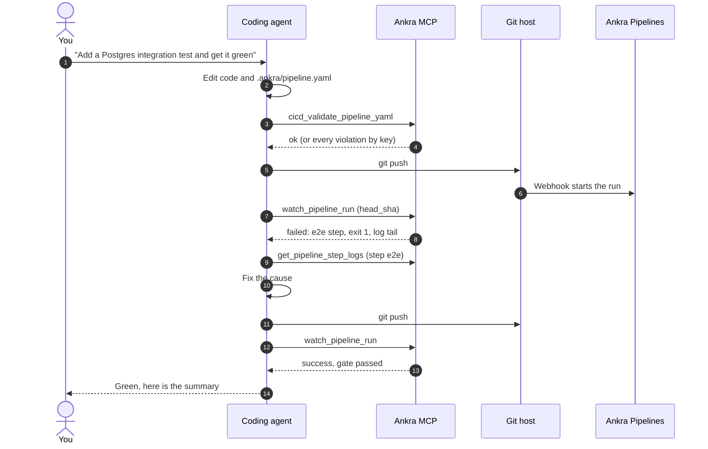

import { CliVersion } from "/snippets/cli-version.jsx";

Your coding agent already writes the code. With Ankra connected, it can also see whether that code passes CI, read why it failed, and fix it. No copying logs out of a web page, no guessing which step broke.

Two things make that work, and you want both:

- **The Ankra MCP server** gives the agent live data: validate a pipeline, convert a workflow, watch a run, read a step's log, request merge when green.
- **The Ankra skills** teach the agent how Ankra pipelines work: the stage kinds, the authority rules, caching, fast CI. It then writes a pipeline that validates the first time instead of a GitHub Actions workflow.

The agent can also run the `ankra` CLI in its terminal, which covers everything the MCP tools do not, such as starting a run.

## The loop your agent runs



The agent never needs your CI provider's web page, and you never paste a log into a chat.

## Set up

<Tabs>
  <Tab title="Claude Code">
    <Steps>
      <Step title="Connect the Ankra MCP server">
        ```bash
        claude mcp add --transport http --scope user ankra https://platform.ankra.app/api/v1/mcp
        ```

        Start Claude Code, run `/mcp`, select **ankra** and choose **Authenticate**. Sign in, pick your organisation and approve. `mcp:read` is enough to validate, convert and watch. Grant `mcp:write` only if you want the agent to request merge when green.
      </Step>
      <Step title="Install the Ankra skills">
        <CliVersion since="0.13.0" command="skills install" />

        ```bash
        ankra skills install --client claude-code
        ```

        The skills land in `~/.claude/skills`, with the `/ankra-*` workflow commands in `~/.claude/commands`. Claude Code picks the right one from what you ask. `ankra-ship` and `ankra-cicd` cover pipelines.
      </Step>
      <Step title="Check it works">
        Ask: *"Validate .ankra/pipeline.yaml with Ankra."* Claude Code should call `cicd_validate_pipeline_yaml` and report `ok`, `warn` or `fatal`.
      </Step>
    </Steps>
  </Tab>
  <Tab title="Codex">
    <Steps>
      <Step title="Create an MCP token">
        ```bash
        ankra tokens create codex --scopes mcp:read
        export ANKRA_MCP_TOKEN="<your-token>"
        ```

        Use `--scopes mcp:read,mcp:write` if the agent should request merge when green. Keep the variable in your shell profile, not in a repository.
      </Step>
      <Step title="Connect the Ankra MCP server">
        ```bash
        codex mcp add ankra --url https://platform.ankra.app/api/v1/mcp --bearer-token-env-var ANKRA_MCP_TOKEN
        ```

        That writes the server into `~/.codex/config.toml`. `codex mcp list` shows it.
      </Step>
      <Step title="Install the Ankra skills">
        ```bash
        ankra skills install --client codex
        ```

        The skills land in `~/.codex/skills`, with an index in `~/.codex/AGENTS.md` that Codex always loads, and prompts in `~/.codex/prompts`. Add `--project .` to install into the repository instead, and commit it so your whole team's Codex gets it.
      </Step>
    </Steps>
  </Tab>
  <Tab title="Claude app">
    <Steps>
      <Step title="Add Ankra as a connector">
        In Claude (web or desktop), open **Settings** → **Connectors** → **Add** → **Add custom connector**. Name it `Ankra`, set the URL to `https://platform.ankra.app/api/v1/mcp`, leave the OAuth fields empty, and select **Add**. Then select **Connect** and sign in to Ankra. Custom connectors need a paid Claude plan. See [MCP server](/platform/mcp-server#connect-claude-with-oauth) for screenshots.
      </Step>
      <Step title="Upload the Ankra skills">
        ```bash
        ankra skills install --client claude-app
        ```

        This writes one `.zip` per skill under `~/.ankra/claude-app`. Upload `ankra-cicd` and `ankra-ship` (or all of them) at **Settings** → **Capabilities** → **Skills** → **Upload skill**.
      </Step>
      <Step title="Use it">
        The Claude app cannot push to your repository, but it can read your pipelines. Ask it to explain a red run, convert a pasted workflow, or review a pipeline file you paste in.
      </Step>
    </Steps>
  </Tab>
</Tabs>

## Prompts that work

These are written for an agent with the MCP server connected and the skills installed. Replace `my-org/my-repo` with your repository.

<AccordionGroup>
  <Accordion title="Put this repository on Ankra Pipelines">
    > This repository has no CI yet. Write an .ankra/pipeline.yaml that tests on every pull request and push to main, caches dependencies, and builds, scans, gates and publishes the image on push. Validate it with Ankra before you show me.

    The `ankra-cicd` skill steers the agent to the right stage kinds, network tiers and cache directories. `cicd_validate_pipeline_yaml` catches anything wrong before you commit.
  </Accordion>
  <Accordion title="Convert our GitHub Actions">
    > Convert everything under .github/workflows into one Ankra pipeline. Keep the matrix and the Postgres service. List every step you could not convert, and delete the workflow files in the same change.

    The agent calls `cicd_convert_workflow_to_pipeline`, which returns the pipeline plus notes for every step it could not map one to one.
  </Accordion>
  <Accordion title="Get my pull request green">
    > Push this branch, watch the Ankra pipeline for my-org/my-repo, and if it fails, read the failing step's log, fix the cause and push again. Stop after three attempts and tell me what you changed.

    `watch_pipeline_run` returns the failing step and a log tail. `get_pipeline_step_logs` gets more of the log when the tail is not enough.
  </Accordion>
  <Accordion title="Make CI faster">
    > Our pull request runs take too long. Add affected: to the Go and pnpm test stages, path sets for the components, and caches where they are missing. Show me with ankra pipeline validate --changed-file which stages a change to web/ would skip.

    The agent edits the pipeline and runs the CLI to prove the plan, as described in [Fast CI](/pipelines/fast-ci).
  </Accordion>
  <Accordion title="Merge it when it is green">
    > Request merge when green for my-org/my-repo pull request 412.

    This needs `mcp:write` and a connection in **Agent** mode. Ankra merges only when the pipeline, its gate, both reviews and the authority all pass. On a repository with a [merge train](/pipelines/merge-train), the pull request joins the train.
  </Accordion>
</AccordionGroup>

## What the agent cannot do, by design

Ankra keeps the decisions that grant power with people:

- **No agent can approve a pipeline's authority.** Approval grants secrets, credentials and network access, so it needs a person with `pipelines.manage` (`ankra pipeline definitions approve`). A pull request the agent writes that adds a secret runs without it until a person approves on the default branch.
- **No agent can merge around your rules.** Merge when green waits for every condition, refuses forks, and is refused outright on a connection in **Ask** mode.
- **The token is the boundary.** An `mcp:read` token cannot call a write tool at all. Give an agent `mcp:write` only where you want it to act.
- **Fork pull requests stay restricted** whoever opened them: no secrets, no credentials, no shared caches.

## When the agent is Ankra's own

You do not need a coding agent on your laptop to get this loop. Ankra's own AI does it inside the platform:

- In **Ankra chat**, ask it to watch a run. It wakes the conversation with the failing step, the log tail, findings and the gate verdict.
- On a **pull request**, the [AI review](/pipelines/ai-in-pull-requests) reads your pipeline's result and findings, and a failed build gets a diagnosis in the pull request's status comment.
- From **Slack or Teams**, the [AI Gateway](/pipelines/ai-gateway) answers questions about your runs and can investigate a failed build.
