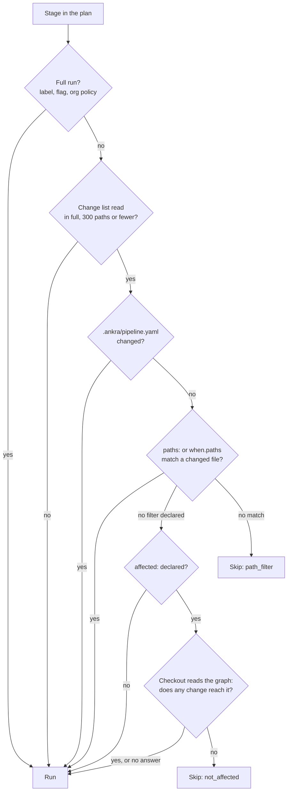
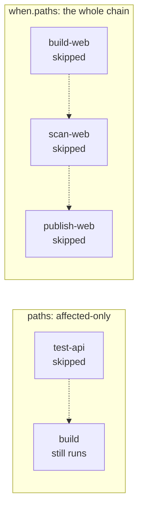
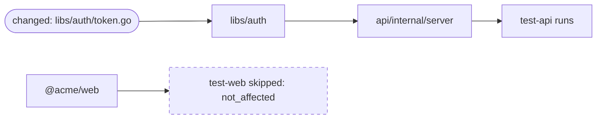
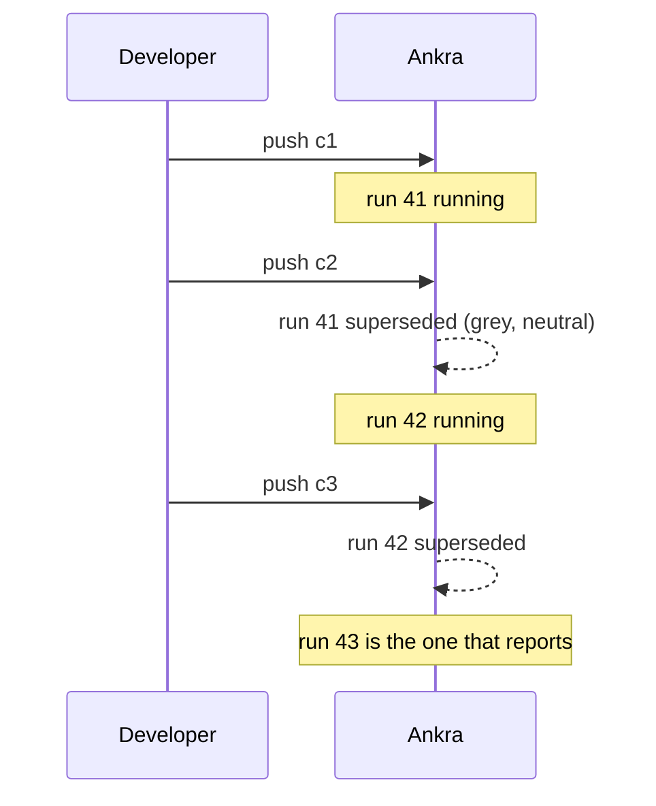
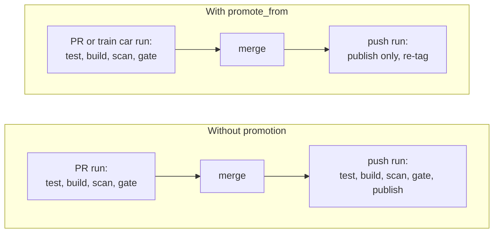

import { CliVersion } from "/snippets/cli-version.jsx";

The fastest step is the one that does not run. Ankra Pipelines gives you five ways to skip work, and each one is built to fail safe. When Ankra cannot prove a skip is safe, the stage runs.

| Technique | What it saves | Where it is set |
|---|---|---|
| [Path filters](#run-only-what-a-change-touches) | Stages whose files did not change | `paths:` and `when.paths` on a stage, `on.<event>.paths` on the pipeline |
| [Dependency graph](#follow-the-imports-affected) | Tests a change cannot reach through imports | `affected:` on a stage |
| [Newest commit wins](#newest-commit-wins) | Runs for commits that were already superseded | `concurrency` |
| [Build once, promote](#build-once-promote-on-merge) | The second build and test of a merge | `publish.promote_from` |
| [Caches](/pipelines/caching) | Re-downloading and recompiling what did not change | `cache` on a stage |

## How Ankra decides whether a stage runs



The rule at every branch is the same: a file Ankra could not see is not a file that did not change. An unreadable diff, a change of more than 300 files, a created branch or a force push all mean "run it", and the run's `paths_unverified` records why.

## Run only what a change touches

There are two kinds of stage path filter. The difference is what happens to the stages after a skipped one.



- **`paths:` makes a stage affected-only.** When no changed file matches, the stage is skipped as `path_filter`, and the stages that need it run without it. Use it for a test stage whose absence should hold nothing back.
- **`when.paths` skips the chain.** The stages behind a skipped stage are skipped too, unless they list it in `skippable_needs`. Use it for a component's whole build, scan, gate and publish chain in a monorepo. It is what the generated monorepo pipeline uses.

```yaml
path_sets:
  pipeline: [".ankra/**"]
  web: ["web/**", "packages/ui/**", { set: pipeline }]
  api: ["api/**", "go.work", { set: pipeline }]

stages:
  - name: checkout
    kind: checkout
  - name: test-web
    kind: run
    image: node:24
    needs: [checkout]
    paths: [{ set: web }]
    run: pnpm -C web test
  - name: test-api
    kind: run
    image: golang:1.26
    needs: [checkout]
    working_directory: api
    paths: [{ set: api }]
    run: go test ./...
```

`path_sets` names a list once, so every stage reuses it and the pipeline file is in every list. Sets can include other sets, and `!` excludes a pattern (the last matching pattern decides).

**Pull requests check what they touch, pushes check everything.** Use an event-scoped `when` block, so the pull request filters on paths and the push does not:

```yaml
- name: test-api
  kind: run
  needs: [checkout]
  run: go test ./...
  when:
    pull_request:
      paths: [{ set: api }]
    push: {}
```

<CliVersion since="0.27.0" command="pipeline validate --changed-file" />

```bash
ankra pipeline validate --changed-file web/app.ts
```

That prints every stage against a push and a pull request for that change, before you commit, so you can see the plan instead of guessing.

## Follow the imports: `affected:`

A path glob has one blind spot: a package your tests import from elsewhere in the repository. `test-api` lists `api/**`, a change to `libs/auth` matches nothing, and the tests that would have caught the break are skipped. `affected:` names packages instead of files, and Ankra follows their imports.



```yaml
- name: test-api
  kind: run
  image: golang:1.26
  needs: [checkout]
  working_directory: api
  affected:
    go: ["./..."]
  paths: ["migrations/**"]
  run: go test ./...

- name: test-web
  kind: run
  image: node:24
  needs: [checkout]
  affected:
    pnpm: ["@acme/web"]
  run: corepack enable && pnpm install --frozen-lockfile && pnpm --filter @acme/web... test
```

- **`go`** names packages as `go test` does: `./...`, `./internal/api`, or an import path. Every `go.mod` in the repository is read, so a local `replace` counts. A change to `go.mod`, `go.sum` or `vendor/` reaches every package of that module.
- **`pnpm`** names workspace packages by name (`@acme/web`) or directory (`./apps/web`). Workspace dependencies are followed. A change to the root lock file, root `package.json`, `pnpm-workspace.yaml` or a patch reaches every pnpm stage.
- **`paths:` beside `affected:`** adds what no import graph sees, such as migrations or fixtures a test opens by path. Either one matching runs the stage.
- **The checkout reads the graph** of the exact commit it checked out, in seconds. No extra step, nothing cached. A stage is skipped only when the checkout positively answered that no change reaches it. A pattern that names nothing, a failed analysis, or one that took over two minutes runs the stage.
- **A skip never waits for capacity.** A not-affected stage is concluded as soon as the checkout answers, without taking a CI slot.

## Newest commit wins

Push three commits to a branch in a minute, and only the last one's result matters.



```yaml
concurrency:
  group: "${{ ankra.repository.provider }}:${{ ankra.repository.owner }}/${{ ankra.repository.name }}-${{ ankra.ref }}"
  cancel_in_progress: true
```

- **`cancel_in_progress: true`** cancels the in-flight run when a newer one arrives in the same group. Every pipeline Ankra generates sets it.
- **`cancel_queued: true`** is the gentler choice: it keeps one running and one waiting run per group, cancelling older runs that have not started, and never the running one.
- **Superseded is not failed.** The older run concludes cancelled, shows as **Superseded** in grey, leaves a neutral status on GitHub, GitLab or Bitbucket, and raises no failure notification.

A definition you wrote keeps what it says. Ankra never flips the flag for you, but `ankra pipeline validate` gives advice (`pipeline_concurrency_queues_behind:`) when a per-branch group would queue a branch behind itself.

## Skip a push with `[skip ci]`

A pushed commit whose message carries `[skip ci]`, `[ci skip]`, `[no ci]`, `[skip ankra]` or `[ankra skip]`, or ends with a `skip-checks: true` trailer, records a skipped run instead of queueing one. The check is still posted.

Markers are honoured where they are safe and nowhere else:

| Run | Marker honoured? |
|---|---|
| Push to a branch other than the default | Yes, by default |
| Push to the default branch | Only when the organisation sets `ci_skip_markers: everywhere` |
| Pull request | Never. Its check is what branch protection reads |
| Tag | Never. A tag releases |
| Merge train car | Never |

## Full runs: set the filters aside

Sometimes you want every stage, whatever the paths say: before a release, after a toolchain bump, or to prove a flaky skip.

| Who asks | How |
|---|---|
| You, for one run | `ankra pipeline run --full`, or `ankra pipeline rerun <run> --full` |
| A pull request | Add the `ankra:full-run` label. Every push runs in full while it stays on, and so does its merge train car |
| The pipeline | A top-level `full_run: { events: [push], branches: [main] }` block |
| Your organisation | `ci_full_run_on_default_branch`, or stages listed in `ci_always_run_stages` that no pull request can filter away |

<CliVersion since="0.40.0" command="pipeline run --full" />

```bash
ankra pipeline run --full --wait
```

The run records why it was a full run and who asked.

## Build once, promote on merge

A merge to `main` normally builds and tests the merged commit again, even though the pull request run already did all of that for the same files. `promote_from` re-tags the tested image instead.



```yaml
- name: publish
  kind: publish
  needs: [gate]
  when:
    events: [push]
  publish:
    promote_from: pull_request
```

A push is promoted only when a run tested **exactly the same git tree**, under the same approved authority, within 72 hours, with every needed stage green and the gate having judged the same digest. A squash merge of a pull request that was up to date has that tree. One that was behind does not, and builds in full, unless the [merge train](/pipelines/merge-train) merged it, because the train's car tested exactly the merged tree. Anything short of the rules builds in full and records why.

## See what you saved

Every run records the CI time it did not spend because of a path filter, the dependency graph or a promotion, estimated from the median of that stage's recent successful runs.

<CliVersion since="0.40.0" command="pipeline time-saved" />

```bash
ankra pipeline get <run-id>                         # a "Time saved" line under the steps
ankra pipeline time-saved                           # organisation total, last 30 days
ankra pipeline time-saved --window 7d --repository <repository-id>
```

| `reason` | Saved by |
|---|---|
| `path_filter` | A stage a path filter left out |
| `dependency_skipped` | A stage skipped because one it needs was left out |
| `not_affected` | A step the dependency graph skipped |
| `promoted` | A step a promoted publish did not run again |
| `run_paths_excluded` | A whole run that `on.<event>.paths` excluded |

The figure is runner time, the seconds the skipped steps would have run added up. A stage with no usable history counts as unknown, never as zero and never as a guess.
