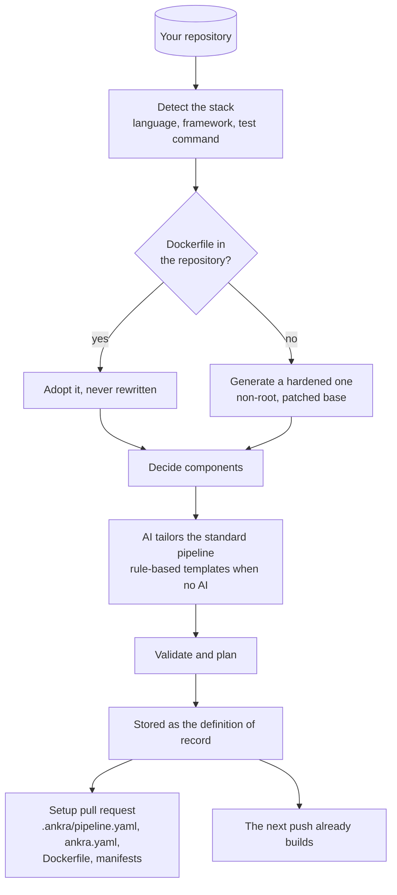
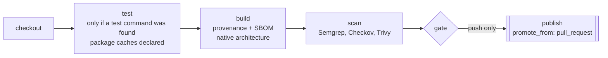
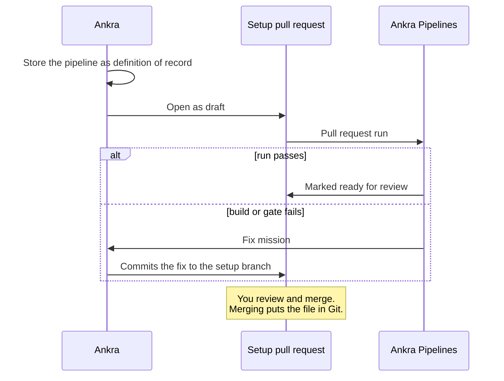
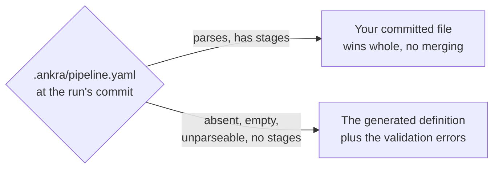

import { CliVersion } from "/snippets/cli-version.jsx";

You do not have to write a pipeline to get one. Point Ankra at a repository, and it reads the code, decides what the service is and how to test it, and commits a complete `.ankra/pipeline.yaml` in a pull request. That pipeline tests, builds, scans, gates and publishes from the first push.

<CliVersion since="0.17.0" note="ship needs v0.15.0; application pipeline convert needs v0.17.0." />

```bash
ankra application ship . --cluster my-dev-cluster
```

`ship` runs the whole road: register the application, open the setup pull request, build the first image, deploy it and verify it. Run it again and it carries on from wherever it stopped. To read the setup pull request before anything deploys, use `ankra application add . --name my-service --wait` instead.

## What happens when you register a repository



1. **Detect.** Ankra reads the files that name a stack: `package.json` (Next.js, Vite, React, Express, NestJS), `requirements.txt` or `pyproject.toml` (FastAPI, Django, Flask), `go.mod`, `Cargo.toml`, `pom.xml` or `build.gradle`, `Gemfile` (Rails), `composer.json` (Laravel) and `mix.exs`. Failing those it counts file types, and a root `index.html` with nothing else is a static site.
2. **Dockerfile.** A Dockerfile you already have is adopted as it is. Otherwise Ankra generates one whose final stage applies OS package upgrades and runs as a non-root user, on a maintained toolchain release.
3. **Components.** A monorepo gets one component per service. Ankra decides them in a fixed order: what `.ankra/ankra.yaml` declares (always wins), then what the repository already carries, then what the AI proposed, then what the tree implies. Names stay stable across re-runs, so stage names never shift under you.
4. **Tailor.** An AI step adapts the standard pipeline to the repository, using the same render and validate tools you can call. With no AI available, rule-based templates produce the same shape.
5. **Record.** The pipeline is validated, planned, and stored as the **definition of record** before the pull request even opens.

## What the generated pipeline contains



| Part | What Ankra sets, and why |
|---|---|
| Triggers | `push` and `pull_request` on your tracked branch, plus `manual`. Pull requests from forks run as `read_only`. |
| Concurrency | One group per ref with `cancel_in_progress: true`, so the newest commit on a branch wins. |
| Defaults | A 30-minute timeout, the `egress-https` network tier, `contents: read`. |
| `test` | Only when a test command was detected. There is never an empty test stage pretending to test. Package caches are declared for the toolchain, under `.ankra-*` directories the scan skips. See [Caching](/pipelines/caching#what-ankra-generates-for-you). |
| `build` | Provenance and SBOM attestations on. No platform pinned, so it builds natively for the node it runs on. |
| `scan` | Semgrep, Checkov and Trivy against the digest just built. Semgrep blocks on `error`, Checkov reports only, Trivy follows your organisation's image gate (by default, fixable critical and high findings in your own dependencies). Semgrep's rule packs are `p/default` and `p/docker` plus your language's packs, with `p/github-actions` only when the repository has workflows. |
| `gate` | Requires `scan`, so nothing unscanned can publish. |
| `publish` | Push events only, with `promote_from: pull_request`: a merge re-tags the image its pull request already tested, and builds in full when no run tested the same tree. |

**A monorepo gets one file.** Each component has its own chain (`build-web`, `scan-web`, `gate-web`, `publish-web`), path-filtered to its directory, all sharing one checkout and one run. A component at the repository root is not filtered.

## The setup pull request

The pull request carries `.ankra/pipeline.yaml`, `.ankra/ankra.yaml`, the Dockerfile when Ankra generated it, and `.ankra/manifests/`.



- **The pull request is a proposal, not a gate.** Because the definition is already recorded, the next push to your branch builds whether or not you merge it. Merging is how the file reaches Git, where you own it from then on.
- **When the setup pull request's own build or gate fails,** Ankra's AI commits a fix to the setup branch, so the pull request you review is one that passes.
- **After a failed setup**, `ankra application retry <application-id>` runs it again.

## Which file governs a run



Once the file is committed, **it is yours**. Ankra never rewrites a pipeline you committed, never merges its own opinions into it, and never flips a setting for you. Improvements Ankra makes to generated pipelines (a new cache layout, say) reach new applications. For an existing one, copy the block from these docs.

The application records where its builds come from as `pipeline_source`:

| `pipeline_source` | Meaning |
|---|---|
| `ankra_pipeline` | A committed `.ankra/pipeline.yaml` or a stored definition of record governs builds |
| `own_ci` | Your repository's own workflow pushes the image |
| `generated_workflow` | The legacy GitHub Actions workflow Ankra used to generate. Convert it (below) |
| `none` | Nothing builds yet |

`ankra application get <application-id> -o json` shows it, with a reason. `pipeline_file_committed_no_ci_cluster` means the file is fine and your organisation has not chosen a CI cluster yet: an administrator sets one with `ankra org ci-settings set --cluster <cluster>`.

## Already have CI? Convert it

<Tabs>
  <Tab title="An application on GitHub Actions">
    ```bash
    ankra application pipeline convert <application-id>
    ```

    One call converts the workflow, stores the result as the definition of record, switches the application to Ankra Pipelines at once, switches Ankra's generated workflow off, and opens a pull request that adds the pipeline and removes the generated workflow. A workflow your repository wrote itself is never touched. `--keep-workflows` keeps the generated workflow running beside the pipeline while you compare.
  </Tab>
  <Tab title="GitLab CI, Bitbucket or CircleCI">
    Ask Ankra AI, or your coding agent through the [MCP server](/pipelines/cli-and-mcp):

    > Convert .gitlab-ci.yml into an Ankra pipeline and validate it.

    `cicd_convert_workflow_to_pipeline` reads GitHub Actions, GitLab CI, Bitbucket Pipelines and CircleCI. It returns the pipeline and a note for everything it could not map. It writes nothing. You review and commit the file.
  </Tab>
</Tabs>

**What converts, and how.** Nothing is dropped silently. The result is always a starting point to review, never a black box.

| In your workflow | In the pipeline |
|---|---|
| `actions/checkout` | A `checkout` stage |
| `docker/build-push-action`, `depot/build-push-action` | A `build` stage: file, context, platforms, build args, provenance, SBOM, cache, tags |
| `aquasecurity/trivy-action` | A `scan` stage |
| `actions/setup-node`, `setup-go`, `setup-python`, `setup-java` | The stage image: `node:<v>`, `golang:<v>`, `python:<v>`, `eclipse-temurin:<v>` |
| `actions/cache` | A stage `cache` block |
| `services:`, `strategy.matrix`, `needs:`, `concurrency` | The same concepts, one to one |
| `docker/login-action`, `setup-buildx`, `setup-qemu`, cloud login actions | Dropped with a note: Ankra provides registry login, the builder, and credentials through the pipeline's `credentials` block |
| A GitLab job and its `stages:` order | One `run` stage per job, with `needs` edges in stage order; `rules: changes:` become path filters |
| Anything with no equivalent | A `run` stage that fails with an explanation, and a note naming it |

[Migrate from GitHub Actions](/guides/migrate-from-github-actions) covers the review checklist after conversion, and how to run both side by side before you switch.
