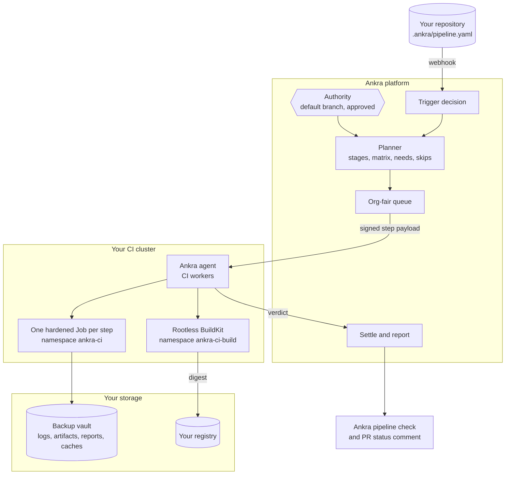
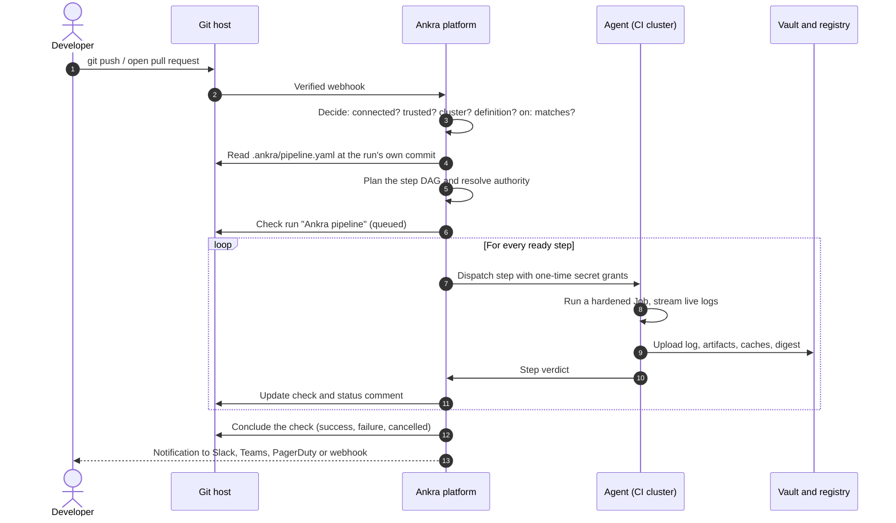
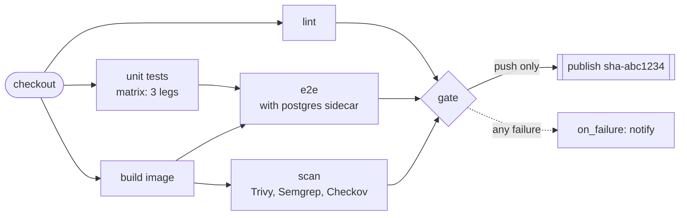
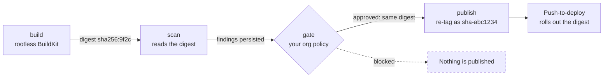
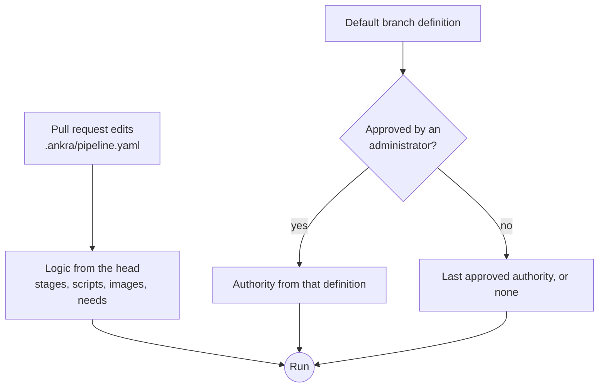
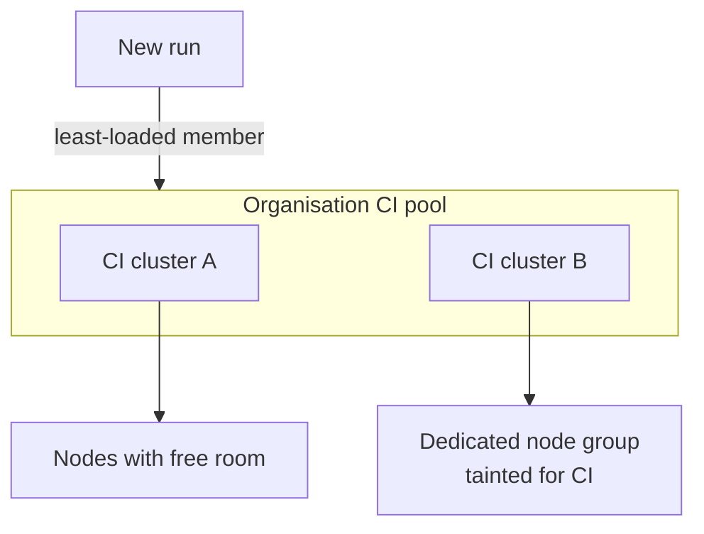

Ankra Pipelines turns one committed file, `.ankra/pipeline.yaml`, into runs on a Kubernetes cluster you already operate through Ankra. This page explains the system as a whole. For every key in the file, see the [pipeline.yaml reference](/guides/pipeline-reference). For the full operating detail (settings, limits, diagnosis codes), see the [Ankra Pipelines guide](/guides/ankra-pipelines).

## The big picture

Three places take part in every run: your Git host, the Ankra platform, and your CI cluster. Your source and your build traffic never leave your cluster. The platform decides what runs, and the agent in your cluster runs it.

- **The agent connects out.** Your CI cluster needs no inbound access, so a cluster behind NAT or a firewall runs pipelines like any other.
- **The agent renders the Kubernetes objects itself.** The platform sends a signed description of the step, never a manifest to apply verbatim.
- **Everything archival goes to a vault.** Step logs, artifacts, scan reports and caches go to your organisation's own [backup vault](/concepts/backup-vaults), or to the Ankra-managed default vault when you have none. You do not need to provision anything before a first run.

## From push to green check

Each numbered step has one job:

1. **Trigger.** A push, pull request, tag, schedule or manual dispatch becomes one normalised event. Ankra answers five questions in a fixed order: is the repository connected, is the head trusted, is there a cluster to run on, is there a definition, and does the `on:` block accept the event. Every answer is recorded, so a push that started nothing still says why.
2. **Plan.** The planner reads the pipeline file at the run's own commit (on GitHub), so a pull request that edits the pipeline tests its own edit. It expands matrices (at most 64 legs per stage) and applies path filters and the dependency graph. Every stage it leaves out is recorded with a reason, never dropped silently.
3. **Dispatch.** Steps are handed out org-fairly. Organisations are served in order of how much they already have running, so one busy team cannot starve another. Secrets become one-time, per-step reveal grants at this point, never written into a payload or a log.
4. **Run.** Each step is a Kubernetes Job with a read-only root filesystem, no privilege escalation, and the network tier the stage asked for. All steps of one run share a workspace volume.
5. **Settle and report.** Ankra records the verdict, unblocks the steps that waited for it, and updates the `Ankra pipeline` check run (or commit status on GitLab and Bitbucket Cloud) and the pull request's one status comment.

## A run is a graph, not a list

Stages declare what they need. Everything whose needs are met runs in parallel, up to your concurrency limits.

- `needs` draws the edges. A stage with no `needs` starts as soon as the run does.
- `matrix` fans one stage out into legs, with the same include and exclude rules as GitHub Actions.
- `on_failure` stages run only when something failed. `finally` stages run whatever the outcome, including after a cancel.
- A stage a path filter or the dependency graph left out is **satisfied** for what needs it, so the graph keeps moving.

## One digest from commit to registry

Most CI systems build, push and then scan, so a vulnerable image is already in the registry by the time the scan fails. Ankra Pipelines splits the work into four stage kinds, and the image only moves forward when the stage before it passed.

- `build` pushes by digest to a **staging** repository, never to the repository your application deploys from.
- `scan` runs Trivy (filesystem, SBOM and the image itself), Semgrep and Checkov from pinned images that a pipeline cannot swap out.
- `gate` judges the run's own persisted findings against the organisation's image gate. A pipeline may make the gate stricter for itself, never looser. A scanner that recorded nothing fails the gate, because an unread scan is not a clean scan.
- `publish` re-tags the exact digest the gate judged. It refuses if the gate is missing, failed, or recorded a different digest. No rebuild, no mutable tag until this point.

## Logic is open, authority is closed

Anyone who can push may change what a pipeline **does**: stages, scripts, images, conditions, matrices. What a run may **touch** is fixed by the default branch's definition, once an organisation administrator has approved it.

The protected sections include:

- `secrets` and `credentials`
- `permissions`
- the fork policy
- network tiers above `egress-https`
- placement and `resources`
- `timeout`
- `cache`
- `services`
- a stage's `with:` block
- `promote_from`

A pull request that adds a credential or widens its network still runs its scripts, but under the trusted authority. The check run says, in a sentence, what was ignored and why. So nobody can sneak a production credential into a pull request, and you never have to choose between letting contributors edit CI and keeping it safe.

Fork pull requests run too, with no secrets, no credentials, no shared caches, no network outside `checkout`, `build` and `scan`, and a fixed budget of compute and artifact space. Their plan applies those clamps up front, so what a reviewer sees is what runs.

## Where a step runs

- The organisation names a CI cluster, or a **pool** of several. A new run goes to the least-loaded member and never moves once started.
- Each cluster's agent runs at most `ci_worker_count` steps at once. These CI slots are separate from the agent's deploy work, so CI never delays a rollout.
- A **step placement** can pin every pipeline pod to a dedicated node group. Ankra node groups scale up when steps ask for more room than the nodes have.
- All steps of one run share one node, because they share one workspace volume. A run that fans out picks the emptiest node first.

## What the run leaves behind

| Where | What you get |
|---|---|
| Your Git host | One `Ankra pipeline` check run per run (GitHub), with a step table and a Cancel button. A commit status on GitLab and Bitbucket Cloud. On a pull request, a single status comment with pipeline, preview and review sections. |
| The portal | The run timeline, an in-app log viewer, test results with flaky detection, cache hit chips, and the time the run saved. |
| The CLI and MCP | `ankra pipeline get`, live `logs --follow`, artifacts and findings, the same data for scripts and AI agents. See [CLI and MCP](/pipelines/cli-and-mcp). |
| Your vault | The complete step log, declared artifacts, scan reports and test reports, kept by your retention settings. |
| Your channels | `pipeline_run_failed`, `pipeline_run_succeeded`, `image_gate_blocked`, `preview_ready` and `preview_failed`, routed by your [notification rules](/guides/notification-routing). |

## Next

<CardGroup cols={2}>
  <Card title="Generated pipelines" icon="wand-magic-sparkles" href="/pipelines/generated-pipelines">
    How Ankra writes the pipeline for you from your repository.
  </Card>
  <Card title="Fast CI" icon="gauge-high" href="/pipelines/fast-ci">
    Run only what a change touches, and never build the same commit twice.
  </Card>
  <Card title="Caching" icon="box-archive" href="/pipelines/caching">
    Warm package and build caches that respect trust boundaries.
  </Card>
  <Card title="Merge train" icon="train" href="/pipelines/merge-train">
    Test every pull request as it will merge, then merge it.
  </Card>
</CardGroup>
