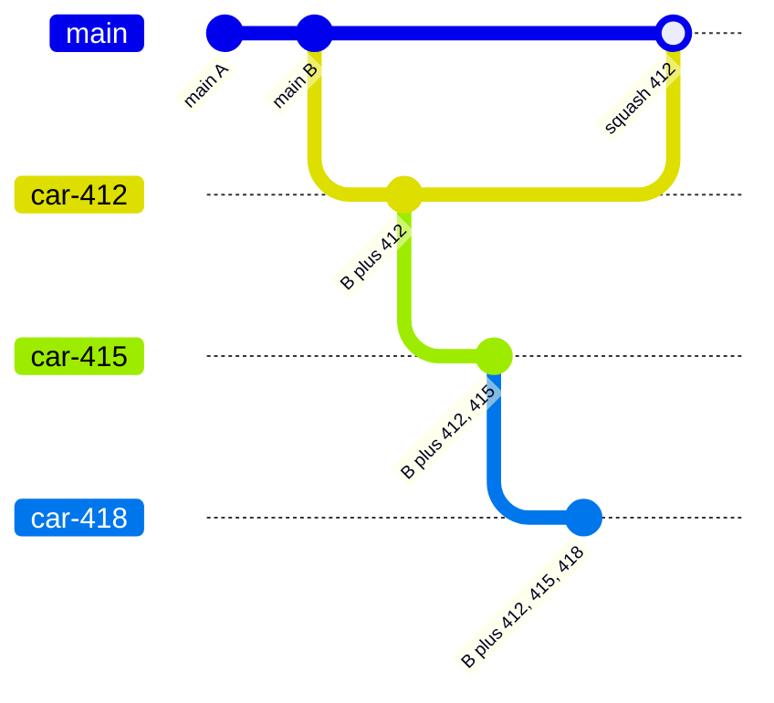
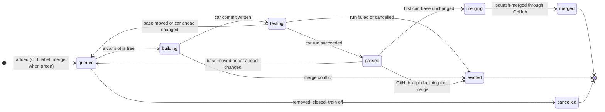
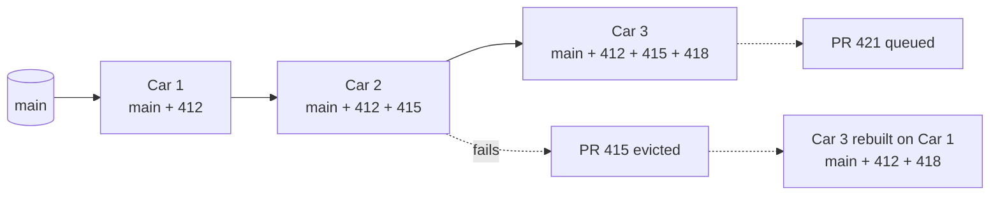
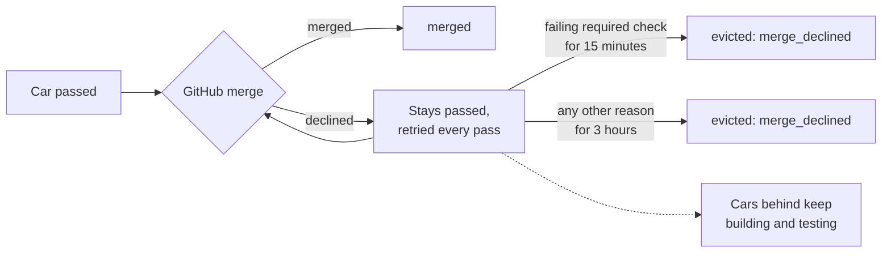
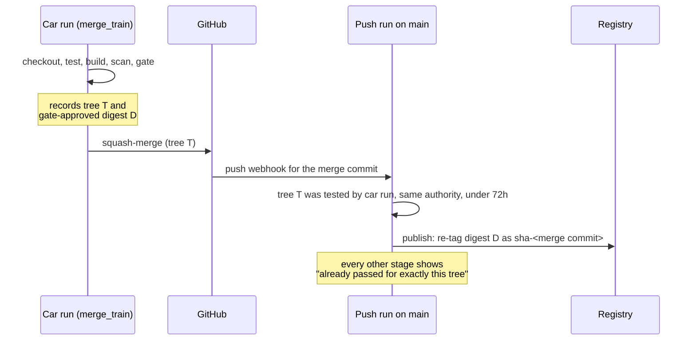

import { CliVersion } from "/snippets/cli-version.jsx";

A pull request's own run tests its head. It does not test that head on top of everything that merged since the branch was cut. Two pull requests can both be green and still break `main` when they land together. That is how a default branch goes red with nobody to blame.

The merge train closes that gap. Ankra tests each pull request **as the commit its merge will produce**, on top of the base branch and every pull request ahead of it. It merges only after that exact commit passes. It does what GitLab's merge trains and GitHub's merge queue do, on any GitHub plan, inside your own CI cluster.

<Info>
The merge train works with **GitHub** repositories today, and merges with **squash**. It is off until you turn it on for a repository.
</Info>

## Why it is worth turning on

- **`main` stays green.** Nothing merges onto a base its car did not test, so a semantic conflict between two pull requests is caught before it lands, not after.
- **No bisection.** Each car tests everything ahead of it. When a car fails, the pull request in that car is the one that broke it.
- **Parallel, not serial.** With several cars, the train tests up to eight pull requests at once, each stacked on the ones ahead.
- **Merge to published is a re-tag.** The merge commit's tree is exactly what the car tested, so a pipeline with [`promote_from`](#build-once-publish-the-tested-image) publishes the car's image instead of building and testing the same tree again.
- **Your rules still apply.** The train merges through GitHub's own merge API. Branch protection, required reviews and required checks hold exactly as for a person's merge. Ankra never pushes to or force-pushes the base branch.

## How a car is built

For each pull request in the train, Ankra writes a **car**: the pull request squashed onto the base branch, or onto the car ahead of it.



1. The car's branch, `ankra-merge-train/<entry id>`, starts at its base: the base branch head for the first car, or the car ahead for every other car.
2. The pull request's pinned head is merged in, using the same merge GitHub's squash merge computes.
3. A single-parent commit with that tree is written. It is exactly the squash commit the merge will create, titled `<title> (#<number>)`.
4. A pipeline run tests that commit. The run records the car's tree, which is what lets the merge publish without a rebuild.

**How the car's run is planned.** A car run is planned as a pull request into the base branch, under the base branch's approved [authority](/pipelines/how-it-works#logic-is-open-authority-is-closed):

- It runs only when the pipeline declares `on.pull_request` with `branches` that match the base branch.
- `when.events: [pull_request]` stages run. Push-only `publish` and deploy stages do not.
- It never joins the pull request's own concurrency group, and a push to an `ankra-merge-train/*` branch never starts a run of its own.
- A `[skip ci]` marker never skips a car.

## The life of a pull request in the train



| Status | What it means |
|---|---|
| `queued` | Waiting for a car. Just added, or sent back to be rebuilt |
| `building` | The car branch is being written |
| `testing` | The car commit exists and its pipeline run is testing it |
| `passed` | The run passed. It waits to be the first car with an unchanged base |
| `merging` | The merge is in progress |
| `merged` | The train merged the pull request |
| `evicted` | The train removed it: its car failed, it could not merge, or it changed under the train |
| `cancelled` | A person removed it, the train was switched off, or the pull request was closed or merged elsewhere |

A car whose run concludes **skipped** counts as passing. For example, every changed file is outside `on.pull_request.paths`. A skipped car is never a promotion source, though.

## Several cars at once

With `--max-cars 3`, the train tests three pull requests side by side, each on top of the ones ahead.



- Only the **first** car merges. It merges once its run passed and the base branch head, re-read just before the merge, is still the head it was built on.
- **When a car fails**, its pull request leaves the train with the failing run linked. Every car behind it included the failed change, so they are rebuilt without it (`predecessor_changed`). Nothing has to be bisected.
- **When someone merges around the train**, every built car goes back to `queued` with `base_moved` and is rebuilt on the new head.
- **When you lower `max_cars`**, cars beyond the new limit are requeued with `train_shortened`.

Ankra builds one car per pass, because the next car needs the commit this one writes. Cars are not batched: each car is one pull request, and each merge is one squash commit.

<Tip>
**Picking `max_cars`.** Start with `1` (one pull request at a time on the latest base) and raise it when pull requests wait in the queue. More cars means more throughput, and more rebuilds when an early car fails. A high merge rate with a reliable test suite is the case for 3 to 8.
</Tip>

## Turn it on

<Steps>
  <Step title="Make sure the pipeline tests pull requests into the base branch">
    The car run is a pull request run, so the pipeline needs:

    ```yaml
    on:
      pull_request:
        branches: ["main"]
    ```

    Without it, a car is evicted with `pipeline_not_triggered`.
  </Step>
  <Step title="Enable the train">
    <CliVersion since="0.30.0" />

    ```bash
    ankra pipeline train enable --max-cars 2
    ```

    Run it from inside the repository's checkout, or name it with `--application <name>` or `--repository <id>`. This needs `pipelines.manage`. `--max-cars` takes 1 to 8 and defaults to 1.
  </Step>
  <Step title="Require the train's check on the base branch">
    Ankra posts an **Ankra merge train** check on every pull request it holds, and concludes it `success` only immediately before it merges. In GitHub's branch protection, require that check, pinned to the Ankra GitHub App rather than any source. Every merge then goes through the train. A pull request outside the train shows the check as expected and waiting, and cannot merge.
  </Step>
  <Step title="Optionally, publish the tested image on merge">
    Add `promote_from: pull_request` to your `publish` stage, so a train merge publishes the car's image instead of rebuilding it. See [Build once, publish the tested image](#build-once-publish-the-tested-image).
  </Step>
</Steps>

## Put a pull request on the train

There are three ways in, and they all lead to the same queue.

<Tabs>
  <Tab title="CLI">
    ```bash
    ankra pipeline train add 412                     # put #412 at the end of the train
    ankra pipeline train add 412 --head-sha 9f2c1e7  # pin the exact commit you reviewed
    ankra pipeline train list                        # the train in order, and what recently left it
    ```
  </Tab>
  <Tab title="Label">
    Add the `ankra:merge-train` label to the pull request, in any letter case. Removing the label only removes an entry the label put there.
  </Tab>
  <Tab title="Merge when green">
    Comment **`@ankraai merge when green`**, press the button in the portal, or ask Ankra AI. On a repository with the train on, the request enters the train instead of merging directly. See [AI in pull requests](/pipelines/ai-in-pull-requests#merge-when-green).
  </Tab>
</Tabs>

**Who may add a pull request.** You need `pipelines.operate` and must be a person, not a service token. You also need one of these: organisation administrator, the pull request's author, or write access to the repository on GitHub through your verified GitHub identity. You can always remove an entry you added yourself. When GitHub cannot be asked, nothing changes and the command says so.

**Pushing to a pull request in the train takes it out** (`head_changed`). The train merges the head a person put in it, never one that arrived later. Push your fix, then add it again.

## Merges GitHub declines

The train merges through GitHub's merge API, so GitHub can say no, usually because one of the pull request's own required reviews or checks has not arrived.



- The car stays `passed` and the merge is retried on every pass, with GitHub's message shown as the reason.
- **Cars behind it keep building and testing meanwhile.** The train does not freeze behind one stuck merge.
- When GitHub says a required status check **is failing**, the car is evicted after **15 minutes**. A failed check does not turn green by waiting, so re-run it and add the pull request again.
- For any other reason, such as a review that has not arrived yet, the car waits up to **3 hours** before it is evicted.

## Why a pull request left the train

`ankra pipeline train list` shows what recently left the train and why. The same sentence is on the pull request's check run.

| Reason | Status | What it means and what to do |
|---|---|---|
| `run_failed` | evicted | The car's run did not pass. Open the linked run, fix, and add it again |
| `run_cancelled` | evicted | The car's run was cancelled |
| `merge_conflict` | evicted | It does not merge cleanly onto the base and the pull requests ahead. Rebase or merge `main` in, then add it again |
| `head_changed` | evicted | Pushed to after it entered the train. Add it again to test the new head |
| `base_branch_changed` | evicted | The pull request now targets a different base branch |
| `merge_declined` | evicted | GitHub kept declining the merge (above) |
| `pipeline_not_triggered` | evicted | The pipeline has no `on.pull_request` trigger matching the base branch |
| `fork` | evicted | Pull requests from forks are never merged automatically |
| `host_unavailable` | evicted | GitHub could not be reached for this pull request for over three hours |
| `nothing_to_merge` | evicted | The base branch already contains the change |
| `pull_request_closed` | cancelled | The pull request was closed |
| `merged_outside_train` | cancelled | Someone merged it outside the train |
| `dequeued` | cancelled | Someone removed it |
| `train_disabled` | cancelled | The train was switched off |

A car sent back to be rebuilt shows `queued (<reason>)`: `base_moved`, `predecessor_changed`, `train_shortened`, `run_missing` or `run_replaced`. That is normal train motion, not a failure.

After every merge, the train compares the merge commit's tree with the car's tree. The **TESTED AS MERGED** column of `train list` is that comparison: it is the proof that what merged is what was tested.

## Build once, publish the tested image

Without the train, a merge to `main` builds, scans, tests and gates the merged commit again, even when the pull request run already did the same work. With the train, the merge commit's tree is exactly the tree the car tested, so that second build is pure waste.



Declare it on the `publish` stage:

```yaml
- name: publish
  kind: publish
  needs: [gate]
  when:
    events: [push]
  publish:
    promote_from: pull_request
```

The push is promoted only when all of these hold. Otherwise it builds in full, and the run records why:

- Every `publish` stage declares `promote_from`, under approved authority. It is a protected section, so a pull request cannot turn it on for itself.
- The push's plan is only `publish` and the stages it needs.
- A pull request or car run tested the same git tree, under the same approved authority, within the last 72 hours.
- Every stage `publish` needs passed in that run on its newest attempt. A stage that run skipped as [not affected](/pipelines/fast-ci#run-only-what-a-change-touches) counts too.
- That run's `gate` judged exactly the digest its `build` reported.
- The run was not from a fork, and was not a skipped car.

The run's detail says `Promotion: promoted (from run #N)`, or names the reason it fell back, such as `no_tested_run`, `source_inputs_differ` or `source_too_old`.

## Commands

<CliVersion since="0.30.0" />

| Command | What it does | Needs |
|---|---|---|
| `ankra pipeline train enable [--max-cars 1-8]` | Turn the train on, or change how many cars test at once | `pipelines.manage` |
| `ankra pipeline train disable` | Turn it off. The train empties on the next pass | `pipelines.manage` |
| `ankra pipeline train add <pr> [--head-sha <sha>]` | Put a pull request at the end of the train | `pipelines.operate`, and author, writer or admin |
| `ankra pipeline train list` | The train in order: pull request, status, attempt, car, run, entry id. Then what recently left, with why | Membership |
| `ankra pipeline train remove <entry-id>` | Take one entry out | `pipelines.operate` |
| `ankra pipeline train front <pr or entry-id>` (CLI 0.47.0+) | Move a pull request ahead of every car still queued, building or testing. Cars it passes are rebuilt | Organisation administrator |

Every command takes `--application <name>` or `--repository <id>`, or infers the repository from your checkout's `origin`. Add `-o json` for scripts. `merge-train` is an alias for `train`. Over the [MCP server](/pipelines/cli-and-mcp), a coding agent enters a pull request through merge when green (`scm_merge_pull_request`), which joins the train on a repository that has one, and follows the car's run with `watch_pipeline_run`.
