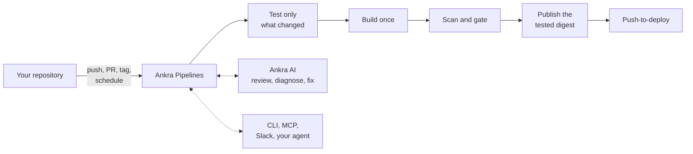

import { CliVersion } from "/snippets/cli-version.jsx";

Ankra Pipelines runs your repository's CI/CD as Kubernetes Jobs on a cluster you already operate through Ankra. One file, `.ankra/pipeline.yaml`, says what to run. Ankra writes it for you, runs it on every push and pull request, reports back to GitHub, GitLab or Bitbucket, and publishes only images it has scanned and gated.



## Get a pipeline in three commands

<CliVersion since="0.15.0" />

<Steps>
  <Step title="Point a CI cluster at pipelines">
    An organisation administrator chooses the cluster and turns on its pipeline workers, once:

    ```bash
    ankra org ci-settings set --cluster my-ci-cluster
    ankra cluster agent ci set --workers 4 --cluster my-ci-cluster
    ```
  </Step>
  <Step title="Ship a repository">
    From the repository's checkout:

    ```bash
    ankra application ship . --cluster my-dev-cluster
    ```

    Ankra analyses the code and opens a setup pull request with a generated `.ankra/pipeline.yaml`. The next push already builds. For a repository with nothing to deploy, connect it instead with `ankra pipeline repositories connect` and commit your own file. See [Examples](/pipelines/examples#a-repository-with-no-application).
  </Step>
  <Step title="Watch it">
    ```bash
    ankra pipeline get --head-sha "$(git rev-parse HEAD)" --latest --wait
    ```

    The same run is an **Ankra pipeline** check on your commit, a section in the pull request's status comment, and a timeline in the portal.
  </Step>
</Steps>

New to Ankra CI? [Get started with Ankra CI](/get-started/ankra-ci) walks the same path with every expected outcome.

## The section

<CardGroup cols={2}>
  <Card title="Why Ankra Pipelines" icon="star" href="/pipelines/why-ankra-pipelines">
    What you care about in CI, and how each piece is delivered.
  </Card>
  <Card title="How it works" icon="diagram-project" href="/pipelines/how-it-works">
    From push to green check, in diagrams: planning, dispatch, authority, the digest chain.
  </Card>
  <Card title="Generated pipelines" icon="wand-magic-sparkles" href="/pipelines/generated-pipelines">
    How Ankra writes your pipeline, and how to convert an existing one.
  </Card>
  <Card title="Fast CI" icon="gauge-high" href="/pipelines/fast-ci">
    Affected-only stages, the dependency graph, newest commit wins, build once.
  </Card>
  <Card title="Caching" icon="box-archive" href="/pipelines/caching">
    Keys, restore, trust scopes, what Ankra generates, and reading a hit or a miss.
  </Card>
  <Card title="Merge train" icon="train" href="/pipelines/merge-train">
    Test every pull request as it will merge, several at once, then merge it.
  </Card>
  <Card title="Examples" icon="code" href="/pipelines/examples">
    Complete pipelines for services, monorepos, databases, libraries, nightlies and releases.
  </Card>
  <Card title="AI in pull requests" icon="code-pull-request" href="/pipelines/ai-in-pull-requests">
    The review that reads your pipeline, merge when green, fixes for failed builds, previews.
  </Card>
  <Card title="AI Gateway" icon="tower-broadcast" href="/pipelines/ai-gateway">
    Slack, Teams, GitHub, GitLab and Bitbucket, with Ask and Agent modes.
  </Card>
  <Card title="CLI and MCP" icon="terminal" href="/pipelines/cli-and-mcp">
    The everyday commands, scripting with exit codes, and the MCP tools.
  </Card>
  <Card title="With coding agents" icon="robot" href="/pipelines/coding-agents">
    Claude Code, Codex and the Claude app: connect, install skills, close the loop.
  </Card>
  <Card title="Full guide and reference" icon="book" href="/guides/ankra-pipelines">
    Every setting, limit, diagnosis code and key, for when you need the detail.
  </Card>
</CardGroup>
