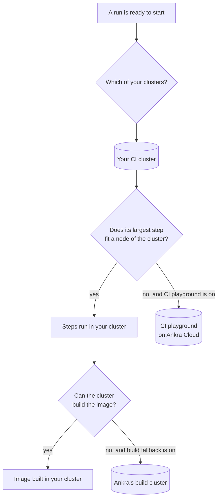

import { CliVersion } from "/snippets/cli-version.jsx";

A pipeline step runs on one of three kinds of place: a cluster of your own, Ankra's build cluster, or a CI playground that Ankra builds for you on Ankra Cloud. Most runs never leave your own cluster. Two fallbacks can move work off it, both are on until you turn them off, and this page explains when each one acts, what it costs, and how to keep every pipeline step in your own cluster.



## Your own cluster

Every run starts by choosing one of your organisation's clusters, in this order. The first that answers wins.

| Order | Where | Set in |
|---|---|---|
| 1 | The cluster the run is already pinned to. A run never moves once its first step has been sent | Nothing to set |
| 2 | A cluster of the organisation's CI pool: the least busy one for its weight. When two are close, the one where the repository ran last, because it holds the warm caches | **Build & delivery → Builds and clusters**, under **CI clusters**, or `ankra org ci-settings pool add` |
| 3 | The organisation's pipeline cluster | **Build & delivery → Builds and clusters**, under **Where pipelines run**, or `ankra org ci-settings set --cluster` |
| 4 | The staging cluster the organisation chose for AI workspaces and previews | **Ankra AI → AI workspaces**, or `ankra org ai-environment set --staging-cluster`. See [AI Gateway](/pipelines/ai-gateway#the-staging-cluster) |
| 5 | A cluster whose purpose a person confirmed, and which is not production | **Infrastructure → Clusters → &lt;your cluster&gt; → Settings → General**, with **Change what it’s used for** |

A production cluster, or one whose purpose nobody confirmed, is never chosen by the last rule, even when it is the organisation's only cluster. With no cluster at all, the push gets a check titled **Choose a CI cluster for this organisation**, and a run's steps conclude with that reason instead of running.

A repository can also send its runs to one cluster of its own, whatever the organisation's settings say. Its next runs go there; runs already queued keep theirs:

<CliVersion since="0.28.0" command="pipeline repositories set-cluster" />

```bash
ankra pipeline repositories set-cluster <repository-id> --cluster my-cluster
ankra pipeline repositories set-cluster <repository-id> --cluster ""
```

In your cluster, steps run as Kubernetes Jobs in the cluster's `ankra-ci` namespaces, on its CI node group if it has one. The cluster's agent needs pipeline workers: each worker runs one step at a time. Your source is checked out, built and tested there.

**What it costs:** the nodes your cluster already runs on. A step reserves the CPU and memory it asks for, so a busy hour needs room on those nodes, or a node group that can grow.

## Ankra's build cluster

A `build` step builds a container image. Two things stop a cluster from building one: its agent does not run pipeline steps at all, or the nodes confine the rootless image builder (AppArmor or seccomp, common on Ubuntu and k3s nodes), which a step reports as `build_runtime_confined`. When that happens, Ankra can build the image on its own build cluster instead, and the `scan`, `gate` and `publish` steps after it run as usual.

Both of these must hold:

- **The organisation's build fallback is on.** It is on until an owner or admin turns it off: **Build on Ankra when your cluster cannot**, under **Build rules** in **Build & delivery → Builds and clusters**. In the CLI it is `--build-fallback platform_builders`.
- **Ankra has enabled platform builds for the organisation.** This is Ankra's grant, not a setting you can change. `ankra org ci-settings get` shows it.

What the build cluster receives: the repository, the commit, a short-lived GitHub installation token to fetch it, the Dockerfile path, and the registry login the image is pushed with. The builder fetches the source at that commit, builds the image and pushes it. The step that ran there carries the notice **Built on Ankra platform builders**, with the reason and the command that brings the run back in your cluster.

With the build fallback off, a build your cluster cannot run is refused with a message that says why, and nothing of that run leaves your cluster.

## A CI playground

A run whose largest step no node of your CI cluster can hold would wait until its time ran out. A cluster where a step recently could not be scheduled, or was killed at its memory limit, in the last seven days, counts as too small too. For those runs, Ankra moves the whole run to a **CI playground**: an Ankra Cloud cluster it builds for the run, with pipeline workers. While the run waits for it, its queue reason is `waiting_for_ci_playground`.

- **The cheapest arrangement wins.** An account without a payment method gets its free trial playground. An account with one gets the smallest Ankra Cloud plan whose node fits the run's largest step.
- **One playground per organisation.** Every run that needs one shares it and queues for room on it like on any CI cluster. It grows to a larger plan only for a single step it cannot hold, and only once no step is running on it, because a resize restarts its server.
- **A billed playground is removed when it goes idle.** Once no run has used it for the organisation's idle time, 5 minutes unless you change it, Ankra tears it down. A trial playground is left to its own expiry.

The whole run moves, so the source is checked out, built and tested on that Ankra Cloud cluster.

**What it costs:** nothing for a trial playground. A billed playground is charged by the minute at its Ankra Cloud plan's price while it exists, idle time included. See [Ankra Cloud clusters](/guides/ankra-cloud-clusters).

With the CI playground off, a run that does not fit stays on your cluster: it waits, and concludes if no node can take its largest step. Lower the stage's `resources`, or add a node group with bigger nodes.

## Keep everything in your own cluster

Two organisation settings keep every pipeline step on your own clusters. An organisation owner or admin changes them.

| Setting | Off means | Where |
|---|---|---|
| Build fallback (`ci_build_fallback`) | A build your cluster cannot run is refused, never sent to Ankra's build cluster | Turn off **Build on Ankra when your cluster cannot** under **Build rules**, then **Save changes**. Or the CLI, below |
| CI playground (`ci_auto_playground`) | A run too large for your cluster's nodes stays on your cluster | The API only, below. The portal and the CLI have no setting for it |

<CliVersion since="0.15.0" command="org ci-settings set --build-fallback" />

```bash
ankra org ci-settings set --build-fallback none

curl -X PUT https://platform.ankra.app/api/v1/org/ci-settings \
  -H "Authorization: Bearer <your-token>" \
  -H "Content-Type: application/json" \
  -d '{"ci_auto_playground": false}'
```

The same API call changes how long an idle billed playground is kept, from 0 to 1440 minutes: `{"ci_playground_idle_minutes": 30}`. A value outside that range is refused with "CI playground idle time must be between 0 and 1440 minutes."

`ankra org ci-settings get` prints **Build fallback** and **Platform builds enabled**. `GET https://platform.ankra.app/api/v1/org/ci-settings` returns `ci_build_fallback`, `ci_auto_playground` and `ci_playground_idle_minutes`.

### Builds outside a pipeline run

The two settings cover pipeline steps. Ankra can still build an application's image on its build cluster outside a pipeline run, for example the first build when you create the application, or a pull request preview whose image is missing. Those builds follow Ankra's platform builds grant, which `ankra org ci-settings get` shows as **Platform builds enabled**, and not the build fallback setting.

If your source may never be built outside your own infrastructure, ask [Ankra support](/platform/support) to turn platform builds off for your organisation before you create an application.

## Related

- [Move to Ankra Pipelines](/guides/migrate-from-github-actions): choose the cluster and its workers once for the organisation.
- [Troubleshooting](/guides/ankra-ci-troubleshooting): a step that waits, or a build that fails before the Dockerfile is read.
- [Cluster autoscaling](/guides/cluster-autoscaling): let the CI node group grow instead of queueing steps.
