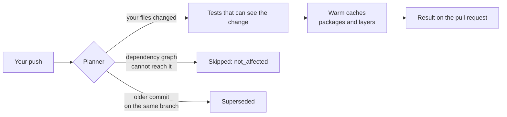
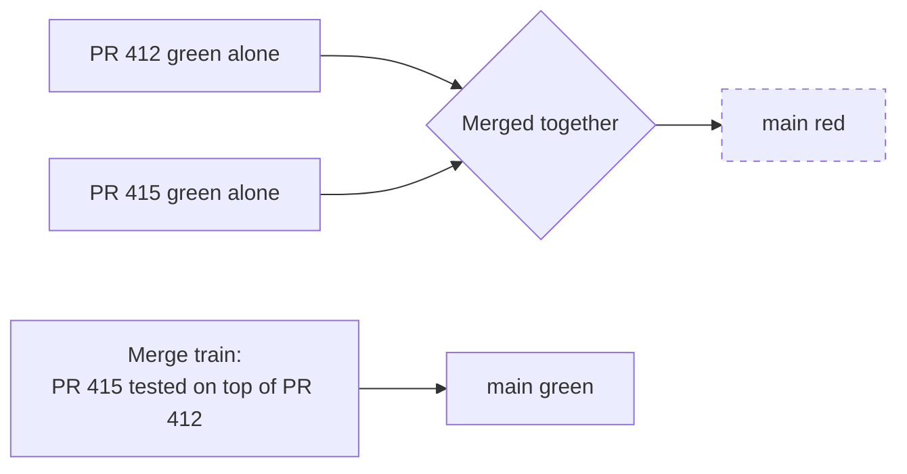
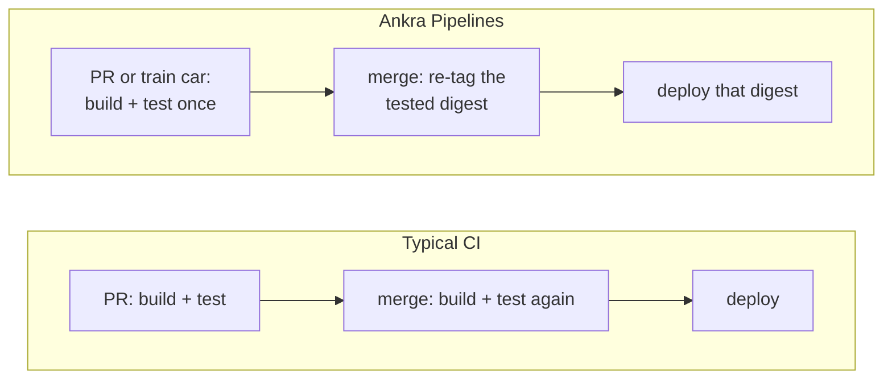
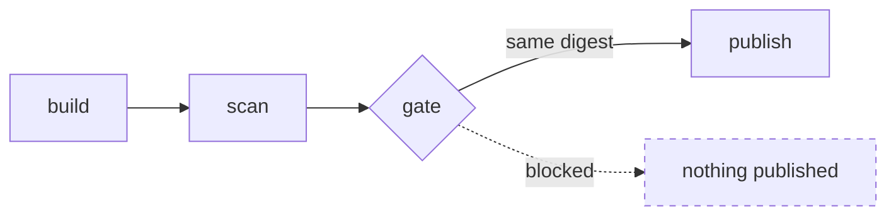

Every CI system runs scripts in containers. That part is a commodity. What separates a CI you stop thinking about from one you fight every week is everything around the scripts: how fast you hear back, whether `main` stays green, whether the same commit gets built three times, whether a pull request can reach a production secret, and whether you can find out why a run failed without opening five tabs.

This page is about those things, in the order people tend to care about them.

## 1. "Tell me fast whether my change works"

The feedback loop is the whole product. Ankra Pipelines shortens it by doing less, not by running the same work on bigger machines.

- **Only what your change can affect runs.** `affected:` follows your real Go and pnpm import graph, not just file globs, so a change to `libs/auth` runs the services that import it and skips everything else. When Ankra cannot prove a skip is safe, the stage runs. [Fast CI](/pipelines/fast-ci)
- **The newest commit wins.** Push three times in a minute and only the last run reports. The others are superseded, shown in grey, never as failures.
- **Caches are warm from the first pull request.** A new branch restores from `main`'s caches, and image builds reuse their layers automatically. [Caching](/pipelines/caching)
- **The time saved is measured, not claimed.** Every run records what it skipped and how long that would have taken, from your own history. `ankra pipeline time-saved` totals it.

## 2. "Keep `main` green"

A red `main` blocks everyone. Most of the time it is not one bad pull request. It is two good ones that conflict.

- **The merge train tests every pull request as the exact commit its merge will produce,** on top of everything ahead of it, then merges it through GitHub with your branch protection intact. Several cars test in parallel. A failing car tells you exactly which pull request broke, with no bisection. It works on every GitHub plan. [Merge train](/pipelines/merge-train)
- **The default branch never skips.** `[skip ci]` is honoured on feature branches and refused on the default branch, on pull requests, on tags and on train cars, because those runs are what protect and release your code.
- **Path filters cannot quietly drop a safety check.** An organisation administrator can name stages that always run, and no pull request can filter them away.

## 3. "Don't make me pay for the same build twice"

The usual flow builds and tests a commit on the pull request, then builds and tests the identical tree again on merge, then sometimes again on deploy.

- **Build once, promote on merge.** With `promote_from`, a merge whose tree a pull request or train car already tested publishes that exact image as a re-tag. What you tested is byte for byte what you ship.
- **No runner fleet to pay for.** Steps run as Kubernetes Jobs on a cluster you already operate through Ankra, in their own worker slots, never at the expense of a deploy. There is no per-minute bill from a CI vendor and no self-hosted runner pool to patch.
- **No second CI system.** Converting an existing workflow is one command, and Ankra warns you against running two CI systems on the same commit.

## 4. "Never ship an image nobody scanned"

- **Scan before publish, by design.** `build` pushes to a staging repository only. `publish` refuses unless a `gate` passed **and** that gate judged the same digest the build produced. A missing record is treated as unknown, not as agreement.
- **Three scanners, pinned.** Trivy (dependencies, SBOM and the image), Semgrep and Checkov run from pinned images no pipeline can swap out.
- **Pipelines can tighten the gate, never loosen it.** Your organisation sets the floor. A pull request may add scrutiny to its own pipeline, and nothing it writes can remove the organisation's.
- **An unread scan is not a clean scan.** A report that never uploaded, or did not parse, fails the step instead of passing as empty.

## 5. "A pull request must not be able to reach production"

The most common CI breach is a pull request that edits the workflow to print a secret. Ankra Pipelines makes that structurally impossible.

- **Logic is open, authority is closed.** Anyone can change what a pipeline does. What it may touch (secrets, credentials, network, placement, caches, compute, timeouts) comes only from the default branch's definition, after an administrator approves it. A pull request that adds a credential still runs, without it, and the check says why. [How it works](/pipelines/how-it-works#logic-is-open-authority-is-closed)
- **Secrets are references, not copies.** They are delivered to one step as one-time reveals, never written into a job spec or a log, and never copied into per-repository CI settings.
- **Approval is human.** No service token and no AI agent can approve authority.
- **Forks run safely.** No secrets, no credentials, no shared caches, no network outside checkout, build and scan, and a fixed compute budget, all applied to the plan a reviewer sees.
- **Caches cannot be poisoned.** Nothing a branch saves is ever restored into a default-branch run.

## 6. "Show me why it failed, where I already am"

- **One comment per pull request.** The run, the preview and the AI review share one status comment that updates in place.
- **The AI review reads your pipeline.** It sees the failing step, the scan findings and the gate verdict, not just the diff, and a failed build gets a diagnosis in plain words. [AI in pull requests](/pipelines/ai-in-pull-requests)
- **Ask from Slack or Teams.** "Why is main red?" gets an answer from the same AI, with your own permissions. [AI Gateway](/pipelines/ai-gateway)
- **Flaky tests are named, not hidden.** A test that passed on retry is recorded as flaky with its attempt count, and a repository can quarantine a proven-flaky test while someone fixes it.

## 7. "Let my AI agent work with CI, not around it"

Your coding agent already writes the code. Ankra lets it close the loop:

- **Validate before pushing**, with every violation by key, through the [MCP server](/pipelines/cli-and-mcp).
- **Watch the run and read the failing step's log**, then fix and push again, without you pasting logs into a chat.
- **Convert a GitHub Actions, GitLab, Bitbucket or CircleCI file** into a pipeline that validates.
- **Install the Ankra skills** so Claude Code, Codex, Cursor or the Claude app write Ankra pipelines correctly the first time. [With coding agents](/pipelines/coding-agents)

The agent can explain, validate, convert and watch. Granting power stays with you.

## 8. "Don't make me write it"

Point Ankra at a repository and it writes the pipeline: it detects the stack, adopts or generates a hardened Dockerfile, and picks the test command and the caches. It wires build, scan, gate and publish with promotion, and splits a monorepo into one chain per component. The setup pull request's own failures are fixed by the AI before you review it. Once you commit the file, it is yours, and Ankra never rewrites it. [Generated pipelines](/pipelines/generated-pipelines)

## At a glance

| What you care about | What you would otherwise build or buy | With Ankra Pipelines |
|---|---|---|
| Skip unaffected work | Path globs, or a monorepo build tool with remote caching | `affected:` from the real import graph, fail-safe |
| Green main | A merge queue, often a paid plan | A merge train in your cluster, up to 8 cars |
| Build once | Custom tagging scripts between workflows | `promote_from`, proven by git tree |
| Scan before ship | Ordering discipline across separate jobs | `build` → `scan` → `gate` → `publish`, enforced by digest |
| Secrets a PR cannot reach | Environment protection rules per repository | Protected sections, human approval, one-time reveals |
| Runners | A hosted per-minute bill or a self-hosted fleet | Jobs on a cluster you already run |
| Failure triage | Logs in the CI vendor's UI | AI review and diagnosis in the PR, Slack and Teams, your agent |
| Pipeline authoring | Hand-written YAML per repository | Generated, tailored and validated for you |

## Start

<CardGroup cols={2}>
  <Card title="Get started with Ankra CI" icon="play" href="/get-started/ankra-ci">
    The short tutorial: from a repository to a green check.
  </Card>
  <Card title="Examples" icon="code" href="/pipelines/examples">
    Complete pipelines for services, monorepos, libraries and releases.
  </Card>
</CardGroup>
