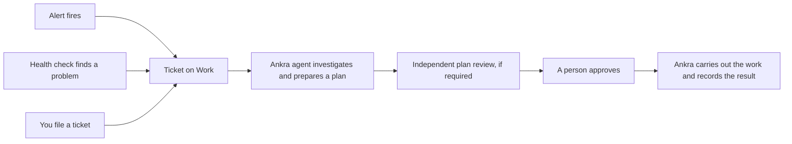

import { CliVersion } from "/snippets/cli-version.jsx";

Ankra AI investigates problems across your clusters, drafts fixes and, where you allow it, applies them. By default nothing that is already running changes until a person approves it: every change Ankra AI proposes in a conversation stops for your confirmation, and fixing alerts on its own is off until someone who manages Ankra AI turns it on. It runs on Ankra's default models within a monthly allowance, or on your own model key. See [Models and cost](/platform/ai-provider).

## What Ankra AI does for you

- **Investigate a problem** - press `⌘J` (`Ctrl+J` on Windows and Linux) on any page to open **Ask Ankra**, and ask why. On a cluster's pages the question carries that cluster. See [AI Assistant](/platform/ai-assistant).
- **Build or change a Stack** - describe what you need and it proposes the add-ons, their order and starting values. See [Building a Stack](/concepts/stacks#building-a-stack).
- **Explain a firing alert** - an alert that fires gets an AI analysis with the likely cause and what to do. See [Alert analysis](/platform/ai-insights#alert-triggered-analysis).
- **Find problems before they page you** - a health check of your clusters files each problem with a likely cause and the steps to fix it. See [AI Insights](/platform/ai-insights).
- **Review pull requests** - a review on every pull request in the repositories you choose, and answers when someone mentions `@ankraai`. See [AI code review](/platform/ai-code-review).
- **Work tickets** - the Ankra agent investigates a ticket, prepares a plan, carries out the work a person approves and records the result. See [AI Board](/platform/ai-board).

## Where everything lives

**Ankra AI** is a row in the sidebar's **Platform** group (`/next/ai`). It opens its own menu. You see it when your role can read agent runs, alerts or the organisation.

| Menu row | Address | What it is for | Read more |
|---|---|---|---|
| **Overview** | `/next/ai` | Decisions waiting on your team, the work in progress and the latest agent results, across all environments. See [The Overview page](#the-overview-page) | This page |
| **Work** | `/next/ai/tickets` | The **Tickets** board: every issue with an owner, a next step and a record of what happened. **Conditions** (`/next/ai/conditions`) group the tickets filed for one problem that keeps coming back on one thing | [AI Board](/platform/ai-board) |
| **Watching** | `/next/ai/watching` | What Ankra looks out for, what it does when it happens, and who hears about it. **Watch something** adds a watch. Firing alerts open here too (`/next/ai/alerts`) | [Alerts](/guides/alerts) |
| **Gateway** | `/next/ai/gateway` | Where your team works with Ankra AI: Slack, Microsoft Teams, pull requests, alert delivery and email. **Set up the gateway** opens the five-step setup | [Set up the AI Gateway](/platform/ai-guided-setup), [AI Gateway](/pipelines/ai-gateway) |
| **Code reviews** | `/next/ai/code-reviews` | What Ankra AI said on every pull request it reviewed, and what the authors did about it | [AI code review](/platform/ai-code-review) |
| **Activity** | `/next/ai/agent-runs` | **Agent runs**: follow Ankra's work from the first step to the recorded result | [AI Agents](/platform/ai-agents) |
| **Settings** | `/next/ai/settings` | **AI settings**: **Configure Gateway**, **Configure work routing** (the **Ticket desk**) and a link to each configuration page below | [How work flows](#how-work-flows) |

The menu's **Configuration** section holds the organisation-wide settings. Your role needs to read the organisation to see it.

| Configuration row | Address | What it is for | Read more |
|---|---|---|---|
| **Models and provider** | `/next/organisation/ai-models` | The models Ankra AI runs on, your own provider key, and what it costs | [Models and cost](/platform/ai-provider) |
| **Skills and tools** | `/next/organisation/ai-skills` | Instructions that teach Ankra AI your conventions, and HTTP tools that let it call your systems | [AI Skills and Custom Tools](/platform/ai-skills) |
| **Autonomy and approvals** | `/next/organisation/ai-autonomy` | **Stop Ankra AI**, **Fixing alerts automatically**, **Tickets and the board** and **Finding problems on its own** | [AI Autonomy](/platform/ai-autonomy) |
| **AI workspaces** | `/next/organisation/ai-workspaces` | The cluster throwaway workspaces and previews run on, how long they live, and **How new chat connections start** | [AI Workspaces](/platform/ai-workspaces) |
| **Memory** | `/next/organisation/ai-memory` | What Ankra AI learned about you and the memories it saved | [AI Memory and Feedback](/platform/ai-memory) |
| **Feedback** | `/next/organisation/ai-feedback` | The ratings people gave Ankra AI's answers | [Feedback](/platform/ai-memory#feedback) |
| **Gateway connections** | `/next/ai/settings/gateway` | Each Slack, Microsoft Teams, GitHub, GitLab and Bitbucket connection, its mode and its review rules | [AI Connections](/platform/ai-connections) |

Two places outside the menu belong to Ankra AI too:

- **Your account → Preferences** (`/next/account/preferences`) holds your own settings: the mode a new conversation starts in, and **What Ankra may do without asking you**. See [AI Assistant](/platform/ai-assistant#choose-a-mode).
- **Needs you** (`/next/needs-you`) lists every approval, fix and alert that waits on a person, once. See [Activity & Inbox](/platform/activity-inbox).

## The Overview page

**Ankra AI → Overview** opens with four counts. Each one opens the list behind it:

| Count | What it counts | Opens |
|---|---|---|
| **Needs your team** | Tickets waiting on a person | **Work**, filtered to tickets that need you |
| **Work in progress** | Tickets that are investigating, planning, executing or verifying | **Work**, filtered to those statuses |
| **Firing alerts** | Alerts firing now | The firing alerts |
| **Active recent runs** | Agent runs still going among the latest runs | **Activity**, filtered to active runs |

Below the counts:

- **Needs your team** lists the decisions waiting on your team. **Open on the board** opens them on **Work**.
- **In progress** lists up to six tickets with their number, cluster and next step. **View board** opens the rest.
- **Recent agent results** shows the three latest finished runs. **All runs** opens **Activity**. The results cover the latest runs only, and a run that completed has not necessarily resolved its ticket.
- **Ankra agent** says where ticket conversations are posted. **Ticket desk settings** changes it.

If tickets are switched off for your organisation, the Overview reads **Tickets are not turned on** and the menu has no **Work** row. [Contact support](/platform/support) to have them turned on.

## What it can change without asking

Five controls bound what Ankra AI may do, each with a safe default.

<CliVersion since="0.74.0" />

| Control | Default | Options | Where it is set |
|---|---|---|---|
| **Conversation mode** - what Ankra AI may do in your own conversations | **Agent** | **Ask**: investigates and explains, and never changes what is running. **Agent**: does the work, and asks before each change to a cluster. **Plan**: proposes a plan for you to approve before it changes anything | The **Mode** switch in the Ask Ankra composer, for one conversation. **Your account → Preferences → Ankra AI**, for every new conversation. `ankra chat --mode ask` or `--mode agent` in the CLI. Each person sets their own |
| **Remembered approvals** - changes Ankra AI makes in your conversations without asking | None: Ankra asks before every change | Restarting or scaling a deployment that you approved once and told Ankra to repeat, in the namespaces it names, on one cluster or on every cluster. **Remove** one and Ankra asks again next time | **Your account → Preferences → What Ankra may do without asking you**. Only an organisation admin can remove them |
| **Connection mode** - what Ankra AI may do when it is asked from Slack, Teams or a pull request | **Ask** for new Slack and Teams connections. Git connections start read-only, with every capability off | **Ask**: reads, and makes only low-risk new things. **Agent**: can make changes, with the access of the person asking | **Ankra AI → Gateway connections**, per connection. The default for new chat connections is **How new chat connections start** on **Ankra AI → AI workspaces** |
| **Agent autonomy** - what a scheduled AI agent may do when it runs | `propose` | `read_only`: never changes anything. `propose`: suggests actions, a person approves each. `auto`: acts alone within its limits | The CLI: `ankra ai tasks update "<agent name>" --autonomy-level propose`. The portal has no page that changes an agent's autonomy |
| **Auto-remediation** - what happens when an alert fires | Off. Turned on, it starts at **Ask first**, with 5 **Fixes in one incident** and a 30-minute **Wait before the same alert is handled again** | **Only look**: finds the cause and reports it. **Ask first**: every fix waits for an organisation admin to approve or deny it, on the Slack approvals webhook's card or in **Needs you**. **Fix small things on its own**: low-risk fixes that can be undone run on their own, everything else asks first. Rules for single fixes: **Run on its own**, **Ask on Slack first**, **Never run** | **Ankra AI → Autonomy and approvals → Fixing alerts automatically**. Only people who manage Ankra AI, such as owners and admins |

Whatever these settings allow, these always wait for a person:

- **Cluster lifecycle** - creating, scaling, upgrading, stopping, moving or deleting a cluster, its node pools or its control plane.
- **Removals** - a Stack change that would remove or replace a deployed add-on or manifest, or delete a Stack, and a Stack change whose validation failed.
- **Alert silences** - muting an alert always needs a person.

Ankra AI never writes into protected namespaces (`kube-*`, `ankra-*`, and operator namespaces such as `cert-manager`, `ingress-nginx`, `argocd` and `vault`), in any mode, and secret values it detects in what it reads are redacted before they reach the model. The exception to all of the above is an auto-remediation rule set to **Run on its own**: that fix runs with no approval, so set it only for a fix you would approve every time.

### Stopping Ankra AI

**Ankra AI → Autonomy and approvals → Stop Ankra AI** has two stops, from the gentler to the harder. Both apply to everyone in the organisation straight away, and need a role that manages Ankra AI.

1. **Pause autonomous actions** - chat, finding causes and read-only investigation keep working, but Ankra AI cannot change anything until a person approves it. Pausing turns auto-remediation off and pauses every AI agent. **Resume autonomous actions** switches back on exactly what the pause switched off.
2. **Stop all AI** - the emergency stop. It cancels every running AI conversation and agent run, expires approvals that are waiting, and blocks chat for everyone until someone resumes it with **Resume all AI**. The analysis Ankra writes when an alert fires and the scheduled health check still run. While it is on, the page reads **All Ankra AI is stopped**.

<Tabs>
  <Tab title="Portal">
    1. Open **Ankra AI → Autonomy and approvals**.
    2. Under **Stop Ankra AI**, press **Pause autonomous actions…** or **Stop all AI…**.
    3. Enter a **Reason** and confirm.
  </Tab>
  <Tab title="CLI">
    ```bash
    ankra ai autonomy pause --reason "investigating a bad deploy"
    ankra ai autonomy stop-all --reason "incident in progress"
    ```

    `ankra ai autonomy status` shows which stops are on. Undo a pause or a stop in the portal: `ankra ai autonomy resume` and `ankra ai autonomy start-all` are refused with a message that starts **Resuming AI needs a person signed in to the portal**, because the CLI signs in with a token and Ankra makes no token that carries the permission to resume.
  </Tab>
</Tabs>

See [AI Autonomy](/platform/ai-autonomy).

## Where you can use it

| Where | How | Page |
|---|---|---|
| **The Ankra portal** | Press `⌘J` (`Ctrl+J`) on any page to open **Ask Ankra**. **Home** is Ask Ankra full screen | [AI Assistant](/platform/ai-assistant) |
| **Slack** | Ask in a channel or a direct message, and follow an investigation in its thread | [AI Connections](/platform/ai-connections) |
| **Microsoft Teams** | Ask in your team's channels | [AI Connections](/platform/ai-connections) |
| **Pull requests** | Mention `@ankraai` in a GitHub, GitLab or Bitbucket comment | [AI code review](/platform/ai-code-review) |
| **Your editor** | Connect Claude, Cursor or another MCP client to Ankra's MCP server | [MCP Server](/platform/mcp-server) |
| **Terminal** | `ankra chat --mode ask "why is my-app crashing?"` | [`ankra chat`](/reference/cli/chat) |

Every surface uses the same tools and the same permission checks, and answers with the permissions of the person asking. A channel or a mode never grants more than that person's own access.

## Models and cost

Ankra AI runs on Ankra's default models, counted against a monthly allowance for your organisation, or on your own provider key, which bills your own account and never draws on the allowance. When the allowance runs out on Pay as you go, your credit pays while there is some. Otherwise a question is refused with a message saying so, or, in an organisation that has the DevOps AI model by Ankra, answered by that model within its own monthly allowance. The rest of Ankra keeps working. [Models and cost](/platform/ai-provider) has the models, the allowance on each plan and the spend cap.

## How work flows

Work reaches the **Work** board from three directions: an alert fires, the health check finds a problem, or a person files a ticket (**Create an Ankra AI ticket** in Find, or `/next/ai/tickets/new`).



The **Ticket desk** (**Ankra AI → Settings → Configure work routing**, `/next/ai/tickets/desk`) decides how this runs. Its **Ankra agent** tab shows the one shared agent that works tickets, with a status such as **Available for automatic staffing** or **No eligible agent reported**, and the **Require an independent plan review** checkbox: the review pass is separate from the work pass, and an agent cannot approve its own work. Its **Communication** tab chooses where new automatic tickets open their shared conversation in Slack or Teams. Organisation administrators can change the ticket desk; everyone else can read it.

## Get started

1. Press `⌘J` on a cluster's page and ask what needs attention. Ankra AI answers in the panel.
2. To bring Ankra AI to your team's chat and pull requests, an admin opens **Ankra AI → Gateway** and presses **Set up the gateway**. See [Set up the AI Gateway](/platform/ai-guided-setup).
