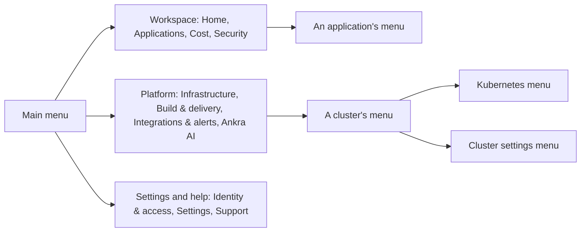

The menu on the left of the Ankra portal (`https://platform.ankra.app/next`) shows one menu at a time. The **main menu** lists the areas of your organisation. Open an application, a cluster, a managed service, or the Cost, Security or Ankra AI area, and the main menu is swapped for that thing's own menu, with a back row at the top that leads to the list you came from.

You only see the rows your role may open. A row for an area you have no permission for is left out, not greyed out.

## The main menu

The main menu has three groups, separated by a thin line. **Platform** folds away behind its heading; it is always open on one of its own pages.

| Group | Row | What it holds | Docs |
| --- | --- | --- | --- |
| Workspace | **Home** | **Ask Ankra**, and under it what needs you | [Ankra AI assistant](/platform/ai-assistant) |
| Workspace | **Applications** | Your applications, each with its own menu | [Applications](/concepts/applications) |
| Workspace | **Cost** | What your clusters and applications cost, savings and budgets. Shown when cost is turned on for the organisation | [Cloud cost](/platform/cloud-cost) |
| Workspace | **Security** | Findings, fixes, accepted risks and evidence. Needs the `security.read` permission | [Security](/security/overview) |
| Platform | **Infrastructure** | **Clusters**, **Managed services** and **Cluster meshes**, and under **Configuration**: **Backups and storage**, **Domains**, **Variables and secrets** | [Add a cluster](/guides/import-cluster) |
| Platform | **Build & delivery** | **Stack profiles**, and under **Configuration**: **Builds and clusters**, **Registries**, **Registry storage**, **Helm registries** | [Get started with Ankra CI](/get-started/ankra-ci) |
| Platform | **Integrations & alerts** | **Credentials**, and under **Configuration**: **Notification destinations**, **Notification routes**, **Alert rules**, **Alert ingest credentials**, **Muted notifications** | [Credentials](/platform/credentials) |
| Platform | **Ankra AI** | What Ankra AI works on and watches, and how it is set up | [Ankra AI](/platform/ai-overview) |
| Settings and help | **Identity & access** | **People**, **Roles**, **Projects** (only while the organisation has projects), **Sign-in and security**, **API and automation**, **Ankra support access**, **Audit log** | [Roles and access](/guides/roles-and-access) |
| Settings and help | **Settings** | **Organisation** and **Plan and billing** | [Organisation settings](/platform/organisation-settings), [Billing](/platform/billing) |
| Settings and help | **Support** | Contact Ankra support | [Support](/platform/support) |

Each Platform area and **Identity & access** opens on an **Overview** of its own.

Some pages have no row in the main menu:

| Page | Where you reach it |
| --- | --- |
| **Needs you** | Every approval, fix and alert that waits on you. Reached from Home |
| **Notifications** | What Ankra told you and your organisation. Opened from the bell |
| **Get started** | The first screen of a new organisation (`/next/onboarding`) |
| **Canvases** | Dashboards and pages saved from Ask Ankra. Reached from Home and Find |
| **Your account** | Your own pages. Reached from the account menu at the foot of the menu |

## An application's menu

Open **Applications → &lt;your application&gt;**. The menu is named after the application and starts with a back row, **Applications**.

| Row | What it holds |
| --- | --- |
| **Overview** | Whether it is working |
| **Deploy** | A group that starts open: **Environments** (where each version is live, and **Deploy a version**), **Pipelines** (what builds it: **Runs**, **Schedules**, **Cache**, **Configuration**) and **Previews** (try a branch) |
| **History** | What changed, where, and who did it |
| **Logs** | What it wrote |
| **Metrics** | How it runs |
| **Security** | Whether it is safe |
| **Data** | **Backups**, **Database** and **Service bindings** |
| **Cost** | What it costs. Shown when cost is turned on |
| **Settings** | **Secrets**, **Address**, **Deploys**, **Who runs it**, **Registry**, **Service goals**, **Park or remove** |

Under **Technical details**, a group that folds away: **Where it runs**, **Architecture**, **Source**.

Until anything of a new application runs, opening it lands on **Environments** rather than **Overview**. [Applications](/concepts/applications) explains each view.

## A cluster's menu

Open **Infrastructure → Clusters → &lt;your cluster&gt;**. The back row is **Clusters**.

| Row | What it holds |
| --- | --- |
| **Overview** | The cluster and whether its agent is connected |
| **Health** | Health checks and runtime usage, with links to nodes, pods and add-ons |
| **Metrics** | Historical resource usage and workload signals |
| **Add-ons** | Installed add-ons, chart versions and security advisories |
| **Backups** | Backups of the cluster's Stacks. Reads **Set up backups** while backups are not turned on for the organisation |
| **Cost** | What the cluster costs. Shown when cost is turned on |
| **Security** | What needs fixing on this cluster. Needs `security.read` |
| **Settings** | Opens the cluster settings menu below |

Under **Technical details**: **Stacks**, **Operations**, **Kubernetes** (opens the Kubernetes menu below), **Kubectl access** and **Audit log**.

[Cluster settings](/platform/cluster-settings) and [Operations](/platform/operations) explain the pages.

### The Kubernetes menu

**Technical details → Kubernetes** swaps in a menu of the cluster's resources. The back row is the cluster's name.

| Group | Rows |
| --- | --- |
| (top) | **All resources**, **Cluster logs** |
| **Workloads** | **Pods**, **Deployments**, **StatefulSets**, **DaemonSets**, **ReplicaSets**, **Jobs**, **CronJobs**, **Horizontal Pod Autoscalers**, **Pod Disruption Budgets** |
| **Networking** | **Services**, **Ingresses**, **Ingress Classes** |
| **Storage** | **Persistent Volumes**, **Persistent Volume Claims**, **Storage Classes**, **CSI Drivers** |
| **Configuration** | **ConfigMaps**, **Secrets** |
| **Access & policies** | **Roles**, **Role Bindings**, **Cluster Roles**, **Cluster Role Bindings**, **Service Accounts**, **Network Policies** |
| **Cluster** | **Nodes**, **Namespaces**, **Events**, **Custom resource definitions** |
| **Helm** | **Helm releases** |

### The cluster settings menu

**Settings** on a cluster swaps in one page per setting, each with its own address under `/next/clusters/<cluster-id>/settings`:

**General**, **Agent**, **Stop, start and schedules**, **Upgrades and maintenance**, **GitOps**, **Kubernetes sync**, **Network**, **SSH access**, **Ankra AI**, **Logs and data**, **Integrations**, **Variables**, **Credentials**, and under **Danger zone**, **Terminate or remove**.

## The Cost, Security and Ankra AI menus

These three areas open their own menu too. Their back row is **Main menu**.

| Area | Rows |
| --- | --- |
| **Cost** | **Overview**, **Explore spend**, **Savings**, **Budgets & alerts**, **Compare options**, **Settings** |
| **Security** | **Overview**, **Resources**, **Vulnerabilities**, **Fix activity**, **Coverage**, **Evidence**, **Accepted risks**, **Software lifecycle**. An organisation where a cluster runs the endpoint scanner also gets **Exposure** |
| **Ankra AI** | **Overview**, **Work** (organisations with Ankra AI tickets), **Watching**, **Gateway**, **Code reviews**, **Activity**, **Settings**, and under **Configuration**: **Models and provider**, **Skills and tools**, **Autonomy and approvals**, **AI workspaces**, **Memory**, **Feedback**, **Gateway connections** |

## A managed service's menu

Open **Infrastructure → Managed services** and a service you run. The back row is **My services**, and the rows are **Overview**, **Connections**, **Activity**, **Usage** and **Settings**. [Managed services](/concepts/managed-services) explains them.

## Where settings live

Settings sit with what they configure, not in one place:

| To change | Open |
| --- | --- |
| The organisation's name, ownership and billing details | **Settings → Organisation** |
| What the organisation pays, its payment method and limits | **Settings → Plan and billing** |
| Members, roles, sign-in rules, API tokens for automation | **Identity & access** |
| Where pipelines run, build rules, pipeline approvals | **Build & delivery → Builds and clusters** |
| Organisation variables and secrets, domains, backup storage | **Infrastructure**, under **Configuration** |
| Where notifications go and alert rules | **Integrations & alerts**, under **Configuration** |
| Ankra AI's model, tools and how much it may do alone | **Ankra AI**, under **Configuration** |
| One cluster | **Infrastructure → Clusters → &lt;your cluster&gt; → Settings** |
| One application | **Applications → &lt;your application&gt; → Settings** |
| Yourself: how you sign in, your personal API tokens | The account menu → **Profile**, then **Sign-in and security** or **API access** |

## Find

**Find**, at the top of the menu, opens one search box for the whole portal. It searches applications and clusters, and pods when you are in a cluster. Its results come in groups: the pages of the menu you are in, other **Pages**, **Settings**, **People**, and **Actions** such as **Create an application**, **Add a cluster** and **Review security fixes**. When nothing you type is a page, Find offers **Ask Ankra: &lt;your question&gt;**. [Command palette](/platform/command-palette) has more.

## Ask Ankra

**Ask Ankra** is the conversation with Ankra AI. **Home** opens on it, and the **Ask Ankra** button in the top bar opens it beside any page. `⌘ J` on macOS or `Ctrl J` on Windows and Linux opens and closes it from any page. In the panel, **Open as a page, with your conversations** shows every earlier conversation. [Ankra AI assistant](/platform/ai-assistant) explains what it can do.

## Your organisation and your account

The top of the menu names the organisation you are in. Click it to switch organisation, or project when the organisation has projects. Pending invitations show there too.

The account menu at the foot of the menu holds **Profile**, **Appearance** (**System**, **Light**, **Dark**), **Show technical details**, **Support** and **Sign out**. **Profile** opens your account's own menu: **Profile**, **Organisations**, **Invitations**, **Sign-in and security**, **Connected accounts**, **Notifications**, **API access** and **Preferences**. [User profile](/platform/user-profile) explains them.

## Addresses

Every page has an address you can bookmark or share. [Portal addresses](/platform/portal-urls) lists them.
