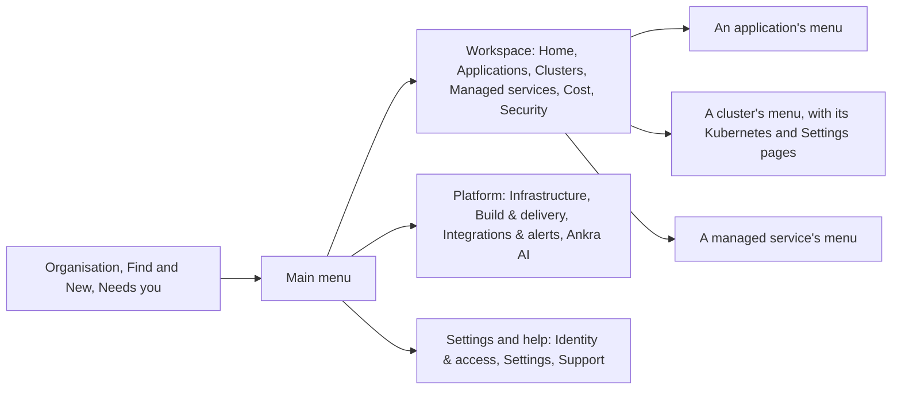

The menu on the left of the Ankra portal (`https://platform.ankra.app/next`) starts with the organisation you are in, **Find** and **Needs you**. Under them is the **main menu**, the areas of your organisation. An area's pages open under its own row, and the rest of the menu stays where it is. Open an application, a cluster or a managed service, and that thing's own menu takes the main menu's place, with a back row at the top that leads to the list you came from. The foot of the menu holds the pages you pinned or left last, and your account.

You only see the rows your role may open. A row for an area you have no permission for is left out, not greyed out.

## The top of every menu

These rows stay at the top whichever menu is open:

| Row | What it does |
| --- | --- |
| The organisation's name | Switches organisation, or project when the organisation has projects. See [Your organisation and your account](#your-organisation-and-your-account) |
| **Find** | One search box for the whole portal. See [Find](#find) |
| **+**, beside **Find** | **New**: creates an application, a cluster or a credential. See [New](#new) |
| **Needs you** | Everything that waits on you, with a red number that counts it. See [Needs you](#needs-you) |

## The main menu

The main menu has three groups, separated by a thin line. **Platform** folds away behind its heading; it is always open on one of its own pages.

| Group | Row | What it holds | Docs |
| --- | --- | --- | --- |
| Workspace | **Home** | **Ask Ankra**, and under it the first things that need you | [Home](/platform/home) |
| Workspace | **Applications** | Your applications, each with its own menu | [Applications](/concepts/applications) |
| Workspace | **Clusters** | Your clusters, each with its own menu. Needs the `clusters.read` permission | [Cluster overview and health](/platform/cluster-overview-and-health) |
| Workspace | **Managed services** | **My services**, the **Catalogue** and the other lists of managed services, each service with its own menu. Shown when managed services are offered to your organisation | [Managed services](/concepts/managed-services) |
| Workspace | **Cost** | **Explore spend**, **Savings**, **Budgets & alerts**, **Compare options**, **Settings**. Shown when cost is turned on for the organisation | [Cloud cost](/platform/cloud-cost) |
| Workspace | **Security** | **Resources**, **Vulnerabilities**, **Fix activity**, **Coverage**, **Evidence**, **Accepted risks**, **Software lifecycle**. An organisation where a cluster runs the endpoint scanner also gets **Exposure**. Needs the `security.read` permission | [Security](/security/overview) |
| Platform | **Infrastructure** | **Cluster meshes**, and under **Configuration**: **Backups and storage**, **Domains**, **Variables and secrets**. Its **Overview** also lists your clusters and managed services | [Organisation settings](/platform/organisation-settings#where-each-setting-lives) |
| Platform | **Build & delivery** | **Stack profiles**, and under **Configuration**: **Builds and clusters**, **Registries**, **Registry storage**, **Helm registries** | [Get started with Ankra CI](/get-started/ankra-ci) |
| Platform | **Integrations & alerts** | **Credentials**, and under **Configuration**: **Notification destinations**, **Notification routes**, **Alert rules**, **Alert ingest credentials**, **Muted notifications** | [Credentials](/platform/credentials) |
| Platform | **Ankra AI** | **Work** (organisations with Ankra AI tickets), **Watching**, **Gateway**, **Code reviews**, **Activity**, **Settings**, and under **Configuration**: **Models and provider**, **Skills and tools**, **Autonomy and approvals**, **AI workspaces**, **Memory**, **Feedback**, **Gateway connections** | [Ankra AI](/platform/ai-overview) |
| Settings and help | **Identity & access** | **People**, **Roles**, **Projects** (only while the organisation has projects), **Sign-in and security**, **API and automation**, **Ankra support access**, **Audit log** | [Roles and access](/guides/roles-and-access) |
| Settings and help | **Settings** | **Organisation** and **Plan and billing** | [Organisation settings](/platform/organisation-settings), [Billing](/platform/billing) |
| Settings and help | **Support** | Contact Ankra support | [Support](/platform/support) |

### An area's pages

**Cost**, **Security**, **Ankra AI**, **Infrastructure**, **Build & delivery**, **Integrations & alerts**, **Identity & access** and **Settings** list their pages under their own row, as the table shows. The row opens the area's **Overview**, so the **Overview** is the row itself and is not listed again under it; **Settings** opens **Organisation**. The chevron at the end of the row shows or hides the pages without leaving the page you are on. The pages of the area you are in start shown. The rest of the main menu stays, and there is no back row.

Some pages have no row in the main menu:

| Page | Where you reach it |
| --- | --- |
| **Notifications** | What Ankra told you and your organisation. Opened from the bell |
| **Get started** | The first screen of a new organisation (`/next/onboarding`) |
| **Canvases** | Dashboards and pages saved from Ask Ankra. Reached from Home and Find |
| **Your account** | Your own pages. Reached from the account menu at the foot of the menu |

## Needs you

### The Needs you row

**Needs you** sits under **Find** in every menu: the main menu, and the menu of an application, a cluster or a managed service. Its red number is how many things wait on you, the title of the **Needs you** page as a number. A number such as **7+** means at least seven: something could not be checked, or a list was read only in part. While Ankra is still checking, the row shows no number.

Each area's row shows its own share in grey, so the grey numbers add up to the red one: **Applications**, **Clusters**, **Managed services**, **Cost**, **Security** and **Ankra AI**. A thing is counted on the area it is about. An alert firing on a cluster is counted on **Clusters**, not on **Ankra AI**, and a security fix pull request Ankra opened is counted on **Applications**, since it changes the application's code.

### The Needs you page

The **Needs you** page (`/next/needs-you`) lists everything that waits on you in one order, by harm, under three headings:

| Heading | What is under it |
| --- | --- |
| **Act today** | What attackers use, what is broken now, and what runs or crosses by itself within a day |
| **Act this week** | What runs or crosses by itself within a week, and every other decision that waits on you |
| **When you can** | Savings to take, budgets that are only close, and what runs or crosses more than a week from now |

Under each heading, what attackers use comes first, then what is broken, then what runs or crosses by itself soonest, then the rest, oldest first.

Each row is the thing's logo, one line that opens its page, one signal (**Used by attackers**, a deadline such as when it runs or crosses, or what it saves) and one button. Above the list, a filter shows one area at a time without changing the order. What you deal with on the page moves under **Done here**, and **What it checks** says when each source was last checked. [Notifications and Needs you](/platform/activity-inbox#needs-you) lists the sources. **Home** shows the first four rows, in the same order and under the same headings.

### Waiting on someone else

The page and the menu count only what your role can act on. What the platform says your role cannot act on, such as a fix your role may not approve or a budget it may not manage, is listed under **Waiting on someone else** and counted nowhere. Someone whose role can, such as an organisation owner or admin, acts on it. When Ankra cannot tell whether your role may act, the thing is counted as yours.

## An application's menu

Open **Applications → &lt;your application&gt;**. The menu is named after the application and starts with a back row, **Applications**.

| Row | What it holds |
| --- | --- |
| **Overview** | Whether it is working |
| **Deploy** | A group that starts open: **Environments** (where each version is live, and **Deploy a version**), **Pipelines** (what builds it: **Runs**, **Schedules**, **Cache**, **Configuration**) and **Previews** (try a branch) |
| **History** | What changed, where, and who did it |
| **Logs** | What it wrote |
| **Metrics** | How it runs |
| **Security** | Whether it is safe |
| **Data** | **Backups**, **Database** and **Service bindings** |
| **Cost** | What it costs. Shown when cost is turned on |
| **Variables** | The secrets and plain values it reads when it runs, per environment |
| **Architecture** | What it is made of |
| **Settings** | **Address**, **Deploys**, **Who runs it**, **Registry**, **Repository**, **Service goals**, **Park or remove** |

There is no **Technical details** group: **Where it runs**, every place the application runs, is the last section of **Environments**.

Until anything of a new application runs, opening it lands on **Environments** rather than **Overview**. [Applications](/concepts/applications) explains each view.

## A cluster's menu

Open **Clusters → &lt;your cluster&gt;**. The back row is **Clusters**.

| Row | What it holds |
| --- | --- |
| **Overview** | The cluster and whether its agent is connected |
| **Health** | Health checks and runtime usage, with links to nodes, pods and add-ons |
| **Metrics** | Historical resource usage and workload signals |
| **Add-ons** | Installed add-ons, chart versions and security advisories |
| **Backups** | Backups of the cluster's Stacks. Reads **Set up backups** while backups are not turned on for the organisation |
| **Cost** | What the cluster costs. Shown when cost is turned on |
| **Security** | What needs fixing on this cluster. Needs `security.read` |
| **Settings** | The cluster's settings, listed under the row: see below |

Under **Technical details**, a group that folds away: **Stacks**, **Operations**, **Kubernetes** (the cluster's resources, listed under the row: see below), **Kubectl access** and **Audit log**.

[Cluster settings](/platform/cluster-settings) and [Operations](/platform/operations) explain the pages.

### Kubernetes

**Technical details → Kubernetes** opens **All resources** and lists the cluster's resource pages under its row, in the cluster's menu:

| Group | Rows |
| --- | --- |
| (top) | **All resources**, **Cluster logs** |
| **Workloads** | **Pods**, **Deployments**, **StatefulSets**, **DaemonSets**, **ReplicaSets**, **Jobs**, **CronJobs**, **Horizontal Pod Autoscalers**, **Pod Disruption Budgets** |
| **Networking** | **Services**, **Ingresses**, **Ingress Classes** |
| **Storage** | **Persistent Volumes**, **Persistent Volume Claims**, **Storage Classes**, **CSI Drivers** |
| **Configuration** | **ConfigMaps**, **Secrets** |
| **Access & policies** | **Roles**, **Role Bindings**, **Cluster Roles**, **Cluster Role Bindings**, **Service Accounts**, **Network Policies** |
| **Cluster** | **Nodes**, **Namespaces**, **Events**, **Custom resource definitions** |
| **Helm** | **Helm releases** |

### The cluster's settings

**Settings** on a cluster opens **General** and lists one page per setting under its row, each with its own address under `/next/clusters/<cluster-id>/settings`:

**General**, **Agent**, **Stop, start and schedules**, **Upgrades and maintenance**, **GitOps**, **Kubernetes sync**, **Network**, **SSH access**, **Ankra AI**, **Logs and data**, **Integrations**, **Variables**, **Credentials**, and under **Danger zone**, **Terminate or remove**.

## A managed service's menu

Open **Managed services** and a service you run under **My services**. The back row is **My services**, and the rows are **Overview**, **Connections**, **Activity**, **Usage** and **Settings**. [Managed services](/concepts/managed-services) explains them.

## Shortcuts in the menu

### Pinned and Recent

The foot of the menu, above your account, keeps pages in reach. **Pin** in the top bar pins the page you are on, and pressed again it unpins it. Pinned pages are listed under **Pinned**, which folds, up to eight; a ninth replaces the one pinned first. A pinned row's cross unpins it.

With nothing pinned, **Recent** lists the two pages you left last that are not about the application, cluster or service open now, each with a pin that moves it to **Pinned**. Home is never listed.

Pinned and Recent are kept in this browser, for you in this organisation, and are not shared with anyone. A support session keeps none.

### New

**+**, beside **Find**, opens **New**: **Application**, **Cluster** and **Credential**, each opening the page that creates one. It lists only what your role may create (`applications.write`, `clusters.create` and `credentials.write`); a role that may create none of them has no **+**.

### Hide the menu

On a wide screen, the button at the left of the top bar, before the path, hides the menu, and pressed again it shows the menu. While the menu is hidden, **Find** and **Needs you**, with its number, sit in the top bar. Ankra remembers the choice for you in this browser. On a small screen, the top bar's menu button opens the menu.

### Switch to another application, cluster or service

The name of the open application, cluster or managed service, at the head of its menu, lists the others of its kind under **Open this page on**, then **All applications**, **All clusters** or **All managed services**. Choosing one keeps the page: **Logs** on one application opens **Logs** on the other, and a cluster's **Nodes** opens the other cluster's **Nodes**. From a page about one record, such as a pod, a Stack or an operation, it opens the list that record is in.

## Where settings live

Settings sit with what they configure, not in one place:

| To change | Open |
| --- | --- |
| The organisation's name, ownership and billing details | **Settings → Organisation** |
| What the organisation pays, its payment method and limits | **Settings → Plan and billing** |
| Members, roles, sign-in rules, API tokens for automation | **Identity & access** |
| Where pipelines run, build rules, pipeline approvals | **Build & delivery → Builds and clusters** |
| Organisation variables and secrets, domains, backup storage | **Infrastructure**, under **Configuration** |
| Where notifications go and alert rules | **Integrations & alerts**, under **Configuration** |
| Ankra AI's model, tools and how much it may do alone | **Ankra AI**, under **Configuration** |
| One cluster | **Clusters → &lt;your cluster&gt; → Settings** |
| One application | **Applications → &lt;your application&gt; → Settings** |
| Yourself: how you sign in, your personal API tokens | The account menu → **Profile**, then **Sign-in and security** or **API access** |

## Find

**Find**, under the organisation's name at the top of every menu, or in the top bar while the menu is hidden, opens one search box for the whole portal. It searches applications and clusters, and pods when you are in a cluster. Its results come in groups: the pages of the menu you are in, other **Pages**, **Settings**, **People**, and **Actions** such as **Create an application**, **Add a cluster** and **Review security fixes**. When nothing you type is a page, Find offers **Ask Ankra: &lt;your question&gt;**. [Command palette](/platform/command-palette) has more.

## Ask Ankra

**Ask Ankra** is the conversation with Ankra AI. **Home** opens on it, and the **Ask Ankra** button in the top bar opens it beside any page. `⌘ J` on macOS or `Ctrl J` on Windows and Linux opens and closes it from any page. In the panel, **Open as a page, with your conversations** shows every earlier conversation. [Ankra AI assistant](/platform/ai-assistant) explains what it can do.

## Your organisation and your account

The top of the menu names the organisation you are in. Click it to switch organisation, or project when the organisation has projects. Pending invitations show there too.

When you open a link to an application, a cluster or a ticket in another of your organisations, Ankra names that organisation. Its **Switch to** button switches you there and opens the same page.

The account menu at the foot of the menu holds **Profile**, **Appearance** (**System**, **Light**, **Dark**), **Show technical details**, **Support** and **Sign out**. **Profile** opens your account's pages. While one of them is open, the main menu lists them under **Your account**, after its other groups: **Profile**, **Organisations**, **Invitations**, **Sign-in and security**, **Connected accounts**, **Notifications**, **API access** and **Preferences**. [User profile](/platform/user-profile) explains them.

## Addresses

Every page has an address you can bookmark or share. [Portal addresses](/platform/portal-urls) lists them.
