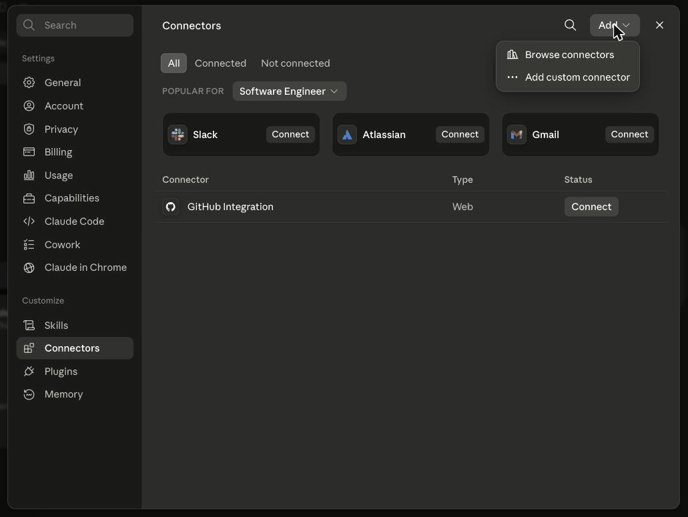
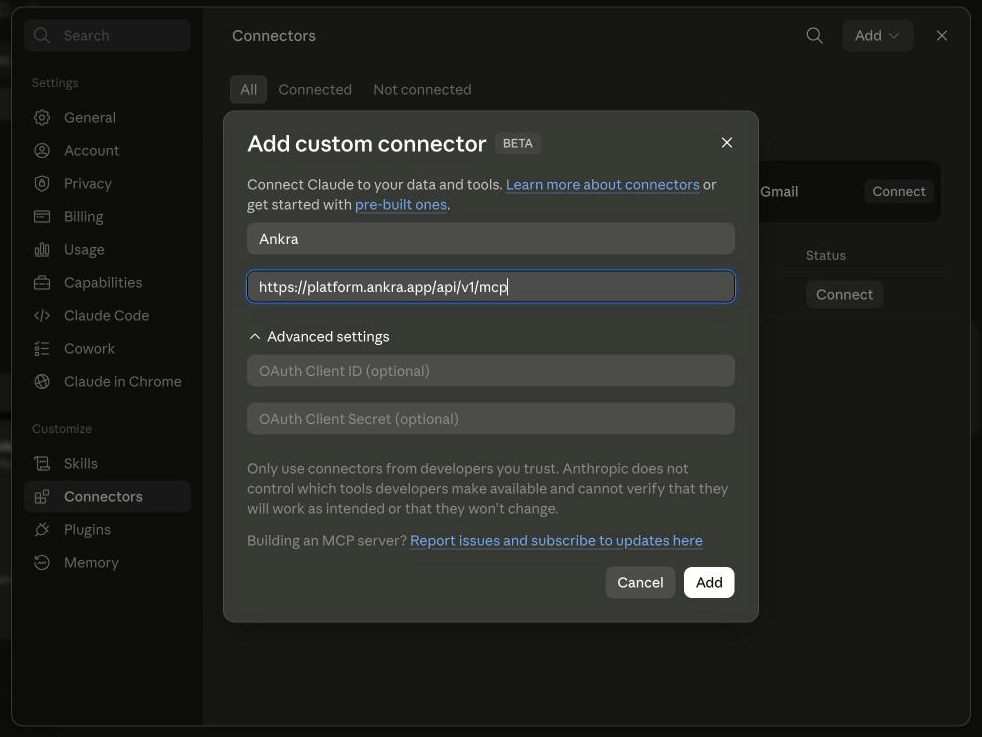

import { CliVersion } from "/snippets/cli-version.jsx";

Ankra exposes a remote [Model Context Protocol](https://modelcontextprotocol.io/) server at:

```text
https://platform.ankra.app/api/v1/mcp
```

Use it to inspect clusters, workloads, logs, alerts, and related platform data from an MCP client. Write access can also apply changes through Ankra's agent tools, and lets your client work [AI board](/platform/ai-board) tickets alongside Ankra's own agents - see [Work the AI board with your own agent](/guides/board-own-agent).

## Choose an Access Scope

| Scope | Access |
| --- | --- |
| `mcp:read` | Read-only platform tools only: a read token changes nothing |
| `mcp:write` | The read surface plus mutating tools such as apply, scale, delete, and pull request creation |

`mcp:write` implies read access. A token made in the portal with **Editor tools: read and change** carries both scopes.

<Warning>
MCP clients own the confirmation experience. Ankra does not show a second server-side confirmation prompt before a write tool runs. Only grant `mcp:write` to clients you trust.
</Warning>

## Create an MCP Token

Claude clients sign in with [OAuth](#connect-claude-with-oauth) and need no token. Make one for Cursor, other MCP clients and scripts.

In the portal, **Create token** appears only once your account has two-step sign-in. Without it, **Your account → API access** shows **Add a second step to sign in first** with a **Set up two-step sign-in** link. See [Account security](/platform/account-security).

<Tabs>
  <Tab title="Portal">
    <Steps>
      <Step title="Open API access">
        Open **Your account → API access** (`/next/account/api`) and select **Create token**. The **Create a token** dialog opens.
      </Step>
      <Step title="Choose what the token can do">
        Enter a **Name** that says where the token is used, such as `Cursor on my laptop`. Under **What can it do?**, choose one:

        | Choice | Scopes | Use it for |
        | --- | --- | --- |
        | **Editor tools: read and change** (selected by default) | `mcp:read`, `mcp:write` | An MCP client that deploys, scales and applies |
        | **Editor tools: read only** | `mcp:read` | An MCP client that lists, describes and queries |
        | **Full API access** | none | Scripts and CI that call the [REST API](/api-reference/introduction); it cannot call the MCP server |

        Select **Editor tools: read only** unless the client needs to change resources. Pick a lifetime under **Expires after** (7 days, 30 days, 90 days or 1 year; 90 days is preselected), then select **Create token**.
      </Step>
      <Step title="Copy the token">
        The dialog now reads **Copy your token now**. Reveal the token, copy it into your client or a password manager, tick **I have stored it somewhere safe**, then select **Done**. Ankra shows the token only once.

        The token is now listed under **Your tokens** with the access you chose, such as **Editor tools: read only**, and its expiry date.
      </Step>
    </Steps>
  </Tab>
  <Tab title="CLI">
    Create a read-only token:

    <CliVersion since="0.6.0" />

    ```bash
    ankra tokens create cursor --scopes mcp:read
    ```

    Create a token with read and write access:

    ```bash
    ankra tokens create cursor --scopes mcp:read,mcp:write
    ```
  </Tab>
</Tabs>

MCP-scoped tokens work only with the MCP endpoint and stay bound to the organisation selected when the token was created. They cannot call Ankra's REST API or override their organisation.

## Connect with the Ankra CLI

The quickest setup for Claude Code, Cursor and Codex is `ankra mcp connect`. It creates the MCP token, stores it and registers the server with the client in one step:

<CliVersion since="0.71.0" command="mcp connect" />

```bash
ankra mcp connect --client claude-code
ankra mcp connect --client cursor
ankra mcp connect --client codex
```

- The token is `mcp:read` only unless you add `--write`, expires in 90 days (`--expires-days` changes that), and is pinned to the project you are acting in (`--project` chooses another).
- The token is never printed and never written into the client's config. It is stored in `~/.ankra/mcp/<client>.json`, readable only by you.
- **Claude Code** is registered for your user (`claude mcp list` shows it) with a headers helper that fetches the token when Claude Code needs it. The `claude` command must be on your `PATH`.
- **Cursor** (`~/.cursor/mcp.json`) and **Codex** (`~/.codex/config.toml`) read the token from `ANKRA_MCP_TOKEN`. Add this to your shell profile, then restart the shell:

  ```bash
  export ANKRA_MCP_TOKEN="$(ankra mcp token --client cursor)"
  ```

  `ankra mcp token` refuses to print to a terminal, so the token only reaches the variable.
- Run `connect` again to renew the token; the old one is revoked.
- It offers to install the Ankra skills for the same client; `--skills` installs them without asking.

The sections below set each client up by hand, for an MCP client the CLI does not cover or when you prefer OAuth.

## Connect Cursor

Add Ankra to your Cursor MCP configuration in `~/.cursor/mcp.json`. The **Connect your editor** section of **Your account → API access** shows the same block with your platform's address filled in.

```json
{
  "mcpServers": {
    "ankra": {
      "url": "https://platform.ankra.app/api/v1/mcp",
      "headers": {
        "Authorization": "Bearer <ankra-token>"
      }
    }
  }
}
```

Restart or refresh MCP servers in Cursor after saving the configuration. Ankra then appears as an available MCP server with tools filtered by the token's scopes.

<Tip>
Keep personal tokens out of shared project configuration. Use a user-level MCP configuration or a local file that is excluded from version control.
</Tip>

## Connect Claude with OAuth

Claude connects to Ankra over OAuth, so you do not need to create or copy a token first. Where you add the connection depends on which Claude you use:

- **Claude web and desktop apps** - add Ankra as a custom connector in Settings.
- **Claude Code** (the terminal client) - add Ankra with the `claude mcp add` command, or use [`ankra mcp connect`](#connect-with-the-ankra-cli), which uses a stored token instead of OAuth.

<Tabs>
  <Tab title="Claude web and desktop">
    Custom connectors are available on every Claude plan; the Free plan allows one. On Team and Enterprise plans an owner may need to add the connector for the organisation.

    <Steps>
      <Step title="Open the Connectors settings">
        In Claude, select your profile icon in the bottom left corner, then **Settings**. In the settings sidebar, select **Connectors** under the **Customize** heading. You see a list of available connectors such as Slack and Gmail - Ankra is not in this list yet, which is why you add it as a custom connector.
      </Step>
      <Step title="Add a custom connector">
        Select the **Add** button in the top right of the Connectors page, then select **Add custom connector** from the menu.

        <Frame caption="The Add menu in the top right of Claude's Connectors settings">
          
        </Frame>
      </Step>
      <Step title="Enter the Ankra server details">
        In the **Add custom connector** dialog, enter `Ankra` as the name and this URL in the **Remote MCP server URL** field:

        ```text
        https://platform.ankra.app/api/v1/mcp
        ```

        Leave the **OAuth Client ID** and **OAuth Client Secret** fields under Advanced settings empty - Ankra does not need them. Then select **Add**.

        <Frame caption="The completed Add custom connector dialog">
          
        </Frame>
      </Step>
      <Step title="Connect and sign in to Ankra">
        Ankra now appears in your connector list with a **Connect** button. Select it. Claude opens Ankra's OAuth consent page in a new window - sign in to Ankra if you are not signed in already, select the organisation the connection should use, review the requested `mcp:read` or `mcp:write` access, then approve the connection. Claude then shows Ankra as connected.
      </Step>
      <Step title="Enable Ankra in a chat">
        Open a new chat and select the tools menu (the sliders icon below the message box). Check that **Ankra** is listed and enabled. To verify the connection works end to end, ask Claude to list your Ankra clusters - it should call the `list_clusters` tool and return the clusters in your organisation.
      </Step>
    </Steps>
  </Tab>
  <Tab title="Claude Code">
    <Steps>
      <Step title="Add the server">
        Run this once from your terminal:

        ```bash
        claude mcp add --transport http ankra https://platform.ankra.app/api/v1/mcp
        ```

        This registers the server for your user in the current project. Add `--scope user` to make it available in every project.
      </Step>
      <Step title="Authenticate">
        Start Claude Code and run the `/mcp` command. It lists every configured MCP server with its connection status - **ankra** shows as needing authentication. Select it, then choose **Authenticate**. Your browser opens Ankra's OAuth consent page - sign in, select the organisation, review the requested access, then approve the connection and return to the terminal.
      </Step>
      <Step title="Verify the connection">
        Run `/mcp` again and confirm that **ankra** shows as connected. Then ask Claude Code to list your Ankra clusters - it should call the `list_clusters` tool and return the clusters in your organisation.
      </Step>
    </Steps>

    If you prefer a long-lived token over OAuth, create an [MCP token](#create-an-mcp-token) and register the server with an authorisation header instead:

    ```bash
    claude mcp add --transport http ankra https://platform.ankra.app/api/v1/mcp \
      --header "Authorization: Bearer <your-token>"
    ```
  </Tab>
</Tabs>

The flow uses OAuth 2.1 authorisation code with PKCE and no client secret. Ankra issues the client an MCP-only access token that lasts seven days, together with a refresh token. The client renews the access token on its own: each refresh token works once and is replaced by a new one with every renewal. You connect again only when the connection ends:

- 90 days after you approved it, however often the client renewed;
- after 30 days in which the client did not renew at all;
- when a refresh token that was already used is presented again after its replacement was used, or more than 30 seconds after the renewal, which ends the connection and its access token at once (a client retrying a renewal whose answer it lost, within those 30 seconds, gets a new pair instead);
- when you are no longer an active member of the organisation.

To connect again, select **Connect** on the Ankra connector in Claude's Connectors settings, or run `/mcp` and authenticate again in Claude Code.

## How Tool Access Works

The [MCP Tool Reference](/platform/mcp-tools) lists the tools with the scope each requires and whether it needs a `cluster_id`.

- `tools/list` only returns tools allowed by the token.
- Cluster-scoped tools require a `cluster_id`. Call `list_clusters` to discover IDs.
- Ankra verifies that the cluster belongs to the token's organisation and [project](/concepts/projects) before dispatch. An MCP token minted while the organisation has projects is pinned to the project it was created in, and an older one is not pinned and does not follow switches (see [Tokens and projects](/concepts/projects#tokens-and-projects)); `list_projects` and `get_current_project` say where it acts.
- Draft-only chat tools are not available over MCP.
- Parameters that look like they carry a literal secret are refused before a mutating tool runs.
- Tool calls are rate limited per token: 120 read calls and 20 write calls per minute. Write calls also use a fail-closed platform write limit.
- Every resolved tool call, including refused calls, is written to the organisation audit log.

## How Calls Behave

MCP is stateless: each `tools/call` is one request with nothing parked between calls. Three consequences follow, and the server's `instructions` field repeats them to the model on `initialize`.

- **Every call has a 55-second deadline**, except `workspace_exec`, which waits for its command (its `timeout_seconds` goes up to 330). A call that outruns its deadline answers `isError` with a timeout. A mutating call that had already started is not undone by that timeout, so read the target's state before repeating a write.
- **Writes that start platform work do not wait for it.** Tools such as `apply_stack_changes`, `upgrade_cluster` or `update_node_group` answer at once with an `operation_id` (or a `live_status_hint` naming the id to poll). Call `wait_for_execution` with that id to block for up to 50 seconds and receive the settled execution, or `timed_out: true` with the last observed step summary; call it again to keep waiting. `get_execution_details` reads the same document without waiting.
- **Confirmation cards do not exist over MCP.** A tool that raises a confirmation card in the Ankra chat executes directly here when the token holds `mcp:write`: the token scope is the approval. `apply_stack_changes` applies the most recently changed draft with that `stack_name` on that cluster, whoever changed it: a same-named draft edited in the portal or by another client after yours is the one that is applied. Pass `stack_name` on every apply, and read the draft before you apply when others work on the same cluster.
- **A call can act under a Launch Plan approval.** Put the approval's id in the call's `_meta` as `"ankra/launch_plan_approval_id"`. The write then runs only if it is one of the actions you approved, the approval is yours, it has not expired or been revoked, and the plan has not changed since you approved it. Each approved action runs once. Any other call naming the approval is refused, and nothing runs.

## Links to the Portal

Everything the tools read and change is also visible in the Ankra portal, and the server's `instructions` ask the model to give you a portal link when it reports on a resource, finishes a change, or asks you to review or approve something in the UI.

- `list_clusters` and `get_cluster_details` return each cluster's `portal_url`.
- `get_portal_url` returns the link for any other page - a cluster's stacks, add-ons, operations or nodes, one pod or Deployment, an application, a pipeline run, a stack profile, an AI ticket, an alert, a CVE, credentials, tokens or settings. It is read-only, so an `mcp:read` token can call it.
- Links carry the organisation as `?org=` and the project as `?project=`, so one opened while another organisation or project is selected offers to switch.

[Portal URLs](/platform/portal-urls) lists every page and how its address is built, if you want to point your own agents or runbooks at them.

## Troubleshooting

### 401 Invalid or missing bearer token

The token is missing, expired, revoked, or copied incorrectly. Create a new MCP token, or select **Renew** on it under **Your account → API access**, and update the client.

A Claude client connected with OAuth renews its own access token, so a 401 there means the connection ended: 90 days passed since you approved it, the client did not renew for 30 days, a used refresh token was presented again, you left the organisation, or the token was revoked. Reconnect the Ankra connector in Claude's settings, or run `/mcp` and authenticate again in Claude Code.

### 403 Token has no MCP scope

The token is REST-only. Recreate it with `mcp:read` or `mcp:read,mcp:write`.

### Claude reports "Couldn't register with Ankra's sign-in service"

Claude could not reach Ankra's OAuth discovery endpoints, so it could not register itself as an OAuth client. This is a platform-side routing problem, not a mistake in your connector configuration - the server URL field only accepts the MCP endpoint, and no OAuth Client ID is needed. Ask your Ankra administrator to confirm that `/oauth/` and the `/.well-known/oauth-*` discovery paths on the platform host route to the API service, then select **Connect** on the Ankra connector again.

### 403 Origin not allowed

A browser-based client is calling from an origin that Ankra does not allow. Contact your Ankra administrator to review the configured origins.

### A tool reports that it needs mcp:write

The requested tool changes state and is outside the read surface. Use a write-scoped token only if the client should make that change.

### A tool reports a rate limit

Wait one minute and retry. If normal usage regularly reaches the limit, ask your Ankra administrator to review the MCP rate limits.

## Related

- [API Tokens](/reference/tokens)
- [Work the AI board with your own agent](/guides/board-own-agent)
- [Portal URLs](/platform/portal-urls)
- [AI Provider](/platform/ai-provider)
- [OpenClaw and Hermes agents](/integrations/openclaw)
