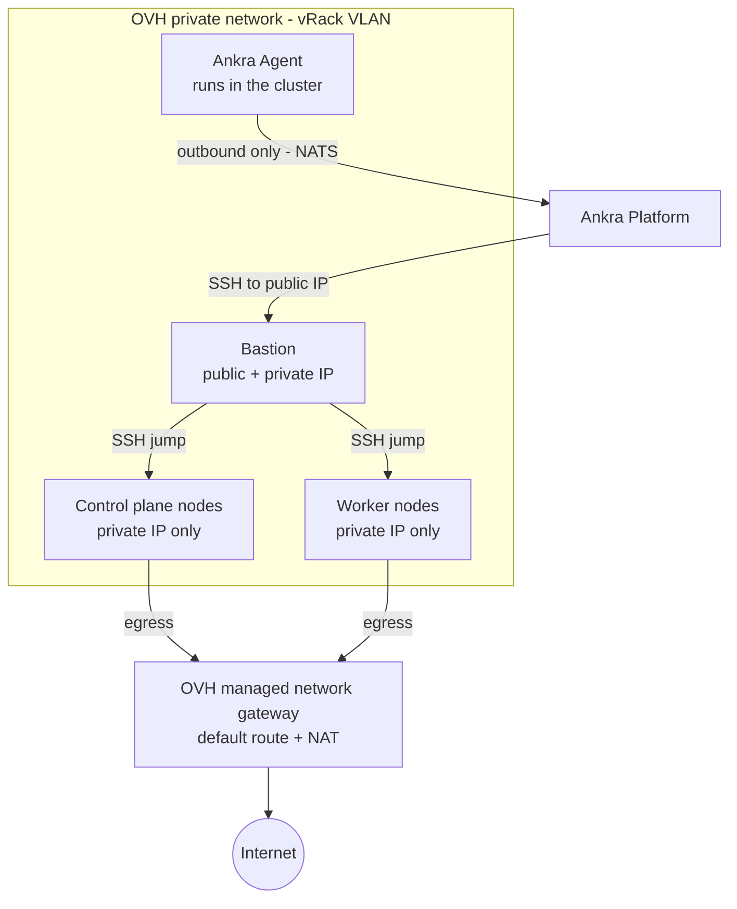

import { CliVersion } from "/snippets/cli-version.jsx";

Reference material for [OVH clusters](/guides/ovh-clusters).

---

## Cluster Configuration Options

The fields of `POST /api/v1/clusters/ovh`. The portal's create form sets most of them; see [Create a Cluster](/guides/create-a-cluster).

<CliVersion since="0.74.0" command="cluster ovh gateway-model" />

| Parameter | Default | Description |
|-----------|---------|-------------|
| `name` | *required* | Unique cluster name |
| `description` | | Free text shown with the cluster |
| `environment` | `development` | What the cluster runs: `production`, `staging`, `development`, `testing`, `local`, or a name of your own. The portal asks for it as **What will this cluster run?** |
| `criticality` | *the environment's own level* | How important the cluster is: `production`, `staging`, `development` or `disposable` |
| `credential_id` | *required* | OVH API credential ID |
| `ssh_key_credential_id` | *required* | SSH key credential ID |
| `region` | *required* | OVH Cloud region |
| `availability_zones` | | 3-AZ regions only. The zone pool the cluster's instances are spread across; more than one zone needs at least 3 control planes. See [Availability Zones](/guides/ovh-clusters#availability-zones) |
| `gateway_model` | `s` | Size of the OVHcloud managed gateway all node egress goes through: `s`, `m`, `l`, `xl`, `2xl` or `3xl`. The portal asks for it as **Internet gateway size**; change it later with `ankra cluster ovh gateway-model`. See [Internet gateway size](/guides/ovh-clusters#internet-gateway-size) |
| `network_vlan_id` | `0` | VLAN ID for the private network |
| `subnet_cidr` | `10.0.1.0/24` | Subnet CIDR range |
| `dhcp_start` | `10.0.1.100` | DHCP allocation range start |
| `dhcp_end` | `10.0.1.200` | DHCP allocation range end |
| `gateway_flavor_id` | `c3-4` | Instance flavor for the SSH bastion (the field name predates the bastion rename). The portal calls it **Gateway** |
| `bastion_allowed_ips` | *any address* | IPv4 addresses or CIDRs allowed to reach the bastion over SSH, at most 64. IPv6 and `0.0.0.0/0` are refused; leave it out to keep SSH open to any address (key-only). Ankra's own egress is always allowed. Change it later with `ankra cluster ovh bastion allowed-ips` |
| `control_plane_count` | `1` | Number of control plane nodes |
| `control_plane_flavor_id` | `b3-16` | Instance flavor for control planes |
| `worker_count` | `1` | Number of worker nodes (legacy, use `node_groups` instead) |
| `worker_flavor_id` | `b3-16` | Instance flavor for workers (legacy, use `node_groups` instead) |
| `node_groups` | | Array of node group definitions (see [Node groups](/guides/operate-ankra-managed-clusters#node-groups)) |
| `distribution` | `kubeadm` | Kubernetes distribution (`kubeadm` or `k3s`) |
| `kubernetes_version` | *latest* | Kubernetes version (optional) |
| `k3s_disabled_components` | | k3s only. Packaged components the k3s install leaves out (`k3s --disable`), on top of what the provider's k3s shape already disables: any of `coredns`, `servicelb`, `traefik`, `local-storage`, `metrics-server`, `runtimes`, for example `["traefik"]` on a cluster that brings its own ingress. A list on a `kubeadm` cluster is refused with a `400` (`k3s_disabled_components is only supported for the k3s distribution.`); an entry outside those six or an entry listed twice is a `422` validation error pointing at the entry |
| `cni` | `cilium` (kubeadm), `flannel` (k3s) | CNI plugin: `flannel`, `calico` or `cilium`. Follows the distribution when omitted; kubeadm clusters always use `cilium` |
| `cni_features` | *all off* | CNI feature toggles, fixed at creation. See [Choices fixed at create time](/guides/operate-ankra-managed-clusters#choices-fixed-at-create-time) |
| `etcd_topology` | `stacked` | kubeadm only. `stacked` or `external` (dedicated etcd instances) |
| `etcd_node_count` | `3` | kubeadm `external` topology only (3 or 5) |
| `etcd_flavor_id` | `b3-16` | kubeadm `external` topology only. Instance flavor for the etcd nodes |
| `external_cloud_provider` | `true` | Install the OpenStack cloud controller manager and Cinder CSI driver and wire the nodes for them |
| `include_networking` | `true` | Deploy the networking stack: Traefik, cert-manager and the `letsencrypt-prod` ClusterIssuer |
| `gateway_api` | `false` | Also serve the Kubernetes Gateway API from the networking stack's Traefik. Needs `include_networking`. See [Gateway API](/guides/gateway-api) |
| `include_dns` | `true` | Give the cluster a delegated subdomain on `ankra.cc` with external-dns wired |
| `gitops_provider` | `github` | Git provider of the GitOps repository: `github` or `bitbucket_cloud` |
| `gitops_credential_name` | | Name of the Git credential for GitOps integration |
| `gitops_repository` | | GitOps repository, for example `my-org/my-repo` |
| `gitops_workspace` | | Bitbucket Cloud only. The workspace that holds the repository |
| `gitops_repo_slug` | | Bitbucket Cloud only. The repository slug |
| `gitops_branch` | `master` | Branch for GitOps pushes |

### OVH Cloud Regions

| Region | Location |
|--------|----------|
| `GRA7` | Gravelines, France |
| `GRA9` | Gravelines, France |
| `GRA11` | Gravelines, France |
| `SBG5` | Strasbourg, France |
| `BHS5` | Beauharnois, Canada |
| `WAW1` | Warsaw, Poland |
| `DE1` | Frankfurt, Germany |
| `UK1` | London, United Kingdom |
| `SGP1` | Singapore |
| `SYD1` | Sydney, Australia |

<Note>
The regions enabled on each OVH project differ. A region that is not enabled on the project's private network fails the reconcile during network setup. List the regions a credential can actually deploy in with `ankra cluster ovh regions --credential-id <credential_id>` before creating a cluster.
</Note>

### OVH Instance Flavors

The defaults come from the current b3/c3 generation:

| Flavor | vCPUs | RAM | Used by default for |
|--------|-------|-----|---------------------|
| `c3-4` | 2 | 4 GB | The bastion (`gateway_flavor_id`) |
| `b3-16` | 4 | 16 GB | Control planes, workers and dedicated etcd nodes |

Other sizes of the same lines include `b3-8`, `b3-32` and `b3-64` (general purpose), `c3-8` and `c3-16` (CPU-optimised) and `r3-16`, `r3-32` and `r3-64` (RAM-optimised). Older projects may still offer the b2/c2/r2 generation.

<Note>
Available flavors vary by region. The portal's create form lists what the chosen region offers, with prices, under **Exact server type**. Check the [OVH Cloud catalog](https://www.ovhcloud.com/en/public-cloud/prices/) for the full list.
</Note>

---

## Node Group API Reference

| Endpoint | Method | Description |
|----------|--------|-------------|
| `/api/v1/clusters/ovh/{id}/node-groups` | GET | List all node groups |
| `/api/v1/clusters/ovh/{id}/node-groups` | POST | Add a node group |
| `/api/v1/clusters/ovh/{id}/node-groups/{name}/scale` | PUT | Scale a node group (0 to 100) |
| `/api/v1/clusters/ovh/{id}/node-groups/{name}/instance-type` | PUT | Change instance flavor |
| `/api/v1/clusters/ovh/{id}/node-groups/{name}/labels` | PUT | Update labels |
| `/api/v1/clusters/ovh/{id}/node-groups/{name}/taints` | PUT | Update taints |
| `/api/v1/clusters/ovh/{id}/node-groups/{name}` | DELETE | Delete a node group |

## Node Actions API

| Endpoint | Method | Description |
|----------|--------|-------------|
| `/api/v1/clusters/ovh/{id}/nodes` | GET | List all nodes (control plane, workers, bastion/gateway) |
| `/api/v1/clusters/ovh/{id}/nodes/{node_id}` | GET | Get a single node's details |
| `/api/v1/clusters/ovh/{id}/nodes/{node_id}/restart` | POST | Restart a node (native reboot, falls back to power cycle) |
| `/api/v1/clusters/ovh/{id}/bastion/instance-type` | PUT | Resize the bastion/gateway instance flavor |

See [Restart a node](/guides/operate-ankra-managed-clusters#restart-a-node) and [Bastion](/guides/operate-ankra-managed-clusters#bastion) for how to use them.

## Disabled k3s Components API

| Endpoint | Method | Description |
|----------|--------|-------------|
| `/api/v1/clusters/ovh/{id}/k3s-disabled-components` | GET | The stored `k3s_disabled_components` (empty when nothing is stored), the k8s node `resource_ids` carrying it, `control_plane_count` and `applies` |
| `/api/v1/clusters/ovh/{id}/k3s-disabled-components` | PUT | Replace the stored list on a running k3s cluster, for example `{"k3s_disabled_components": ["traefik"]}` |

The `k3s_disabled_components` list set at create can grow on a running k3s cluster. The body is the complete list and has to contain every entry already stored; an unknown or repeated entry is a `422` validation error pointing at the entry. `applies` answers: "The platform's maintenance read lane compares each control plane's k3s server config against this list within about five minutes and flags the ones missing an entry; the reconcile lane then patches the config and restarts k3s on one control plane at a time, in the cluster's k8s update chain. Control planes already carrying every entry are not touched. The list only grows: re-enabling a bundled component is not supported yet, so a change that removes a stored entry is refused, and so is any change while a node update, version upgrade or node restart is still in progress on the cluster." The refusals answer `409` with the detail shown:

| Request | Detail |
|---------|--------|
| The cluster runs kubeadm (the read is refused too) | `k3s_disabled_components is only supported for the k3s distribution.` |
| The cluster has no Kubernetes node resources (the read is refused too) | `No Kubernetes node resources found for this cluster` |
| The list drops a stored entry, here `traefik` | `k3s_disabled_components: re-enabling a bundled component is not supported yet, so a stored entry cannot be removed: traefik. Send the stored list plus any additions.` |
| The list adds `coredns` | `k3s_disabled_components: coredns cannot be disabled on a running cluster. It is load-bearing for in-cluster DNS, and k3s removes it on the first control plane that restarts with the entry.` |
| A node update, version upgrade or node restart is in progress | `k3s_disabled_components cannot be changed while a Kubernetes node update, version upgrade or node restart is in progress on this cluster. Retry once it has finished.` |

---

## Architecture

The managed network gateway (`<cluster>-network-gw`) is the nodes' router and NAT; the bastion (`<cluster>-bastion`, or `<cluster>-gateway` on clusters created before the rename) is an SSH jump host only. See [What Ankra created in your project](/guides/ovh-clusters#what-ankra-created-in-your-project).
