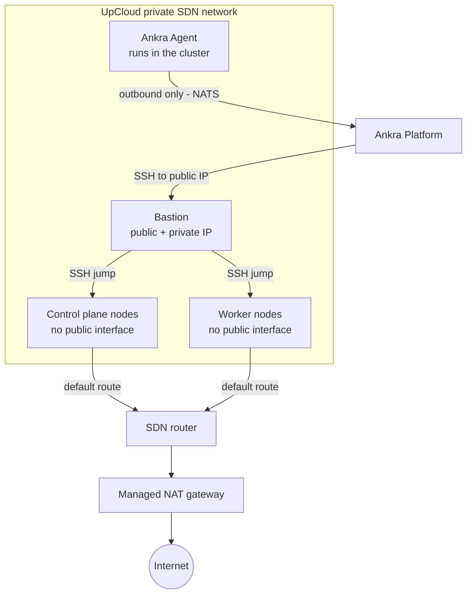

import { CliVersion } from "/snippets/cli-version.jsx";

Reference material for [UpCloud clusters](/guides/upcloud-clusters).

---

## Cluster Configuration Options

The fields of `POST /api/v1/clusters/upcloud`. The portal's create form sets most of them; see [Create a Cluster](/guides/create-a-cluster).

<CliVersion since="0.74.0" command="cluster upcloud gateway-plans" />

| Parameter | Default | Description |
|-----------|---------|-------------|
| `name` | *required* | Unique cluster name |
| `description` | | Free text shown with the cluster |
| `environment` | `development` | What the cluster runs: `production`, `staging`, `development`, `testing`, `local`, or a name of your own. The portal asks for it as **What will this cluster run?** |
| `criticality` | *the environment's own level* | How important the cluster is: `production`, `staging`, `development` or `disposable`. Also sets the default `load_balancer_plan` |
| `credential_id` | *required* | UpCloud API credential ID |
| `ssh_key_credential_id` | *required* | SSH key credential ID |
| `zone` | *required* | UpCloud datacenter zone |
| `zones` | | Zone pool for a multi-zone cluster, must include `zone` (the primary). At least 3 zones and 3 control planes; `kubeadm` only. See [Multi-zone clusters](/guides/upcloud-clusters#multi-zone-clusters) |
| `network_mode` | *derived* | `private_network` or `wireguard_mesh`; `wireguard_mesh` for a pool, and on a single zone it makes the cluster mesh-capable so zones can be added later. On a `wireguard_mesh` cluster the load balancer backends are addressed on the private network rather than the overlay, so `LoadBalancer` Services work unchanged - see [the guide](/guides/upcloud-clusters#loadbalancer-services-on-a-meshed-cluster) |
| `network_ip_range` | *a `/24` picked for the cluster* | Private network IP range. The portal accepts a private range of `/24` or larger. Left out, Ankra picks a `10.x.y.0/24` for this cluster, different for each cluster. A multi-zone pool takes one consecutive `/24` per zone from this range |
| `bastion_plan` | `STARTER-1xCPU-1GB` | Server plan for the bastion host |
| `bastion_allowed_ips` | *any address* | IPv4 addresses or CIDRs allowed to reach the bastion over SSH, at most 64. IPv6 and `0.0.0.0/0` are refused; leave it out to keep SSH open to any address (key-only). Ankra's own egress is always allowed. Change it later with `ankra cluster upcloud bastion allowed-ips` |
| `gateway_plan` | `standard` | Plan of the NAT gateway all node egress goes through. List the plans with `ankra cluster upcloud gateway-plans`; change it later with `ankra cluster upcloud gateway-plan`, which cuts egress for several minutes. See [NAT gateway and load balancer plans](/guides/upcloud-clusters#nat-gateway-and-load-balancer-plans) |
| `load_balancer_plan` | `production-small` for a production cluster, `development` otherwise | Plan of the UpCloud load balancer in front of the ingress Ankra installs. Needs `include_networking`. List the plans with `ankra cluster upcloud load-balancer-plans`; change it later with `ankra cluster upcloud load-balancer-plan set` |
| `control_plane_count` | `1` | Number of control plane nodes (1 or 3) |
| `control_plane_plan` | `PREMIUM-4xCPU-8GB` | Server plan for control planes |
| `worker_count` | `1` | Number of worker nodes (legacy, use `node_groups` instead) |
| `worker_plan` | `PREMIUM-2xCPU-4GB` | Server plan for workers (legacy, use `node_groups` instead) |
| `node_groups` | | Array of node group definitions (see [Node groups](/guides/operate-ankra-managed-clusters#node-groups)) |
| `distribution` | `kubeadm` | Kubernetes distribution (`kubeadm` or `k3s`) |
| `kubernetes_version` | *latest stable* | Kubernetes version (optional) |
| `k3s_disabled_components` | | k3s only. Packaged components the k3s install leaves out (`k3s --disable`), on top of what the provider's k3s shape already disables: any of `coredns`, `servicelb`, `traefik`, `local-storage`, `metrics-server`, `runtimes`, for example `["traefik"]` on a cluster that brings its own ingress. A list on a `kubeadm` cluster is refused with a `400` (`k3s_disabled_components is only supported for the k3s distribution.`); an entry outside those six or an entry listed twice is a `422` validation error pointing at the entry |
| `cni` | `cilium` (kubeadm), `flannel` (k3s) | CNI plugin: `flannel`, `calico` or `cilium`. Follows the distribution when omitted; kubeadm clusters always use `cilium` |
| `cni_features` | *all off* | CNI feature toggles, fixed at creation. See [Choices fixed at create time](/guides/operate-ankra-managed-clusters#choices-fixed-at-create-time) |
| `etcd_topology` | `stacked` | kubeadm only. `stacked` or `external` (dedicated etcd servers) |
| `etcd_node_count` | `3` | kubeadm `external` topology only (3 or 5) |
| `etcd_plan` | `PREMIUM-4xCPU-8GB` | kubeadm `external` topology only. Server plan for the etcd nodes |
| `external_cloud_provider` | `true` | Install the UpCloud cloud controller manager and CSI driver and wire the nodes for them |
| `include_networking` | `true` | Deploy the networking stack: Traefik, cert-manager and a `letsencrypt-prod` Let's Encrypt ClusterIssuer |
| `gateway_api` | `false` | Also serve the Kubernetes Gateway API from the networking stack's Traefik. Needs `include_networking`. See [Gateway API](/guides/gateway-api) |
| `include_dns` | `true` | Give the cluster a delegated subdomain on `ankra.cc` with external-dns wired |
| `gitops_provider` | `github` | Git provider of the GitOps repository: `github` or `bitbucket_cloud` |
| `gitops_credential_name` | | Name of the Git credential for GitOps integration |
| `gitops_repository` | | GitOps repository, for example `my-org/my-repo` |
| `gitops_workspace` | | Bitbucket Cloud only. The workspace that holds the repository |
| `gitops_repo_slug` | | Bitbucket Cloud only. The repository slug |
| `gitops_branch` | `master` | Branch for GitOps pushes |

### UpCloud Datacenter Zones

| Zone | Location |
|------|----------|
| `fi-hel1` | Helsinki, Finland |
| `de-fra1` | Frankfurt, Germany |
| `us-chi1` | Chicago, United States |
| `nl-ams1` | Amsterdam, Netherlands |
| `uk-lon1` | London, United Kingdom |
| `sg-sin1` | Singapore |
| `au-syd1` | Sydney, Australia |
| `pl-waw1` | Warsaw, Poland |
| `fi-hel2` | Helsinki, Finland (second zone) |
| `se-sto1` | Stockholm, Sweden |
| `es-mad1` | Madrid, Spain |
| `us-nyc1` | New York, United States |
| `us-sjo1` | San Jose, United States |

### UpCloud Server Plans

| Plan | vCPUs | RAM | Monthly Cost |
|------|-------|-----|-------------|
| `1xCPU-1GB` | 1 | 1 GB | $5.00 |
| `2xCPU-4GB` | 2 | 4 GB | $20.00 |
| `4xCPU-8GB` | 4 | 8 GB | $40.00 |
| `8xCPU-16GB` | 8 | 16 GB | $80.00 |

<Note>
Available plans may vary by zone. Check the [UpCloud pricing page](https://upcloud.com/pricing/) for the latest offerings.
</Note>

---

## Node Group API Reference

| Endpoint | Method | Description |
|----------|--------|-------------|
| `/api/v1/clusters/upcloud/{id}/zones` | PUT | Grow a multi-zone cluster's zone pool (`{"zones": [...]}`, primary first; zones are only ever added) |
| `/api/v1/clusters/upcloud/{id}/node-groups` | GET | List all node groups |
| `/api/v1/clusters/upcloud/{id}/node-groups` | POST | Add a node group |
| `/api/v1/clusters/upcloud/{id}/node-groups/{name}/scale` | PUT | Scale a node group (0 to 100) |
| `/api/v1/clusters/upcloud/{id}/node-groups/{name}/instance-type` | PUT | Change server plan |
| `/api/v1/clusters/upcloud/{id}/node-groups/{name}/labels` | PUT | Update labels |
| `/api/v1/clusters/upcloud/{id}/node-groups/{name}/taints` | PUT | Update taints |
| `/api/v1/clusters/upcloud/{id}/node-groups/{name}` | DELETE | Delete a node group |

## Node Actions API

| Endpoint | Method | Description |
|----------|--------|-------------|
| `/api/v1/clusters/upcloud/{id}/nodes` | GET | List all nodes (control plane, workers, bastion) |
| `/api/v1/clusters/upcloud/{id}/nodes/{node_id}` | GET | Get a single node's details |
| `/api/v1/clusters/upcloud/{id}/nodes/{node_id}/restart` | POST | Restart a node (native reboot, falls back to power cycle) |
| `/api/v1/clusters/upcloud/{id}/bastion/instance-type` | PUT | Resize the bastion instance type |

See [Restart a node](/guides/operate-ankra-managed-clusters#restart-a-node) and [Bastion](/guides/operate-ankra-managed-clusters#bastion) for how to use them.

## Disabled k3s Components API

| Endpoint | Method | Description |
|----------|--------|-------------|
| `/api/v1/clusters/upcloud/{id}/k3s-disabled-components` | GET | The stored `k3s_disabled_components` (empty when nothing is stored), the k8s node `resource_ids` carrying it, `control_plane_count` and `applies` |
| `/api/v1/clusters/upcloud/{id}/k3s-disabled-components` | PUT | Replace the stored list on a running k3s cluster, for example `{"k3s_disabled_components": ["traefik"]}` |

The `k3s_disabled_components` list set at create can grow on a running k3s cluster. The body is the complete list and has to contain every entry already stored; an unknown or repeated entry is a `422` validation error pointing at the entry. `applies` answers: "The platform's maintenance read lane compares each control plane's k3s server config against this list within about five minutes and flags the ones missing an entry; the reconcile lane then patches the config and restarts k3s on one control plane at a time, in the cluster's k8s update chain. Control planes already carrying every entry are not touched. The list only grows: re-enabling a bundled component is not supported yet, so a change that removes a stored entry is refused, and so is any change while a node update, version upgrade or node restart is still in progress on the cluster." The refusals answer `409` with the detail shown:

| Request | Detail |
|---------|--------|
| The cluster runs kubeadm (the read is refused too) | `k3s_disabled_components is only supported for the k3s distribution.` |
| The cluster has no Kubernetes node resources (the read is refused too) | `No Kubernetes node resources found for this cluster` |
| The list drops a stored entry, here `traefik` | `k3s_disabled_components: re-enabling a bundled component is not supported yet, so a stored entry cannot be removed: traefik. Send the stored list plus any additions.` |
| The list adds `coredns` | `k3s_disabled_components: coredns cannot be disabled on a running cluster. It is load-bearing for in-cluster DNS, and k3s removes it on the first control plane that restarts with the entry.` |
| A node update, version upgrade or node restart is in progress | `k3s_disabled_components cannot be changed while a Kubernetes node update, version upgrade or node restart is in progress on this cluster. Retry once it has finished.` |

---

## Architecture

The managed NAT gateway on the router carries all node egress; the bastion is an SSH jump host only. On a multi-zone cluster each additional zone gets its own router, private network and NAT gateway, and a WireGuard mesh (`wg0`) joins every node over the account-wide utility network. See [What Ankra created in your account](/guides/upcloud-clusters#what-ankra-created-in-your-account).
