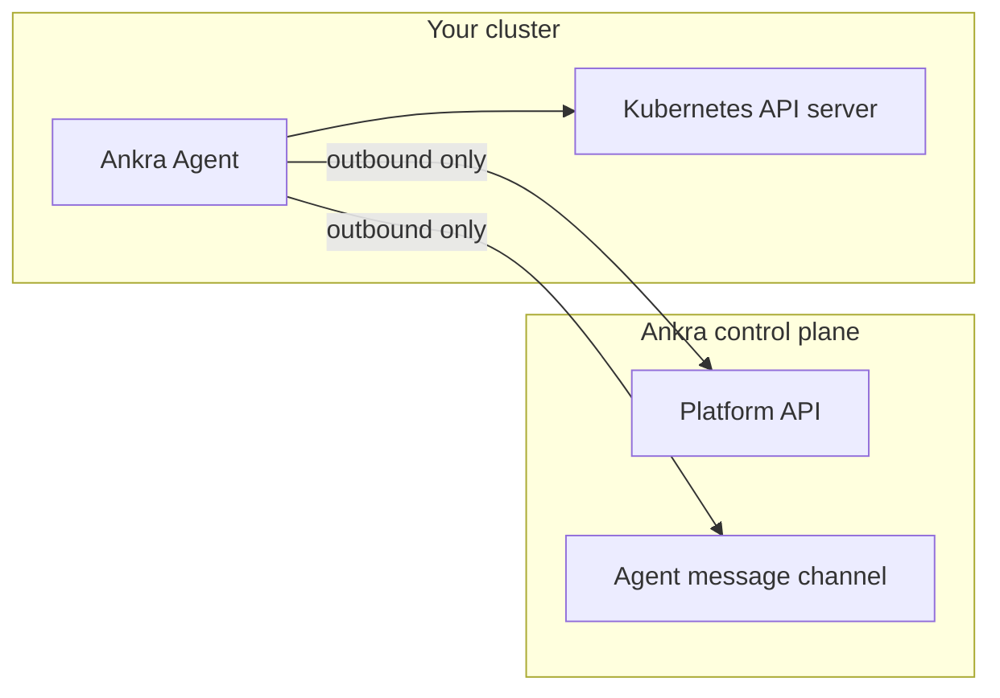

Before you connect a cluster, you need to know what Ankra can reach inside it, what it keeps, where that data lives, who can get at it, and how to limit each of those. This page answers those questions in one place. Where the honest answer is "more than you might assume", it says so, and every section links to the page with the detail.

---

## What the agent can do in your cluster

Ankra works in your cluster through the [Ankra Agent](/concepts/cluster-agent), a single pod you install with Helm. The agent's ClusterRole grants **every verb on every resource in every API group**, plus all non-resource URLs, bound cluster-wide. In practice that is cluster-admin. It needs that reach because it installs whatever Helm charts and manifests you choose, keeps them in the state you declared, and carries `kubectl` requests, logs and terminal sessions for the whole cluster. No value in the agent's Helm chart narrows the ClusterRole.

What limits that power:

- **No inbound path.** The agent opens every connection, outbound, to the Ankra platform. Nothing on Ankra's side can connect into your network, and there are no ports to open. [Agent Compliance Posture](/security/agent-compliance#what-crosses-the-boundary) lists the endpoints.
- **A hardened pod.** Non-root, read-only root filesystem, all Linux capabilities dropped, `RuntimeDefault` seccomp, and no host namespaces or host paths.
- **An identity you can cut off from outside.** Each cluster has its own registration token and its own message-channel credentials. Revoking the token at the platform disconnects the agent without needing access to the cluster.
- **Changes go through a reviewable path.** Changes to your stacks are applied from a versioned definition, committed to your Git repository when one is connected. Changes the AI proposes wait for a person by default. The opt-in autonomy settings in [What it can change without asking](/platform/ai-overview#what-it-can-change-without-asking) let some of them run without one.
- **Uninstalling removes it.** `helm uninstall` and deleting the namespace remove the agent, its ServiceAccount and the ClusterRoleBinding.

For a control-by-control review of the agent, including how to record the cluster-admin binding as a justified exception, see [Agent Compliance Posture](/security/agent-compliance). To restrict its network egress and what it watches, see [Hardening the Agent](/security/agent-hardening).

---

## What leaves your cluster

Everything below travels over the agent's outbound connection, except the audit log, which Ankra writes itself when someone acts through the platform. Retention is how long Ankra keeps the data by default.

| Data | When it leaves | Stored by Ankra? | Retention |
|------|----------------|------------------|-----------|
| **Resource inventory** - the Kubernetes objects in the cluster (Deployments, Pods, Services, ConfigMaps, custom resources and so on), plus node and cluster metadata | Continuously, as the agent watches the cluster | Yes. **Secret values are replaced with SHA-256 digests** before they leave; key names remain | No fixed period |
| **Ankra built-in metrics** - node, namespace and workload usage, and request counts and response times from a Traefik ingress controller, for [cluster metrics](/platform/cluster-metrics) | Every 30 seconds, unless the cluster opts out | Yes | 30 days |
| **Pod logs, read live** | Only when someone opens them in the console, the CLI or the AI Assistant | No, streamed to the person viewing them | Not kept |
| **Pod logs, on a cluster with [Ankra hosted logs](/guides/hosted-logs) turned on** - the log lines of the cluster's running containers, from up to 100 containers at once by default, outside any namespace listed in `logs_ship.exclude_namespaces` | Continuously, once a member with `clusters.write` on the cluster turns hosted logs on and Ankra offers hosted logs for that cluster. Where it does not, the cluster's hosted logs setting says so and nothing is sent. Hosted logs are off on every cluster until someone turns them on | Yes, in Ankra's own log store | Up to 7 days. After hosted logs are turned off the cluster stops sending within a minute, and lines already sent are kept for up to 7 days |
| **Pod terminal and `exec` sessions** | Only when a member with `kubernetes.exec` opens one | Yes. A recording of what crossed the terminal, including anything the shell printed | Transcript 90 days by default; who opened it, where and when stays in the audit log |
| **Secret values revealed in the console, the CLI or the API** | Only when a member with `kubernetes.secrets_reveal` clicks **Reveal values** on one Secret, runs `ankra cluster get secrets <name> -n <namespace> --reveal`, or an API token asks for one Secret's values | Shown to that member. Each reveal is written to the audit log; the stored inventory keeps only the digests | Not kept |
| **Helm release values** | Only when someone opens a release. Passwords, tokens and keys in its values, the Secrets it renders and its notes stay hidden unless a member with `kubernetes.secrets_reveal` clicks **Reveal values** | Shown to that member. Each reveal is written to the audit log | Not kept |
| **Secrets read with `kubectl` through Ankra** | Only for a member with `kubernetes.secrets_reveal` and an access grant that allows it | Not stored. Each request is written to the audit log | Not kept |
| **Vulnerability findings** - CVE ids, severities, affected images and workloads | When [Trivy Operator](/guides/cluster-security) runs in the cluster (part of the security baseline) | Yes | No fixed period |
| **Software bill of materials** - package names, versions and licences per image | Only on clusters where SBOM generation is turned on (off by default) | Yes | No fixed period |
| **AI chat transcripts** - your questions and whatever cluster data the AI read to answer them | When a member uses the [AI Assistant](/platform/ai-assistant) | Yes, after secret redaction | Until the conversation is deleted |
| **Audit log** - actions taken in Ankra | Written by Ankra, not sent by the agent | Yes | 365 days |

**Container image contents** never leave the cluster, because Trivy scans in-cluster and only its reports are read. **Your source code** leaves your infrastructure when Ankra builds an image on its platform builders, which fetch the source and build it there. Some of those builds Ankra starts by itself while **Build on Ankra when your cluster cannot** is on; [Application CI/CD](/guides/cicd-pipeline) lists every case. What the agent decrypts from Git at deploy time is not sent back as such: a decrypted value that ends up in a Secret reaches Ankra only as a digest, but one written into a ConfigMap, a pod spec or any other object is part of the resource inventory. Sealing a value with [SOPS](/guides/sops) keeps it unreadable in Git, not from Ankra: Ankra holds the organisation's private key and uses it itself, for example when it reads a sealed file back from your repository. Your application traffic, volume data and database contents do not pass through the agent either. [Backups](/concepts/backup-vaults) are written straight from the cluster to a bucket you own, not to Ankra.

<Note>
Browsing a cluster in Ankra shows a Secret's key names and value digests, never the values. Reading the values needs the `kubernetes.secrets_reveal` permission, which the `owner`, `admin` and `operator` roles hold and `member` and `viewer` do not. It is a separate, explicit request for one Secret, and each one is written to the audit log with who, which cluster and which Secret. Listings never return values, and the AI never sees them, whatever the member's role.

The same permission covers the two other ways to read a credential through Ankra. A Helm release's values hide passwords, tokens and keys until the member reveals them. `kubectl` through Ankra refuses any request for Secrets from a member without the permission, whatever Kubernetes role their [access grant](/guides/cluster-access) gives them, and records every request it lets through.
</Note>

---

## Where it lives

**The control plane.** The Ankra platform, its databases, its metrics store, the message channel agents connect to, and its secret store run in the EU, in Finland. Database backups are kept in Germany. The providers behind these, and every other sub-processor, are listed at [ankra.ai/trust](https://ankra.ai/trust).

**[Ankra Cloud](/guides/ankra-cloud-kubernetes) clusters (closed beta).** A cluster you run on Ankra Cloud sits on infrastructure the Ankra team operates, so for that cluster Ankra is also your hosting provider. Every other cluster runs on infrastructure and accounts you control.

**Secrets you give Ankra.** Cloud, Git and registry credentials, and AI provider keys, are stored encrypted at rest in a Vault-compatible secret store (OpenBao or HashiCorp Vault). Ankra's platform services decrypt a credential when an action needs it, for example to provision a cluster, deploy, seal a value for Git or call your cloud provider, so those services can read the credentials they hold. All organisations share one store: Ankra's API checks on every request that a credential belongs to your organisation, and there is no separate encryption key per organisation. Every reveal of a value by a member is written to the organisation's [audit log](/guides/audit-log), which keeps entries for 365 days, and so is Ankra staff access to your organisation. The platform's own use of a credential when it provisions or deploys is not written there. Removing a credential deletes it from the store. For AWS you can connect a [role Ankra assumes with an external ID](/platform/credentials/aws) instead of storing access keys. For values that live in Git, each organisation has its own [SOPS](/guides/sops) key pair: Git receives ciphertext for every key a resource lists under `encrypted_paths`, and every other value in plain text, including a [variable](/concepts/variables#secret-variables) Ankra filled in. The private key is kept in Ankra's secret store. Ankra uses it itself to read sealed files back from Git, a cluster's agent is given it when a deploy reaches a sealed value, and on a cluster whose add-ons deploy through ArgoCD it is also stored in the cluster as the Secret `ankra-sops-age-key`. A value you enter in the Stack Builder is held by the control plane as entered, so that Ankra can seal it each time it writes to Git.

**The AI model provider.** When a member uses an AI feature, Ankra sends the question and the cluster data its tools read (resources, events, logs) to a model provider. Detected secret values are redacted from tool results before the model sees them, and the AI's tools read Kubernetes Secrets as key names and counts only. Which provider receives the data is your choice under **Ankra AI** → **Models and provider** - see [AI Provider](/platform/ai-provider):

- **Ankra** (the default) - Ankra's own key, routed to third-party model providers.
- **Anthropic** or **OpenRouter** - your own key and your own agreement with that provider.
- **OpenAI-compatible** - any endpoint you run or choose, including a self-hosted model, so model traffic goes only where you point it.

Scheduled AI analysis of your clusters ([AI Insights](/platform/ai-insights)) is off by default. Without it, AI features send data only when a member uses them.

---

## Who can reach it

- **Sign-in.** Members sign in through a managed identity provider (Auth0); Ankra does not store passwords. Federation to your own identity provider through OIDC single sign-on is available on every plan except the single-user Homebuilder plan. See [Identity & Access Controls](/security/identity-and-access).
- **MFA.** Authenticator apps, passkeys and security keys, and recovery codes. An organisation can require MFA for every member. See [Account Security & 2FA](/platform/account-security).
- **Roles.** Five built-in roles - `owner`, `admin`, `operator`, `member` and `viewer` - plus custom roles, each assigned for the whole organisation, one cluster, a cluster group or a project. The [permission matrix](/guides/roles-and-access#permission-matrix) shows exactly what each role can do.
- **Tokens.** Scripts, CI and MCP clients use API tokens. A token carries its own scopes on top of the role of the member or service account behind it, so it can be narrower than that role but never wider. See [Service Tokens](/guides/service-tokens) and [Tokens](/reference/tokens).
- **Kubernetes access.** `kubectl` access goes through Ankra with short-lived tokens tied to the member, instead of shared kubeconfigs. See [Cluster Access](/guides/cluster-access).

---

## How to restrict it

| To limit | Do this | Where |
|----------|---------|-------|
| What the agent watches and sends | Set `k8s_watch.dynamic_discovery: false` in the agent's Helm values, so it watches only its built-in list of resource types and not every custom resource in the cluster | [Hardening the Agent](/security/agent-hardening#turn-off-optional-egress) |
| Ankra built-in metrics | Set `metrics_collect.enabled: false` in the agent's Helm values, on agent 2.1.1339 or later. Older agents ignore the value and keep sending metrics. Once it takes effect, the views that read Ankra built-in metrics stay empty | [Cluster Metrics](/platform/cluster-metrics) |
| Container logs kept by Ankra | Leave Ankra hosted logs off (the default). To make sure a cluster never sends its logs, whoever turns the switch on, set `logs_ship.enabled: false` in its agent's Helm values: the agent then never sends log lines, whatever the switch in Ankra says. To keep only some namespaces out, list them in `logs_ship.exclude_namespaces`. Otherwise keep `clusters.write` to the people who may make that decision. Among the built-in roles `member`, `operator`, `admin` and `owner` have it | [Ankra Hosted Logs](/guides/hosted-logs), [Roles & Access](/guides/roles-and-access#permission-matrix) |
| Where the agent can connect | Apply a `NetworkPolicy` that allows the agent's namespace to reach only the Ankra endpoints and your registry | [Hardening the Agent](/security/agent-hardening#restrict-network-egress) |
| Terminal and `exec` access | Keep `kubernetes.exec` out of the roles most people hold. Among the built-in roles only `operator`, `admin` and `owner` have it | [Roles & Access](/guides/roles-and-access#permission-matrix) |
| Reading stored credentials | Keep `credentials.reveal` to the few people who need it. Among the built-in roles only `admin` and `owner` have it | [Roles & Access](/guides/roles-and-access#permission-matrix) |
| Reading Kubernetes Secret values | Keep `kubernetes.secrets_reveal` to the people who need it. Among the built-in roles `operator`, `admin` and `owner` have it. It also covers Helm release values and Secrets read with `kubectl` through Ankra. Every reveal is in the audit log. Give members who must not see credentials a `view` access grant: a grant that can open a shell in a pod can still read a Secret the pod mounts | [Roles & Access](/guides/roles-and-access#permission-matrix), [Audit Export](/security/audit-export) |
| Who can browse a cluster | Assign roles on a cluster or cluster group rather than the whole organisation | [Roles & Access](/guides/roles-and-access#scopes) |
| Which model provider sees cluster data | Switch the AI provider to your own key or your own endpoint | [AI Provider](/platform/ai-provider) |
| Scheduled AI analysis | Leave proactive AI Insights off (the default), or turn AI Insights off for one cluster | [AI Insights](/platform/ai-insights) |
| Package inventories leaving the cluster | Leave SBOM generation off (the default) | [Cluster Security](/guides/cluster-security) |

---

## Evidence and compliance

- [Shared Responsibility](/security/shared-responsibility) - where Ankra's responsibility ends and yours begins, and what that means for a SOC 2 or ISO 27001 scope.
- [Agent Compliance Posture](/security/agent-compliance) - the agent, control by control.
- [Audit Log](/guides/audit-log) and [Audit Export](/security/audit-export) - who did what in Ankra, and how to get the trail out.
- [Compliance Management](/security/compliance-management) - benchmark results across the fleet, framework evidence, exceptions with owners and review dates, and an evidence report.
- [Audit-ready evidence](/security/audit-ready) - ISO 27001 and SOC 2 evidence from Ankra, step by step, and where each auditor question is answered.
- [Cluster Security](/guides/cluster-security) - vulnerability findings across the fleet, ranked by what is being exploited.

To have an organisation's stored data removed when you leave Ankra, and for the offboarding timeline, [contact support](/platform/support).

<Warning>
Take Ankra's own certification status and its sub-processor list from [ankra.ai/trust](https://ankra.ai/trust) or from us directly, not from this documentation. That page is kept current as the programme progresses.
</Warning>

**Next:** if you are reviewing the agent for approval, go to [Agent Compliance Posture](/security/agent-compliance). If you are ready to connect a cluster, start with [Hardening the Agent](/security/agent-hardening) so the restrictions above are in place from the first install.
