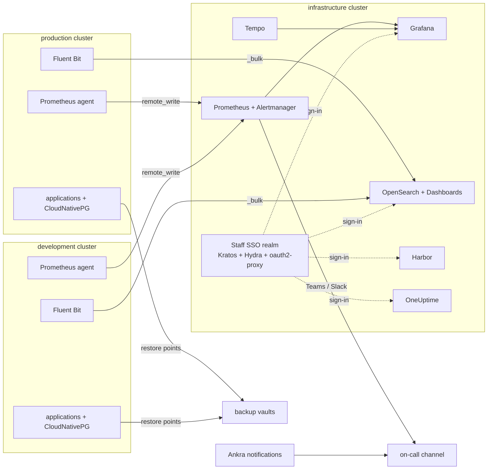

This use case is the shape of a real estate Ankra operates: one **infrastructure cluster** that every other cluster leans on, and a **production** and a **development** cluster that run the applications. Everything lives in one GitOps repository, every secret is sealed with SOPS, every stateful stack is protected into a backup vault, and every alert reaches one on-call channel.

It is long because it is complete. Each step is one stack in one cluster file, so you can take the parts you need and leave the rest.

<Frame caption="Hub and spokes: the infrastructure cluster receives, the application clusters send">

</Frame>

---

## What you build

| Where | Stack | What it carries |
|---|---|---|
| Organisation | DNS zone, alert destination and routes, backup vaults, Helm registries | Shared by every cluster, including ones created later |
| Infrastructure | `networking` | Traefik, cert-manager, external-dns and a Let's Encrypt ClusterIssuer - installed by Ankra at create time |
| Infrastructure | `storage` | A `Retain` StorageClass and VolumeSnapshotClass so a deleted stack never takes its disks with it |
| Infrastructure | `infra-secrets` | Every pre-created Secret the other stacks read, sealed with SOPS |
| Infrastructure | `monitoring` | kube-prometheus-stack with a remote-write receiver, Alertmanager to your chat channel, Grafana with multi-cluster dashboards, Tempo for traces, and the `metrics-ingest` endpoint the spokes write to |
| Infrastructure | `logs` | OpenSearch operator, a three-node OpenSearch cluster with Dashboards, retention policies, per-cluster shipper users, and the `logs-ingest` endpoint the spokes write to |
| Infrastructure | `sso-gateway` | Ory Kratos and Hydra as a staff identity realm pinned to your Microsoft 365 tenant, and oauth2-proxy as a forward-auth gate any Ingress can opt into |
| Infrastructure | `registry` | Harbor on CloudNativePG and Redis, signed in through the staff realm |
| Infrastructure | `uptime` | OneUptime for external probes, incidents and status pages, behind the gate |
| Production and development | `metrics-agent` | Prometheus in agent mode, remote-writing every series to the hub with a `cluster` label |
| Production and development | `log-shipping` | Fluent Bit reading the application namespaces and shipping to the hub with a per-cluster user |
| Production and development | `ankra-security-baseline` | Trivy Operator and Pod Security Standards - installed by Ankra at create time |
| Production and development | application stacks | Your workloads, CloudNativePG databases, protected into the environment's vault |

<Note>
Nothing here is specific to one cloud. The example creates the clusters on UpCloud because that is where this layout runs today; swap the `create` command for [Hetzner](/guides/hetzner-clusters), [Scaleway](/guides/scaleway-clusters) or any other [Ankra Managed](/guides/operate-ankra-managed-clusters) provider and the stacks are unchanged, apart from the storage class names.
</Note>

---

## Prerequisites

- An Ankra organisation where you are an admin, and the [CLI](/integrations/ankra-cli) logged in.
- A cloud credential and an SSH key credential for the provider you build on ([UpCloud credentials](/platform/credentials/upcloud)).
- A Git credential with write access to the GitOps repository ([Git credentials](/platform/credentials/git)).
- A domain you control, for example `example.com`, and a DNS credential Ankra can publish records with ([custom DNS zones](/guides/avura-domains) covers the Avura route; `ankra org dns credentials create` stores an external-dns webhook credential for any other provider).
- A Microsoft 365 (Entra ID) tenant for staff sign-in. Any OpenID Connect provider Kratos supports works the same way.
- A Microsoft Teams or Slack webhook for the on-call channel.
- The Helm registries the stacks pull from, connected once for the organisation:

```bash
ankra helm registries create --name prometheus-community --url https://prometheus-community.github.io/helm-charts
ankra helm registries create --name grafana --url https://grafana.github.io/helm-charts
ankra helm registries create --name opensearch-operator --url https://opensearch-project.github.io/opensearch-k8s-operator/
ankra helm registries create --name fluent --url https://fluent.github.io/helm-charts
ankra helm registries create --name ory --url https://k8s.ory.sh/helm/charts
ankra helm registries create --name oauth2-proxy --url https://oauth2-proxy.github.io/manifests
ankra helm registries create --name cloudnative-pg --url https://cloudnative-pg.github.io/charts
ankra helm registries create --name harbor --url https://helm.goharbor.io
ankra helm registries create --name oneuptime --url https://helm-chart.oneuptime.com
```

<Tip>
Write the cluster files by hand in the layout below and apply them with `ankra cluster apply`, or build the stacks in the portal and let Ankra write them to Git. Both end in the same repository. This page shows the files, because they are what you review, diff and roll back.
</Tip>

---

## Step 1: Create the clusters

Three clusters, created with the GitOps flags so Ankra commits their generated stacks to your repository from the first minute. The control plane count is the one choice you cannot change later: three for anything that must survive losing a node.

<Steps>
  <Step title="Store the credentials">
    ```bash
    ankra credentials upcloud create --name upcloud-main          # prompts for the token
    ankra credentials upcloud ssh-key create --name platform-ssh --generate
    ```
  </Step>
  <Step title="Create the infrastructure cluster">
    Three control planes, three workers. The OpenSearch nodes, Prometheus and Harbor all want memory, so size the workers for them.

    ```bash
    ankra cluster upcloud create \
      --name infrastructure \
      --credential-id <upcloud-credential-id> \
      --ssh-key-credential-id <ssh-key-credential-id> \
      --zone fi-hel1 \
      --control-plane-count 3 \
      --control-plane-plan 2xCPU-4GB \
      --worker-count 3 \
      --worker-plan 4xCPU-16GB \
      --bastion-allowed-ips <office-ip>/32 \
      --gitops-repository my-org/platform-gitops \
      --gitops-credential-name github-platform \
      --gitops-branch main
    ```

    `--include-networking` and `--include-dns` are on by default: the cluster arrives with Traefik behind a cloud load balancer, cert-manager, a `letsencrypt-prod` ClusterIssuer and external-dns for its generated subdomain under `ankra.cc`.
  </Step>
  <Step title="Create the production cluster">
    Same shape, sized for the applications. Keep the control plane at three.

    ```bash
    ankra cluster upcloud create \
      --name production \
      --credential-id <upcloud-credential-id> \
      --ssh-key-credential-id <ssh-key-credential-id> \
      --zone fi-hel1 \
      --control-plane-count 3 \
      --control-plane-plan 2xCPU-4GB \
      --worker-count 3 \
      --worker-plan 4xCPU-8GB \
      --bastion-allowed-ips <office-ip>/32 \
      --gitops-repository my-org/platform-gitops \
      --gitops-credential-name github-platform \
      --gitops-branch main
    ```
  </Step>
  <Step title="Create the development cluster">
    One control plane is fine here: losing it loses nothing you cannot rebuild from Git.

    ```bash
    ankra cluster upcloud create \
      --name development \
      --credential-id <upcloud-credential-id> \
      --ssh-key-credential-id <ssh-key-credential-id> \
      --zone fi-hel1 \
      --control-plane-count 1 \
      --worker-count 2 \
      --worker-plan 4xCPU-8GB \
      --gitops-repository my-org/platform-gitops \
      --gitops-credential-name github-platform \
      --gitops-branch main
    ```
  </Step>
  <Step title="Wait for online, then look at the repository">
    `create` submits and returns. Watch the cluster list until all three read **online**, then pull the repository. Ankra has written one directory per cluster:

    ```
    platform-gitops/
      clusters/
        infrastructure-<short-id>/
          infrastructure.yaml          # the ImportCluster definition
          .ankra-owned.json            # what Ankra last wrote - never edit or delete
          .sops.yaml                   # the AGE rule for this directory
          stacks/
            networking/
              add-ons/traefik/values.yaml
              add-ons/cert-manager/values.yaml
              manifests/letsencrypt-prod.yaml
              manifests/external-dns.yaml
            ankra-security-baseline/
            upcloud-cloud-provider/
        production-<short-id>/
        development-<short-id>/
    ```

    Every stack you add below is another entry under `spec.stacks` in that cluster's YAML, with its values and manifests next to it. See [GitOps](/concepts/gitops) for how Ankra and your commits share the directory.
  </Step>
</Steps>

<Warning>
A control plane count, the CNI, the etcd topology and the network mode are fixed at creation. Everything else - node groups, plans, Kubernetes version, autoscaling - changes later. See [Choices fixed at create time](/guides/operate-ankra-managed-clusters#choices-fixed-at-create-time).
</Warning>

---

## Step 2: Organisation-wide DNS, alerting and vaults

These are declared once and inherited by every cluster, including clusters you create next year.

<Steps>
  <Step title="Serve your own zone from every cluster">
    The external-dns Ankra installs publishes only under the generated `ankra.cc` subdomain. For `example.com`, store a DNS credential and declare the zone for the organisation. Ankra renders a second external-dns per cluster, scoped to exactly that zone, with its own record ownership.

    ```bash
    ankra org dns credentials create --name example-dns   # prompts for the webhook provider URL
    ankra org custom-dns-zones add --zone example.com --credential example-dns
    ankra org custom-dns-zones list
    ```

    From here on, an Ingress with `external-dns.alpha.kubernetes.io/hostname: metrics.example.com` gets its record, and `cert-manager.io/cluster-issuer: letsencrypt-prod` gets its certificate.
  </Step>
  <Step title="One destination, two routes">
    Ankra's own notifications - a failed deployment, a cluster whose agent went offline, a GitOps sync that stopped, new severe CVEs - go to the same channel as Alertmanager will.

    ```bash
    ankra alerts destinations create --name ops-teams --type teams --url https://<your-teams-workflow-webhook>
    ankra alerts destinations test <destination-id>

    # critical first, and stop there
    ankra alerts routes create --destination-id <destination-id> --severity critical --priority 10 --stop-on-match
    # everything else that is not noise
    ankra alerts routes create --destination-id <destination-id> \
      --kinds execution_failed,resource_deployment_failed,resource_health_degraded,gitops_sync_failed,agent_offline,security_new_severe_cves
    ```

    `ankra alerts routes preview --kind gitops_sync_failed --severity warning --cluster-id <cluster-id>` shows which destinations a notification would reach before one happens. [Notification routing](/guides/notification-routing) explains the evaluation order.
  </Step>
  <Step title="One backup vault per environment">
    A vault is an S3-compatible bucket Ankra verifies and keeps the keys for. Let Ankra create the buckets on the same provider credential; keep production and development apart so a retention mistake in one cannot touch the other.

    ```bash
    ankra backup vaults provision production-backups --credential upcloud-main --region europe-1 --wait
    ankra backup vaults provision development-backups --credential upcloud-main --region europe-1 --wait
    ankra backup vaults list
    ```

    Both should read **ready**. Nothing is backed up yet; Step 9 attaches stacks to them.
  </Step>
</Steps>

---

## Step 3: Infrastructure cluster - storage and secrets

Two small stacks that everything else depends on. They go into `clusters/infrastructure-<short-id>/infrastructure.yaml` under `spec.stacks`.

<Steps>
  <Step title="A storage class that keeps its disks">
    The provider's default StorageClass reclaims a volume the moment its claim is deleted. Prometheus, OpenSearch, Harbor and the identity database all get a class with `reclaimPolicy: Retain`, and a snapshot class the backup data plane can use.

    ```yaml
    # stacks/storage/manifests/retain-storageclass.yaml
    apiVersion: storage.k8s.io/v1
    kind: StorageClass
    metadata:
      name: block-storage-retain
    provisioner: storage.csi.upcloud.com
    parameters:
      tier: maxiops
    reclaimPolicy: Retain
    allowVolumeExpansion: true
    volumeBindingMode: Immediate
    ```

    ```yaml
    # stacks/storage/manifests/retain-volumesnapshotclass.yaml
    apiVersion: snapshot.storage.k8s.io/v1
    kind: VolumeSnapshotClass
    metadata:
      name: block-storage-snapshot-retain
    driver: storage.csi.upcloud.com
    deletionPolicy: Retain
    ```

    ```yaml
    stacks:
      - name: storage
        manifests:
          - name: retain-storageclass
            from_file: stacks/storage/manifests/retain-storageclass.yaml
          - name: retain-volumesnapshotclass
            from_file: stacks/storage/manifests/retain-volumesnapshotclass.yaml
    ```

    On another provider, change `provisioner`, `driver` and `parameters` to that CSI driver's values.
  </Step>
  <Step title="Pre-created Secrets, sealed">
    The passwords Grafana, OpenSearch, the log shippers and Harbor read are created in one stack that the consumers list as a parent, so a Secret always exists before the chart that mounts it. Write them in plaintext, then seal them before committing.

    ```yaml
    # stacks/infra-secrets/manifests/grafana-admin.yaml
    apiVersion: v1
    kind: Secret
    metadata:
      name: grafana-admin
      namespace: grafana
    type: Opaque
    stringData:
      admin-user: admin
      admin-password: <generate-a-long-random-value>
    ```

    ```yaml
    stacks:
      - name: infra-secrets
        manifests:
          - name: grafana-namespace
            from_file: stacks/infra-secrets/manifests/grafana-namespace.yaml
          - name: grafana-admin
            from_file: stacks/infra-secrets/manifests/grafana-admin.yaml
            parents:
              - kind: manifest
                name: grafana-namespace
            encrypted_paths:
              - admin-password
          - name: opensearch-admin
            from_file: stacks/infra-secrets/manifests/opensearch-admin.yaml
            encrypted_paths:
              - password
          - name: opensearch-log-shipper-production
            from_file: stacks/infra-secrets/manifests/opensearch-log-shipper-production.yaml
            encrypted_paths:
              - password
          - name: opensearch-log-shipper-development
            from_file: stacks/infra-secrets/manifests/opensearch-log-shipper-development.yaml
            encrypted_paths:
              - password
    ```

    Seal every Secret in file mode before the commit; the CLI rewrites the file in place and verifies each listed value is `ENC[...]`:

    ```bash
    ankra cluster encrypt manifest grafana-admin --all-data -f clusters/infrastructure-<short-id>/infrastructure.yaml
    ankra cluster encrypt manifest opensearch-admin --all-data -f clusters/infrastructure-<short-id>/infrastructure.yaml
    ```

    `--all-data` seals every key under `data` and `stringData` of a Secret. For a value inside Helm values, `ankra cluster encrypt addon <name> --key <key> -f <cluster.yaml>` does the same. [SOPS Encryption](/guides/sops) covers rotation and glob keys.
  </Step>
</Steps>

<Warning>
Ankra identifies a manifest by its `name`. Renaming the manifest that holds a namespace, a PersistentVolumeClaim or a database deletes those objects and creates new ones. Keep the names of stateful manifests fixed from the first commit. See [Protect Persistent Data](/guides/protect-persistent-data).
</Warning>

---

## Step 4: Infrastructure cluster - central metrics with Prometheus, Grafana and Tempo

One Prometheus holds every cluster's series. The hub scrapes itself; the spokes remote-write into it through a public endpoint that accepts exactly one path from exactly their addresses. Grafana queries only this Prometheus, so a dashboard with a `cluster` drop-down shows the whole estate.

<Steps>
  <Step title="kube-prometheus-stack as the receiver">
    ```yaml
    # stacks/monitoring/add-ons/kube-prometheus-stack/values.yaml
    nameOverride: prometheus-stack
    crds:
      enabled: false              # the prometheus-operator-crds add-on owns them
    grafana:
      enabled: false              # Grafana is its own add-on below
      forceDeployDashboards: true # ... but the mixin dashboards still render, into its namespace
      namespaceOverride: grafana
      sidecar:
        dashboards:
          multicluster:
            global:
              enabled: true       # every dashboard gets the cluster drop-down
    kubeControllerManager:
      enabled: false
    kubeScheduler:
      enabled: false
    kubeEtcd:
      enabled: false
    kubeProxy:
      enabled: false
    defaultRules:
      rules:
        kubeProxy: false
    prometheus:
      prometheusSpec:
        enableRemoteWriteReceiver: true
        retention: 30d
        retentionSize: 180GB
        scrapeClasses:
          - name: default
            default: true
            relabelings:
              - action: replace
                targetLabel: cluster
                replacement: infrastructure
        ruleSelectorNilUsesHelmValues: false
        serviceMonitorSelectorNilUsesHelmValues: false
        podMonitorSelectorNilUsesHelmValues: false
        probeSelectorNilUsesHelmValues: false
        storageSpec:
          volumeClaimTemplate:
            spec:
              accessModes:
                - ReadWriteOnce
              storageClassName: block-storage-retain
              resources:
                requests:
                  storage: 200Gi
        resources:
          requests:
            cpu: 250m
            memory: 3Gi
          limits:
            memory: 6Gi
    alertmanager:
      alertmanagerSpec:
        storage:
          volumeClaimTemplate:
            spec:
              accessModes:
                - ReadWriteOnce
              storageClassName: block-storage-retain
              resources:
                requests:
                  storage: 5Gi
      config:
        route:
          receiver: teams
          group_by:
            - alertname
            - namespace
            - cluster
          group_wait: 30s
          group_interval: 5m
          repeat_interval: 4h
          routes:
            - receiver: 'null'
              matchers:
                - alertname = "Watchdog"
            - receiver: teams
              continue: true
              matchers:
                - severity =~ "critical|warning"
        receivers:
          - name: 'null'
          - name: teams
            msteamsv2_configs:
              - webhook_url: https://<your-teams-workflow-webhook>
                send_resolved: true
    prometheus-node-exporter:
      priorityClassName: system-node-critical
    ```

    Three lines do the multi-cluster work. `enableRemoteWriteReceiver` opens `/api/v1/write`. The default `scrapeClass` stamps `cluster=infrastructure` on the hub's own scrapes so they sit next to the spokes' series, which carry their own `cluster` external label. `group_by` includes `cluster` so one noisy spoke does not fold into another's alert. Every rule in this Prometheus now evaluates the spokes' series too, so their alerts reach the channel without any Alertmanager on the spokes.

    Seal the webhook before committing: `ankra cluster encrypt addon kube-prometheus-stack --key webhook_url -f <cluster.yaml>`. Alertmanager is the one place a Slack receiver is `slack_configs` with `api_url` instead; everything else is identical.
  </Step>
  <Step title="Grafana with Prometheus and Tempo data sources">
    Grafana is a separate add-on so it can be upgraded, restarted and gated independently of Prometheus. The sign-in block refers to the gate from Step 6; leave `auth.proxy` out until that stack exists, and the local admin from `grafana-admin` is the only account.

    ```yaml
    # stacks/monitoring/add-ons/grafana/values.yaml
    replicaCount: 1
    deploymentStrategy:
      type: Recreate
    persistence:
      enabled: true
      size: 5Gi
      storageClassName: block-storage-retain
    admin:
      existingSecret: grafana-admin
    sidecar:
      dashboards:
        enabled: true
    datasources:
      datasources.yaml:
        apiVersion: 1
        datasources:
          - name: Prometheus
            type: prometheus
            uid: prometheus
            isDefault: true
            url: http://kube-prometheus-stack-prometheus.prometheus-stack.svc.cluster.local:9090
          - name: Tempo
            type: tempo
            uid: tempo
            url: http://tempo.tempo.svc.cluster.local:3200
            jsonData:
              tracesToMetrics:
                datasourceUid: prometheus
              serviceMap:
                datasourceUid: prometheus
              nodeGraph:
                enabled: true
    grafana.ini:
      server:
        root_url: https://metrics.example.com
      analytics:
        reporting_enabled: false
        check_for_updates: false
      auth:
        signout_redirect_url: https://oauth.example.com/oauth2/sign_out
      auth.proxy:
        enabled: true
        header_name: X-Auth-Request-Email
        header_property: email
        auto_sign_up: true
        sync_ttl: 60
        enable_login_token: false
        whitelist: 10.244.0.0/16        # the pod network: only Traefik may present the header
    ingress:
      enabled: true
      ingressClassName: traefik
      annotations:
        cert-manager.io/cluster-issuer: letsencrypt-prod
        external-dns.alpha.kubernetes.io/hostname: metrics.example.com
        traefik.ingress.kubernetes.io/router.entrypoints: websecure
        traefik.ingress.kubernetes.io/router.tls: "true"
        traefik.ingress.kubernetes.io/router.middlewares: sso-gateway-sso@kubernetescrd
      hosts:
        - metrics.example.com
      tls:
        - secretName: grafana-tls
          hosts:
            - metrics.example.com
    ```
  </Step>
  <Step title="Tempo for traces">
    Tempo's metrics generator writes service-graph and span metrics back into the same Prometheus, which is what makes the Grafana service map work across clusters.

    ```yaml
    # stacks/monitoring/add-ons/tempo/values.yaml
    fullnameOverride: tempo
    tempo:
      reportingEnabled: false
      metricsGenerator:
        enabled: true
        remoteWriteUrl: http://kube-prometheus-stack-prometheus.prometheus-stack.svc.cluster.local:9090/api/v1/write
    persistence:
      enabled: true
      size: 50Gi
      storageClassName: block-storage-retain
    ```

    Applications send OTLP to `tempo.tempo.svc.cluster.local:4317` from inside the hub, or through an Ingress on `traces-ingest.example.com` built the same way as the metrics endpoint below.
  </Step>
  <Step title="The metrics-ingest endpoint">
    This is the only way into the hub's Prometheus from outside the cluster: one exact path, TLS from Let's Encrypt, and an IP allow-list of the spokes' egress addresses. No credential is needed because the endpoint can only append samples, never read them.

    ```yaml
    # stacks/monitoring/manifests/metrics-ingest.yaml
    apiVersion: traefik.io/v1alpha1
    kind: Middleware
    metadata:
      name: metrics-ingest-allowlist
      namespace: prometheus-stack
    spec:
      ipAllowList:
        sourceRange:
          - <production-egress-ip>/32
          - <development-egress-ip>/32
    ```

    ```yaml
    # stacks/monitoring/manifests/metrics-ingest.yaml (continued)
    apiVersion: networking.k8s.io/v1
    kind: Ingress
    metadata:
      name: metrics-ingest
      namespace: prometheus-stack
      annotations:
        cert-manager.io/cluster-issuer: letsencrypt-prod
        external-dns.alpha.kubernetes.io/hostname: metrics-ingest.example.com
        traefik.ingress.kubernetes.io/router.entrypoints: websecure
        traefik.ingress.kubernetes.io/router.tls: "true"
        traefik.ingress.kubernetes.io/router.middlewares: prometheus-stack-metrics-ingest-allowlist@kubernetescrd
    spec:
      ingressClassName: traefik
      rules:
        - host: metrics-ingest.example.com
          http:
            paths:
              - path: /api/v1/write
                pathType: Exact
                backend:
                  service:
                    name: kube-prometheus-stack-prometheus
                    port:
                      number: 9090
      tls:
        - hosts:
            - metrics-ingest.example.com
          secretName: metrics-ingest-tls
    ```

    The allow-list only works if Traefik sees the real client address. The networking stack Ankra generates on UpCloud already trusts PROXY protocol v2 from the load balancer (`ports.websecure.proxyProtocol.trustedIPs`); on a provider whose load balancer passes `X-Forwarded-For` instead, the equivalent is `forwardedHeaders.trustedIPs`.

    A spoke's egress address is its NAT gateway. Read it from inside the spoke with `ankra cluster exec <any-pod> -n <namespace> -- curl -s https://ifconfig.me`, and expect to update the list when a cluster's network is recreated.
  </Step>
  <Step title="Declare the stack">
    ```yaml
    stacks:
      - name: monitoring
        description: Central Prometheus, Alertmanager, Grafana and Tempo for every cluster.
        manifests:
          - name: prometheus-stack-namespace
            from_file: stacks/monitoring/manifests/prometheus-stack-namespace.yaml
          - name: tempo-namespace
            from_file: stacks/monitoring/manifests/tempo-namespace.yaml
          - name: metrics-ingest
            from_file: stacks/monitoring/manifests/metrics-ingest.yaml
            parents:
              - kind: addon
                name: kube-prometheus-stack
        addons:
          - name: prometheus-operator-crds
            chart_name: prometheus-operator-crds
            chart_version: 30.0.1
            registry_name: prometheus-community
            registry_url: https://prometheus-community.github.io/helm-charts
            namespace: prometheus-stack
            parents:
              - kind: manifest
                name: prometheus-stack-namespace
          - name: kube-prometheus-stack
            chart_name: kube-prometheus-stack
            chart_version: 83.4.0
            registry_name: prometheus-community
            registry_url: https://prometheus-community.github.io/helm-charts
            namespace: prometheus-stack
            parents:
              - kind: addon
                name: prometheus-operator-crds
              - kind: manifest
                name: prometheus-stack-namespace
            configuration:
              from_file: stacks/monitoring/add-ons/kube-prometheus-stack/values.yaml
              encrypted_paths:
                - webhook_url
          - name: tempo
            chart_name: tempo
            chart_version: 2.0.0
            registry_name: grafana
            registry_url: https://grafana.github.io/helm-charts
            namespace: tempo
            parents:
              - kind: addon
                name: kube-prometheus-stack
              - kind: manifest
                name: tempo-namespace
            configuration:
              from_file: stacks/monitoring/add-ons/tempo/values.yaml
          - name: grafana
            chart_name: grafana
            chart_version: 10.5.15
            registry_name: grafana
            registry_url: https://grafana.github.io/helm-charts
            namespace: grafana
            parents:
              - kind: addon
                name: kube-prometheus-stack
              - kind: addon
                name: tempo
            configuration:
              from_file: stacks/monitoring/add-ons/grafana/values.yaml
    ```

    The CRDs deploy first, then Prometheus, then Tempo (which needs the remote-write target up), then Grafana (which needs both data sources). Every parent is a `kind` and `name` pair; the shorthand `- addon: tempo` is silently dropped.
  </Step>
  <Step title="Make it the cluster's metrics source">
    Ankra's own metrics pages, insights and the AI read from the cluster's configured Prometheus. Point the hub at itself in the cluster file, and the hub's dashboards light up on the next sync:

    ```yaml
    spec:
      prometheus_metrics:
        endpoint: http://kube-prometheus-stack-prometheus.prometheus-stack.svc.cluster.local:9090
        flavor: self_hosted
    ```

    The spokes run Prometheus in agent mode and hold no queryable data, so they cannot point at themselves. Give them the hub instead: add a second Ingress on the hub for `metrics-query.example.com` with a `basicAuth` middleware, register that username and password as a metrics credential in Ankra, and set each spoke's `prometheus_metrics` to that endpoint with `credential_name` and `verify_ssl: true`. [Prometheus](/integrations/prometheus) covers the credential and the endpoints Ankra accepts.
  </Step>
</Steps>

---

## Step 5: Infrastructure cluster - central logs with OpenSearch

The OpenSearch operator runs a three-node cluster with Dashboards. Fluent Bit on the hub ships the hub's own logs; the spokes ship theirs through a `logs-ingest` endpoint that exposes exactly `/_bulk` to allow-listed addresses, each spoke with its own user that can write only its own index prefix.

<Steps>
  <Step title="The OpenSearch cluster">
    ```yaml
    # stacks/logs/manifests/opensearch-cluster.yaml
    apiVersion: opensearch.org/v1
    kind: OpenSearchCluster
    metadata:
      name: infra
      namespace: opensearch
    spec:
      general:
        serviceName: infra-logs
        version: 2.19.2
      dashboards:
        enable: true
        version: 2.19.2
        replicas: 2
        tls:
          enable: false
        resources:
          requests:
            memory: 512Mi
            cpu: 200m
          limits:
            memory: 1Gi
            cpu: 500m
      security:
        config:
          adminCredentialsSecret:
            name: opensearch-admin          # from the infra-secrets stack, keys username and password
          securityConfigSecret:
            name: opensearch-securityconfig # users, roles and role mappings below
        tls:
          transport:
            generate: true
            perNode: true
          http:
            generate: true
      nodePools:
        - component: masters
          replicas: 3
          diskSize: 500Gi
          roles:
            - cluster_manager
            - data
            - ingest
          jvm: -Xms1g -Xmx1g
          resources:
            requests:
              memory: 2Gi
              cpu: 500m
            limits:
              memory: 2Gi
              cpu: "1"
          persistence:
            pvc:
              storageClass: block-storage-retain
              accessModes:
                - ReadWriteOnce
    ```

    Pre-creating the admin password in `infra-secrets` instead of letting the operator generate one is what lets Fluent Bit on the hub read it from the same Secret. The operator defaults `securityConfigSecret` to an empty name with its own field manager, so this manifest is declared with `force: true` in the stack, or server-side apply conflicts on it.
  </Step>
  <Step title="Retention and the application log index template">
    Two ISM policies delete indices by age, and one index template keeps the application indices to a single shard with structured log lines under `app` as a `flat_object`, so two applications that use the same key with different types never reject each other's documents.

    ```yaml
    # stacks/logs/manifests/opensearch-retention.yaml
    apiVersion: opensearch.org/v1
    kind: OpenSearchISMPolicy
    metadata:
      name: log-rotation
      namespace: opensearch
    spec:
      opensearchCluster:
        name: infra
      policyId: log-rotation
      description: Delete indices older than 14 days
      defaultState: hot
      states:
        - name: hot
          actions: []
          transitions:
            - stateName: delete
              conditions:
                minIndexAge: 14d
        - name: delete
          actions:
            - delete: {}
          transitions: []
      ismTemplate:
        indexPatterns:
          - "*"
        priority: 100
    ```

    ```yaml
    # stacks/logs/manifests/opensearch-retention.yaml (continued)
    apiVersion: opensearch.org/v1
    kind: OpensearchIndexTemplate
    metadata:
      name: app-logs
      namespace: opensearch
    spec:
      opensearchCluster:
        name: infra
      name: app-logs
      indexPatterns:
        - production-*
        - development-*
      priority: 200
      template:
        settings:
          index:
            number_of_shards: 1
            number_of_replicas: 1
            refresh_interval: 30s
            mapping:
              total_fields:
                limit: 2000
        mappings:
          properties:
            app:
              type: flat_object
            log:
              type: text
    ```

    ISM attaches a policy version to an index when the index is created. Shortening `minIndexAge` later applies to new indices on its own; existing ones keep the version they were born with until they age out.
  </Step>
  <Step title="One user per sending cluster">
    The security config is a Secret the operator pushes through a securityadmin job whenever it changes. Anything added through the Dashboards UI is wiped by the next run, so roles live in Git. The relevant part gives each spoke a role that can create and bulk-write its own prefix and nothing else:

    ```yaml
    # inside the opensearch-securityconfig Secret, roles.yml
    log_shipper_production:
      cluster_permissions:
        - cluster_monitor
        - indices:data/write/bulk
      index_permissions:
        - index_patterns:
            - "production-*"
          allowed_actions:
            - create_index
            - indices:data/write/bulk*
            - indices:data/write/index
    ```

    The users themselves are `OpenSearchUser` resources whose password comes from the sealed `opensearch-log-shipper-production` and `-development` Secrets in `infra-secrets`; the same values are what the spokes' shippers are given in Step 8. A `401` on a spoke means those two copies differ.
  </Step>
  <Step title="The logs-ingest endpoint">
    Traefik terminates the public TLS, re-encrypts to OpenSearch and verifies the operator-generated certificate, so no shipper ever needs `insecureSkipVerify`.

    ```yaml
    # stacks/logs/manifests/logs-ingest.yaml
    apiVersion: v1
    kind: Service
    metadata:
      name: logs-ingest
      namespace: opensearch
      annotations:
        traefik.ingress.kubernetes.io/service.serversscheme: https
        traefik.ingress.kubernetes.io/service.serverstransport: opensearch-opensearch-http@kubernetescrd
    spec:
      type: ClusterIP
      ports:
        - name: https
          port: 9200
          targetPort: 9200
      selector:
        opensearch.org/opensearch-cluster: infra
        opensearch.org/opensearch-nodepool: masters
    ```

    ```yaml
    # stacks/logs/manifests/logs-ingest.yaml (continued)
    apiVersion: traefik.io/v1alpha1
    kind: ServersTransport
    metadata:
      name: opensearch-http
      namespace: opensearch
    spec:
      serverName: infra.opensearch.svc
      rootCAs:
        - secret: infra-http-cert
    ```

    ```yaml
    # stacks/logs/manifests/logs-ingest.yaml (continued)
    apiVersion: traefik.io/v1alpha1
    kind: Middleware
    metadata:
      name: logs-ingest-allowlist
      namespace: opensearch
    spec:
      ipAllowList:
        sourceRange:
          - <production-egress-ip>/32
          - <development-egress-ip>/32
    ```

    ```yaml
    # stacks/logs/manifests/logs-ingest.yaml (continued)
    apiVersion: networking.k8s.io/v1
    kind: Ingress
    metadata:
      name: logs-ingest
      namespace: opensearch
      annotations:
        cert-manager.io/cluster-issuer: letsencrypt-prod
        external-dns.alpha.kubernetes.io/hostname: logs-ingest.example.com
        traefik.ingress.kubernetes.io/router.entrypoints: websecure
        traefik.ingress.kubernetes.io/router.tls: "true"
        traefik.ingress.kubernetes.io/router.middlewares: opensearch-logs-ingest-allowlist@kubernetescrd
    spec:
      ingressClassName: traefik
      rules:
        - host: logs-ingest.example.com
          http:
            paths:
              - path: /_bulk
                pathType: Exact
                backend:
                  service:
                    name: logs-ingest
                    port:
                      number: 9200
      tls:
        - hosts:
            - logs-ingest.example.com
          secretName: logs-ingest-tls
    ```

    Only exact `/_bulk` is routed. `_search`, `_cat`, `_security` and the rest of the REST API are not reachable through this host at all; Dashboards on `logs.example.com` is the only human entrance, and it is gated in Step 6.
  </Step>
  <Step title="Fluent Bit for the hub's own logs">
    ```yaml
    # stacks/logs/add-ons/fluent-bit/values.yaml
    env:
      - name: OPENSEARCH_USER
        valueFrom:
          secretKeyRef:
            name: opensearch-admin
            key: username
      - name: OPENSEARCH_PASSWORD
        valueFrom:
          secretKeyRef:
            name: opensearch-admin
            key: password
    tolerations:
      - operator: Exists
        effect: NoSchedule
    config:
      service: |
        [SERVICE]
            Flush         5
            Log_Level     info
            Parsers_File  parsers.conf
            HTTP_Server   On
            HTTP_Listen   0.0.0.0
            HTTP_Port     2020
      inputs: |
        [INPUT]
            Name              tail
            Path              /var/log/containers/*.log
            multiline.parser  docker, cri
            Tag               kube.*
            Mem_Buf_Limit     50MB
            DB                /var/log/flb_kube.db
            Skip_Long_Lines   On
      filters: |
        [FILTER]
            Name                kubernetes
            Match               kube.*
            Merge_Log           On
            Keep_Log            Off
            K8S-Logging.Parser  On
            K8S-Logging.Exclude On
      outputs: |
        [OUTPUT]
            Name                opensearch
            Match               kube.*
            Host                infra-logs.opensearch.svc
            Port                9200
            HTTP_User           ${OPENSEARCH_USER}
            HTTP_Passwd         ${OPENSEARCH_PASSWORD}
            tls                 On
            tls.verify          Off
            Suppress_Type_Name  On
            Logstash_Format     On
            Logstash_Prefix     infrastructure
            Replace_Dots        On
    ```
  </Step>
  <Step title="Declare the stack and the log source">
    ```yaml
    stacks:
      - name: logs
        description: OpenSearch operator, cluster, Dashboards, retention and Fluent Bit.
        manifests:
          - name: opensearch-namespace
            from_file: stacks/logs/manifests/opensearch-namespace.yaml
          - name: opensearch-securityconfig
            from_file: stacks/logs/manifests/opensearch-securityconfig.yaml
            parents:
              - kind: manifest
                name: opensearch-namespace
            encrypted_paths:
              - internal_users.yml
          - name: opensearch-cluster
            from_file: stacks/logs/manifests/opensearch-cluster.yaml
            force: true
            parents:
              - kind: addon
                name: opensearch-operator
              - kind: manifest
                name: opensearch-securityconfig
          - name: opensearch-retention
            from_file: stacks/logs/manifests/opensearch-retention.yaml
            parents:
              - kind: manifest
                name: opensearch-cluster
          - name: opensearch-log-shipper-users
            from_file: stacks/logs/manifests/opensearch-log-shipper-users.yaml
            parents:
              - kind: manifest
                name: opensearch-cluster
          - name: logs-ingest
            from_file: stacks/logs/manifests/logs-ingest.yaml
            parents:
              - kind: manifest
                name: opensearch-cluster
        addons:
          - name: opensearch-operator
            chart_name: opensearch-operator
            chart_version: 3.0.2
            registry_name: opensearch-operator
            registry_url: https://opensearch-project.github.io/opensearch-k8s-operator/
            namespace: opensearch-operator
            parents: []
          - name: fluent-bit
            chart_name: fluent-bit
            chart_version: 0.49.1
            registry_name: fluent
            registry_url: https://fluent.github.io/helm-charts
            namespace: opensearch
            parents:
              - kind: manifest
                name: opensearch-cluster
            configuration:
              from_file: stacks/logs/add-ons/fluent-bit/values.yaml
    ```

    Then make OpenSearch the cluster's log source so Ankra's log search and the AI read from it. The credential is registered in the platform and referred to by name; it is never in Git.

    ```yaml
    spec:
      log_source:
        provider: opensearch
        endpoint: https://infra-logs.opensearch.svc:9200
        credential_name: opensearch-read
        index_pattern: "infrastructure-*"
    ```

    The spokes get the same block with their own index pattern once Step 8 has them shipping. [Log Sources](/integrations/log-sources) has the field mappings OpenSearch needs.
  </Step>
</Steps>

<Note>
If you would rather not run a log store, [Ankra Hosted Logs](/guides/hosted-logs) keeps seven days of every cluster's container logs with one switch. The OpenSearch route is for longer retention, your own retention rules and a store you can query from Grafana and your own tooling.
</Note>

---

## Step 6: Infrastructure cluster - a staff sign-in realm with Kratos and Hydra

Grafana, OpenSearch Dashboards, Harbor and OneUptime each have their own login. Instead of four sets of local accounts, the hub runs one **staff identity realm**: Ory Kratos, with Microsoft 365 as its only sign-in method, pinned to your Entra tenant; Ory Hydra, which turns a Kratos session into OpenID Connect tokens for each tool; and oauth2-proxy, a forward-auth gate that any Ingress opts into with one annotation. Disabling someone in Entra ends their next sign-in everywhere, because Kratos holds no password, passkey or code of its own that could outlive it.

<Note>
This realm is for the tools on the hub. Sign-in to Ankra itself is the organisation's [single sign-on](/guides/single-sign-on), and `kubectl` access is a [cluster access grant](/guides/cluster-access). The three are separate on purpose: a person removed from one is not implicitly removed from the others, so remove them from all three.
</Note>

| Host | What | Who talks to it |
|---|---|---|
| `staff-login.example.com` | The OAuth2 endpoints of Hydra, the self-service endpoints of Kratos, the login and consent UI | Browsers, during a sign-in |
| `oauth.example.com` | oauth2-proxy | Traefik, on every request to a gated host |

<Steps>
  <Step title="A database for the realm">
    Kratos and Hydra need separate databases (their table names collide). One CloudNativePG cluster with two instances hosts both; the second instance is a standby for failover. The `cloudnative-pg` operator can be shared with Harbor's database in Step 7.

    ```yaml
    # stacks/sso-gateway/manifests/sso-postgres.yaml
    apiVersion: postgresql.cnpg.io/v1
    kind: Cluster
    metadata:
      name: sso-postgres
      namespace: sso-gateway
    spec:
      instances: 2
      imageName: ghcr.io/cloudnative-pg/postgresql:17.10-standard-bookworm
      primaryUpdateStrategy: unsupervised
      bootstrap:
        initdb:
          database: hydra
          owner: hydra
          secret:
            name: sso-hydra-db-credentials
      managed:
        roles:
          - name: kratos
            ensure: present
            login: true
            passwordSecret:
              name: sso-kratos-db-credentials
      postgresql:
        parameters:
          max_connections: "100"
      storage:
        size: 5Gi
        storageClass: block-storage-retain
      resources:
        requests:
          cpu: 100m
          memory: 256Mi
        limits:
          cpu: "1"
          memory: 1Gi
    ```

    ```yaml
    # stacks/sso-gateway/manifests/sso-postgres.yaml (continued)
    apiVersion: postgresql.cnpg.io/v1
    kind: Database
    metadata:
      name: sso-kratos
      namespace: sso-gateway
    spec:
      name: kratos
      owner: kratos
      cluster:
        name: sso-postgres
    ```
  </Step>
  <Step title="Kratos: one sign-in method, pinned to your tenant">
    Everything Kratos would own outright stays off. Registration is enabled only so a first Microsoft sign-in creates the identity; with the identity mapper supplying every required trait, no form is ever shown.

    ```yaml
    # stacks/sso-gateway/add-ons/kratos/values.yaml
    replicaCount: 2
    secret:
      enabled: false
      nameOverride: sso-kratos-secrets   # dsn, secretsDefault, secretsCookie, secretsCipher - a sealed manifest
    courier:
      enabled: false                      # no email flows, nothing to send
    cleanup:
      enabled: true
      batchSize: 100
      keepLast: 6h
    cronjob:
      cleanup:
        schedule: "30 */6 * * *"
    kratos:
      development: false
      automigration:
        enabled: true
        type: job                         # one migration per release, not a race between replicas
      identitySchemas:
        identity.default.schema.json: |
          {
            "$id": "https://staff-login.example.com/schemas/default.schema.json",
            "$schema": "http://json-schema.org/draft-07/schema#",
            "title": "Staff",
            "type": "object",
            "properties": {
              "traits": {
                "type": "object",
                "properties": {
                  "email": {
                    "type": "string",
                    "format": "email",
                    "pattern": "^[^@\\s]+@example\\.com$",
                    "ory.sh/kratos": { "verification": { "via": "email" } }
                  }
                },
                "required": ["email"],
                "additionalProperties": false
              }
            }
          }
      config:
        serve:
          public:
            port: 4433
            base_url: https://staff-login.example.com/
          admin:
            port: 4434
            base_url: http://kratos-admin.sso-gateway.svc.cluster.local/
        identity:
          default_schema_id: default
          schemas:
            - id: default
              url: file:///etc/config/identity.default.schema.json
        oauth2_provider:
          url: http://hydra-admin.sso-gateway.svc.cluster.local:4445
        selfservice:
          default_browser_return_url: https://staff-login.example.com/
          allowed_return_urls:
            - https://staff-login.example.com/
          methods:
            password:
              enabled: false
            passkey:
              enabled: false
            webauthn:
              enabled: false
            totp:
              enabled: false
            lookup_secret:
              enabled: false
            link:
              enabled: false
            code:
              enabled: false
            oidc:
              enabled: true
              config:
                providers:
                  - id: microsoft
                    provider: microsoft
                    label: Microsoft 365
                    microsoft_tenant: <entra-tenant-id>
                    client_id: <entra-application-id>
                    client_secret: <entra-client-secret>
                    pkce: never
                    scope:
                      - openid
                      - profile
                      - email
                    mapper_url: base64://<jsonnet-mapper-base64>
          flows:
            login:
              ui_url: https://staff-login.example.com/login
              lifespan: 10m
            registration:
              enabled: true
              ui_url: https://staff-login.example.com/registration
              lifespan: 10m
              after:
                oidc:
                  hooks:
                    - hook: session
            settings:
              ui_url: https://staff-login.example.com/settings
              privileged_session_max_age: 15m
              required_aal: highest_available
            error:
              ui_url: https://staff-login.example.com/error
    ```

    Three layers decide who gets in: the tenant pin (`microsoft_tenant`), the schema's email pattern (which also keeps B2B guests of the tenant out), and each tool's own domain check. The identity mapper is a small Jsonnet document that reads `email`, falling back to `preferred_username` and `upn` because Entra omits `email` for many directory members, lower-cases it, and records it as a verified address:

    ```jsonnet
    local claims = std.extVar('claims');
    local has(o, k) = std.objectHas(o, k) && o[k] != null && o[k] != '';
    local found =
      if has(claims, 'email') then claims.email
      else if has(claims, 'preferred_username') then claims.preferred_username
      else if has(claims, 'upn') then claims.upn
      else null;
    local email = if found != null then std.asciiLower(found) else null;
    {
      identity: {
        traits: { [if email != null then 'email']: email },
        [if email != null then 'verified_addresses']: [{ via: 'email', value: email }],
      },
    }
    ```

    `verified_addresses` is what makes the consent step emit `email_verified=true`; without it oauth2-proxy refuses the sign-in. Validate any change to the mapper with `jsonnet` before merging: Microsoft is the only method, so a mapper error is a total lockout.

    In Entra, register a single-tenant **Web** application whose redirect URI is exactly `https://staff-login.example.com/self-service/methods/oidc/callback/microsoft`, with delegated `openid profile email` and admin consent. Until that URI is registered Microsoft answers every sign-in with `AADSTS50011`. Seal the secret: `ankra cluster encrypt addon kratos --key client_secret -f <cluster.yaml>`.
  </Step>
  <Step title="Hydra: tokens for the tools">
    ```yaml
    # stacks/sso-gateway/add-ons/hydra/values.yaml
    replicaCount: 2
    secret:
      enabled: false
      nameOverride: sso-hydra-secrets    # dsn, secretsSystem, secretsCookie - a sealed manifest
    hydra:
      dev: false
      automigration:
        enabled: true
        type: job
      config:
        serve:
          public:
            port: 4444
          admin:
            port: 4445                      # never routed
          cookies:
            same_site_mode: Lax
          tls:
            allow_termination_from:
              - 10.0.0.0/8                  # the pod CIDR: Traefik terminates TLS
        urls:
          self:
            issuer: https://staff-login.example.com/
            public: https://staff-login.example.com/
          login: https://staff-login.example.com/login
          consent: https://staff-login.example.com/consent
          logout: https://staff-login.example.com/logout
          error: https://staff-login.example.com/error
          post_logout_redirect: https://staff-login.example.com/
        ttl:
          access_token: 1h
          refresh_token: 8h
          id_token: 1h
          auth_code: 10m
        oauth2:
          expose_internal_errors: false
        log:
          level: info
          format: json
          leak_sensitive_values: false
    maester:
      enabled: true                         # registers OAuth2Client resources from any namespace
    janitor:
      enabled: true
      cleanupGrants: true
      cleanupRequests: true
      cleanupTokens: true
    cronjob:
      janitor:
        schedule: "0 */6 * * *"
    pdb:
      enabled: true
      spec:
        minAvailable: 1
    ```

    Two details break everything when wrong. The issuer string, trailing slash included, is the `iss` claim and oauth2-proxy compares it byte for byte with its `--oidc-issuer-url`. And `allow_termination_from` must contain the pod CIDR, or Hydra silently emits `http://` redirect and issuer URLs behind Traefik.

    Each tool is an `OAuth2Client` resource that hydra-maester registers; its secret is read from a sealed Secret in the tool's own namespace. Keep `skipConsent: false` on every client: the consent app is what injects the `email` claim into the id_token.
  </Step>
  <Step title="oauth2-proxy: the gate">
    ```yaml
    # stacks/sso-gateway/add-ons/oauth2-proxy/values.yaml
    fullnameOverride: oauth2-proxy
    replicaCount: 2
    config:
      existingSecret: oauth2-proxy-credentials   # client-id, client-secret, cookie-secret - sealed
      configFile: ""
      emailDomains:
        - example.com
      upstreams:
        - static://202
    extraArgs:
      - --provider=oidc
      - --provider-display-name=Staff
      - --oidc-issuer-url=https://staff-login.example.com/
      - --scope=openid email
      - --oidc-email-claim=email
      - --code-challenge-method=S256
      - --insecure-oidc-allow-unverified-email=false
      - --email-domain=example.com
      - --upstream=static://202
      - --reverse-proxy=true
      - --skip-provider-button=true
      - --set-xauthrequest=true
      - --pass-access-token=false
      - --pass-authorization-header=false
      - --skip-auth-preflight=true
      - --redirect-url=https://oauth.example.com/oauth2/callback
      - --cookie-domain=.example.com
      - --whitelist-domain=.example.com
      - --cookie-secure=true
      - --cookie-httponly=true
      - --cookie-samesite=lax
      - --cookie-expire=8h
      - --cookie-refresh=0
      - --cookie-csrf-per-request=true
      - --session-store-type=cookie
    ingress:
      enabled: true
      className: traefik
      path: /
      pathType: Prefix
      hosts:
        - oauth.example.com
      annotations:
        cert-manager.io/cluster-issuer: letsencrypt-prod
        external-dns.alpha.kubernetes.io/hostname: oauth.example.com
      tls:
        - secretName: oauth2-proxy-tls
          hosts:
            - oauth.example.com
    podDisruptionBudget:
      enabled: true
      minAvailable: 1
    metrics:
      enabled: true
      serviceMonitor:
        enabled: true
    ```

    The cookie is set for `.example.com`, so one sign-in covers every gated host for eight hours, then Microsoft again. The gate itself is a Traefik middleware:

    ```yaml
    # stacks/sso-gateway/manifests/sso-middleware.yaml
    apiVersion: traefik.io/v1alpha1
    kind: Middleware
    metadata:
      name: sso
      namespace: sso-gateway
    spec:
      forwardAuth:
        address: http://oauth2-proxy.sso-gateway.svc.cluster.local:80/
        trustForwardHeader: true
        preserveLocationHeader: true
        authResponseHeaders:
          - X-Auth-Request-User
          - X-Auth-Request-Email
          - X-Auth-Request-Preferred-Username
    ```

    Any Ingress on the cluster opts in with one annotation; this is the line already on Grafana's Ingress in Step 4:

    ```yaml
    metadata:
      annotations:
        traefik.ingress.kubernetes.io/router.middlewares: sso-gateway-sso@kubernetescrd
    ```
  </Step>
  <Step title="Protect the header">
    Grafana trusts `X-Auth-Request-Email` as the signed-in user. Only Traefik may present it, so a NetworkPolicy lets only the `traefik` and `prometheus-stack` namespaces reach the Grafana pods. Without it, any pod in the cluster could forge the header and become any user.

    ```yaml
    # stacks/sso-gateway/manifests/grafana-networkpolicy.yaml
    apiVersion: networking.k8s.io/v1
    kind: NetworkPolicy
    metadata:
      name: grafana-allow-gated-ingress
      namespace: grafana
    spec:
      podSelector:
        matchLabels:
          app.kubernetes.io/name: grafana
      policyTypes:
        - Ingress
      ingress:
        - from:
            - namespaceSelector:
                matchLabels:
                  kubernetes.io/metadata.name: traefik
            - namespaceSelector:
                matchLabels:
                  kubernetes.io/metadata.name: prometheus-stack
            - namespaceSelector:
                matchLabels:
                  kubernetes.io/metadata.name: grafana
    ```
  </Step>
  <Step title="Route the realm and declare the stack">
    Hydra's public endpoints (`/oauth2`, `/userinfo`, `/.well-known/openid-configuration`, `/.well-known/jwks.json`), Kratos's public endpoints (`/self-service`, `/sessions`, `/schemas`, `/.well-known/ory`) and the login UI (everything else) share `staff-login.example.com` as three Ingresses with Traefik router priorities. Neither admin API is routed: Kratos's admin API has no authentication of its own, and exposing it is publishing the staff directory.

    ```yaml
    stacks:
      - name: sso-gateway
        description: Staff identity realm (Kratos + Hydra on Microsoft 365) and the oauth2-proxy gate.
        manifests:
          - name: sso-gateway-namespace
            from_file: stacks/sso-gateway/manifests/namespace.yaml
          - name: sso-hydra-db-credentials
            from_file: stacks/sso-gateway/manifests/sso-hydra-db-credentials.yaml
            parents:
              - kind: manifest
                name: sso-gateway-namespace
            encrypted_paths:
              - password
          - name: sso-kratos-db-credentials
            from_file: stacks/sso-gateway/manifests/sso-kratos-db-credentials.yaml
            parents:
              - kind: manifest
                name: sso-gateway-namespace
            encrypted_paths:
              - password
          - name: sso-postgres
            from_file: stacks/sso-gateway/manifests/sso-postgres.yaml
            parents:
              - kind: addon
                name: cloudnative-pg
              - kind: manifest
                name: sso-hydra-db-credentials
              - kind: manifest
                name: sso-kratos-db-credentials
          - name: sso-hydra-secrets
            from_file: stacks/sso-gateway/manifests/sso-hydra-secrets.yaml
            parents:
              - kind: manifest
                name: sso-gateway-namespace
            encrypted_paths:
              - dsn
              - secretsSystem
              - secretsCookie
          - name: sso-kratos-secrets
            from_file: stacks/sso-gateway/manifests/sso-kratos-secrets.yaml
            parents:
              - kind: manifest
                name: sso-gateway-namespace
            encrypted_paths:
              - dsn
              - secretsDefault
              - secretsCookie
              - secretsCipher
          - name: oauth2-proxy-credentials
            from_file: stacks/sso-gateway/manifests/oauth2-proxy-credentials.yaml
            parents:
              - kind: manifest
                name: sso-gateway-namespace
            encrypted_paths:
              - client-secret
              - cookie-secret
          - name: sso-gateway-oauth2-client
            from_file: stacks/sso-gateway/manifests/sso-gateway-oauth2-client.yaml
            parents:
              - kind: addon
                name: hydra
          - name: sso-middleware
            from_file: stacks/sso-gateway/manifests/sso-middleware.yaml
            parents:
              - kind: addon
                name: oauth2-proxy
          - name: staff-login-ingress
            from_file: stacks/sso-gateway/manifests/staff-login-ingress.yaml
            parents:
              - kind: addon
                name: hydra
              - kind: addon
                name: kratos
          - name: grafana-networkpolicy
            from_file: stacks/sso-gateway/manifests/grafana-networkpolicy.yaml
        addons:
          - name: cloudnative-pg
            chart_name: cloudnative-pg
            chart_version: 0.29.1
            registry_name: cloudnative-pg
            registry_url: https://cloudnative-pg.github.io/charts
            namespace: cnpg-system
            parents: []
          - name: hydra
            chart_name: hydra
            chart_version: 0.63.0
            registry_name: ory
            registry_url: https://k8s.ory.sh/helm/charts
            namespace: sso-gateway
            parents:
              - kind: manifest
                name: sso-postgres
              - kind: manifest
                name: sso-hydra-secrets
            configuration:
              from_file: stacks/sso-gateway/add-ons/hydra/values.yaml
          - name: kratos
            chart_name: kratos
            chart_version: 0.63.0
            registry_name: ory
            registry_url: https://k8s.ory.sh/helm/charts
            namespace: sso-gateway
            parents:
              - kind: manifest
                name: sso-postgres
              - kind: manifest
                name: sso-kratos-secrets
              - kind: addon
                name: hydra
            configuration:
              from_file: stacks/sso-gateway/add-ons/kratos/values.yaml
              encrypted_paths:
                - client_secret
          - name: kratos-selfservice-ui-node
            chart_name: kratos-selfservice-ui-node
            chart_version: 0.63.0
            registry_name: ory
            registry_url: https://k8s.ory.sh/helm/charts
            namespace: sso-gateway
            parents:
              - kind: addon
                name: kratos
            configuration:
              from_file: stacks/sso-gateway/add-ons/kratos-selfservice-ui-node/values.yaml
          - name: oauth2-proxy
            chart_name: oauth2-proxy
            chart_version: 10.7.0
            registry_name: oauth2-proxy
            registry_url: https://oauth2-proxy.github.io/manifests
            namespace: sso-gateway
            parents:
              - kind: addon
                name: hydra
              - kind: manifest
                name: oauth2-proxy-credentials
              - kind: manifest
                name: sso-gateway-oauth2-client
            configuration:
              from_file: stacks/sso-gateway/add-ons/oauth2-proxy/values.yaml
    ```

    The parent edges matter here more than anywhere: Hydra's migration job is a Helm pre-install hook, so Ankra must not start the release until CloudNativePG reports the database healthy, and oauth2-proxy must not start until Hydra can answer its discovery request.
  </Step>
</Steps>

<Warning>
**Never gate the registry host.** A browser redirect on `registry.example.com` breaks `docker login`, CI pushes and Ankra's own chart pulls. Harbor and OpenSearch Dashboards sign in through the realm with their native OpenID Connect support (an `OAuth2Client` each); only tools with no OIDC of their own go behind the oauth2-proxy gate. Keep every tool's local admin as the break-glass account, reachable off the gated path.
</Warning>

---

## Step 7: Infrastructure cluster - registry and uptime

Two more stacks follow the same pattern, so only what is different is shown.

<Steps>
  <Step title="Harbor on CloudNativePG and Redis">
    Harbor's chart runs its own database and Redis by default; for production they come from operators instead, so they are backed up, replicated and upgraded like every other database. Harbor's OIDC settings go in `core.extraEnvVars` as `CONFIG_OVERWRITE_JSON`, read from a sealed Secret, with the Hydra client `harbor` registered by an `OAuth2Client` next to it:

    ```json
    {
      "auth_mode": "oidc_auth",
      "oidc_name": "Staff",
      "oidc_endpoint": "https://staff-login.example.com/",
      "oidc_client_id": "harbor",
      "oidc_client_secret": "<sealed>",
      "oidc_scope": "openid,profile,email,offline_access",
      "oidc_user_claim": "email",
      "oidc_auto_onboard": true,
      "oidc_verify_cert": true,
      "self_registration": false
    }
    ```

    Harbor applies that JSON on every core start and then makes every setting read-only in the UI, so changes are a Git change plus a bump of a pod annotation. Robot accounts never look at `auth_mode`, so CI pushes and Ankra's pulls are unaffected. Once Harbor is up, [register it as your application registry](/guides/harbor-registry) so Ankra mints a push robot per application.

    Add a `PrometheusRule` beside it. The infrastructure Prometheus evaluates it, so the alert reaches the same channel as everything else:

    ```yaml
    # stacks/registry/manifests/harbor-alerts.yaml
    apiVersion: monitoring.coreos.com/v1
    kind: PrometheusRule
    metadata:
      name: harbor-core
      namespace: harbor
    spec:
      groups:
        - name: harbor-core
          rules:
            - alert: HarborCoreReplicaServerErrors
              expr: |
                (
                  sum by (pod) (rate(harbor_core_http_request_total{code=~"5.."}[5m]))
                  /
                  sum by (pod) (rate(harbor_core_http_request_total[5m]))
                ) > 0.2
                and
                sum by (pod) (rate(harbor_core_http_request_total[5m])) > 0.1
              for: 5m
              labels:
                severity: critical
              annotations:
                summary: "harbor-core pod {{ $labels.pod }} is failing {{ $value | humanizePercentage }} of requests"
            - alert: HarborComponentUnhealthy
              expr: harbor_health == 0
              for: 5m
              labels:
                severity: critical
              annotations:
                summary: "Harbor reports component {{ $labels.component }} unhealthy"
    ```

    The first rule is per pod on purpose: a single replica returning 5xx behind a healthy Service is exactly what a readiness probe misses.
  </Step>
  <Step title="OneUptime behind the gate">
    OneUptime probes the public URLs that matter from inside the cluster every minute, opens an incident when one fails, and hosts status pages. Its Ingress carries the `sso-gateway-sso@kubernetescrd` middleware, and its own login is Global OIDC against the staff Hydra, so staff get in with Microsoft 365 and nobody else sees the page. Its Postgres is another CloudNativePG cluster, two instances, on the retain storage class.

    A status page meant for customers needs an un-gated host of its own; everything under the gated host is staff-only by construction.
  </Step>
</Steps>

---

## Step 8: Production and development clusters - send metrics and logs

The spokes carry no Grafana, no Alertmanager, no rules and no queryable Prometheus. Two small stacks make each of them a sender. Add the following to `clusters/production-<short-id>/production.yaml`, then repeat for development with the names swapped.

<Steps>
  <Step title="Prometheus in agent mode">
    The same kube-prometheus-stack chart, with `agentMode` on and the hub as the remote-write target. The `cluster` external label is what tells this cluster's series apart in the central store; keep it equal to the Ankra cluster name.

    ```yaml
    # stacks/metrics-agent/add-ons/metrics-agent/values.yaml
    fullnameOverride: metrics-agent
    crds:
      enabled: false
    grafana:
      enabled: false
    alertmanager:
      enabled: false
    defaultRules:
      create: false
    kubeControllerManager:
      enabled: false
    kubeScheduler:
      enabled: false
    kubeEtcd:
      enabled: false
    kubeProxy:
      enabled: false
    prometheus:
      agentMode: true
      prometheusSpec:
        externalLabels:
          cluster: production
        remoteWrite:
          - url: https://metrics-ingest.example.com/api/v1/write
            queueConfig:
              capacity: 10000
              maxSamplesPerSend: 2000
        serviceMonitorSelectorNilUsesHelmValues: false
        podMonitorSelectorNilUsesHelmValues: false
        probeSelectorNilUsesHelmValues: false
        scrapeConfigSelectorNilUsesHelmValues: false
        resources:
          requests:
            cpu: 100m
            memory: 512Mi
          limits:
            memory: 1536Mi
    prometheus-node-exporter:
      priorityClassName: system-node-critical
    ```

    ```yaml
    stacks:
      - name: metrics-agent
        description: Prometheus agent remote-writing every series to the infrastructure cluster.
        manifests:
          - name: metrics-agent-namespace
            from_file: stacks/metrics-agent/manifests/namespace.yaml
        addons:
          - name: prometheus-operator-crds
            chart_name: prometheus-operator-crds
            chart_version: 30.0.1
            registry_name: prometheus-community
            registry_url: https://prometheus-community.github.io/helm-charts
            namespace: metrics-agent
            parents:
              - kind: manifest
                name: metrics-agent-namespace
          - name: metrics-agent
            chart_name: kube-prometheus-stack
            chart_version: 83.4.0
            registry_name: prometheus-community
            registry_url: https://prometheus-community.github.io/helm-charts
            namespace: metrics-agent
            parents:
              - kind: addon
                name: prometheus-operator-crds
              - kind: manifest
                name: metrics-agent-namespace
            configuration:
              from_file: stacks/metrics-agent/add-ons/metrics-agent/values.yaml
    ```

    Every `ServiceMonitor` and `PodMonitor` an application ships is picked up (the `NilUsesHelmValues: false` lines), so adding an exporter to an application is enough for it to appear in Grafana on the hub.
  </Step>
  <Step title="Fluent Bit shipping to the hub">
    Read only the application namespaces, buffer on the node's filesystem so an outage on the hub is replayed rather than lost, and authenticate as this cluster's own OpenSearch user. The password is the same value sealed into the hub's `infra-secrets` stack in Step 3.

    ```yaml
    # stacks/log-shipping/add-ons/fluent-bit/values.yaml
    env:
      - name: OPENSEARCH_PASSWORD
        valueFrom:
          secretKeyRef:
            name: central-logs-opensearch
            key: password
    resources:
      requests:
        cpu: 50m
        memory: 64Mi
      limits:
        memory: 256Mi
    config:
      service: |
        [SERVICE]
            Flush                     5
            Log_Level                 info
            Parsers_File              parsers.conf
            HTTP_Server               On
            HTTP_Listen               0.0.0.0
            HTTP_Port                 2020
            storage.path              /var/fluent-bit/data
            storage.sync              normal
            storage.backlog.mem_limit 16M
            storage.max_chunks_up     32
      inputs: |
        [INPUT]
            Name              tail
            Path              /var/log/containers/*_shop_*.log,/var/log/containers/*_api_*.log
            multiline.parser  cri
            Tag               kube.*
            Read_from_Head    On
            Skip_Long_Lines   On
            Skip_Empty_Lines  On
            storage.type      filesystem
            DB                /var/fluent-bit/data/tail.db
      filters: |
        [FILTER]
            Name                kubernetes
            Match               kube.*
            Merge_Log           On
            Merge_Log_Key       app
            Keep_Log            Off
            K8S-Logging.Parser  On
            K8S-Logging.Exclude On
            Labels              On
            Annotations         Off
        [FILTER]
            Name    modify
            Match   kube.*
            Add     cluster production
      outputs: |
        [OUTPUT]
            Name                     opensearch
            Match                    kube.*
            Host                     logs-ingest.example.com
            Port                     443
            tls                      On
            tls.verify               On
            HTTP_User                log-shipper-production
            HTTP_Passwd              ${OPENSEARCH_PASSWORD}
            Suppress_Type_Name       On
            Logstash_Format          On
            Logstash_Prefix          production
            Replace_Dots             On
            compress                 gzip
            Trace_Error              On
            Retry_Limit              20
            storage.total_limit_size 1G
    extraVolumes:
      - name: buffer
        hostPath:
          path: /var/fluent-bit/data
          type: DirectoryOrCreate
    extraVolumeMounts:
      - name: buffer
        mountPath: /var/fluent-bit/data
    ```

    Indices arrive on the hub as `production-YYYY.MM.DD`, one per cluster per day, filtered by `kubernetes.namespace_name` or `cluster`. Structured JSON lines land under `app.*`; anything else stays in `log`.

    ```yaml
    stacks:
      - name: log-shipping
        description: Fluent Bit shipping the application namespaces to the central OpenSearch.
        manifests:
          - name: log-shipping-namespace
            from_file: stacks/log-shipping/manifests/namespace.yaml
          - name: central-logs-opensearch
            from_file: stacks/log-shipping/manifests/central-logs-opensearch.yaml
            parents:
              - kind: manifest
                name: log-shipping-namespace
            encrypted_paths:
              - password
        addons:
          - name: fluent-bit
            chart_name: fluent-bit
            chart_version: 0.49.1
            registry_name: fluent
            registry_url: https://fluent.github.io/helm-charts
            namespace: log-shipping
            parents:
              - kind: manifest
                name: central-logs-opensearch
            configuration:
              from_file: stacks/log-shipping/add-ons/fluent-bit/values.yaml
    ```
  </Step>
  <Step title="Add the spoke's egress address on the hub">
    Both ingest endpoints refuse everything that is not on their allow-list. Read the spoke's egress address, add it to `metrics-ingest-allowlist` and `logs-ingest-allowlist` in the hub's cluster file, and apply. Until then every write from the spoke is a `403` in the agent's and Fluent Bit's logs.
  </Step>
  <Step title="Application databases on the spokes">
    Every stateful application stack on a spoke follows one shape: a CloudNativePG cluster with three instances spread across workers, the retain storage class, and an owner role per database. This is what makes Step 9 work, because the backup data plane captures CloudNativePG clusters by name.

    ```yaml
    # stacks/shop/manifests/shop-postgres.yaml
    apiVersion: postgresql.cnpg.io/v1
    kind: Cluster
    metadata:
      name: shop-postgres
      namespace: shop
    spec:
      instances: 3
      imageName: ghcr.io/cloudnative-pg/postgresql:17.10-standard-bookworm
      primaryUpdateStrategy: unsupervised
      bootstrap:
        initdb:
          database: shop
          owner: shop
          secret:
            name: shop-db-credentials
      storage:
        size: 20Gi
        storageClass: block-storage-retain
      resources:
        requests:
          cpu: 250m
          memory: 512Mi
        limits:
          cpu: "2"
          memory: 2Gi
    ```
  </Step>
</Steps>

---

## Step 9: Back up every stateful stack

A vault is where restore points land; a stack's backup policy is what puts them there. Protection is a property of the stack itself: the command writes a `backup` block onto the stack definition, and the platform installs the backup data plane (Velero and the CloudNativePG Barman plugin) on the cluster the first time a stack on it is protected.

<Steps>
  <Step title="See what a backup would carry">
    ```bash
    ankra cluster select production
    ankra cluster stacks data list shop
    ```

    The output lists the stack's standalone PersistentVolumeClaims and the databases an operator runs, with the engine that would capture each and the consistency it can promise. Databases are captured by default; volumes only where you name them.
  </Step>
  <Step title="Protect each stateful stack, staggered">
    One stack at a time, each on its own minute, so the captures do not compete for the same disks and the same vault at once:

    ```bash
    ankra cluster stacks protect shop \
      --vault production-backups \
      --schedule "0 1 * * *" \
      --retention daily=7,weekly=4,monthly=6 \
      --include-pvc shop/uploads \
      --backup-now --wait

    ankra cluster stacks protect identity \
      --vault production-backups \
      --schedule "10 1 * * *" \
      --retention daily=7,weekly=4,monthly=6 \
      --backup-now --wait
    ```

    The first command reports `Backup stack: installing` until Velero is actually on the cluster; a capture started before then waits rather than failing. The policy lands in the cluster file as a `backup` block, so from here on it is reviewed and versioned like everything else:

    ```yaml
    stacks:
      - name: shop
        backup:
          enabled: true
          vault: production-backups
          schedule: "0 1 * * *"
          retention:
            daily: 7
            weekly: 4
            monthly: 6
          selection:
            databases: true
            persistent_volume_claims:
              - shop/uploads
    ```

    Repeat on the development cluster against `development-backups`. The hub's own stateful stacks - `sso-gateway`, `registry`, `uptime` - are protected the same way into a third vault, or into `production-backups` if you prefer fewer buckets.
  </Step>
  <Step title="Read the posture">
    ```bash
    ankra cluster backups status
    ```

    Every stack on the cluster is listed against what protects it: `protected`, `unprotected (no_data_assets)` for stacks with nothing to carry, and `unprotected (no_policy)` for the ones you still owe a policy. The last line of each row says when the last run succeeded or failed and when the next fires. A stack that holds data and reads `no_policy` is the thing to fix before calling the estate production.
  </Step>
  <Step title="Prove a restore point can be read">
    ```bash
    ankra cluster stacks restore-points list shop
    ankra cluster stacks restore-points get shop <restore-point-id>
    ```

    `get` shows the manifest, the assets it carries and the run that produced it. A restore point whose status is `failed` carries nothing; find the run under `ankra runs list --kind backup --cluster production` and fix the cause before the next schedule fires. [Backups and Restore Points](/guides/backups) covers restoring in place and cloning a stack with its data onto another cluster.
  </Step>
</Steps>

<Warning>
Nothing is scheduled inside the cluster: no Velero `Schedule`, no CloudNativePG `ScheduledBackup`. Ankra takes the scheduled restore points itself, so every backup is one you can list, inspect and restore from the platform. If you add an in-cluster schedule as well, the same data is captured twice.
</Warning>

---

## Step 10: Security and access

Most of this is already in place from Step 1. What remains is turning it on where it is off by default, and deciding who reaches what.

<Steps>
  <Step title="Security baseline on every cluster">
    Clusters Ankra provisions arrive with the `ankra-security-baseline` stack: Trivy Operator for image vulnerabilities, configuration audits and the CIS benchmark, and Pod Security Standards enforced by the API server from namespace labels the agent manages. It starts in **Audit** mode. Once the Security Center shows no workloads failing the `baseline` standard, enforce it:

    ```bash
    ankra security policy-mode enforce --cluster production
    ankra security violations --cluster production
    ankra security overview
    ```

    Kyverno is not part of the baseline; it is the opt-in `ankra-policy-engine` profile for image-signature verification and policies of your own. [Cluster Security](/guides/cluster-security#security-baseline) describes what runs where.
  </Step>
  <Step title="Kubernetes access through the gateway, time-boxed">
    Nobody gets a static kubeconfig. Access to a cluster's API goes through the Ankra kube gateway, per person, per role, with an expiry and a reason:

    ```bash
    ankra cluster access grant alice@example.com --cluster production --role view
    ankra cluster access grant bob@example.com --cluster production --role edit --namespace shop --expires 8h --reason "release 3.2"
    ankra cluster access list --cluster production
    ```

    The organisation [access policy](/guides/cluster-access#organisation-access-policy) can require an expiry and a reason on every grant. For an incident at three in the morning, `ankra cluster access elevate --cluster production --role edit --expires 4h --reason "incident 4711"` gives the caller themselves time-boxed access within that policy, and the grant is in the audit log.
  </Step>
  <Step title="Credentials that can do one thing">
    - The DNS credential can edit one zone.
    - The Git credential can write one repository.
    - Each log shipper user can create and bulk-write one index prefix.
    - The metrics-ingest endpoint can append samples and nothing else.
    - Harbor robot accounts are minted per application by Ankra and can push one project.
    - The backup vault keys are held by Ankra and never printed.

    None of them is reused, so revoking one revokes one thing.
  </Step>
  <Step title="Everything sensitive is sealed before it is committed">
    Run `ankra cluster sops-config` once to confirm the organisation has its AGE key, then make a rule of it: no `stringData` in a commit, no webhook URL in values. The pre-push check is the simplest one there is:

    ```bash
    grep -rn "stringData:" clusters/ --include=*.yaml | grep -v ENC
    ```
  </Step>
</Steps>

---

## Verify

Run through this once at the end, and again after any change to the hub.

<Steps>
  <Step title="Every stack converged">
    ```bash
    ankra cluster operations list --cluster infrastructure
    ankra cluster stacks list --cluster infrastructure
    ankra cluster get pods -n sso-gateway --cluster infrastructure
    ankra cluster get pods -n opensearch --cluster infrastructure
    ```

    Every stack reads `up`; `sso-postgres` x2, `hydra`, `kratos`, the UI and `oauth2-proxy` are Running; three OpenSearch nodes and two Dashboards are Ready.
  </Step>
  <Step title="The spokes' series have arrived">
    ```bash
    ankra cluster metrics query 'count by (cluster) (up)' --cluster infrastructure
    ```

    Three values, one per cluster. A missing cluster is an allow-list or a `cluster` label problem; the spoke's Prometheus log shows which.
  </Step>
  <Step title="The ingest endpoints refuse everyone else">
    From your laptop, which is not on the allow-list:

    ```bash
    curl -s -o /dev/null -w '%{http_code}\n' -X POST https://metrics-ingest.example.com/api/v1/write
    curl -s -o /dev/null -w '%{http_code}\n' -X POST https://logs-ingest.example.com/_bulk
    curl -s -o /dev/null -w '%{http_code}\n' https://logs-ingest.example.com/_cat/indices
    ```

    `403`, `403`, `404`. The third line is the path restriction: the REST API is not reachable through that host at all.
  </Step>
  <Step title="The realm answers">
    ```bash
    curl -s https://staff-login.example.com/.well-known/openid-configuration | grep -o '"issuer":"[^"]*"'
    ```

    Exactly `https://staff-login.example.com/`, trailing slash included. Then in a browser, from `https://metrics.example.com/`: the Microsoft 365 sign-in, and Grafana with your address in the top right. Start a sign-in from a tool, never from `staff-login` itself.
  </Step>
  <Step title="Logs are searchable from Ankra">
    Open the production cluster's **Logs** and search `cluster:production`. Rows appear with `kubernetes.namespace_name` and `app.*` fields. In OpenSearch Dashboards the same query runs against `production-*`.
  </Step>
  <Step title="Backups are on and recent">
    ```bash
    ankra cluster backups status --cluster production
    ankra backup vaults list
    ```

    No stack with data reads `no_policy`, every last run is `succeeded`, and both vaults read `ready`.
  </Step>
  <Step title="An alert reaches the channel">
    ```bash
    ankra alerts destinations test <destination-id>
    ankra alerts routes preview --kind resource_health_degraded --severity critical --cluster-id <production-id>
    ```

    The test lands in the channel; the preview names the destination. Then silence the Alertmanager `Watchdog` route for a minute in the hub's values and watch Alertmanager's own `Watchdog` arrive the same way - that proves the in-cluster path end to end.
  </Step>
</Steps>

---

## Troubleshooting

<AccordionGroup>
  <Accordion title="Remote write or log shipping returns 403">
    The spoke's egress address is not on the hub's allow-list. The address changes when a cluster's network is recreated. Read it from inside the spoke, update `metrics-ingest-allowlist` and `logs-ingest-allowlist` in the hub's cluster file, and apply. Fluent Bit replays its filesystem buffer once the `403`s stop; Prometheus's remote-write queue holds roughly an hour before it drops samples.
  </Accordion>
  <Accordion title="Log shipping returns 401">
    The password in the spoke's `central-logs-opensearch` Secret and the hub's `opensearch-log-shipper-<cluster>` Secret differ. Decrypt both with `ankra cluster decrypt manifest <name> -f <cluster.yaml>` and compare. The shipper users are also briefly absent for up to 30 seconds after every security config push while the operator re-creates them; a burst of `401`s right after a commit to `opensearch-securityconfig` is that, and clears on its own.
  </Accordion>
  <Accordion title="A dependency edge was ignored and something deployed before its parent">
    The shorthand `- addon: name` parses to an empty parent and is dropped without an error. Every parent is `kind` and `name` on two lines. Confirm what was stored with `ankra cluster stacks list <stack> -o json`, which echoes each resource's real `parents`.
  </Accordion>
  <Accordion title="OpenSearch Dashboards will not start">
    Dashboards fetches the realm's discovery document at startup and refuses to start while `staff-login.example.com` is unreachable, password form included. Fix the realm first. The REST API with the `admin` basic credentials still works in the meantime through `ankra cluster exec` on an OpenSearch pod.
  </Accordion>
  <Accordion title="Hydra issues http:// redirect URLs, or oauth2-proxy says the issuer does not match">
    Two separate causes with the same symptom. `allow_termination_from` must contain the pod CIDR, or Hydra does not trust `X-Forwarded-Proto` from Traefik and emits `http://` everywhere. And the issuer string in Hydra's values and oauth2-proxy's `--oidc-issuer-url` must be identical, trailing slash included.
  </Accordion>
  <Accordion title="Microsoft answers AADSTS50011">
    The redirect URI `https://staff-login.example.com/self-service/methods/oidc/callback/microsoft` is not registered on the Entra application, platform **Web**. Keep `pkce: never` in the Kratos provider: with PKCE on, Kratos switches to the provider-less callback path and the registered URI no longer matches.
  </Accordion>
  <Accordion title="Alertmanager fires but nothing reaches the channel">
    Alertmanager's receiver still holds a placeholder, or the sealed `webhook_url` was never declared in `encrypted_paths` and deployed as ciphertext. `ankra cluster addons values kube-prometheus-stack --cluster infrastructure` shows the live values; the webhook must be a real URL there. Ankra's own notifications are a separate path: `ankra alerts destinations test` proves that one.
  </Accordion>
  <Accordion title="A scheduled restore point fails every night">
    `ankra runs list --kind backup --cluster production` names the run; `ankra runs get <run-id>` shows which asset failed. The usual causes are a VolumeSnapshotClass whose CSI sidecars cannot write snapshot status (a chart RBAC gap - upgrade the CSI add-on), and a database that is `backup-policy`-annotated but whose operator plugin is not yet installed (the data plane shows `installing` in `ankra cluster backups status`).
  </Accordion>
  <Accordion title="A stack change deleted a volume">
    A manifest was renamed, or a namespace manifest was removed, with a StorageClass that reclaims on delete. The retain class in Step 3 is the guard; the PersistentVolume still exists and can be re-bound. [Protect Persistent Data](/guides/protect-persistent-data) walks through it.
  </Accordion>
</AccordionGroup>

---

## Next steps

<CardGroup cols={2}>
  <Card title="Turn the hub into a stack profile" icon="layer-group" href="/concepts/stack-profiles">
    Parameterise the domain, the tenant and the storage class, and launch the same infrastructure for the next region in one apply.
  </Card>
  <Card title="Ship an application to production" icon="rocket" href="/guides/deliver-your-app">
    Connect a repository, build and scan on Ankra Pipelines, publish to the Harbor you just built, and deploy to the production cluster on merge.
  </Card>
  <Card title="Connect the clusters with Cluster Mesh" icon="diagram-project" href="/platform/cluster-mesh">
    Let a service on production reach the hub's Tempo or OpenSearch over the WireGuard overlay instead of a public endpoint.
  </Card>
  <Card title="Compliance evidence" icon="clipboard-check" href="/security/compliance-management">
    Map the scanner coverage, the access grants and the backup posture you now have onto a framework.
  </Card>
</CardGroup>
